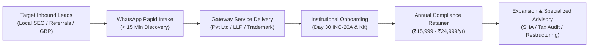
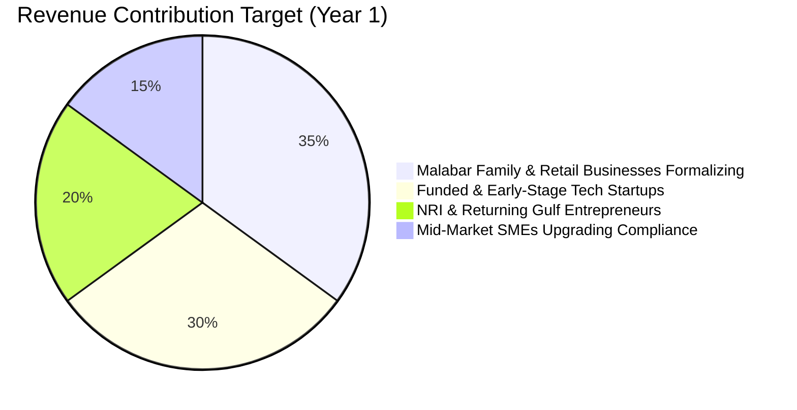
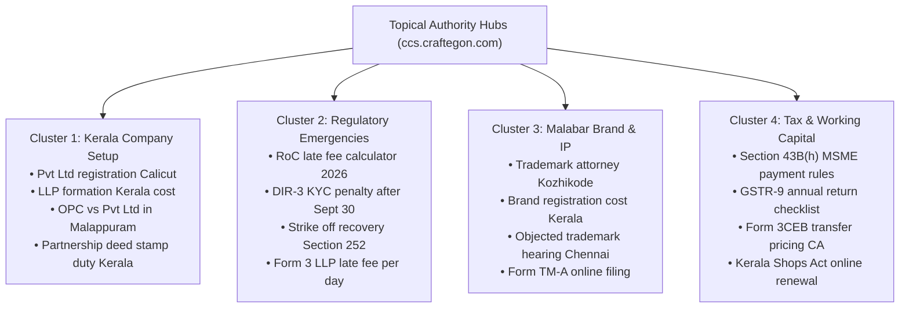
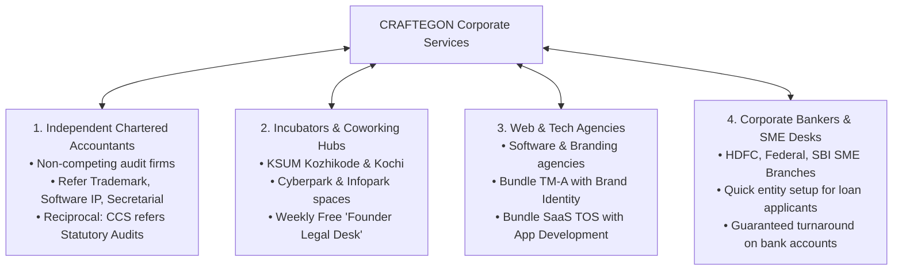
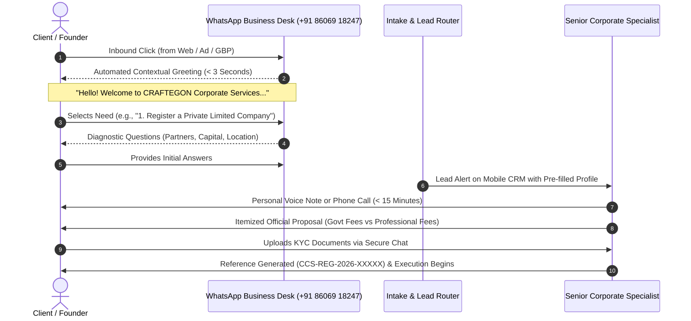
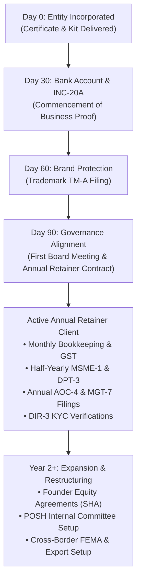
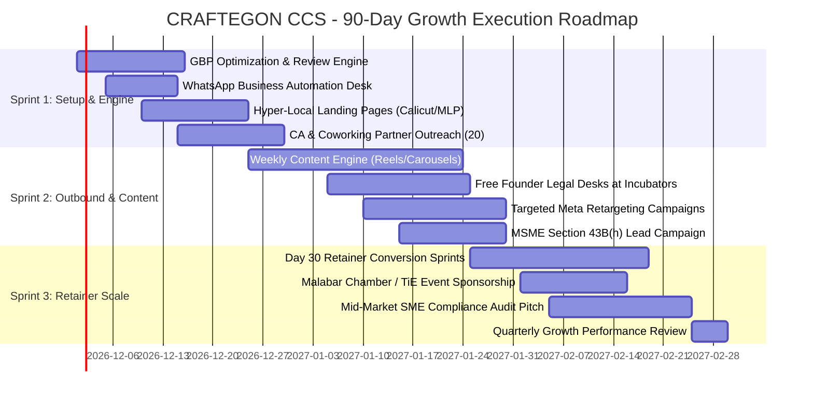

# CRAFTEGON CORPORATE SERVICES (CCS)
## Customer Acquisition & Growth System (CAGS)
### Practical Inbound Engine, Local SEO, Ecosystem Partnerships, WhatsApp Sales Automation & 90-Day Execution Calendar

**Document Identifier:** `DOC-CCS-GROWTH-2026-V1`  
**Classification:** Commercial Growth Strategy, Customer Acquisition & Sales Engineering  
**Version:** 1.0 – Authoritative Growth Architecture  
**Date:** 22 November 2026  
**Operating Division:** CRAFTEGON Corporate Services (CCS) – Division of CRAFTEGON LLP  
**Primary Target Market:** Kerala (Focus: Kozhikode, Malappuram, Ernakulam) & South Indian SME Hubs  
**Mandate:** Build a predictable, profitable customer acquisition engine prioritizing cash flow, qualified enquiries, and high-LTV retainer clients over vanity metrics.

---

## 1. STRATEGIC GROWTH PHILOSOPHY & UNIT ECONOMICS

CRAFTEGON Corporate Services does not compete in the commoditized "₹499 registration" race. Low-cost transactional models suffer from high customer acquisition costs (CAC), negative gross margins, zero customer retention, and severe regulatory liability.

CCS operates on a **High-Trust, Lifecycle-Anchored Growth Model**:
- **Gateway Offer:** Rapid, friction-free business setup (Pvt Ltd, LLP, MSME Udyam, Trademark TM-A) at transparent, mid-market pricing.
- **Backend Anchor:** High-margin recurring compliance (Annual RoC Retainer, GST Filing, TDS, Secretarial Audits, Board Governance).
- **Core KPI:** Expansion from initial entity formation to an active Annual Compliance Retainer within 90 days.

### 1.1 Target Growth Unit Economics

| Metric | Target Benchmark | Economic Rationale |
| :--- | :--- | :--- |
| **Blended Customer Acquisition Cost (CAC)** | **₹1,200 – ₹1,800** | Blended across organic SEO, GBP, referral commissions, and targeted Meta ads. |
| **Average Initial Order Value (AOV)** | **₹7,500 – ₹9,500** | Net platform revenue per formation/IP assignment (excluding government statutory disbursements). |
| **First-Year Customer Lifetime Value (LTV)** | **₹24,000 – ₹38,000** | Initial formation + Post-incorporation filings (INC-20A) + Trademark + Annual Retainer. |
| **3-Year Customer Lifetime Value (LTV)** | **₹55,000 – ₹85,000** | 3-year recurring secretarial, tax, and governance retainer. |
| **Target LTV : CAC Ratio** | **> 12 : 1 (Year 1) / > 25 : 1 (Year 3)** | Industry benchmark is 3:1; CCS achieves superior ratios through organic local dominance. |
| **Inquiry-to-Qualified Lead Rate** | **> 45%** | Filtered via automated WhatsApp and web qualification tools. |
| **Qualified Lead-to-Customer Win Rate** | **> 28%** | Driven by rapid phone/WhatsApp consultation and institutional credibility. |

---

## 2. TARGET CUSTOMER SEGMENTS & ICP PROFILES

To maximize gross margin and team productivity, marketing efforts focus exclusively on four Ideal Customer Profiles (ICPs):

### Segment 1: Malabar Family & Commercial Enterprises Formalizing
- **Geographic Cluster:** Kozhikode (SM Street, Mavoor Road, Cheruvannur), Malappuram (Manjeri, Perinthalmanna, Kottakkal), Kannur.
- **Business Profile:** Established trading houses, healthcare/Ayurvedic clinics, food processing units, textile retailers, and construction firms currently operating as sole proprietorships or unregistered partnerships with annual revenues of ₹75 Lakh to ₹10 Crore.
- **Pain Points:** Need limited liability protection, tax optimization under Section 115BAA (22% corporate rate), formal banking credit lines, and succession planning.
- **Key Decision Maker:** Senior Family Patriarch, Managing Partner, or Next-Gen Commercial Director.
- **Gateway Services:** Partnership to Private Limited / LLP Conversion, Partnership Registration, Trademark Registration (TM-A).
- **LTV Potential:** **Very High (₹50,000 – ₹1,20,000/yr)** – Requires full bookkeeping, GST, annual RoC, and payroll.

### Segment 2: Funded & High-Growth Startups
- **Geographic Cluster:** Calicut Cyberpark, UL Cyberpark (Kozhikode), KSUM Technology Innovation Zone (Kochi Infopark), Thiruvananthapuram.
- **Business Profile:** Tech, SaaS, D2C, and AI founders building scalable ventures with angel backing, KSUM seed funding, or bootstrapping toward institutional rounds.
- **Pain Points:** Complex founder equity vesting, DPIIT Section 80-IAC tax holiday certification, investor due diligence readiness, and intellectual property protection.
- **Key Decision Maker:** Founder / CEO / CTO (tech-literate, demands speed, transparent pricing, and digital tracking).
- **Gateway Services:** Private Limited Incorporation (SPICe+), Founder Shareholder Agreements (SHA), DPIIT Startup India Recognition, Software Copyright.
- **LTV Potential:** **High (₹35,000 – ₹75,000/yr)** – Rapidly expands into ESOP design, cross-border agreements, and secretarial audit.

### Segment 3: Non-Resident Indian (NRI) & Returning Gulf Entrepreneurs
- **Geographic Cluster:** Malappuram (Tirur, Perinthalmanna), Kozhikode, Thrissur, Kannur, Dubai/Riyadh networks.
- **Business Profile:** Expatriates investing capital back home in Kerala in real estate, education, hospitality, logistics, or digital services.
- **Pain Points:** Inability to physically visit government offices; fear of local bureaucratic delays; complex FEMA, RBI FLA, and foreign inward remittance reporting.
- **Key Decision Maker:** NRI Principal or trusted resident family director.
- **Gateway Services:** Private Limited Setup with Foreign/NRI Director, RBI FLA Filing, FC-GPR / FC-TRS Foreign Investment Reporting.
- **LTV Potential:** **Premium (₹45,000 – ₹90,000/yr)** – Values remote execution, total reliability, and zero physical paperwork.

### Segment 4: Mid-Market SMEs Upgrading from Informal Accountants
- **Geographic Cluster:** Pan-Kerala manufacturing, engineering, and logistics units.
- **Business Profile:** Companies incorporated 2–7 years ago whose accounting was handled by local freelance tax practitioners; facing accumulated RoC compliance gaps, unfiled MSME-1 returns, or Section 43B(h) vendor payment disputes.
- **Pain Points:** Fear of RoC Section 403 penalties (₹100/day), director disqualification under Section 164(2), and bank loan renewal rejections due to dirty secretarial records.
- **Key Decision Maker:** Managing Director / Chief Financial Officer.
- **Gateway Services:** RoC Overdue Filing & Secretarial Health Check, Form AOC-4 / MGT-7 regularisation, DIR-3 KYC verification.
- **LTV Potential:** **High (₹30,000 – ₹60,000/yr)** – Readily converts to full Annual RoC Retainer.

---

## 3. ORGANIC INBOUND & SEARCH ENGINE OPTIMIZATION (SEO)

CCS builds long-term, zero-CAC client acquisition through **High-Intent Search Domination**. Rather than targeting vanity terms ("what is business"), content targets high-commercial-intent keywords indicating immediate transaction readiness.

### 3.1 Keyword Architecture & Content Clusters

### 3.2 Hyper-Local Landing Architecture

CCS deploys dedicated geo-targeted conversion assets combining canonical service data with localized regulatory parameters:
1. `/locations/kozhikode-corporate-services.html`: Tailored for Cyberpark tech startups, SM Street retail formalization, and Cheruvannur industrial units. Highlights physical desk availability in Kozhikode and liaison with Registrar of Companies (RoC Kochi).
2. `/locations/malappuram-business-setup.html`: Focuses on NRI investment structuring, healthcare clinic incorporation, partnership formalization, and Trade Marks filing.
3. `/locations/kochi-startup-legal.html`: Focused on Infopark ventures, seed-stage equity pacts (SHA), and DPIIT tax holiday advisory.

---

## 4. GOOGLE BUSINESS PROFILE (GBP) DOMINATION STRATEGY

For corporate services in Tier-2/Tier-3 business hubs like Kozhikode and Malappuram, the Google Business Profile "Local 3-Pack" generates over 55% of inbound discovery calls and WhatsApp inquiries.

### 4.1 Profile Setup & Category Mapping
- **Primary Business Name:** `CRAFTEGON Corporate Services - Business Setup & RoC Compliance Desk`
- **Primary Category:** `Corporate Campus` / `Legal Services`
- **Secondary Categories:** `Business Management Consultant`, `Tax Consultant`, `Financial Consultant`.
- **Operating Radius:** Kozhikode, Malappuram, Wayanad, Palakkad, Ernakulam, and Pan-Kerala.
- **Physical Desk Locations:** 
  - Operating Desk: Alappuzha, Kerala (Pan-Kerala Digital Coordination).
  - Client Consulting Desk (Kozhikode): Mavoor Road / Cyberpark partner hub.

### 4.2 GBP Products & Services Catalog
Map all 57 canonical services as distinct **GBP Products** with high-resolution brand cards, transparent fee ranges, and direct UTM-tagged deep links:
- *Private Limited Company Incorporation* $\rightarrow$ Deep link to `/services/pvt-ltd-registration.html?utm_source=gbp&utm_medium=product`
- *LLP Registration & Agreement* $\rightarrow$ Deep link to `/services/llp-registration.html?utm_source=gbp&utm_medium=product`
- *Trademark Registration (TM-A)* $\rightarrow$ Deep link to `/services/trademark-registration.html?utm_source=gbp&utm_medium=product`
- *RoC Annual Compliance Retainer* $\rightarrow$ Deep link to `/services/roc-annual-compliance.html?utm_source=gbp&utm_medium=product`

### 4.3 5-Star Review Generation Engine
Client trust in professional services is determined by social proof. CCS enforces an automated **Post-Filing Review Workflow**:
1. **Trigger:** Government certificate issued (MCA Incorporation Certificate, Trademark TM-A Receipt, Udyam Certificate).
2. **WhatsApp Milestone Message:** Client receives their digital certificate pack accompanied by congratulations from the Senior Desk Lead.
3. **Review Link Delivery (T+2 Hours):**
   > *"Dear [Founder Name], congratulations on the official incorporation of [Company Name]! If our team made the paperwork smooth and transparent for you, could you take 30 seconds to support our local Malabar desk with a 5-star Google review? It helps other Kerala entrepreneurs find reliable support: [Direct Review Shortlink]"*
4. **Target:** 50+ genuine 5-star reviews within the first 90 days.

---

## 5. SOCIAL MEDIA & CONTENT AUTHORITY (INSTAGRAM & LINKEDIN)

Social media in professional services must never rely on generic AI stock photos or motivational quotes. CCS uses social platforms to build **unshakeable technical authority** and demystify complex corporate law for founders.

### 5.1 Platform-Specific Roles
- **Instagram & Facebook (Meta):** Founder education, business breakdown carousels, short-form video reels explaining regulatory traps, and retargeting ads. Target audience: First-time founders, family business owners (22–45 age bracket in Kerala).
- **LinkedIn:** B2B thought leadership, founder equity structuring, M&A teardowns, corporate governance alerts, and referral partner engagement with CAs, CSs, and startup accelerators.

### 5.2 Content Pillar Matrix (4 Weekly Posts)

| Pillar | Format | Content Concept & Hook | Objective |
| :--- | :--- | :--- | :--- |
| **1. The 60-Second Legal Fix** | Instagram Reel / YouTube Short | *"Why missing Form 3 after your LLP is approved costs you ₹3,000 every month (The Section 69 trap)."* | Awareness / Problem Identification |
| **2. Kerala Enterprise Teardown** | Carousel (5–7 slides) | *"How Kerala's top bakery & restaurant chains structured their parent Pvt Ltd vs operating LLPs to protect brand ownership and limit food safety liability."* | Authority / Business Structuring |
| **3. The Founder's Contract Clause** | Single Graphic + Deep Caption | *"The Tag-Along Clause: Why you should never sign a Shareholder Agreement without this 3-line sentence."* | Trust / Specialist Positioning |
| **4. Regulatory Deadline Radar** | Urgent Notice Card | *"T-7 Days: RoC Form DPT-3 deadline is June 30. Does your company have any outstanding director loans? Here is what happens if you miss it."* | Urgent Inbound Demand |

---

## 6. B2B REFERRAL & ECOSYSTEM PARTNERSHIP ENGINE

High-value corporate clients frequently originate through trusted professional advisors. CCS builds an institutional **Ecosystem Referral Network**:

### 6.1 Partnership Operational Protocols

1. **Independent CAs and Tax Advocates:** Many traditional CAs in Malabar focus on statutory tax audit and GST and actively avoid handling MCA V3 online secretarial resubmissions, NCLT documentation, or Trademark Agent hearings. CCS enters into reciprocal co-working arrangements: CCS provides legal drafting and tech filings; the CA retains full audit and book sign-off rights.
2. **Weekly "Founder Legal & Secretarial Desk" at Incubators:** Partner with KSUM incubators and private coworking spaces in Kozhikode (Cyberpark) to host a free, 45-minute monthly legal checkup for member startups. Provides free cap-table reviews and generates 5–8 high-intent formation/SHA leads per session.
3. **Commercial Web & Branding Agency Integration:** Offer web agencies a white-labeled or referral partner pack: when they design a new corporate brand or e-commerce platform, CCS handles the trademark clearance search and Form TM-A registration, protecting the client's new identity.

---

## 7. WHATSAPP INTAKE & RAPID CONVERSION ENGINE

In Kerala, over 80% of business decisions and professional conversations occur over WhatsApp. CCS deploys a dedicated, technology-enabled WhatsApp Business Desk (`+91 86069 18247`) designed for institutional response speed.

### 7.1 WhatsApp Routing Architecture

### 7.2 Core WhatsApp Intake Templates

#### A. Initial Inbound Auto-Response (Instant - 0 to 5 seconds):
> *"Welcome to **CRAFTEGON Corporate Services (CCS)**. Building business and compliance infrastructure for modern Indian enterprises.*  
>  
> *How can our corporate desk assist you today?*  
> *1️⃣ Start a New Company (Pvt Ltd, LLP, OPC)*  
> *2️⃣ Register a Trademark / Brand Name (TM-A)*  
> *3️⃣ Annual RoC Compliance & Overdue Filings*  
> *4️⃣ Founder Agreements & Legal Drafting*  
> *5️⃣ Direct Consultation with a Corporate Specialist*  
>  
> *Reply with a number or simply text your query below. A desk specialist will review your details immediately."*

#### B. The 15-Minute Human Follow-Up Script:
> *"Hello [Founder Name], this is [Specialist Name] from CRAFTEGON CCS. I received your enquiry regarding incorporating your Private Limited company in [Kozhikode/Kerala].*  
>  
> *To provide you with an exact, transparent quote with zero hidden costs, I just need to clarify 2 quick details:*  
> *1. How many directors/shareholders will the company have?*  
> *2. Do all proposed directors already have an active PAN and Aadhaar?*  
>  
> *I can share our complete incorporation checklist and itemized fee breakdown right away."*

---

## 8. SALES PIPELINE, LEAD QUALIFICATION & FOLLOW-UP CADENCE

### 8.1 CRM Pipeline Stages & Strict Service Level Agreements (SLAs)

| Stage | Name | Description & Key Action | Maximum SLA | Owner |
| :---: | :--- | :--- | :---: | :--- |
| **01** | `NEW_ENQUIRY` | Lead arrives via WhatsApp, Web Form, or Phone Call. Automated intake triggers. | **< 15 Mins** | Inbound Desk |
| **02** | `DISCOVERY_CALL` | Specialist calls or voice-notes client; qualifies need, entity suitability, and timelines. | **< 2 Hours** | Senior Desk Lead |
| **03** | `PROPOSAL_SENT` | Itemized PDF proposal sent with clear separation of Govt Disbursements vs CCS fees. | **Same Day** | Desk Specialist |
| **04** | `KYC_RECEIVED` | Client confirms engagement; submits PAN, Aadhaar, address proofs, and utility bills. | **< 24 Hours** | Onboarding Desk |
| **05** | `FILING_IN_PROGRESS` | Form preparation, DSC registration, empanelled CA/CS review, and portal upload. | **48–72 Hours** | Regulatory Team |
| **06** | `APPROVAL_DELIVERED` | Certificate of Incorporation / Trademark Receipt delivered with master dossier. | **Day of Approval** | Senior Desk Lead |
| **07** | `RETAINER_ONBOARDING` | Day 30 follow-up: INC-20A bank account check and annual compliance retainer pitch. | **Day 30 Post-Inc** | Growth Lead |

### 8.2 Lead Qualification Matrix (The BANT-R Framework)

Every lead is scored into one of four actionable tiers:
- **Tier 1 (Immediate Hot Lead):** High intent, statutory deadline within 15 days, direct founder contact, ready budget $\rightarrow$ Assigned to Senior Desk Lead with 15-minute phone turnaround.
- **Tier 2 (Commercial Evaluation):** Forming entity within next 30 days, comparing providers, evaluating LLP vs Pvt Ltd $\rightarrow$ Sent detailed entity comparison matrix and scheduled for diagnostic call.
- **Tier 3 (Nurture / Information Seeker):** College student exploring startup ideas, academic queries $\rightarrow$ Directed to free website knowledge guides and automated calculators; enrolled in monthly email newsletter.
- **Tier 4 (Disqualified / Mismatched):** Looking for litigious courtroom representation before District Court, or demanding unlawful filing manipulation $\rightarrow$ Explicitly disclaimed and turned down or redirected to Bar Council legal aid.

### 8.3 7-Day Multi-Touch Follow-Up Cadence

| Touchpoint | Timing | Channel | Content & Message Tone |
| :--- | :--- | :--- | :--- |
| **Touch 1** | T + 15 Mins | WhatsApp + Phone | Immediate acknowledgment, discovery qualification, and warm professional connection. |
| **Touch 2** | T + 4 Hours | WhatsApp + Email | Formal itemized quotation + "What's Included in Your CCS Incorporation Kit" infographic. |
| **Touch 3** | Day 2 (Morning) | WhatsApp | Value-Add: Send the *Kerala Business Setup Checklist PDF* with zero sales pressure. |
| **Touch 4** | Day 3 (Afternoon) | Phone Call | Consultation Check: *"Did you have a chance to review the fee breakdown? Any questions on the authorized capital or stamp duty?"* |
| **Touch 5** | Day 5 (Morning) | WhatsApp | Urgency / Regulatory Context: Informing client of CRC name reservation processing times or impending regulatory changes. |
| **Touch 6** | Day 7 (Final) | WhatsApp | Professional Courtesy Close: *"Hi [Founder], checking if you've finalized your setup timeline. If you've postponed the launch, no worries at all—we're here whenever you're ready to proceed."* |

---

## 9. CUSTOMER RETENTION & ANNUAL RETAINER EXPANSION

The true enterprise value of CRAFTEGON CCS lies in customer lifetime value. A business registered today generates predictable recurring compliance fees for the next 5 to 10 years.

### 9.1 The "Day 30 / Day 90" Retainer Conversion Protocol
1. **The INC-20A Anchor (Day 30):** Under Section 10A of the Companies Act, 2013, every new company must file Form INC-20A within 180 days, requiring bank account opening and capital contribution proof. CCS contacts the founder at Day 30 to facilitate bank account setup and file INC-20A, introducing the **Annual Secretarial Retainer**.
2. **The Trademark Cross-Sell (Day 60):** Once the entity is registered, the corporate name is protected only as a company name, *not* as a commercial brand against third-party infringement. CCS pitches Form TM-A with MSME 50% government fee concession.
3. **The Pre-AGM Onboarding (Day 90):** Presenting the founder with the comprehensive **Annual RoC & Tax Retainer (₹15,999/yr for Small Companies)**, eliminating year-end panic and automating compliance tracking.

---

## 10. 90-DAY MARKETING & SALES EXECUTION CALENDAR

The 90-day execution plan is divided into three focused 30-day operational sprints:

### Sprint 1 (Days 1–30): Foundation, Local SEO & Infrastructure
- **Objective:** Establish unassailable local digital presence in Kozhikode and Malappuram; activate high-speed WhatsApp response desk.
- **Key Milestones:**
  1. Optimize Google Business Profile with all 57 canonical services and geo-tagged images; achieve first 15 client reviews.
  2. Implement WhatsApp Business multi-agent desk with instant 5-second interactive routing menus and 15-minute response SLA.
  3. Deploy local conversion landing pages for Kozhikode and Malappuram with hyper-local schema and local business testimonials.
  4. Pitch 20 non-competing Malabar Chartered Accountants for reciprocal secretarial/IP referral partnerships.

### Sprint 2 (Days 31–60): Inbound Demand, Content Authority & Incubator Blitz
- **Objective:** Generate 50+ qualified formation and IP enquiries per month from high-growth startups and family business conversions.
- **Key Milestones:**
  1. Launch the 4x/week social content engine (Instagram Reels & LinkedIn carousels highlighting Kerala business case studies and RoC traps).
  2. Host 2 physical "Founder Legal Clinics" at KSUM Kozhikode (Cyberpark) and a private coworking space in Calicut.
  3. Run hyper-targeted Meta Lead Ads targeting business page admins in Malabar with the *Kerala Founder Incorporation Guide 2026*.
  4. Launch the *MSME Section 43B(h) Working Capital Campaign* aimed at suppliers seeking faster payment recovery.

### Sprint 3 (Days 61–90): Retainer Scaling, Mid-Market Audits & Channel Expansion
- **Objective:** Institutionalize the Annual Compliance Retainer conversion engine and expand average client LTV.
- **Key Milestones:**
  1. Launch the automated Day 30 INC-20A and Day 90 Annual Retainer conversion pipeline for all companies incorporated in Sprint 1.
  2. Run the "Overdue RoC Health Check" campaign targeting companies incorporated between 2020–2024 with delinquent filings.
  3. Form formal corporate banking referral desks with SME officers at Federal Bank and HDFC Bank branches in Calicut and Malappuram.
  4. Conduct the first Quarterly Growth Review: Evaluate blended CAC, inquiry conversion rates, and retainer retention against financial model targets.

---
*Prepared and Authorized for Commercial Execution by:*  
**Chief Growth Officer, CRAFTEGON Corporate Services (CCS)**  
*Approved by Managing Partners, CRAFTEGON LLP*