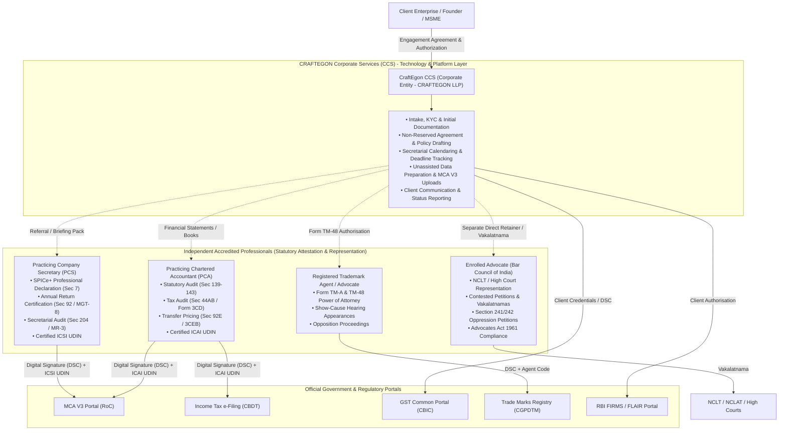
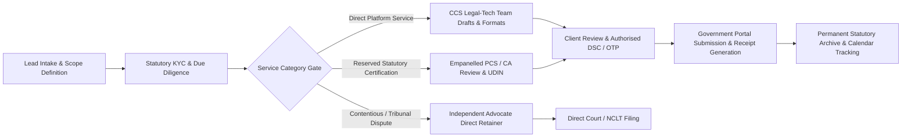

# CRAFTEGON CORPORATE SERVICES (CCS)
## Master Legal & Regulatory Compliance Architecture
### Indian Statutory Frameworks, Professional Separation of Powers, Service Compliance Matrix, Marketing Audits & Standard Terms

**Document Identifier:** `DOC-CCS-LEG-ARCH-2026-V1`  
**Classification:** Regulatory Governance, Professional Compliance & Legal Architecture  
**Version:** 1.0 – Authoritative Regulatory Architecture  
**Date:** 22 November 2026  
**Operating Division:** CRAFTEGON Corporate Services (CCS) – Division of CRAFTEGON LLP  
**Jurisdiction:** Republic of India (Primary focus: Kerala State & Pan-India Corporate Registries)  
**Applicable Regulators:** MCA, CBDT, CBIC, DPIIT, MSME, BCI, ICAI, ICSI, CGPDTM, RBI, MeitY  

---

## 1. EXECUTIVE LEGAL ARCHITECTURE & APPLICABLE STATUTORY FRAMEWORKS

CRAFTEGON Corporate Services (CCS) is a specialized corporate services and business infrastructure platform operating under the commercial umbrella of **CRAFTEGON LLP**. CCS provides business establishment, secretarial maintenance, tax compliance coordination, commercial drafting, governance diagnostics, and regulatory facilitation for enterprises across their operational lifecycle.

To maintain strict compliance with Indian law, avoid regulatory penalties, and honor the statutory monopolies granted to chartered professions, CCS operates under a **Tripartite Institutional Model**:



### 1.1 Primary Governing Statutes

Every service delivered, coordinated, or facilitated by CCS is governed by specific primary Indian legislation and delegated subordinate rules:

1. **Companies Act, 2013 (Act No. 18 of 2013):**
   - Sections 3, 7, 8, 12, 10A, 62, 92, 117, 134, 137, 139–143, 164, 173, 204, 233, 248, 403, 447, and 448.
   - Companies (Incorporation) Rules, 2014; Companies (Management and Administration) Rules, 2014; Companies (Accounts) Rules, 2014; Companies (Audit and Auditors) Rules, 2014; Companies (Appointment and Qualification of Directors) Rules, 2014.
2. **Limited Liability Partnership Act, 2008 (Act No. 6 of 2009):**
   - Sections 11, 23, 25, 34, 35, 74, and the LLP (Amendment) Act, 2021 (decriminalization and rationalized penalties).
   - Limited Liability Partnership Rules, 2009 (FiLLiP, Form 3, Form 8, Form 11, Form 24).
3. **The Advocates Act, 1961 (Act No. 25 of 1961):**
   - Sections 29, 30, and 33 (exclusive right of enrolled advocates to practice law before courts and tribunals).
   - Bar Council of India Rules (Part VI, Chapter II: Standards of Professional Conduct and Etiquette; Rules on advertising, solicitation, and corporate partnerships).
4. **The Chartered Accountants Act, 1949 (Act No. 38 of 1949):**
   - Sections 2(2), 24, 25, 26, and the First and Second Schedules (exclusive scope of audit, restrictions on corporate entities practicing chartered accountancy, fee sharing prohibitions).
   - ICAI Unique Document Identification Number (UDIN) Guidelines (Council Decision dated 17 December 2018).
5. **The Company Secretaries Act, 1980 (Act No. 56 of 1980):**
   - Sections 2(2), 24, 25, and 26 (practice of company secretary, secretarial audit, mandatory certifications).
   - ICSI Unique Document Identification Number (UDIN) Guidelines, 2019; ICSI Auditing Standards (CSAS-1 to CSAS-4).
6. **Trade Marks Act, 1999 (Act No. 47 of 1999):**
   - Sections 18, 21, 23, 25, 145 (representation before the Registrar of Trade Marks).
   - Trade Marks Rules, 2017 (Rules 18–21, Rule 25 user affidavits, Form TM-A, Form TM-48).
7. **Central Goods and Services Tax (CGST) Act, 2017 (Act No. 12 of 2017) & State GST Acts:**
   - Sections 22–25 (Registration), Section 35 (Accounts), Section 37–39 (Returns), Section 44 (Annual Return), Section 50 (Interest).
   - CGST Rules, 2017 (Rule 80, Form GSTR-1, GSTR-3B, GSTR-9, GSTR-9C self-certification post-Finance Act 2021).
8. **Income Tax Act, 1961 (Act No. 43 of 1961):**
   - Sections 43B(h) (MSME payment disallowance), 44AB (Tax Audit), 80-IAC (Startup tax deductions), 92E (Transfer Pricing Form 3CEB), 115BAA/BAB (Concessional corporate tax), 139 (ITR filings), 200/206C (TDS/TCS).
   - *Finance Act, 2024:* Complete abolition of Section 56(2)(viib) ("Angel Tax") effective AY 2025-26.
9. **Micro, Small and Medium Enterprises Development (MSMED) Act, 2006 (Act No. 27 of 2006):**
   - Sections 7, 8, 15–24 (Delayed payments to micro and small enterprises, compound interest, MSEFC arbitration).
   - Ministry of MSME Notification S.O. 2119(E) dated 26 June 2020 (Composite criteria for classification & Udyam Portal).
10. **Startup India Regulatory Framework (DPIIT):**
    - Notification G.S.R. 127(E) dated 19 February 2019, amended by Notification G.S.R. 108(E) dated 4 February 2026.
    - Section 80-IAC certification via Inter-Ministerial Board (IMB).
11. **Prevention of Sexual Harassment of Women at Workplace (POSH) Act, 2013 (Act No. 14 of 2013):**
    - Sections 4 (Internal Committee constitution), 19 (Employer duties), 21 & 22 (Annual reporting to District Officer & Directors' Report inclusion under Section 134(3)(q)).
12. **Digital Personal Data Protection (DPDP) Act, 2023 (Act No. 22 of 2023):**
    - Sections 4, 5, 6 (Notice and itemized consent), 8 (Data Fiduciary obligations), 9 (Processing children's data), 11 (Data Protection Officer), 33 (Penalties up to ₹250 Crore).
13. **Foreign Exchange Management Act, 1999 (FEMA) (Act No. 42 of 1999):**
    - Foreign Exchange Management (Non-debt Instruments) Rules, 2019; Foreign Exchange Management (Mode of Payment and Reporting of Non-Debt Instruments) Regulations, 2019 (Form FC-GPR, FC-TRS, FLA Return).

---

## 2. STATUTORY DIVISION OF POWERS & PROFESSIONAL BOUNDARIES MATRIX

Indian law establishes strict functional boundaries between general business facilitation services and statutorily reserved professional activities. CCS operates as a business infrastructure and legal-tech coordination partner. It does **not** hold itself out as a law firm, a firm of chartered accountants, or a firm of practicing company secretaries.

### 2.1 Legal Separation of Capacities

| Professional Sphere | Statutory Basis | Activities Statutorily Reserved (Cannot be Performed by Corporate Entity) | Permitted Role for CRAFTEGON CCS | Mandatory Execution Mechanism |
| :--- | :--- | :--- | :--- | :--- |
| **Legal Advocacy & Court Appearances** | Advocates Act, 1961 (Sec 29, 30, 33); Bar Council of India Rules | • Courtroom appearance before High Court, Supreme Court, Civil Courts.<br/>• Pleading before NCLT, NCLAT, ITAT, DRT, Consumer Commissions.<br/>• Signing and filing *Vakalatnama* or formal legal pleadings.<br/>• Corporate legal practice / fee-sharing on litigation. | • Business documentation drafting (non-contentious contracts, NDAs, MoUs, SHAs).<br/>• General legal research and regulatory compilation.<br/>• Managing discovery dossiers and case documentation for briefing.<br/>• Client referral to independent advocates. | Executed solely by **Independent Enrolled Advocates** engaged on an independent *Vakalatnama* executed directly between Client and Advocate. |
| **Chartered Accountancy & Audit** | CA Act, 1949 (Sec 2(2), 24, 25, 26); Companies Act 2013 (Sec 139-143) | • Statutory Audit of Financial Statements (Sec 139).<br/>• Tax Audit Reports (Form 3CA/3CB-3CD under Sec 44AB).<br/>• International Transfer Pricing Certification (Form 3CEB under Sec 92E).<br/>• Non-profit Audit (Form 10B / 10BB).<br/>• Net worth, turnover, or solvency certifications. | • Day-to-day bookkeeping, accounting data entry, and payroll processing.<br/>• Preparation of draft financial statements as per Schedule III.<br/>• GST return data computation and compilation.<br/>• ITR data entry and electronic filing assistance. | Executed solely by **Independent Practicing Chartered Accountants** holding active COP and generating verifiable **ICAI UDIN**. |
| **Company Secretarial & Governance** | CS Act, 1980 (Sec 2(2)); Companies Act 2013 (Sec 7, 92, 204) | • Professional declaration for incorporation in SPICe+ Part B (Sec 7(1)(b)).<br/>• Annual Return Certification (Form MGT-8 under Sec 92(2)).<br/>• Secretarial Audit (Form MR-3 under Sec 204).<br/>• Scrutinizer for General Meetings / E-voting.<br/>• Section 233 Fast-Track Merger compliance certification. | • Drafting Board Minutes, AGM Notices, and Directors' Reports.<br/>• Maintaining physical and electronic Statutory Registers.<br/>• Preparing e-forms (AOC-4, MGT-7, DIR-3 KYC, DPT-3, MSME-1) for Director DSC signature.<br/>• RoC calendar monitoring and compliance tracking. | Certified e-forms and statutory reports executed solely by **Independent Practicing Company Secretaries (PCS)** with active COP and verifiable **ICSI UDIN**. |
| **Intellectual Property Representation** | Trade Marks Act, 1999 (Sec 145); Trade Marks Rules, 2017 | • Acting as registered Agent of Record on the Trade Marks Registry portal.<br/>• Signing Form TM-A on behalf of applicant without direct applicant DSC.<br/>• Appearing in Show Cause hearings before the Trade Marks Officer.<br/>• Filing Trademark Oppositions / Rectifications. | • Comprehensive trademark search across Classes 1–45 via public IP portal.<br/>• Preparation of Form TM-A XML dossiers and user affidavits under Rule 25.<br/>• Brand monitoring and trademark status tracking.<br/>• Coordination with client to execute Form TM-48. | Filed either directly by the Client using their own DSC, or by an **Empanelled Registered Trade Marks Agent / Advocate** authorized under statutory **Form TM-48**. |

### 2.2 Judicial Precedents Governing Corporate Services Platforms

1. ***Bar Council of India v. A.K. Balaji (2018) 5 SCC 379:*** The Supreme Court held that only advocates enrolled with State Bar Councils have the right to practice law before courts and tribunals in India. Foreign law firms and non-advocate commercial entities cannot establish offices in India to practice litigation. However, non-litigation corporate drafting and administrative coordination by corporate entities is permissible provided there is no holding-out as an advocate or law firm.
2. ***ICAI v. Price Waterhouse (2010):*** The Chartered Accountants Act prohibits bodies corporate from practicing accountancy or providing statutory audit services. Audits must be signed in an individual partner capacity with their personal membership number and UDIN.
3. ***ICSI Guidelines on UDIN (2019):*** A Company Secretary in Practice must generate a UDIN for every certification, secretarial audit, or return issued. A corporate entity cannot issue or share UDIN credentials.

---

## 3. MASTER SERVICE-WISE STATUTORY COMPLIANCE MATRIX

The following table provides the exhaustive, verified statutory compliance matrix for all 57 canonical services offered across the 15 specialist business verticals:

| Vertical & Service ID | Service Name | Primary Statute & Section / Rule | Mandatory e-Form / Portal | Statutory Filing Deadline | Classification | Statutory Fee / Stamp Duty | Non-Compliance Penalties & Late Fees | Mandatory Certification Required | CCS Delivery Classification |
| :--- | :--- | :--- | :--- | :--- | :--- | :--- | :--- | :--- | :--- |
| **V01-SVC-001** | DPIIT Startup India Recognition | DPIIT Notification G.S.R. 127(E) & 108(E); Income Tax Act Sec 80-IAC | DPIIT / NSWS Portal (Startup India) | Event-driven (Post-incorporation, up to 10 yrs; 20 yrs for Deep Tech) | `MANDATORY_FOR_BENEFITS` | ₹0 (Official Govt Portal Fee is Nil) | Loss of Section 80-IAC 3-year tax holiday, public procurement exemptions, and 80% patent rebate | Self-declaration by Directors / Partners | **Direct Platform Service** |
| **V01-SVC-002** | LLP Registration | LLP Act, 2008, Sec 11; LLP Rules, 2009, Rule 11 & 21 | RUN-LLP, FiLLiP, Form 3 (Agreement) | Form 3 within 30 days of incorporation date | `MANDATORY_STATUTORY` | Variable by state capital (FiLLiP: ₹500; Stamp duty on Form 3: ₹1,000–₹5,000+) | Form 3 delay: Enhanced late fee of ₹100/day without cap under LLP (Amendment) Act 2021 | Advocate / CS / CA certification on FiLLiP | **Partner-Led Execution** (Statutory Declaration by PCS/CA) |
| **V01-SVC-003** | MSME / Udyam Registration | MSMED Act, 2006, Sec 8; Notification S.O. 2119(E) | Udyam Registration Portal | Voluntary / Prior to claiming MSME statutory protections | `MANDATORY_FOR_BENEFITS` | ₹0 (Official Govt Portal Fee is Nil) | Inability to invoke Sec 15-24 MSEFC recovery or claim Sec 43B(h) buyer tax disallowance protection | Self-declaration linked to PAN & Aadhaar | **Direct Platform Service** (Facilitation & advisory) |
| **V01-SVC-004** | One Person Company (OPC) Registration | Companies Act, 2013, Sec 2(62), Sec 3(1)(c); Incorporation Rules, Rule 3 | SPICe+ (INC-32), INC-3 (Nominee), INC-33, INC-34, AGILE-PRO-S | Pre-incorporation | `MANDATORY_STATUTORY` | Zero MCA fee up to ₹15 Lakh nominal capital; State stamp duty applicable (₹1,000–₹3,000) | Inability to commence lawful corporate business | Form INC-140 Professional Declaration by PCS / CA / Advocate | **Partner-Led Execution** (PCS / CA statutory declaration) |
| **V01-SVC-005** | Partnership Firm Registration | Indian Partnership Act, 1932, Sec 58 & 59 | Form 1 to Registrar of Firms (RoF - Kerala / State) | Event-driven | `RECOMMENDED_BEST_PRACTICE` (Unregistered firm barred under Sec 69 from suing third parties) | State fee (₹100–₹500) + Deed Stamp Duty (Kerala: ₹5,000 or 1% of capital) | Inability under Section 69 to enforce contractual rights in civil court against third parties | Notary Public / Advocate attestation of Deed | **Direct Platform Service** (Drafting & RoF filing facilitation) |
| **V01-SVC-006** | Sole Proprietorship Registration | Kerala Shops & Commercial Establishments Act, 1960; CGST Act, Sec 22 | Labour Commissionerate Portal / GST Portal / Udyam | Within 60 days of establishment opening | `MANDATORY_STATUTORY` (For premises / over ₹40L turnover) | Shops Act: ₹200–₹2,000 (Based on employee count); GST: ₹0 | Fine under Shops Act up to ₹5,000; GST Sec 122 penalty (100% of tax evaded or ₹10,000) | Self-declaration by Proprietor | **Direct Platform Service** |
| **V01-SVC-007** | Private Limited Registration | Companies Act, 2013, Sec 7; Companies (Incorporation) Rules, 2014, Rule 38 | SPICe+ Part A & B, INC-9, INC-33, INC-34, AGILE-PRO-S | Pre-incorporation | `MANDATORY_STATUTORY` | Zero MCA fee up to ₹15 Lakh nominal capital; State stamp duty applicable | Illegal association under Sec 464 if >50 persons carry on business without incorporation | Form INC-140 Declaration by PCS / CA / Advocate | **Partner-Led Execution** (PCS / CA statutory declaration) |
| **V01-SVC-008** | Section 8 Non-Profit Registration | Companies Act, 2013, Sec 8; Companies (Incorporation) Rules, 2014, Rule 19 | SPICe+ Part A, SPICe+ Part B, INC-12 (Licence application) | Pre-incorporation | `MANDATORY_STATUTORY` | INC-12 fee: ₹2,000; Stamp duty on Articles / Memorandum | Unlawful use of limited liability without "Limited" suffix | Professional declaration by PCS / CA / Advocate | **Partner-Led Execution** (PCS / CA certification) |
| **V01-SVC-009** | Society Registration | Societies Registration Act, 1860 / Travancore-Cochin Act, 1955 | State District Registrar Office | Pre-commencement | `MANDATORY_STATUTORY` | State registration fee (Kerala: ₹1,000–₹2,000) | Lack of legal juristic personality; personal liability of governing body members | Verification by Gazetted Officer / Advocate / Notary | **Direct Platform Service** (Byelaw drafting & RoS filing) |
| **V01-SVC-010** | Charitable Trust Registration | Indian Trusts Act, 1882; Indian Registration Act, 1908, Sec 17 | Sub-Registrar Office (SRO) | Event-driven (Before receiving donations) | `MANDATORY_STATUTORY` | Deed Stamp Duty (Kerala: 5% of settled property) + 2% registration fee | Trust void regarding immovable property unless registered under Sec 17 Registration Act | Sub-Registrar physical execution & Advocate draft verification | **Direct Platform Service** (Trust deed drafting & SRO assistance) |
| **V02-SVC-001** | AOC-4 XBRL Financial Tagging | Companies Act, 2013, Sec 137; Rule 3 of XBRL Rules 2015 | Form AOC-4 XBRL on MCA V3 | Within 30 days of AGM date | `MANDATORY_STATUTORY` (For listed, capital ≥₹5Cr or turnover ≥₹100Cr) | Normal filing fee (₹600) | ₹100/day late fee under Sec 403; Director fine up to ₹1 Lakh + ₹100/day | Independent Practicing CA / CS certification | **Partner-Led Execution** (PCS/CA certification + XBRL instance validation) |
| **V02-SVC-002** | DIR-3 KYC Annual Verification | Companies (Appointment of Directors) Rules, 2014, Rule 12A | DIR-3 KYC (e-Form) or DIR-3 KYC Web | Annually on or before September 30 | `MANDATORY_STATUTORY` | ₹0 if filed on or before Sept 30; ₹5,000 statutory late fee post-deadline | DIN status marked "Deactivated due to non-filing of DIR-3 KYC"; barred from signing any MCA e-forms | e-Form requires DSC + PCS / CA / CMA certification; Web KYC is OTP-based | **Direct Platform Service** (Web OTP) / **Partner-Led** (e-Form with DSC) |
| **V02-SVC-003** | Form ADT-1 Auditor Appointment | Companies Act, 2013, Sec 139(1); Companies (Audit & Auditors) Rules, 2014 | Form ADT-1 on MCA V3 | Within 15 days of AGM date (or appointment) | `MANDATORY_STATUTORY` | Normal MCA fee (₹200–₹600 based on capital) | ₹100/day late fee under Sec 403; Company fine up to ₹5 Lakh under Sec 147 | Director DSC (Attestation of Board resolution) | **Direct Platform Service** (Secretarial drafting & MCA filing) |
| **V02-SVC-004** | Form AOC-4 Financial Statements | Companies Act, 2013, Sec 137(1); Companies (Accounts) Rules, 2014 | Form AOC-4 / AOC-4 CFS / AOC-4 XBRL | Within 30 days of AGM date | `MANDATORY_STATUTORY` | Normal MCA fee (₹200–₹600 based on capital) | ₹100/day without limit under Sec 403; Sec 164(2)(a) disqualification for 3-year default | Certified by Practicing CA / CS (for non-small) or Director DSC | **Direct Platform Service** (Drafting & e-filing) + **Partner Sign-off** |
| **V02-SVC-005** | Form BEN-2 SBO Reporting | Companies Act, 2013, Sec 90(4); SBO Rules, 2018, Rule 4 | Form BEN-2 on MCA V3 | Within 30 days of receiving Form BEN-1 | `MANDATORY_STATUTORY` | Normal MCA fee (₹200–₹600) | Sec 90(11) fine on company up to ₹5 Lakh + ₹1,000/day; Director imprisonment / fine | Mandatory certification by Practicing CS / CA / CMA | **Partner-Led Execution** (PCS / CA certification) |
| **V02-SVC-006** | Form DPT-3 Return of Deposits | Companies Act, 2013, Sec 73; Acceptance of Deposits Rules, 2014, Rule 16 | Form DPT-3 on MCA V3 | Annually on or before June 30 | `MANDATORY_STATUTORY` (Applies to all companies having any outstanding loan/borrowing) | Normal MCA fee (₹200–₹600) | Sec 76A fine: Minimum ₹1 Crore or twice deposit amount; Officers imprisonment up to 7 years | Statutory Auditor Certificate required if reporting deposits | **Direct Platform Service** (Drafting) / **Partner-Led** (Auditor Certificate) |
| **V02-SVC-007** | Form MGT-14 Special Resolutions | Companies Act, 2013, Sec 117; Management Rules, 2014, Rule 24 | Form MGT-14 on MCA V3 | Within 30 days of resolution passing | `MANDATORY_STATUTORY` | Normal MCA fee (₹200–₹600) | Sec 117(2): Company penalty ₹10,000 + ₹100/day (max ₹2 Lakh); Officers ₹10,000 (max ₹50,000) | Certified by Practicing CS / CA / CMA | **Partner-Led Execution** (PCS / CA certification) |
| **V02-SVC-008** | Form MGT-7 / 7A Annual Return | Companies Act, 2013, Sec 92; Management Rules, 2014, Rule 11 | Form MGT-7 (Regular) / MGT-7A (Small / OPC) | Within 60 days of AGM date | `MANDATORY_STATUTORY` | Normal MCA fee (₹200–₹600) | ₹100/day under Sec 403; Section 92(5) company penalty ₹10,000 + ₹100/day (max ₹2 Lakh) | MGT-7 requires PCS certification; MGT-8 (PCS audit report) if Capital ≥₹10Cr or Turnover ≥₹50Cr | **Partner-Led Execution** (PCS certification for MGT-7 & MGT-8) |
| **V02-SVC-009** | Form MR-1 MD / WTD Appointment | Companies Act, 2013, Sec 196; Appointment of Managerial Personnel Rules, Rule 3 | Form MR-1 on MCA V3 | Within 60 days of appointment date | `MANDATORY_STATUTORY` | Normal MCA fee (₹200–₹600) | Sec 197(15) penalty on company ₹5 Lakh; Officers ₹1 Lakh | Certified by Practicing CS / CA / CMA | **Partner-Led Execution** (PCS / CA certification) |
| **V02-SVC-010** | Form MSME-1 Half-Yearly Return | Companies Act, 2013, Sec 405; Specified Companies Order, 2019 | Form MSME-1 on MCA V3 | Half-yearly: April 30 (for Oct–Mar) & October 31 (for Apr–Sep) | `MANDATORY_STATUTORY` (If MSME dues exceed 45 days) | ₹0 (No fee for timely filing) | Sec 405(4) penalty: Company ₹20,000 + ₹1,000/day (max ₹3 Lakh); Officers imprisonment/fine | Director DSC | **Direct Platform Service** (Secretarial compilation & e-filing) |
| **V02-SVC-011** | Form MSC-1 Dormant Status | Companies Act, 2013, Sec 455; Miscellaneous Rules, 2014, Rule 3 | Form MSC-1 on MCA V3 | Event-driven | `RECOMMENDED_BEST_PRACTICE` (To minimize compliance cost for inactive entities) | Normal MCA fee (₹1,000–₹2,000) | If inactive without dormant status, company risks strike-off under Sec 248 or cumulative late fees | Certified by Practicing CS / CA / CMA + Statement of Assets by Auditor | **Partner-Led Execution** (PCS / CA certification) |
| **V02-SVC-012** | Form PAS-6 Share Capital Audit | Companies (Prospectus & Allotment) Rules, 2014, Rule 9A | Form PAS-6 on MCA V3 | Half-yearly within 60 days of half-year end | `MANDATORY_STATUTORY` (For all unlisted public companies) | Normal MCA fee (₹200–₹600) | Rule 9A(9) penalty under Section 450 (₹10,000 + ₹1,000/day) | Certified by Practicing Company Secretary / CA | **Partner-Led Execution** (PCS certification mandatory) |
| **V02-SVC-013** | Form STK-2 Strike-Off | Companies Act, 2013, Sec 248(2); Removal of Names Rules, 2016 | Form STK-2 on MCA V3 | Event-driven (Extinguishment of all liabilities) | `MANDATORY_STATUTORY` (To lawfully dissolve inactive company) | Statutory filing fee: ₹10,000 | Continuing compliance exposure, ₹100/day late fees, and director disqualification under Sec 164(2) | Statement of Accounts by CA + Professional Certification by PCS / CA | **Partner-Led Execution** (CA accounting + PCS certification) |
| **V02-SVC-014** | LLP Annual Filings (Form 8 & 11) | LLP Act, 2008, Sec 34 & 35; LLP Rules, 2009, Rule 24 & 25 | Form 11 (by May 30) & Form 8 (by Oct 30) | Form 11: 30 May; Form 8: 30 October annually | `MANDATORY_STATUTORY` | Normal MCA fee (₹50–₹200 based on contribution) | Section 69 enhanced late fee of ₹100/day without cap for each day of default | Form 8 requires CA/CS certification if turnover >₹40L or capital >₹25L | **Direct Platform Service** / **Partner Sign-off** |
| **V02-SVC-015** | LLP Form 24 Strike-Off | LLP Act, 2008, Sec 74; LLP Rules, 2009, Rule 37(1) | Form 24 on MCA V3 | Event-driven (No liabilities, bank closed) | `MANDATORY_STATUTORY` (To lawfully dissolve inactive LLP) | Statutory fee: ₹1,000 | Continuing liability of partners; non-filing penalties of ₹100/day for Form 8 and 11 | Statement of Accounts by CA (less than 30 days old) | **Partner-Led Execution** (CA Statement of Accounts certification) |
| **V02-SVC-016** | Form MBP-1 & DIR-8 Disclosures | Companies Act, 2013, Sec 184(1) & Sec 164(2); Rules, 2014 | Internal Board Records (Tabled at first BM) | First Board Meeting of each FY or upon change | `MANDATORY_STATUTORY` | ₹0 (Internal secretarial records) | Section 184(4) failure: Imprisonment up to 1 yr or fine ₹50,000 to ₹1 Lakh; Vacation of office under Sec 167 | Signed by Director personally | **Direct Platform Service** (Secretarial drafting & register maintenance) |
| **V02-SVC-017** | RoC Annual Compliance Retainer | Companies Act, 2013, Sec 92, 137, 173, 204; Secretarial Standards | Comprehensive MCA Filings & Secretarial Pack | Ongoing throughout FY | `MANDATORY_STATUTORY` | Statutory MCA filing fees per e-form | Prevention of cumulative ₹100/day late fees and Sec 164(2) DIN disqualification | Combination of Director DSC and Independent PCS UDIN certifications | **Direct Coordination Platform** + **Empanelled PCS Execution** |
| **V02-SVC-018** | Registrar of Firms (RoF) Amendments | Indian Partnership Act, 1932, Sec 60–65 | Form II / V to State RoF | Within 15–30 days of partner change or address change | `MANDATORY_STATUTORY` (For registered partnerships) | State fee (Kerala: ₹100–₹500) | Failure to update leaves retired partner liable to third parties under Sec 32(3) | Partner execution + Advocate / Notary attestation | **Direct Platform Service** (Drafting & RoF coordination) |
| **V03-SVC-001** | Form 10B / 10BB Trust Audit | Income Tax Act, 1961, Sec 12A(1)(b); Income Tax Rules, Rule 16CC & 17B | Income Tax e-Filing Portal | Annually on or before September 30 (one month prior to ITR) | `MANDATORY_STATUTORY` (For trusts claiming 11 & 12 exemption if income > basic exemption) | ₹0 (Govt Portal Fee) | Complete denial of tax exemption under Sections 11 & 12; Trust taxed at Maximum Marginal Rate (MMR - 42.74%) | Mandatory signature by Practicing CA with ICAI UDIN | **Partner-Led Execution** (Practicing CA Audit Report) |
| **V03-SVC-002** | Form 3CEB Transfer Pricing | Income Tax Act, 1961, Sec 92E; Income Tax Rules, Rule 10E | Income Tax e-Filing Portal | Annually on or before October 31 | `MANDATORY_STATUTORY` (For international or specified domestic transactions) | ₹0 (Govt Portal Fee) | Section 271BA penalty of ₹1,00,000; Section 271AA penalty (2% of transaction value) | Mandatory signature by Practicing CA with ICAI UDIN | **Partner-Led Execution** (Practicing CA Audit Report) |
| **V03-SVC-003** | GST Annual Return (GSTR-9 & 9C) | CGST Act, 2017, Sec 44; CGST Rules, 2017, Rule 80 | GST Common Portal | Annually on or before December 31 following FY end | `MANDATORY_STATUTORY` (GSTR-9: Turnover >₹2Cr; 9C: Turnover >₹5Cr) | ₹0 (Govt Portal Fee) | Section 47(2) late fee of ₹200/day (₹100 CGST + ₹100 SGST) subject to 0.50% turnover cap | Self-certified by taxpayer (reconciled with Audited Financials) | **Direct Platform Service** (Reconciliation & filing assistance) |
| **V03-SVC-004** | ITR-7 Non-Profit / Company Tax | Income Tax Act, 1961, Sec 139(4A), (4B), (4C), (4D) | Income Tax e-Filing Portal | October 31 (for audit cases) or November 30 (TP cases) | `MANDATORY_STATUTORY` | ₹0 (Govt Portal Fee) | Section 234F fee up to ₹5,000; Interest under 234A/B/C; Loss of tax exemptions | Digital Signature of Managing Trustee / Director | **Direct Platform Service** (ITR data preparation & electronic submission) |
| **V03-SVC-005** | Proprietorship & SME Income Tax | Income Tax Act, 1961, Sec 139(1); ITR-1, 2, 3, 4 | Income Tax e-Filing Portal | July 31 (non-audit) or October 31 (tax audit cases) | `MANDATORY_STATUTORY` (If income exceeds basic exemption) | ₹0 (Govt Portal Fee) | Section 234F late filing fee (₹1,000 or ₹5,000); interest on unpaid tax under Sec 234A | E-verification via Aadhaar OTP / Bank EVC / DSC | **Direct Platform Service** (Tax computation & electronic filing) |
| **V04-SVC-001** | PF & ESIC Registration & ECR | EPF & MP Act, 1952; ESI Act, 1948 | Unified Shram Suvidha Portal / EPFO / ESIC Portal | Monthly on or before the 15th of each month | `MANDATORY_STATUTORY` (EPFO: ≥20 employees; ESIC: ≥10 employees) | ₹0 registration fee; monthly statutory employer contributions | Section 14 EPF Act: Imprisonment up to 1 yr; Damages under 14B (5% to 25% p.a.) + 12% interest | Authorized Signatory DSC / OTP | **Direct Platform Service** (Registration & monthly ECR filing) |
| **V05-SVC-001** | Founder Agreements & SHAs | Indian Contract Act, 1872; Companies Act, 2013, Sec 58 | Private Legal Contract (Executed on Stamp Paper) | Prior to equity allotment / funding round | `RECOMMENDED_BEST_PRACTICE` (Crucial for investor rights, vesting & deadlock resolution) | State Stamp Duty (₹500–₹5,000 based on transaction value) | Unprotected founder dilution, lack of tag-along/drag-along rights, unresolvable deadlocks | Mutual execution by parties; Notary attestation recommended | **Direct Platform Service** (Commercial drafting & transaction structuring) |
| **V05-SVC-002** | Master Service Agreements (MSA) | Indian Contract Act, 1872; Specific Relief Act, 1963 | Private Legal Contract (Executed on Stamp Paper) | Prior to commercial client engagement | `RECOMMENDED_BEST_PRACTICE` | State Stamp Duty (₹500–₹2,000) | Absence of limitation of liability, vague IP ownership, exposure to consequential damages | Mutual execution by authorized signatories | **Direct Platform Service** (Commercial drafting & SOW structuring) |
| **V06-SVC-001** | IP Cease & Desist Notices | Trade Marks Act, 1999; Copyright Act, 1957; Specific Relief Act | Formal Legal Demand Notice | Event-driven (Discovery of infringement) | `RECOMMENDED_BEST_PRACTICE` (Mandatory precursor to commercial trademark litigation) | Speed Post / Registered Post delivery fees | Waiver of right to claim damages or pre-litigation settlement | Drafted and dispatched under Advocate's formal letterhead | **Partner-Led Execution** (Issued under Empanelled Advocate's Name) |
| **V06-SVC-002** | Software Copyright & Patents | Copyright Act, 1957; Patents Act, 1970; Patent Rules, 2003 | Copyright Office / Indian Patent Office (IPO) | Prior to public disclosure | `MANDATORY_FOR_BENEFITS` | Copyright: ₹500; Patent Form 1 (Startup/Small): ₹1,600 | Forfeiture of worldwide novelty for patents; loss of statutory presumption under Copyright Sec 48 | Registered Patent Agent / Advocate for patents; Author for copyright | **Direct Platform Service** (Copyright) / **Partner-Led** (Patent Agent) |
| **V06-SVC-003** | Trademark Registration (TM-A) | Trade Marks Act, 1999, Sec 18; Trade Marks Rules, 2017 | IP India e-Filing Portal (Form TM-A) | Event-driven (Prior to brand public launch) | `MANDATORY_FOR_BENEFITS` | Online fee: ₹4,500 (Individual / Startup / MSME) or ₹9,000 (Others) | Common law passing-off remedy only; inability to sue for statutory trademark infringement | Registered Trade Marks Agent or Advocate under Form TM-48 | **Partner-Led Execution** (Registered TM Agent filing via TM-48) |
| **V07-SVC-001** | Labour Code & Employee Handbooks | Industrial Relations Code, Occupational Safety & Code on Wages | Internal Corporate Policy Dossier | Pre-hiring / Ongoing workforce governance | `MANDATORY_STATUTORY` (Standing orders apply to industrial units >300 workers) | ₹0 (Internal operational document) | Penalties under respective state labour acts for non-maintenance of employment records | Formal adoption by Board of Directors | **Direct Platform Service** (HR legal architecture & policy drafting) |
| **V07-SVC-002** | POSH Act Compliance & IC Setup | POSH Act, 2013, Sec 4, 19, 21, 22; POSH Rules, 2013 | Internal Committee Order & Annual Report to District Officer | Order immediate on reaching 10 employees; Annual report by Jan 31 | `MANDATORY_STATUTORY` (For every workplace with 10 or more employees) | ₹0 (No government filing fee) | Section 26 penalty: Fine of ₹50,000; Repeated violation leads to cancellation of business licence | IC Presiding Officer & External Member sign-off | **Direct Platform Service** (Policy, IC constitution & filing facilitation) |
| **V09-SVC-001** | Section 233 Fast-Track Mergers | Companies Act, 2013, Sec 233; Companies (Compromises) Rules, 2016 | Forms CAA-9, CAA-10, CAA-11, CAA-12 to RoC & Regional Director | Event-driven (Between two small companies or parent & wholly owned subsidiary) | `MANDATORY_STATUTORY` | Normal MCA filing fees per form | Amalgamation void without Central Government / Regional Director confirmation order | Statutory Declaration of Solvency (CAA-10) by Directors + PCS/CA certification | **Partner-Led Execution** (PCS / CA statutory certification & RD representation) |
| **V09-SVC-002** | Corporate Slump Sale Governance | Income Tax Act, 1961, Sec 50B; Companies Act, 2013, Sec 180(1)(a) | Business Transfer Agreement (BTA) & Form MGT-14 | Event-driven (Prior to business undertaking transfer) | `MANDATORY_STATUTORY` | Stamp duty on BTA (ad valorem on movable/immovable assets as per state schedule) | Form 3CEA non-filing penalty; challenge by dissenting shareholders under Sec 180(1)(a) | Form 3CEA certified by Practicing CA; Special resolution in MGT-14 by PCS | **Partner-Led Execution** (CA valuation & Form 3CEA + PCS MGT-14) |
| **V09-SVC-003** | NCLT Merger Petitions | Companies Act, 2013, Sec 230–232; NCLT Rules, 2016 | NCLT Electronic Portal & Physical Bench Filings | Event-driven (Complex mergers, unlisted with public, capital reductions) | `MANDATORY_STATUTORY` | NCLT application fee (₹5,000 per application) + stamp duty on final order | Unlawful merger without judicial sanction | Mandatory representation by enrolled Advocate or Practicing CS / CA holding COP | **Partner-Led Execution / Referral** (Enrolled Advocate / PCS representation) |
| **V10-SVC-001** | Director Removal Disputes | Companies Act, 2013, Sec 169; NCLT Rules, 2016 | Special Notice under Sec 115, Form DIR-12, NCLT Petition | Within 30 days of board / general meeting resolution | `MANDATORY_STATUTORY` | MCA filing fee: ₹600; NCLT fee if challenged: ₹2,500 | Illegal removal actionable under Sec 241/242; Section 169 non-compliance invalidates removal | Enrolled Advocate representation before NCLT Bench | **Pure Referral Channel** (Independent Advocate on separate Vakalatnama) |
| **V10-SVC-002** | NCLT Insolvency Defense (CIRP) | Insolvency & Bankruptcy Code, 2016, Sec 7, 8, 9; IBBI Regulations | Form 5 reply to demand notice; NCLT Bench Reply Affidavit | Within 10 days of receiving Section 8 demand notice | `MANDATORY_STATUTORY` | NCLT Vakalatnama stamp duty | Failure to reply within 10 days leads to admission of CIRP, board suspension, and IRP takeover | Enrolled Advocate holding valid Bar Council enrolment | **Pure Referral Channel** (Independent Advocate on separate Vakalatnama) |
| **V10-SVC-003** | Oppression & Mismanagement | Companies Act, 2013, Sec 241, 242, 244; NCLT Rules, 2016 | Petition under Section 241 before jurisdictional NCLT Bench | Event-driven (Prejudice to public interest or oppressive conduct) | `MANDATORY_STATUTORY` | NCLT Petition filing fee: ₹2,500 | Dismissal for want of prosecution; irreversible corporate restructuring by hostile faction | Enrolled Advocate / Senior Counsel with Vakalatnama | **Pure Referral Channel** (Independent Advocate on separate Vakalatnama) |
| **V11-SVC-001** | Board Governance Health Check | Companies Act, 2013, Sec 118, 134, 173; Secretarial Standards 1 & 2 | Internal Secretarial Governance Diagnostic Dossier | Periodic (Pre-Audit or Quarterly) | `RECOMMENDED_BEST_PRACTICE` | ₹0 (Internal diagnostic) | Identification of latent non-compliance before RoC inspection or investor due diligence | Conducted by Senior Corporate Governance Specialists | **Direct Platform Service** (Proprietary diagnostic & remediation blueprint) |
| **V11-SVC-002** | Board Minutes & Registers | Companies Act, 2013, Sec 88, 118; SS-1 & SS-2 | Physical / Electronic Registers (MGT-1, MGT-2, MBP-2, MBP-3, MBP-4) | Minutes entered in Minute Book within 30 days of meeting | `MANDATORY_STATUTORY` | ₹0 (Internal statutory records) | Sec 118(11) penalty: Company ₹25,000; Officers ₹5,000; Tampering with minutes: Imprisonment up to 2 yrs | Signed by Chairman of the meeting or next succeeding meeting | **Direct Platform Service** (Drafting minutes, resolutions & register maintenance) |
| **V11-SVC-003** | Form CSR-2 Annual CSR Report | Companies Act, 2013, Sec 135; CSR Policy Rules, 2014, Rule 8 | Form CSR-2 on MCA V3 (Standalone or addendum to AOC-4) | On or before 31 March (or alongside AOC-4) | `MANDATORY_STATUTORY` (Net worth ≥₹500Cr, Turnover ≥₹1000Cr, or Net Profit ≥₹5Cr) | Normal MCA filing fee | Sec 135(7) penalty: Twice unspent amount or ₹1 Crore; Officers 1/10th unspent amount or ₹2 Lakh | Director DSC | **Direct Platform Service** (Secretarial compilation & e-filing) |
| **V11-SVC-004** | Mandatory Secretarial Audit (MR-3) | Companies Act, 2013, Sec 204(1); Managerial Personnel Rules, Rule 9 | Form MR-3 attached to Board's Report (AOC-4) | Tabled before AGM & attached to Directors' Report | `MANDATORY_STATUTORY` (Listed, Public capital ≥₹50Cr, Turnover ≥₹250Cr, Loans ≥₹100Cr) | ₹0 (Attached to AOC-4) | Section 204(4) penalty: Company, every officer, and PCS liable to penalty of ₹2 Lakh | Strictly executed by independent Practicing Company Secretary with Peer Review & UDIN | **Partner-Led Execution** (Empanelled PCS Secretarial Audit Report) |
| **V12-SVC-001** | Cyber Incident Reporting | Information Technology Act, 2000, Sec 70B; CERT-In Directions 2022 | CERT-In Incident Reporting Portal (incident@cert-in.org.in) | Mandatory within 6 hours of noticing cyber incident | `MANDATORY_STATUTORY` | ₹0 (Govt Portal Fee) | Section 70B(7) punishment: Imprisonment up to 1 year or fine up to ₹1 Lakh | Authorized Information Security Officer / Legal Counsel | **Direct Platform Service** (Incident response advisory & drafting) |
| **V12-SVC-002** | DPDP Act Fiduciary Governance | Digital Personal Data Protection Act, 2023, Sec 5, 6, 8, 11 | Data Privacy Governance Framework & Consent Notices | Ongoing (Compliance ready upon notification of rules) | `MANDATORY_STATUTORY` | ₹0 (Internal operational framework) | Section 33 DPDP Act: Penalties up to ₹250 Crore imposed by Data Protection Board of India | Data Protection Officer (DPO) / CISO / Governance Head | **Direct Platform Service** (Privacy architecture, consent notices & RoPA) |
| **V12-SVC-003** | SaaS Terms & Privacy Architecture | IT Act, 2000, Sec 79; Intermediary Guidelines Rules 2021; DPDP Act | Public Website & App Legal Pages | Prior to commercial user onboarding | `MANDATORY_STATUTORY` (To claim Safe Harbour under Sec 79 IT Act) | ₹0 (Internal legal architecture) | Forfeiture of Section 79 intermediary safe harbor immunity; vicarious liability for user content | Corporate Legal Drafters & Tech Law Specialists | **Direct Platform Service** (Custom SaaS agreements, TOS & DPDP notices) |
| **V13-SVC-001** | Cross-Border Tech Licensing | Foreign Exchange Management Act, 1999; Current Account Rules, 2000 | Private Cross-Border Contract & Form A2 via AD Category-1 Bank | Prior to cross-border royalty or tech fee remittance | `MANDATORY_STATUTORY` | Bank remittance fees + Form 15CA/CB statutory certification | FEMA Section 13 penalty: Up to thrice the amount remitted or ₹2 Lakh | Form 15CB certified by Practicing CA | **Direct Platform Service** (Contract drafting) / **Partner Sign-off** (Form 15CB) |
| **V13-SVC-002** | Form FC-3 / FC-4 Foreign Branch | Companies Act, 2013, Sec 380, 384; Foreign Companies Rules, 2014 | Form FC-3 & Form FC-4 on MCA V3 | FC-3: Within 30 days of change; FC-4: Within 6 months of close of FY | `MANDATORY_STATUTORY` | Normal MCA filing fee (₹6,000 per form) | Section 392 fine on foreign company: ₹1 Lakh to ₹3 Lakh + ₹50,000/day for continuing default | Authorized Indian Representative DSC + CA audit certification | **Partner-Led Execution** (Authorized secretarial filing & CA audit) |
| **V13-SVC-003** | RBI FLA Return (FDI / ODI) | FEMA, 1999; RBI Foreign Liabilities & Assets Reporting Regulations | RBI FLAIR Portal (flair.rbi.org.in) | Annually on or before July 15 | `MANDATORY_STATUTORY` (For all Indian entities receiving FDI or making ODI) | ₹0 (RBI Portal Fee) | Late Submission Fee (LSF) under RBI circulars; compounding under Section 15 of FEMA | Authorized Signatory declaration based on audited financial statements | **Direct Platform Service** (Data compilation & RBI FLAIR e-submission) |

---

## 4. MARKETING CLAIMS, SLA PROMISES & WEBSITE REGULATORY AUDIT

To eliminate liability under the **Consumer Protection Act, 2019** (prohibition of misleading advertisements under Sections 2(28) and 10), the **Advertising Standards Council of India (ASCI) Code**, and statutory professional conduct regulations, all public claims published on `ccs.craftegon.com` are audited and remediated below:

### 4.1 Legislative Abolition of Section 56(2)(viib) "Angel Tax"

> [!WARNING] Mandatory Statutory Redaction
> **Previous Claim:** "DPIIT Startup India Recognition provides complete exemption from Angel Tax under Section 56(2)(viib) of the Income Tax Act."  
> **Statutory Finding:** The **Finance Act, 2024** officially **abolished Section 56(2)(viib) in its entirety** for all classes of investors (both resident and non-resident) with effect from April 1, 2025 (Assessment Year 2025-26). Promoting "Angel Tax exemption" for fresh capital raises is factually obsolete and legally misleading.  
> **Mandatory Corrective Action:** Update service titles and marketing copy across `services/dpiit-startup-india.html` and related hubs. Pivot the DPIIT Startup India value proposition to:
> 1. Section 80-IAC (100% tax holiday for 3 consecutive years out of 10 years).
> 2. Exemption from prior turnover and experience in government public procurement (Rule 173(i) of GFR 2017).
> 3. 80% statutory fee rebate on patent applications and 50% rebate on trademark Form TM-A filings.
> 4. Fast-track patent examination under Rule 24C of the Patent Rules.

### 4.2 Absolute Turnaround Time Guarantees (SLA Disclaimers)

> [!CAUTION] Prohibited Representation
> **Unlawful Marketing Practice:** Promising unqualified turnaround times (e.g., "Company incorporated in exactly 48 hours" or "Trademark registered in 7 days").  
> **Statutory Reality:** Timelines on government registries (MCA V3 portal, Central Registration Centre CRC Manesar, Trade Marks Registry, State GST offices) depend on portal uptime, jurisdictional officer backlogs, and statutory resubmission notices (Rule 25 of Incorporation Rules gives CRC 30 days; GST Rule 9 provides 7 working days for officer queries).  
> **Mandatory Corrective Standard:** All delivery timeframes must be framed as **"CCS Document Preparation & Portal Submission Turnaround"**, explicitly excluding government processing and portal latency:  
> *"CCS completes document preparation and professional verification within 48–72 working hours of receiving complete, verified KYC documentation. Registry approvals are subject to official MCA/CRC processing schedules."*

### 4.3 Government Fees vs. Professional / Platform Fees

Under the Consumer Protection Act, 2019, bundling government disbursements into a single opaque fee without itemization creates deceptive pricing liability. CCS strictly adheres to the **Dual-Component Billing Standard**:
1. **Government Statutory Disbursements:** Clearly identified as statutory fees payable directly to the government treasury (e.g., RoC filing fees, State Stamp Duty, Trade Marks Registry statutory fee of ₹4,500/₹9,000, GST zero fee). These are statutory pass-through costs.
2. **CCS Professional & Administrative Fee:** Covers document preparation, legal drafting, secretarial verification, and portal coordination.

### 4.4 Section 403 RoC Late Fee Computation Standards

Marketing materials and the interactive RoC late fee calculator (`/conversion/calculator.html`) must accurately reflect **Section 403 of the Companies Act, 2013** and the **Companies (Registration Offices and Fees) Rules, 2014**:
- For Form AOC-4 and MGT-7, the statutory late fee is strictly **₹100 per day** from the expiry of the due date, accruing without an upper cap.
- For normal event-based forms (e.g., INC-22, PAS-3, CHG-1), late fees follow the statutory slab multiplier under Table B of the Fees Rules (from 2 times to 12 times the normal fee, plus additional ad valorem rates where applicable).
- The calculator must explicitly state: *"Calculated figures represent statutory RoC additional filing fees under Section 403. Compounding fines, officer-in-default penalties under substantive sections, and professional certification costs are distinct."*

---

## 5. CUSTOMER TERMS, STATUTORY DISCLAIMERS & BOUNDARY DISCLOSURES

The following model clauses are legally mandated across CCS Customer Engagement Agreements, Proposals, and Website Legal Notices:

### 5.1 Advocates Act Non-Litigation & Independent Counsel Disclaimer

```markdown
### STATUTORY BOUNDARY & ADVOCATES ACT DISCLAIMER
CRAFTEGON Corporate Services ("CCS"), a business division of CRAFTEGON LLP, is a corporate services, secretarial coordination, and business infrastructure management platform. CCS is not a law firm and does not provide legal representation, litigation advocacy, or courtroom pleadings before any court, tribunal, or judicial body, including the Supreme Court of India, High Courts, District Courts, National Company Law Tribunal (NCLT), National Company Law Appellate Tribunal (NCLAT), Debt Recovery Tribunal (DRT), or Income Tax Appellate Tribunal (ITAT). 

In compliance with Sections 29, 30, and 33 of the Advocates Act, 1961, all contentious matters, dispute resolution, insolvency defense under the Insolvency and Bankruptcy Code (IBC), and tribunal appearances are executed exclusively by independent, enrolled advocates engaged directly by the Client under a separate, formal Vakalatnama. CCS's role is strictly limited to non-contentious corporate documentation, administrative secretarial assistance, and commercial coordination.
```

### 5.2 Independent Professional Attestation & UDIN Attribution Disclosure

```markdown
### PROFESSIONAL ATTESTATION & UDIN GOVERNANCE
Where statutory e-forms, financial statements, annual returns, secretarial audits, or tax reports require mandatory certification or attestation by a Chartered Accountant, Company Secretary, or Cost Accountant in practice (including declarations under Section 7(1)(b), Section 92(2), Section 137, Section 140, Section 204 of the Companies Act, 2013, or Section 44AB of the Income Tax Act, 1961), such certifications are executed independently by empanelled practicing professionals holding valid Certificates of Practice (COP) issued by the Institute of Chartered Accountants of India (ICAI) or the Institute of Company Secretaries of India (ICSI). 

Every statutory report, attestation, and certification is issued with an official, verifiable Unique Document Identification Number (UDIN) generated by the respective practicing professional in their individual professional capacity. CRAFTEGON LLP does not sign, issue, or endorse statutory audit or secretarial certifications as a corporate body.
```

### 5.3 Client Data Accuracy, KYC Indemnity & Fraud Warranty

```markdown
### CLIENT ACCURACY, KYC VERIFICATION & STATUTORY INDEMNITY
The Client warrants that all identity proofs, corporate resolutions, address documents, financial records, bank statements, and beneficial ownership declarations provided to CCS are genuine, authentic, complete, and legally accurate. The Client acknowledges that submitting false, misleading, or forged documentation to the Ministry of Corporate Affairs, Income Tax Department, or GST Network constitutes a criminal offense under Sections 447, 448, and 449 of the Companies Act, 2013 and applicable provisions of the Bharatiya Nyaya Sanhita, 2023 (formerly Indian Penal Code).

The Client agrees to fully defend, indemnify, and hold harmless CRAFTEGON LLP, its designated partners, officers, employees, and empanelled professional partners against any claims, statutory penalties, investigations, show-cause notices, or damages arising out of incomplete, inaccurate, fraudulent, or forged information provided by the Client or its authorized representatives.
```

### 5.4 Digital Personal Data Protection (DPDP) Act Affirmative Consent Clause

```markdown
### DATA PROTECTION & AFFIRMATIVE PROCESSING NOTICE (DPDP ACT, 2023)
In compliance with Sections 5 and 6 of the Digital Personal Data Protection Act, 2023, the Client explicitly consents to the collection, storage, and processing of personal data (including names, PANs, Aadhaar numbers, director identification numbers, residential addresses, contact numbers, and email addresses) by CRAFTEGON LLP strictly for the purpose of executing the requested corporate registrations, compliance filings, and statutory obligations. 

Personal data shall be shared exclusively with official government regulatory authorities (including MCA, CBDT, CBIC, and CGPDTM) and accredited empanelled professional partners bound by professional confidentiality. The Client reserves the right to review, update, or request the erasure of personal data, subject to mandatory statutory record retention periods required by Indian tax and corporate laws.
```

### 5.5 Limitation of Liability & Portal Downtime Standard

```markdown
### LIMITATION OF LIABILITY & REGISTRY PORTAL LATENCY
CCS shall exercise reasonable professional skill, care, and diligence in preparing and submitting corporate filings. However, CCS shall not be held liable for any statutory late fees, rejection penalties, or consequential commercial damages resulting from:
1. Unscheduled downtime, technical outages, gateway errors, or database synchronisation latency on government portals (including MCA V3, GSTN, Income Tax e-filing, and IP India).
2. Unreasonable delays by the Client in providing necessary KYC documents, digital signatures (DSC), or OTP verifications prior to statutory cut-off dates.
3. Official queries, show-cause notices, or rejection orders issued by government regulatory officers exercising statutory discretion.

In all circumstances, the aggregate financial liability of CRAFTEGON LLP for any claim arising out of an engagement shall be strictly capped at the professional service fees actually paid by the Client to CCS for that specific assignment, excluding statutory government disbursements.
```

---

## 6. STATUTORY DOCUMENTATION & KYC CHECKLISTS

To ensure zero-defect regulatory execution and prevent resubmission orders from government registries, CCS enforces the following standardized documentation checklists:

### Checklist A: Private Limited Company / OPC Incorporation (SPICe+ Part B)

| Doc Code | Statutory Document Description | Mandatory Format | Governing Rule / Statute | Validation Standard |
| :---: | :--- | :--- | :--- | :--- |
| **DOC-INC-01** | Identity Proof of Directors & Subscribers | Self-attested PDF (Color) | Rule 16, Companies (Incorporation) Rules | PAN is mandatory for Indian nationals; Passport mandatory for foreign nationals. |
| **DOC-INC-02** | Residential Address Proof | Self-attested PDF (Color) | Rule 16, Companies (Incorporation) Rules | Bank Statement, Electricity Bill, or Telephone Bill (strictly < 2 months old; address must match exactly). |
| **DOC-INC-03** | Registered Office Address Proof | Utility Bill (Electricity, Gas, Water) | Section 12, Companies Act; Rule 25 | Utility bill must not be older than 2 months and must carry complete municipal address. |
| **DOC-INC-04** | No Objection Certificate (NOC) from Owner | Signed PDF on Stamp / Plain paper | Rule 25(2), Companies (Incorporation) Rules | Signed by property owner confirming permission to use premises as registered office. |
| **DOC-INC-05** | Form INC-9 (Subscriber Declaration) | Electronic / Auto-generated in SPICe+ | Section 7(1)(c); Rule 15 | Electronic declaration confirming non-conviction and compliance; signed via DSC. |
| **DOC-INC-06** | Form DIR-2 (Consent to Act as Director) | Signed PDF | Section 152(5); Rule 8, Appointment Rules | Mandatory written consent signed by every proposed director prior to appointment. |
| **DOC-INC-07** | Nominee Consent in Form INC-3 (OPC Only) | Signed PDF + Nominee ID/Address | Rule 4(4), Companies (Incorporation) Rules | Mandatory consent and identity proof of the nominee in One Person Company setups. |
| **DOC-INC-08** | Digital Signature Certificate (DSC) | Class 3 Token / Electronic DSC | Information Technology Act, 2000 | Active Class 3 DSC registered against PAN on MCA V3 portal for each director. |

### Checklist B: LLP Formation & Agreement Filing (FiLLiP & Form 3)

| Doc Code | Statutory Document Description | Mandatory Format | Governing Rule / Statute | Validation Standard |
| :---: | :--- | :--- | :--- | :--- |
| **DOC-LLP-01** | Identity & Address Proof of Designated Partners | Self-attested PDF | Rule 18, LLP Rules, 2009 | PAN card + Aadhaar / Voter ID / Passport + Bank statement (< 2 months old). |
| **DOC-LLP-02** | Consent to Act as Designated Partner | Signed PDF (Form 9) | Rule 7, LLP Rules, 2009 | Written consent executed by each designated partner. |
| **DOC-LLP-03** | Registered Office Proof & Owner NOC | Utility Bill + Signed NOC | Section 13, LLP Act, 2008 | Utility bill < 2 months old; NOC from title holder. |
| **DOC-LLP-04** | Form 3 LLP Agreement | Executed Deed on Non-Judicial Stamp Paper | Section 23; Rule 21, LLP Rules, 2009 | Printed on stamp paper of appropriate state denomination (Kerala: based on capital contribution); signed by all partners; filed within 30 days. |

### Checklist C: Annual RoC Compliance Dossier (AOC-4, MGT-7, DIR-3 KYC)

| Doc Code | Statutory Document Description | Mandatory Format | Governing Rule / Statute | Validation Standard |
| :---: | :--- | :--- | :--- | :--- |
| **DOC-ROC-01** | Audited Balance Sheet & P&L with Notes | Signed PDF / XBRL Instance | Section 134, 137, Companies Act | Signed by 2 Directors (including MD) and Statutory Auditor with official UDIN. |
| **DOC-ROC-02** | Independent Auditor's Report | Signed PDF | Section 143, Companies Act | Unqualified or qualified audit report with valid ICAI UDIN. |
| **DOC-ROC-03** | Directors' Report with Mandatory Disclosures | Signed PDF | Section 134(3), Companies Act | Must contain POSH disclosure, annual return extract, web link of annual return, CSR report. |
| **DOC-ROC-04** | Notice of Annual General Meeting (AGM) | Signed PDF | Section 101, 102, Companies Act | Minimum 21 clear days' notice (or shorter consent signed by 95% of members). |
| **DOC-ROC-05** | Form MGT-8 Certification (If Applicable) | Signed PDF by PCS | Section 92(2); Rule 11 | Mandatory if paid-up capital ≥ ₹10 Cr or turnover ≥ ₹50 Cr; verified with ICSI UDIN. |
| **DOC-ROC-06** | Form MBP-1 & DIR-8 from all Directors | Signed PDFs | Section 184(1) & 164(2) | Annual disclosure of interest and non-disqualification tabled at first BM of FY. |

### Checklist D: Tax Audit (Section 44AB) & Corporate Tax Preparation Dossier

| Doc Code | Statutory Document Description | Mandatory Format | Governing Rule / Statute | Validation Standard |
| :---: | :--- | :--- | :--- | :--- |
| **DOC-TAX-01** | Form 3CA / 3CB & Form 3CD Annexures | Form uploaded on IT Portal by CA | Section 44AB, Income Tax Act | Prepared and digitally signed by independent CA with ICAI UDIN; accepted by Director DSC. |
| **DOC-TAX-02** | Section 43B(h) MSME Supplier Ageing Report | Tabular Schedule (Excel / PDF) | Section 43B(h); Sec 15 MSMED Act | Invoice-wise breakdown of payments to Micro and Small suppliers; identifying dues > 15/45 days. |
| **DOC-TAX-03** | Form 26AS, AIS, and TIS Reconciliation | Reconciled Master Spreadsheet | Section 199; Rule 37BA | 100% reconciliation of turnover and TDS credits claimed against CBDT data portals. |
| **DOC-TAX-04** | GST Turnover vs Books Reconciliation | Reconciled Master Spreadsheet | Section 44 CGST Act; Form GSTR-9C | Reconciliation of GSTR-1, GSTR-3B taxable turnover with audited financial statements. |

### Checklist E: Trademark Application (Form TM-A) Dossier

| Doc Code | Statutory Document Description | Mandatory Format | Governing Rule / Statute | Validation Standard |
| :---: | :--- | :--- | :--- | :--- |
| **DOC-TM-01** | High-Resolution Logo / Device Mark Representation | JPEG / PNG (Max 5x5 cm) | Rule 23, Trade Marks Rules, 2017 | Clear graphical representation without watermarks. |
| **DOC-TM-02** | Power of Attorney in Form TM-48 | Signed on Stamp Paper (₹100–₹500) | Section 145; Rule 19 | Executed by applicant authorizing the registered TM Agent / Advocate. |
| **DOC-TM-03** | User Affidavit under Rule 25 (Prior User Claim) | Notarized Affidavit on Stamp Paper | Rule 25, Trade Marks Rules, 2017 | Mandatory if claiming use prior to filing date; accompanied by dated documentary evidence (invoices, domain, tax bills). |
| **DOC-TM-04** | MSME Udyam / DPIIT Certificate | Official Government PDF | First Schedule, Trade Marks Rules | Mandatory to claim 50% concession on statutory government fee (₹4,500 instead of ₹9,000). |

### Checklist F: Mandatory POSH Compliance Dossier (Workplace with ≥ 10 Employees)

| Doc Code | Statutory Document Description | Mandatory Format | Governing Rule / Statute | Validation Standard |
| :---: | :--- | :--- | :--- | :--- |
| **DOC-POSH-01** | Internal Committee (IC) Constitution Order | Formal Executive Order on Letterhead | Section 4, POSH Act, 2013 | Presiding Officer (senior woman employee) + 2 members + 1 independent external NGO member. |
| **DOC-POSH-02** | Workplace Anti-Sexual Harassment Policy | Written Corporate Policy | Section 19(a), POSH Act, 2013 | Circulated to all employees and displayed prominently at premises. |
| **DOC-POSH-03** | Annual Complaints Return to District Officer | Prescribed Statutory Format | Section 21, POSH Act, 2013 | Submitted annually on or before January 31 to the District Officer (District Magistrate/Collector). |
| **DOC-POSH-04** | Section 134(3)(q) Directors' Report Disclosure | Clause in Board's Report | Section 134, Companies Act | Formal declaration that company has complied with provisions relating to the constitution of IC. |

---

## 7. REGULATORY IMPLEMENTATION & GOVERNANCE ROADMAP

To institutionalize this legal architecture across CCS daily operations, the following controls are deployed:



1. **Empanelled Partner Vetting & UDIN Verification:** Every empanelled Practicing CA and Practicing CS must execute an annual Professional Services Retainer with CRAFTEGON LLP. Every statutory certificate, audit report, and attestation uploaded via CCS must have its UDIN verified on the official ICAI/ICSI portal before delivery to the client.
2. **Statutory Filing Escalation Milestones:** To ensure clients never incur Section 403 or Section 69 late fees, automated compliance alerts are configured at:
   - **T-30 Days:** Initial document request and audit ledger requisition.
   - **T-15 Days:** First draft completion and client approval circulation.
   - **T-7 Days:** Final DSC signing and empanelled partner review.
   - **T-2 Days:** Final filing submission on MCA/ITD/GSTN.
3. **Annual Regulatory Audit:** An annual regulatory verification audit must be conducted every October to review all amendments in the Union Budget (Finance Act), MCA notifications, and Bar Council guidelines, updating all customer documents and portal calculators accordingly.

---
*Verified and Approved for Public & Operational Implementation by:*  
**Chief Legal & Regulatory Compliance Counsel, CRAFTEGON LLP**