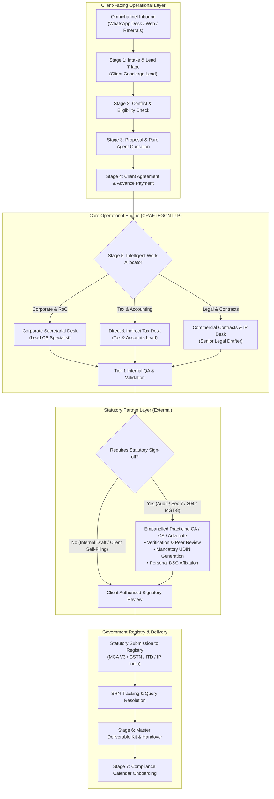
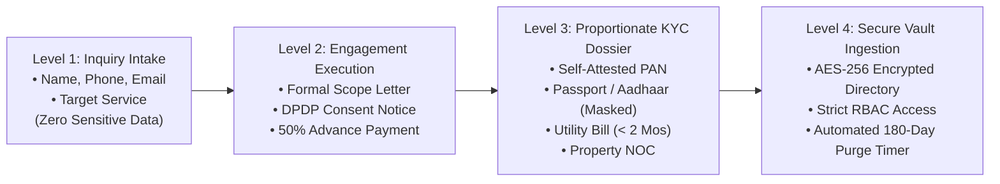
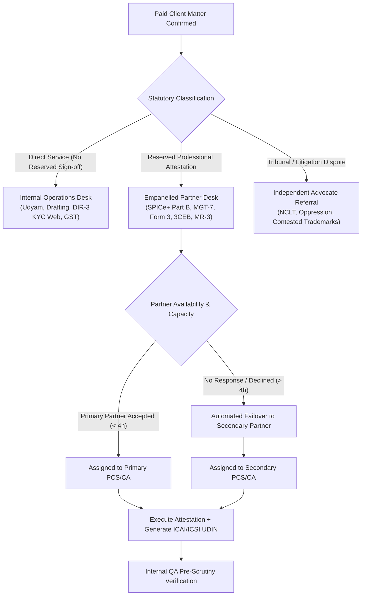
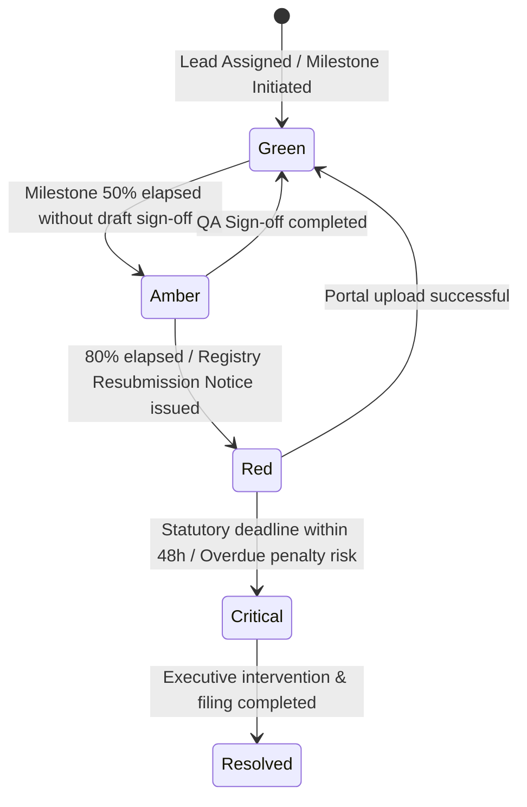
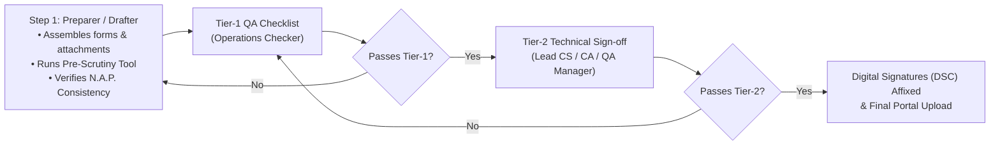
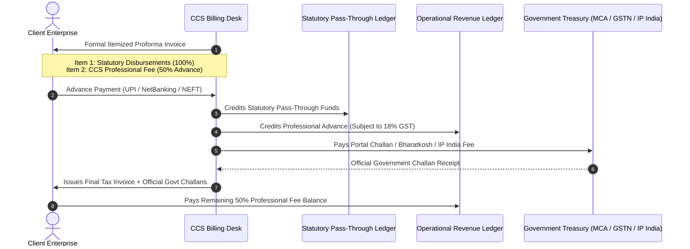
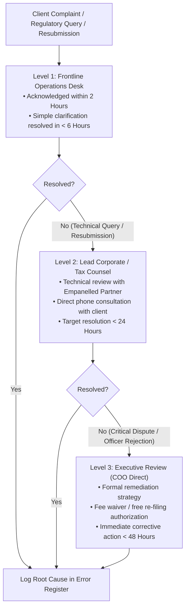
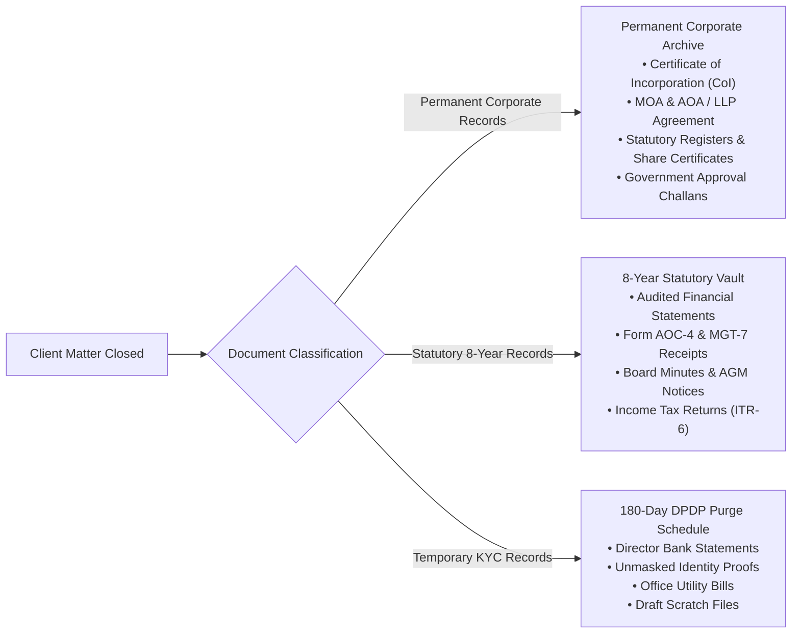
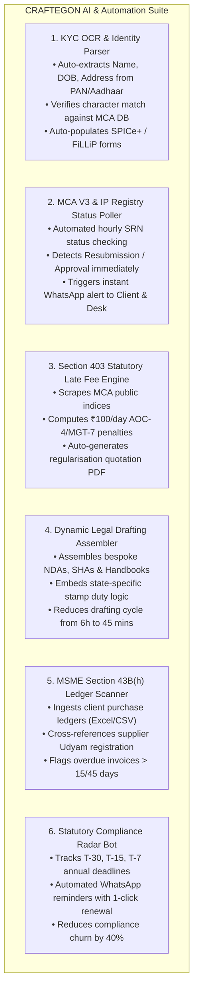

# CRAFTEGON CORPORATE SERVICES (CCS)
## Master Operational System & Service Standard Operating Procedures (SOPs)
### Customer Onboarding, KYC Architecture, Professional Review, Quality Control, Payment Workflows, Dispute Resolution & AI Automation Engine

**Document Identifier:** `DOC-CCS-OPS-SOP-2026-V1`  
**Classification:** Operational Architecture, Service Delivery SOPs & Quality Assurance  
**Version:** 1.0 – Authoritative Operating Architecture  
**Date:** 22 November 2026  
**Operating Division:** CRAFTEGON Corporate Services (CCS) – Division of CRAFTEGON LLP  
**Chief Operating Officer (COO):** Operational Governance Directorate  
**Compliance Standard:** ISO 9001:2015 Quality Management Alignment • DPDP Act 2023 Security Standard  

---

## 1. OPERATIONAL ARCHITECTURE & ORGANIZATIONAL DESIGN

CRAFTEGON Corporate Services (CCS) operates an institutional, technology-augmented delivery infrastructure designed to bridge client intake, statutory secretarial workflows, and accredited professional attestations with zero compliance failure.

### 1.1 Key Roles and Operational Accountability

| Role Title | Core Operational Responsibilities | Primary Performance KPI |
| :--- | :--- | :--- |
| **Chief Operating Officer (COO)** | Overall operational throughput, partner SLAs, risk management, and systems automation. | Gross delivery margin > 65%; Zero statutory late-filing incidents across client base. |
| **Lead Secretarial Specialist** | Oversees all MCA V3 filings, incorporation dossiers, RoC annual compliance, and secretarial registers. | First-time-approval rate at CRC/RoC > 95%; Form resubmission turnaround < 24 hours. |
| **Lead Tax & Accounting Specialist** | Manages GST reconciliations, ITR preparation, TDS filings, and tax audit preparatory packs. | Zero Section 234F / 47(2) late fees; 100% GSTR-2B ITC matching. |
| **Lead IP & Contracts Drafter** | Manages trademark searches, Form TM-A filings, founder pacts (SHA), and commercial contracts. | Trademark opposition rate < 5%; Contract turnaround time < 48 hours. |
| **Quality Assurance (QA) Manager** | Executes mandatory Tier-1 pre-scrutiny checks; audits data consistency across PAN, Aadhaar, and MCA forms. | Zero document rejection due to typographical or clerical error. |
| **Client Concierge Specialist** | First-line intake, KYC document collection, client milestone updates, and WhatsApp desk coordination. | Lead first-response SLA < 15 minutes; Client CSAT score > 4.8 / 5.0. |
| **Empanelled Partner Liaison** | Coordinates assignments with practicing CAs, CSs, and Advocates; tracks UDIN compliance and payments. | Partner assignment acceptance SLA < 4 hours; UDIN generation < 24 hours. |

---

## 2. CUSTOMER ONBOARDING, KYC & SECURE DATA GOVERNANCE

Under the **Digital Personal Data Protection (DPDP) Act, 2023** and **Sections 447 & 448 of the Companies Act, 2013**, corporate service providers must enforce rigorous identity validation while maintaining strict data minimization.

### 2.1 Proportionate KYC Tiering

1. **Tier 1 (Inquiry & Discovery Phase):**
   - Strictly *no* personal identity documents or financial statements are requested.
   - Collected data: Full Name, Business Email, Mobile Number, Proposed Entity Type, and Primary Service Need.
2. **Tier 2 (Post-Engagement KYC Collection):**
   - Initiated only after engagement acceptance and advance payment.
   - Mandatory Documents for Directors/Shareholders:
     - **Identity Proof:** Self-attested PAN card (Mandatory for Indian nationals). For Aadhaar, the first 8 digits must be masked by client or intake team before storage.
     - **Address Proof:** Bank Statement, Electricity Bill, or Telephone Bill (strictly < 2 months old; address must match identity proof exactly).
     - **Premises Proof:** Registered office utility bill (< 2 months old) + Signed NOC from the legal property owner.
3. **Tier 3 (Enhanced Due Diligence for High-Risk / Foreign Matters):**
   - For foreign direct investment (FDI), NRI incorporations, or Section 8 non-profits:
     - Notarized and Apostilled/Consularized Passport and Foreign Address Proof.
     - Ultimate Beneficial Ownership (UBO) declaration under Rule 9 of PMLA Rules.

### 2.2 Sensitive Document Security & DSC Protection Protocol

> [!CAUTION] Security & Liability Mandate
> **Strict Prohibition on DSC Password Custody:** Under no circumstances shall CCS employees request, record, or store client Digital Signature Certificate (DSC) PINs/passwords in unencrypted text, spreadsheets, or shared drives. DSC signing must occur either:
> 1. Directly on the client's local workstation via guided remote screen-share (AnyDesk / Google Meet).
> 2. Via an isolated, hardware-encrypted signing terminal where the client enters the PIN personally for token authorization.

- **Encrypted Client Storage:** Client KYC dossiers are stored in isolated, access-controlled directory structures:
  `secure-storage://clients/[CLIENT-ID]/matters/[MATTER-ID]/kyc/`
  Access is restricted via Role-Based Access Control (RBAC) strictly to the assigned drafter, QA manager, and empanelled professional.
- **DPDP Act Purge Automation:** In accordance with Section 8 of the DPDP Act 2023, personal address utility bills and bank statements collected solely for incorporation are automatically queued for secure deletion **180 days post-incorporation**, retaining only permanent corporate statutory records (MOA, AOA, Certificate of Incorporation, Form INC-20A).

---

## 3. SERVICE ALLOCATION, PROFESSIONAL REVIEW & PARTNER GOVERNANCE

To eliminate delivery bottlenecks, CCS employs an automated **Three-Tier Allocation and Review Algorithm**:

### 3.1 Empanelled Partner Service Level Agreements (SLAs)

All empanelled Practicing Company Secretaries (PCS) and Chartered Accountants (PCA) are bound by the **CCS Professional Services Framework Agreement**:
- **Assignment Acceptance SLA:** Mandatory acceptance or decline within **4 business hours** of matter transmission. Unacknowledged matters automatically roll over to the secondary empanelled partner.
- **Review & Certification SLA:** Completed review, form pre-scrutiny, and UDIN generation within **24 business hours** of receiving the verified Tier-1 document dossier.
- **UDIN Validation Mandate:** Every certified form uploaded to MCA or Income Tax must carry an active UDIN verifiable on the official ICAI/ICSI portals (`udin.icai.org` / `udin.icsi.edu`). Filings lacking a valid UDIN will not be processed for partner disbursement.
- **Partner Professional Liability:** If an MCA resubmission or rejection arises from a partner's clerical oversight (e.g., mismatched UDIN, expired digital certificate, incorrect attachment), the partner must remediate within **12 hours** without additional fees.

---

## 4. MASTER SERVICE DELIVERY TIMELINES & ESCALATION MATRIX

CCS enforces precise statutory and operational milestones across all service categories:

| Service Category | Core Service Example | Internal Drafting & QA SLA | Professional Review & UDIN SLA | Total CCS Turnaround (To Submission) | Typical Registry Approval Time | Critical Escalation Window |
| :--- | :--- | :---: | :---: | :---: | :---: | :--- |
| **01. Business Setup** | Private Limited (SPICe+) | 24 Hours | 24 Hours | **48 Hours** | 2–5 Working Days (CRC Manesar) | > 72h without CRC update |
| **01. Business Setup** | LLP Formation (FiLLiP) | 24 Hours | 24 Hours | **48 Hours** | 3–7 Working Days (CRC) | > 30 Days (Form 3 late fee risk) |
| **01. Business Setup** | MSME Udyam Registration | 4 Hours | N/A (Direct) | **4 Hours** | Instant / Same Day | > 24h portal generation delay |
| **02. Corporate Compliance**| DIR-3 KYC (Web / e-Form) | 2 Hours | 4 Hours (e-Form) | **6 Hours** | Same Day / Instant | T-7 Days before Sept 30 |
| **02. Corporate Compliance**| AOC-4 / MGT-7 Annual RoC | 48 Hours | 24 Hours | **72 Hours** | 1–3 Days (STP / RoC) | T-15 Days before AGM deadline |
| **02. Corporate Compliance**| STK-2 Company Strike-Off | 72 Hours | 48 Hours | **5 Working Days** | 30–90 Days (RoC Gazetting) | > 15 Days RoC query |
| **03. Tax Compliance** | GST Registration (REG-01) | 12 Hours | N/A (Direct) | **24 Hours** | 7 Working Days (Officer approval) | Aadhaar biometric site visit notice |
| **03. Tax Compliance** | GST Annual Return (GSTR-9/9C)| 48 Hours | N/A (Self-certified) | **72 Hours** | Instant (GSTN) | T-10 Days before Dec 31 |
| **03. Tax Compliance** | Form 3CEB Transfer Pricing | 5 Working Days| 48 Hours | **7 Working Days** | Instant (ITD Upload) | T-15 Days before Oct 31 |
| **04. Licences & Permits** | FSSAI Basic / State Registration| 24 Hours | N/A (Direct) | **48 Hours** | 7–30 Days (Food Safety Dept) | Inspection notice received |
| **05. Legal Contracts & IP** | Founder Agreement (SHA) | 48 Hours | 24 Hours | **72 Hours** | N/A (Private Execution) | > 48h client feedback delay |
| **05. Legal Contracts & IP** | Trademark Registration (TM-A) | 12 Hours | 12 Hours (TM Agent)| **24 Hours** | 1–2 Days (TM-A Receipt issued) | Examination Report with Objection |
| **06. Workforce Operations**| Mandatory POSH Setup & Policy | 24 Hours | N/A (Direct) | **48 Hours** | N/A (Board Adoption) | Employee strength hits 10 |

### 4.1 Automated Deadline Escalation System

- **Green Status (Standard):** Matter progressing within agreed SLAs. Client receives automated WhatsApp update.
- **Amber Alert (Lead Warning):** 50% of SLA time elapsed without draft sign-off. Operational alert sent to Lead Specialist.
- **Red Alert (High Risk):** 80% of SLA elapsed or statutory resubmission notice received from CRC/RoC. Matter flagged to COO; specialist must resolve within 12 hours.
- **Critical Status (Executive Intervention):** Statutory deadline within 48 hours. Direct conference call between COO, Client, and Empanelled Partner.

---

## 5. TWO-TIER QUALITY ASSURANCE (QA) & PRE-FILING AUDIT

To achieve a **< 2% resubmission rate** on MCA V3 and IP India, CCS enforces a strict two-tier pre-filing quality control process:

### 5.1 The 10-Point Pre-Filing QA Inspection Checklist

1. **Identity & N.A.P. Verification:** Name, father's name, date of birth, and residential address across PAN, Aadhaar, bank statements, and SPICe+/FiLLiP forms match character-for-character.
2. **Document Recency Standard:** Bank statements, electricity bills, and telephone bills are strictly **dated within the previous 60 days**.
3. **Registered Office Proof & NOC:** Utility bill clearly reflects the exact municipal address; signed NOC from property owner is attached and dated.
4. **Main Objects Clause Audit:** The object clauses in MOA (INC-33) align with the industrial code (NIC Code) and contain no prohibited or banking-regulated words without RBI prior approval.
5. **Capital Math & Stamp Duty Check:** Authorized capital, paid-up capital, number of shares, and face value correspond mathematically; state-specific stamp duty on MOA/AOA is calculated correctly.
6. **Form Pre-Scrutiny Validation:** Electronic forms successfully pass the built-in portal pre-scrutiny tool without validation errors before DSC affixation.
7. **DSC Validity & Token Registration:** All director DSCs are active (not expired) and registered against their respective PAN/DIN on the MCA V3 portal.
8. **Statutory Board Resolutions:** Where corporate shareholders or entity directors are involved, board resolutions authorizing subscription are signed and sealed.
9. **Empanelled Partner UDIN Verification:** For certified forms (MGT-7, AOC-4, 3CEB, MR-3), the generated UDIN is verified live on the ICAI/ICSI portal.
10. **File Size & Resolution Limits:** All PDF attachments are compressed to < 2 MB, scanned in black-and-white (200 DPI), and completely legible.

---

## 6. PAYMENT COLLECTION, PURE AGENT DISBURSEMENT & REFUND SOP

To ensure positive operating cash flow and avoid GST liability on government pass-through fees, CCS operates a **Dual-Component Billing Architecture** under **Rule 33 of the CGST Rules, 2017 (Pure Agent Provision)**.

### 6.1 Payment Milestone Protocol

| Milestone | Timing | Amount Payable | Deliverable Gate |
| :--- | :--- | :--- | :--- |
| **Milestone 1 (Intake)** | At Engagement Acceptance | **100% of Government Disbursements + 50% of Professional Fees** | Work commences; name reservation & document drafting unlocked. |
| **Milestone 2 (Filing Gate)** | Upon Draft Approval / Prior to Portal Upload | **Remaining 50% of Professional Fees** | Final digital signatures affixed and uploaded to government registry. |
| **Milestone 3 (Post-Delivery)** | Within 7 Days of Certificate Handover | **Reconciled Out-of-Pocket Disbursements (if any)** | Delivery of master physical/digital corporate kit and statutory register archive. |

### 6.2 Pure Agent Accounting Rules (Rule 33 CGST Rules)
- Statutory disbursements paid to the Government of India (MCA RoC fees, Bharatkosh, Trade Marks Registry statutory fee, State Stamp Duty) are treated as **Pure Agent expenditures**.
- These disbursements are **exempt from GST** provided they are separately itemized on client invoices and backed by official government receipt challans issued in the name of the client entity.
- CCS only levies 18% GST on its own professional coordination and service fees.

### 6.3 Refund & Cancellation Rules
- **Government Disbursements:** Completely non-refundable once paid into the government treasury (MCA, Bharatkosh, IP India) as government fees cannot be recovered.
- **Professional Fees:**
  - *Cancellation prior to document drafting:* Full refund of professional advance minus a ₹1,000 administrative onboarding charge.
  - *Cancellation post-drafting but prior to filing:* 50% refund of professional advance.
  - *Cancellation post-portal submission:* Zero refund of professional fees.

---

## 7. COMPLAINT MANAGEMENT, INCIDENT REMEDIATION & ROOT-CAUSE AUDIT

To safeguard brand equity and ensure high client retention, complaints are handled via a structured **Three-Level Resolution Escalation Framework**:

### 7.1 Incident Classification & Root-Cause Remediation

| Severity Level | Definition | Mandatory Response SLA | Remediation Owner |
| :--- | :--- | :---: | :--- |
| **Severity 1 (Critical)** | Statutory rejection by CRC/RoC; pending penalty deadline within 24h; lost/corrupted KYC data. | **Immediate (< 2 Hours)** | COO & Lead Secretarial Specialist |
| **Severity 2 (High)** | MCA resubmission query issued; partner missed 24h UDIN review window; client billing dispute. | **< 6 Hours** | QA Manager & Desk Lead |
| **Severity 3 (Medium)** | Delayed milestone update; client request for contract clause clarification. | **< 12 Hours** | Senior Drafter |
| **Severity 4 (Low)** | General question on compliance calendar; copy of previously delivered invoice requested. | **< 24 Hours** | Client Concierge Specialist |

---

## 8. RECORD RETENTION, ARCHIVAL & AUDIT TRAILS

CCS enforces compliance with **Section 128 and Section 88 of the Companies Act, 2013** alongside the **DPDP Act, 2023**:

1. **Permanent Statutory Records Archive:** All final certificates of incorporation, approved MOAs/AOAs, registered partnership deeds, trademark registration certificates, and MCA filing challans are stored in a permanent, immutable digital archive.
2. **8-Year Retention Vault:** Annual returns (MGT-7), financial filings (AOC-4), tax audit reports (3CD), and board minute extracts are retained for a minimum of 8 financial years immediately preceding the current year under Section 128(5) of the Companies Act.
3. **Automated 180-Day DPDP Data Purge:** Scratch drafts, temporary residential utility bills, and director bank statements collected strictly for address verification are permanently sanitized and purged after 180 days post-matter completion.

---

## 9. SERVICE-SPECIFIC STANDARD OPERATING PROCEDURES (SOPs)

### SOP-01: Private Limited Company Incorporation (SPICe+ Part A & B)
- **Applicable Statutes:** Companies Act, 2013, Section 7; Companies (Incorporation) Rules, 2014.
- **Portals:** MCA V3 Portal (Central Registration Centre, Manesar).
- **End-to-End Workflow:**
  1. *Step 1 (Name Reservation - SPICe+ Part A):* Collect 2 unique proposed names with business object justification. Conduct trademark clearance check on IP India Class directory. Submit Part A with ₹1,000 fee. Name reserved for 20 days upon approval.
  2. *Step 2 (KYC & Document Drafting):* Prepare digital Form INC-9 (Subscriber Declaration), DIR-2 (Director Consent), e-MOA (INC-33), and e-AOA (INC-34). Draft Registered Office NOC and obtain utility bill.
  3. *Step 3 (SPICe+ Part B Assembly):* Populate DIN allotment details, share capital distribution, and AGILE-PRO-S (Mandatory GST, EPFO, ESIC, Profession Tax, and Bank Account selection).
  4. *Step 4 (Partner Certification):* Assign to empanelled Practicing CA/CS for Form INC-140 statutory declaration and UDIN generation.
  5. *Step 5 (DSC Affixation & Portal Upload):* Promoters and professional affix Class 3 DSCs. Upload to MCA V3 and pay statutory filing fees and state stamp duty.
  6. *Step 6 (Handover & Post-Incorporation Memo):* Upon CRC approval, download Certificate of Incorporation (with CIN, PAN, and TAN). Issue the Master Incorporation Pack and the **Day 30 INC-20A Commencement Briefing**.

---

### SOP-02: Limited Liability Partnership (LLP) Registration & Form 3 Agreement
- **Applicable Statutes:** Limited Liability Partnership Act, 2008, Section 11 & Section 23; LLP Rules, 2009.
- **Portals:** MCA V3 Portal.
- **End-to-End Workflow:**
  1. *Step 1 (RUN-LLP Name Reservation):* Reserve name through RUN-LLP (up to 2 names, valid for 90 days upon approval).
  2. *Step 2 (Form FiLLiP Incorporation):* Prepare partner KYC, Form 9 consent, and registered office NOC. Empanelled CA/CS executes statutory certification. Affix DSCs and submit.
  3. *Step 3 (Certificate of Incorporation):* Receive Form 16 (LLP Certificate of Incorporation) with LLPIN.
  4. *Step 4 (LLP Agreement Formulation - Form 3):* **CRITICAL 30-DAY WINDOW.** Draft comprehensive LLP Agreement specifying capital contribution, profit sharing, designated partner powers, dispute resolution, and voting ratios.
  5. *Step 5 (Stamp Duty & Execution):* Print Agreement on non-judicial stamp paper of appropriate state denomination (Kerala: ad valorem based on contribution schedule). All partners execute agreement before two witnesses.
  6. *Step 6 (Filing Form 3 on MCA V3):* File Form 3 with executed agreement within **30 days of incorporation**. Failure attracts an enhanced late fee of ₹100/day without cap.

---

### SOP-03: Trademark Registration (Form TM-A)
- **Applicable Statutes:** Trade Marks Act, 1999; Trade Marks Rules, 2017.
- **Portals:** IP India Comprehensive e-Filing Portal (CGPDTM).
- **End-to-End Workflow:**
  1. *Step 1 (Comprehensive IP Clearance Search):* Conduct phonetically, visually, and conceptually similar searches across relevant NICE Classes (1 to 45) on public IP registry to assess conflict risk.
  2. *Step 2 (Form TM-48 Authorisation):* Execute Power of Attorney in Form TM-48 authorizing the empanelled Trade Marks Agent / Advocate.
  3. *Step 3 (User Affidavit Drafting under Rule 25):* If claiming use prior to filing date, prepare a notarized User Affidavit with documentary evidence (invoices, domain registration, social proof).
  4. *Step 4 (Fee Concession Verification):* Verify MSME Udyam or DPIIT Startup certificate to unlock the **50% statutory fee discount** (₹4,500 online fee vs ₹9,000 normal fee).
  5. *Step 5 (Electronic Filing of Form TM-A):* Upload mark, class description, and attachments under Agent DSC. Generate official TM-A Electronic Acknowledgement with Application Number.
  6. *Step 6 (Brand Monitoring Setup):* Enroll mark in automated IP monitoring bot to track examination reports, Section 9/11 objections, and journal publications.

---

### SOP-04: Annual RoC Secretarial Retainer (AOC-4, MGT-7, DIR-3 KYC)
- **Applicable Statutes:** Companies Act, 2013, Sections 92, 137, 173; Secretarial Standards 1 & 2.
- **Portals:** MCA V3 Portal.
- **End-to-End Workflow:**
  1. *Step 1 (Annual Requisition - T-45 Days before AGM):* Requisition draft financial statements, trial balances, and director disclosure letters (MBP-1 & DIR-8).
  2. *Step 2 (Secretarial Drafting):* Draft Notice of AGM, Directors' Report (with POSH disclosures, web link to annual return, and CSR notes), and Board Meeting minutes approving financial statements.
  3. *Step 3 (Financial Statements Filing - Form AOC-4):* Assemble Audited Balance Sheet, P&L, Notes, and Auditor's Report with ICAI UDIN. File Form AOC-4 within **30 days of AGM**.
  4. *Step 4 (Annual Return Filing - Form MGT-7/7A):* Extract shareholder list, transfer history, and meeting dates. Form MGT-7 certified by empanelled PCS with ICSI UDIN (MGT-7A self-signed for Small Companies/OPCs). File within **60 days of AGM**.
  5. *Step 5 (Annual Director Verification - DIR-3 KYC):* Verify mobile and email OTPs for all DIN holders on DIR-3 KYC Web (or DSC-certified e-Form for changed personal details) on or before **September 30**.
  6. *Step 6 (Statutory Register Update):* Inscribe updated member records, director disclosures, and meeting minutes in statutory registers (MGT-1, MGT-2, MBP-4).

---

### SOP-05: Direct Tax & GST Annual Compliance (GSTR-9/9C & ITR-6)
- **Applicable Statutes:** CGST Act, 2017, Section 44; Income Tax Act, 1961, Section 139(1) & Section 44AB.
- **Portals:** GST Common Portal & Income Tax e-Filing Portal.
- **End-to-End Workflow:**
  1. *Step 1 (GST Turnover & Tax Reconciliation):* Reconcile cumulative GSTR-1 outward supplies and GSTR-3B tax paid with audited books of accounts. Match GSTR-2B inward supplies to maximize Input Tax Credit (ITC) recovery.
  2. *Step 2 (GSTR-9 / GSTR-9C Annual Return):* Prepare Form GSTR-9 (Mandatory if turnover > ₹2 Crore) and GSTR-9C reconciliation statement (Self-certified, mandatory if turnover > ₹5 Crore). File on or before **December 31**.
  3. *Step 3 (Section 43B(h) MSME Supplier Audit):* Review accounts payable ledger to identify payments to Micro and Small suppliers delayed beyond 15/45 days; flag for disallowance.
  4. *Step 4 (Tax Audit Form 3CD Coordination):* For entities crossing Section 44AB thresholds (₹10 Cr for digital transactions / ₹1 Cr non-digital), coordinate with independent CA for Form 3CA/3CB-3CD signing with ICAI UDIN.
  5. *Step 5 (Corporate Income Tax Return - ITR-6):* Prepare tax computation incorporating MAT (Section 115JB) or Section 115BAA corporate tax rate (22%). File ITR-6 with Director DSC on or before **October 31**.

---

### SOP-06: Commercial Contracts & Founder Shareholder Agreements (SHA)
- **Applicable Statutes:** Indian Contract Act, 1872; Specific Relief Act, 1963; Companies Act, 2013, Section 58.
- **End-to-End Workflow:**
  1. *Step 1 (Commercial Intake & Deal Term Sheet):* Intake meeting with founders to capture equity split, reverse vesting schedules (e.g., 4-year vesting with 1-year cliff), board composition, and veto matters.
  2. *Step 2 (Bespoke Legal Drafting):* Draft customized clauses for:
     - Right of First Refusal (ROFR) and Right of First Offer (ROFO).
     - Tag-Along and Drag-Along Exit Rights.
     - Deadlock Resolution Mechanisms (Russian Roulette / Shotgun or Mediation).
     - Non-Compete, Non-Solicitation, and IP Assignment warranties.
  3. *Step 3 (Founder Review & Iteration):* Circulate initial draft with executive summary annotations. Host a 45-minute alignment call to finalize commercial compromises.
  4. *Step 4 (Stamp Duty & Non-Judicial Execution):* Calculate state-specific stamp duty on contract value. Execute on non-judicial stamp paper; arrange physical signing or secure digital e-signing (Aadhaar e-Sign).
  5. *Step 5 (Corporate Adoption):* Draft Board resolution taking note of SHA and amending the company's Articles of Association (AOA) via Form MGT-14 to make contractual transfer restrictions legally binding on third parties under Section 58.

---

## 10. CRAFTEGON AI & AUTOMATION ENGINE

To deliver institutional turnaround speed while maintaining lean operating margins, CCS deploys specialized proprietary automations across six core operational bottlenecks:

### 10.1 High-Impact Automation Specifications

1. **Intelligent KYC OCR & Schema Ingestion Engine:**
   - *Problem:* Manual typing of promoter names, father's names, and addresses into MCA forms leads to typographical mismatches and CRC resubmission delays.
   - *Automation:* AI OCR extracts structured JSON data from uploaded PAN cards, passports, and utility bills; auto-checks for name consistency against CBDT/UIDAI databases; auto-formats data into standard MCA V3 XML schema.
2. **Autonomous Registry Status Poller:**
   - *Problem:* Operations staff waste 10–15 hours weekly manually logging into MCA V3 and IP India portals to check Service Request Numbers (SRNs).
   - *Automation:* Headless status poller queries public tracking endpoints every 2 hours; upon status change (`APPROVED`, `RESUBMISSION`, `REJECTED`), instantly downloads approval receipts, updates internal CRM, and delivers a formatted WhatsApp alert to the client.
3. **Dynamic Legal Contract Assembler:**
   - *Problem:* Custom drafting of commercial NDAs, Founder SHAs, and vendor MSAs takes 4–8 hours of lawyer time.
   - *Automation:* Structured intake questionnaire feeds a dynamic contract assembler with pre-vetted institutional clause libraries, generating a polished, custom first draft in under 45 minutes for lawyer final review.
4. **Section 43B(h) MSME Working Capital Scanner:**
   - *Problem:* Manual checking of hundreds of vendor invoices against MSMED Act 15/45 day payment rules is slow and error-prone during year-end tax audits.
   - *Automation:* Ingests client accounts payable ledgers, parses supplier Udyam registration numbers, calculates exact statutory due dates, and outputs an audit-ready Schedule of Disallowances under Section 43B(h).

---
*Operational Architecture Approved and Promulgated for Immediate Execution by:*  
**Chief Operating Officer (COO), CRAFTEGON LLP**  
*In Consultation with Lead Company Secretary & Technical Compliance Directorate*