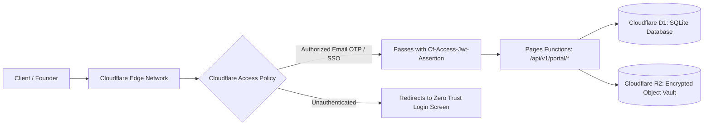

# CraftEgon CCS: Cloudflare Zero Trust, D1 Database & R2 Encrypted Vault Architecture

This architecture document specifies the migration of CRAFTEGON Corporate Services client portal (`/portal/*`) and back-office administrative desk (`/admin/*`) from client-side mockups to an enterprise-grade Zero Trust security stack.

---

## 1. Cloudflare Access & Zero Trust Identity Protection

To prevent unauthorized access or prototype exposure, `/portal/*` and `/admin/*` are secured behind **Cloudflare Access** (Identity-Aware Proxy):



### Access Application Configuration Steps
1. Navigate to **Cloudflare Zero Trust Dashboard > Access > Applications**.
2. Click **Add an Application** > Select **Self-hosted**.
3. Application Name: `CraftEgon CCS Client Portal`.
4. Domain: `ccs.craftegon.com/portal` (and separate policy for `ccs.craftegon.com/admin`).
5. **Identity Providers:**
   * One-time PIN (OTP) sent to client's registered business email.
   * Google Workspace / Microsoft Entra ID for corporate administrators (`@craftegon.com`).
6. **Session Duration:** 8 hours (with automatic token rotation).

---

## 2. Serverless Relational Database (Cloudflare D1)

The structured compliance milestones, entity profiles, and audit records are managed via Cloudflare D1 (serverless SQLite at edge).

### Provisioning & Migration Commands
```bash
# 1. Create the D1 Database
npx wrangler d1 create ccs-compliance-db

# 2. Bind the database to Cloudflare Pages project
# In wrangler.toml or Pages Project Settings > Settings > Functions > D1 Database Bindings:
# Variable name: DB
# Database: ccs-compliance-db

# 3. Apply Schema
npx wrangler d1 execute ccs-compliance-db --file=./schema/d1-compliance-schema.sql
```

The schema (defined in `schema/d1-compliance-schema.sql`) enforces foreign keys, unique CIN/LLPIN constraints, statutory due dates, and tamper-evident audit logging for DPDP Act 2023 compliance.

---

## 3. Encrypted Document Vault (Cloudflare R2)

All sensitive corporate records (DSC PIN certificates, PAN/Aadhaar KYC cards, SPICe+ Part B incorporation dossiers, certified MOA/AOA, and MCA payment receipts) are stored in a private Cloudflare R2 bucket:

* **Bucket Name:** `ccs-client-vault`
* **Encryption:** AES-256 Server-Side Encryption (SSE-S3).
* **Direct Public Access:** Disabled (All reads and writes are brokered by `functions/api/v1/portal/vault.js` via expiring time-limited presigned URLs).
* **Data Residency:** Regulated within India / Asia-Pacific region.

### Provisioning R2 Bucket
```bash
# 1. Create the R2 Bucket
npx wrangler r2 bucket create ccs-client-vault

# 2. Bind to Pages Project Settings > Functions > R2 Bucket Bindings:
# Variable name: CLIENT_VAULT_BUCKET
# Bucket: ccs-client-vault
```

---

## 4. API Route Index

| Route | Method | Function File | Purpose |
| :--- | :---: | :--- | :--- |
| `/api/v1/portal/session` | `GET` | `functions/api/v1/portal/session.js` | Validates Zero Trust assertion & returns role |
| `/api/v1/portal/compliance` | `GET` | `functions/api/v1/portal/compliance.js` | Fetches live RoC/tax deadlines from D1 |
| `/api/v1/portal/vault` | `GET` | `functions/api/v1/portal/vault.js` | Lists encrypted vault documents for entity |
| `/api/v1/portal/vault` | `POST` | `functions/api/v1/portal/vault.js` | Issues expiring upload presigned URL |
