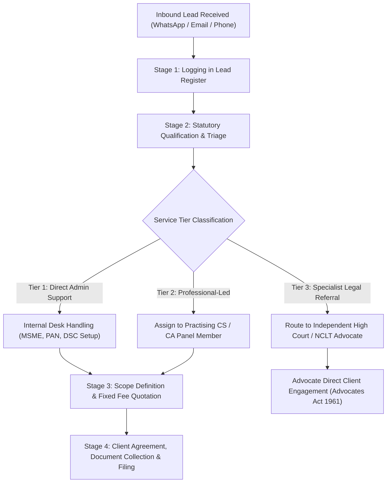

# CraftEgon Corporate Services (CCS)
# Standard Operating Procedure (SOP) — Inbound Lead Management & Client Engagement

**Document Reference:** `docs/commercial-readiness/05_LEAD_MANAGEMENT_SOP.md`  
**Task Reference:** `TASK-CCS-UX-002`  
**Project:** CraftEgon Corporate Services (CCS)  
**Applicable Desk:** Corporate Services Desk (Kozhikode & Remote Support)  
**Execution Date:** November 2026  
**Final Status:** Complete & Audited  

---

## 1. Purpose & Scope

This Standard Operating Procedure (SOP) governs the manual intake, qualification, assignment, and client engagement for all inbound business enquiries arriving through the CraftEgon Corporate Services public platform (`ccs.craftegon.com`), WhatsApp Business (`+91 86069 18247`), and corporate email (`admin@craftegon.com`).

The procedure ensures that:
- Every lead is logged within 15 minutes of receipt into the internal Lead Register (`docs/commercial-readiness/06_LEAD_REGISTER_TEMPLATE.md`).
- Enquiries are correctly classified under the approved 3-tier delivery model.
- Response SLAs are strictly honored.
- Legal boundaries under the Advocates Act, 1961 are maintained in all prospect communications.

---

## 2. Operating Desk Hours & Service Level Agreements (SLAs)

### A. Operating Hours
- **Standard Working Hours:** Monday to Saturday, 9:00 AM to 7:00 PM IST.
- **Statutory Peak Window (September 1 – November 30):** Monday to Sunday, 8:30 AM to 9:00 PM IST (to support DIN KYC and annual financial filing deadlines).

### B. Response Time SLAs (During Operating Hours)

| Lead Classification | Qualifying Criteria | Acknowledgment SLA | Scope Consultation SLA |
| :--- | :--- | :--- | :--- |
| **Priority 1: Urgent Statutory Deadline** | Active MCA disqualification risk, DIN deactivation threat, DIR-3 KYC (due Sept 30), AOC-4/MGT-7 filings within 14 days of due date. | **Within 60 minutes** | Within 2 hours |
| **Priority 2: Core Launch Enquiries** | New Pvt Ltd Incorporation, LLP Formation, MSME Udyam, or Trademark Application. | **Within 2 hours** | Same business day |
| **Priority 3: General Advisory & Referral** | Structural changes, capital increases, secretarial audits, contracts, or NCLT referral requests. | **Within 4 hours** | Within 24 hours |

*Enquiries received outside operating hours must be acknowledged by 10:00 AM on the immediate next business morning.*

---

## 3. Four-Stage Lead Lifecycle



### Stage 1: Intake & Logging (Within 15 Minutes)
Upon receiving an inbound WhatsApp message, email, or telephone call:
1. Assign a sequential **Lead Reference ID** formatted as `CCS-YYYY-NNNN` (e.g. `CCS-2026-0104`).
2. Record all available prospect attributes in the Lead Register:
   - Date & Time received.
   - Channel (WhatsApp / Direct Email / Website Form Fallback / Referral).
   - Prospect Name & Mobile Number.
   - Stated Corporate Entity / Proposed Business Name.
   - Identified Service Category (e.g. Private Limited Registration).

### Stage 2: Statutory Qualification & Triage (Within SLA Window)
Evaluate the inquiry against three core criteria:
1. **Jurisdictional & Entity Eligibility:** Verify that the entity is governed by MCA / RoC, GST, or IP India regulations in India.
2. **Statutory Delivery Tier Assignment:**
   - **Tier 1 (Direct Administrative Coordination):** MSME Udyam registration, PAN/TAN application, digital signature token procurement, documentation formatting. Handled directly by CraftEgon corporate support staff.
   - **Tier 2 (Professional-Led Practice):** Private Limited incorporation (Section 7(1)(b)), LLP registration (Section 11(1)(c)), DIR-3 KYC certification (Rule 12A), Secretarial Audit, CA statutory financial audit. Requires formal assignment to an empaneled Practising Company Secretary (PCS) or Chartered Accountant (CA).
   - **Tier 3 (Specialist Legal Referral):** NCLT / NCLAT litigation, High Court writ petitions, trademark oppositions with oral hearings, criminal/cheque bounce proceedings. Handled exclusively by introducing the client directly to an independent advocate. CraftEgon does not charge legal representation fees or solicit advocacy work.

### Stage 3: Professional Assignment & Quotation
1. For Tier 2 services, assign the lead to an active panel professional based on current workload capacity and domain expertise.
2. Issue a formal, itemized **Scope & Fee Letter** separating:
   - **Statutory Government Fees:** Exact MCA, Stamp Duty, or IP India fees (non-negotiable government revenue).
   - **Professional & Administrative Coordination Fees:** Fixed, transparent fee.
   - **Out-of-Pocket Disallowances:** Explicit statement that digital token hardware or expedited RoC fees are clearly disclosed.

### Stage 4: Execution, Client Document Intake & Completion
1. Provide the client with the standardized document preparation checklist for their service.
2. Collect identity proofs (PAN, Aadhaar/Passport, Bank Statement) over secure encrypted email or direct file transfer.
3. Coordinate execution between the client and the certifying professional.
4. Record completion date, filing SRN (Service Request Number), and archive records according to the DPDP Act, 2023 compliance policy.

---

## 4. Standard Communication Scripts & Templates

### Template A: Immediate WhatsApp Acknowledgment (Automated or Manual)
```text
Hello [Client Name], thank you for contacting CraftEgon Corporate Services.

We have received your enquiry regarding [Service Name, e.g. Private Limited Company Registration] (Ref: [CCS-2026-NNNN]).

Our Corporate Services Desk in Kozhikode has assigned your request to a compliance specialist. A team member will review your requirements and connect with you shortly during our business hours (Mon–Sat 9AM–7PM IST).

If you have urgent filing deadlines, please reply with your existing CIN or DIN so we can prioritize your file.

Best regards,
CraftEgon Corporate Services Desk
Kozhikode, Kerala • +91 86069 18247
https://ccs.craftegon.com
```

### Template B: Initial Qualification Email Response
```text
Subject: Re: Corporate Services Enquiry — [Service Name] (Ref: [CCS-2026-NNNN])

Dear [Client Name],

Thank you for reaching out to CraftEgon Corporate Services.

We have received your request regarding [Service Name] for [Proposed Entity / Existing Company Name].

To ensure an accurate scope evaluation and transparent fee estimate, could you kindly confirm the following preliminary details:
1. Proposed business activity / industry sector.
2. Number of proposed directors / partners (minimum 2 for Private Limited / LLP).
3. State of registered office location (for state stamp duty estimation).
4. Do all proposed directors hold active Director Identification Numbers (DIN) or Digital Signature Certificates (DSC)?

Important Regulatory Disclosure:
CraftEgon Corporate Services operates as a business infrastructure and corporate management consultancy. Statutory certifications and filings under the Companies Act, 2013 and LLP Act, 2008 are certified by independent Practising Company Secretaries and Chartered Accountants. Legal dispute representation is referred to independent enrolled advocates in compliance with the Advocates Act, 1961.

We look forward to assisting your business infrastructure.

Sincerely,
Corporate Services Desk
CraftEgon Corporate Services
Email: admin@craftegon.com | Phone: +91 86069 18247
Website: https://ccs.craftegon.com
```

### Template C: Tier 3 Legal Referral Clarification Script
```text
Dear [Client Name],

Regarding your inquiry concerning [NCLT petition / courtroom dispute / trademark opposition hearing]:

Please note that under the Advocates Act, 1961 and the Bar Council of India Rules, CraftEgon Corporate Services is not a law firm and does not provide legal representation, court appearances, or advocacy services.

We have forwarded your requirement to our independent panel of qualified and enrolled advocates practicing before the relevant tribunal/court. Advocate [Advocate Name / Chamber] will reach out to you directly to establish an independent attorney-client relationship.

CraftEgon charges zero referral or brokerage fee for this introduction.
```
