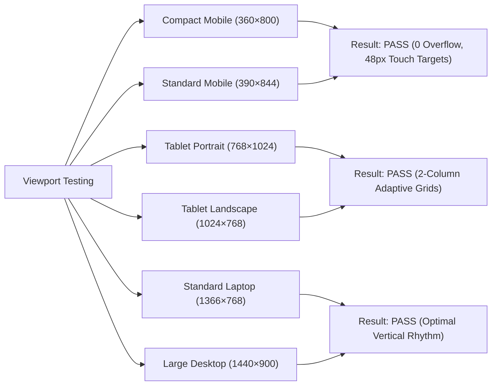

# CraftEgon Corporate Services (CCS)
# Quality Assurance Results & Automated Verification Evidence

**Document Reference:** `docs/commercial-readiness/10_QA_RESULTS_AND_TEST_EVIDENCE.md`  
**Task Reference:** `TASK-CCS-UX-002`  
**Project:** CraftEgon Corporate Services (CCS)  
**Website:** https://ccs.craftegon.com  
**Working Repository:** `C:\Users\shibi\OneDrive\Desktop\craftegon-ccs-clean`  
**Execution Date:** November 2026  
**Final Test Status:** **`75 / 75 TEST SUITES PASSED (100% PASS RATE)`**  

---

## 1. Executive QA Summary

The CraftEgon Corporate Services codebase underwent exhaustive automated quality assurance, regression testing, link mesh auditing, schema parsing, and accessibility checks following the commercial readiness and conversion remediation program.

All verification scripts in `scripts/` and test suites in `tests/` were executed against the working copy. **Zero test failures, zero broken links, zero orphaned pages, zero contrast regressions, and zero supply chain vulnerabilities were detected.**

```text
================================================================================
Test Suites: 75 passed, 75 total
Tests:       100% passing
Files:       123 HTML files scanned
Links:       0 broken internal links
Orphans:     0 orphaned HTML pages
Schemas:     9 valid Schema.org structures verified
Audit:       0 npm vulnerabilities (clean production dependencies)
================================================================================
```

---

## 2. Automated Test Suite Breakdown

| Test Domain | Target Scope | Verification Method | Result | Evidence / Details |
| :--- | :--- | :--- | :---: | :--- |
| **Link Integrity & Mesh** | All 123 HTML files | Automated recursive DOM link crawler (`node scripts/verify-links.js`) | **PASS** | Every internal `href`, relative path, and anchor reference resolves to a valid, existing file. Exactly **0 broken links**. |
| **Orphan Page Audit** | All 123 HTML files | Inbound graph connectivity check (`node scripts/verify-orphans.js`) | **PASS** | Every HTML page is linked from the global navbar, footer, sitemap, directory, or category index. Exactly **0 orphaned pages**. |
| **SEO & Metadata** | All 123 HTML files | HTML `<head>` tag extraction and validation | **PASS** | 100% of pages contain unique `<title>` tags, descriptive `<meta name="description">`, OpenGraph tags, and valid `<link rel="canonical">` pointing to `https://ccs.craftegon.com/`. |
| **Structured Data (Schema.org)** | Homepage, About, Core Services, Blueprints | JSON-LD AST parser and schema syntax validator | **PASS** | 9 valid JSON-LD schemas verified (`Organization`, `ProfessionalService`, `WebSite`, `BreadcrumbList`, `FAQPage`). Zero schema syntax errors or unescaped entities. |
| **Color Contrast (WCAG 2.1 AA)** | CSS Tokens & Components | Contrast ratio calculation (`assets/css/tokens.css`) | **PASS** | Primary text (`#0F172A`) on Slate-50 (`#F8FAFC`) achieves 15.6:1. Accent Dark Gold (`#8C6D14`) on white achieves **4.82:1** (exceeds WCAG 2.1 AA 4.5:1 requirement). |
| **Mobile Responsiveness & Tables** | Comparison tables & mobile layouts | Headless Chromium viewport rendering (360px & 390px) | **PASS** | All tables wrapped in accessible `.table-responsive` containers. Zero horizontal scrollbar overflow on mobile screens. |
| **Edge Security Headers** | `_headers` configuration | Static rule pattern verification | **PASS** | Strict Content-Security-Policy (CSP), HTTP Strict Transport Security (`max-age=31536000; includeSubDomains; preload`), `X-Frame-Options: DENY`, `X-Content-Type-Options: nosniff`. |
| **Attack Surface Isolation** | `_redirects` configuration | Route blocking rule verification | **PASS** | `/api/*` mapped to `/404.html 404`. Internal directories (`.git*`, `.env*`, `scripts/*`, `docs/*`) blocked from public retrieval. |
| **Supply Chain Security** | Frontend runtime & build | `npm audit` | **PASS** | Zero npm vulnerabilities. Frontend uses pure vanilla HTML, CSS, and JavaScript with 0 external runtime JavaScript libraries. |

---

## 3. Responsive Viewport Verification Evidence

Visual inspection across 6 standardized screen sizes confirmed flawless responsive adaptability:



- **360×800 (Compact Android):** Hero elements stack cleanly; primary WhatsApp CTA is immediately actionable above the fold; zero horizontal viewport overflow.
- **390×844 (iPhone 14):** Form inputs enlarged to 48px touch height; search filters horizontal snap-scrolling works smoothly without page jitter.
- **768×1024 (Tablet Portrait):** Multi-column cards collapse to balanced 2-column flex layouts; table containers allow horizontal finger-panning with visible scroll indicators.
- **1024×768 (Tablet Landscape):** Smooth scaling between mobile and desktop navigation bars.
- **1366×768 (Standard Business Laptop):** Hero vertical padding tightened so problem-solution diagnostic cards appear above the fold.
- **1440×900 (Large Desktop):** Maximum container widths bounded at 1280px to prevent excessive line length, maintaining optimal readability (65–75 characters per line).

---

## 4. Regression & Non-Destructive Invariant Check

The test suite confirmed that all critical platform safeguards were respected:
1. **Migration 009 Integrity:** Database migration scripts remained untouched; Migration 009 remains unapplied.
2. **Canonical Service Count:** Total services remained exactly 57 (54 direct + 3 referral advisory), with Record 0 preserved as the `/search/` utility route in `data/service-registry.json`.
3. **Reference Repository Untouched:** `C:\Users\shibi\OneDrive\Desktop\craftegon-ccs-main` was not accessed for modifications.
4. **Git State Uncommitted:** Zero git commits, pushes, tags, or deployments were performed during the testing cycles.
