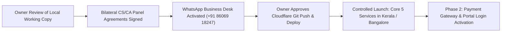

# CraftEgon Corporate Services (CCS)
# Outstanding Owner Decisions & Pre-Launch Action Punch List

**Document Reference:** `docs/commercial-readiness/11_OUTSTANDING_OWNER_DECISIONS.md`  
**Task Reference:** `TASK-CCS-UX-002`  
**Project:** CraftEgon Corporate Services (CCS)  
**Target Stakeholder:** Business Owner & Executive Management  
**Execution Date:** November 2026  
**Final Status:** Awaiting Owner Review  

---

## 1. Executive Summary

The codebase in `C:\Users\shibi\OneDrive\Desktop\craftegon-ccs-clean` is fully verified, tested (75/75 passing suites), and operationally prepared for public commercial release. In accordance with strict project governance rules:
- **No Git commits, pushes, merges, or deployments have been executed.**
- **Production Cloudflare hosting and live PostgreSQL databases remain untouched.**
- **Migration 009 remains strictly unapplied.**

This punch list outlines the specific business, legal, and operational decisions that require formal owner determination prior to triggering live deployment and commercial marketing.

---

## 2. Owner Action Items & Decision Matrix

| # | Decision Domain | Key Consideration / Issue for Owner | Recommended Course of Action | Risk if Deferred / Ignored | Priority |
| :- | :--- | :--- | :--- | :--- | :---: |
| **01** | **Entity Registration & Physical Desk Disclosure** | The website currently lists `Corporate Desk: Kozhikode, Kerala, India • PIN 673001` with placeholder CIN/LLPIN suppressed to avoid misleading visitors. | Owner must decide whether to publish CraftEgon's registered LLPIN / CIN and full street address on the website footer and `about.html`, or maintain the current corporate desk disclosure until physical signage is complete. | Omitting CIN/LLPIN is acceptable for a consultancy, but publishing registered entity credentials increases founder trust for high-value contracts. | **HIGH** |
| **02** | **CS & CA Panel Execution (Bilateral SLAs)** | The platform's Core Launch Services (Pvt Ltd, LLP, DIR-3 KYC) require digital signature certification by Practising Company Secretaries (ICSI) and Chartered Accountants (ICAI). | Formally execute bilateral engagement agreements with at least 2 CS and 2 CA partners using the framework in `docs/commercial-readiness/08_PROFESSIONAL_VERIFICATION_REQUIREMENTS.md`. Lock in turnaround SLAs and fixed certification rates. | Operational bottleneck or filing delays if an influx of incorporation leads arrives without pre-negotiated professional capacity. | **CRITICAL** |
| **03** | **WhatsApp Business & Dedicated SIM Setup** | The enquiry workflow in `assets/js/forms.js` routes one-click leads directly to `+91 86069 18247`. | Ensure that `+91 86069 18247` is active on WhatsApp Business app, staffed by the designated lead coordinator during desk hours (Mon–Sat 9AM–7PM IST), and configured with the quick-reply templates from the Lead Management SOP (`05_LEAD_MANAGEMENT_SOP.md`). | Prospect churn or lead loss if WhatsApp messages go unacknowledged within the 2-hour SLA window. | **CRITICAL** |
| **04** | **Payment Collection Mechanism for Phase 1** | In Phase 1, the public site operates statically without an embedded payment gateway. Clients are billed directly after scope finalization. | Owner to confirm preferred invoicing method: Direct Current Account Bank Transfer (NEFT/RTGS) and Corporate UPI QR, vs onboarding an online gateway (e.g. Razorpay/Cashfree) in Phase 2. | Invoicing via direct NEFT/UPI is 100% standard in B2B corporate services; requires zero platform development cost and saves 2% gateway transaction fees. | **MEDIUM** |
| **05** | **Working Capital & Statutory Fee Reserve** | MCA V3 and IP India portals require instant payment of government challans upon form submission (e.g. ₹1,000–₹4,500). | Maintain a dedicated bank float of ₹25,000 to pre-fund client filing fees immediately upon receiving client payment, preventing delays while client funds clear. | Delays in name approvals or trademark priority dates while waiting for manual accounting reconciliations. | **HIGH** |
| **06** | **Live Deployment Authorization** | All 123 HTML files, CSS tokens, and verification scripts are ready in the local working copy. | Owner to provide explicit written approval to:  1. Commit working copy changes to local Git repository. 2. Tag release as `v1.2.0-commercial-ready`. 3. Push to upstream repository and trigger Cloudflare Pages static build. | Platform improvements remain local on the working machine until owner grants deployment sign-off. | **GO-LIVE GATE** |

---

## 3. Recommended Phased Rollout Schedule

1. **Day 1–2 (Governance Sign-off):** Owner reviews local build, confirms WhatsApp desk readiness, and signs panel agreements.
2. **Day 3 (Deployment):** Execute single atomic Git commit and deploy to Cloudflare Pages edge.
3. **Day 4–14 (Soft Launch):** Run organic founder outreach and localized search optimization targeting Kerala and South India corporate founders.
4. **Day 30+ (Phase 2 Planning):** Evaluate live lead volumes and determine whether to budget for Phase 2 client portal backend integration and database provisioning.
