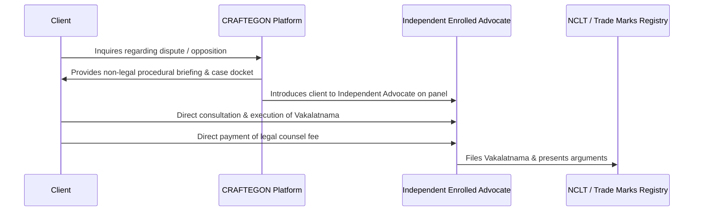

# CRAFTEGON LLP: Independent Advocate Referral & Direct Vakalatnama Protocol
**Statutory Framework:** Section 30 of the Advocates Act, 1961 & Bar Council of India (BCI) Rules on Professional Conduct and Etiquette.

---

## 1. Statutory Mandate & Strict Separation of Powers
Under Section 30 of the Advocates Act, 1961 and the Bar Council of India Rules:
1. **Right to Practice:** The right to practice law before courts, tribunals (NCLT, NCLAT, High Courts, Supreme Court), and judicial authorities is reserved exclusively for enrolled Advocates.
2. **Prohibition of Corporate Law Practice:** A corporate entity or Limited Liability Partnership cannot practice law, act as an advocate, or represent clients before judicial bodies.
3. **Prohibition of Fee-Sharing:** Advocates are strictly barred by Bar Council Rules from sharing legal fees with non-advocates or corporate intermediaries.

---

## 2. Platform Protocol for Contested & Tribunal Matters
When a client of CRAFTEGON Corporate Services encounters a contested legal matter—such as:
* Trademark Opposition (Form TM-O) and Show-Cause Hearing representation before the Trade Marks Registry;
* NCLT Insolvency Defense (Section 7/9 IBC) or Oppression & Mismanagement Petitions (Section 241/242 Companies Act);
* High Court writ petitions or statutory tax appeals;

The following operational protocol is **mandatory**:

---

## 3. Direct Vakalatnama Requirements
1. **Direct Privity of Contract:** The Advocate is engaged directly by the Client. Privity of legal representation exists strictly between the Client and the Advocate.
2. **Direct Billing:** All advocate fees for legal drafting of petitions, counter-statements, and appearances are quoted directly by the Advocate and billed directly to the Client. CRAFTEGON LLP receives zero commission or fee-split.
3. **Role of CRAFTEGON LLP:** The role of CRAFTEGON LLP is strictly confined to:
   * Assembling the historical company records, secretarial minutes, and filing chronologies from the client repository.
   * Assisting the client with administrative document management and scheduling.
   * Ensuring the client is fully informed of hearing dates and procedural requirements.

---

## 4. Verification & Panel Eligibility
Independent advocates empaneled on the CRAFTEGON referral roster must:
* Be actively enrolled with the Bar Council of Kerala (or relevant State Bar Council).
* Have a minimum of 5 years of verifiable practice in Corporate Law, IP Litigation, or Commercial Arbitration.
* Sign an acknowledgment of this Non-Fee-Sharing Protocol and adhere to strict DPDP Act 2023 client confidentiality.
