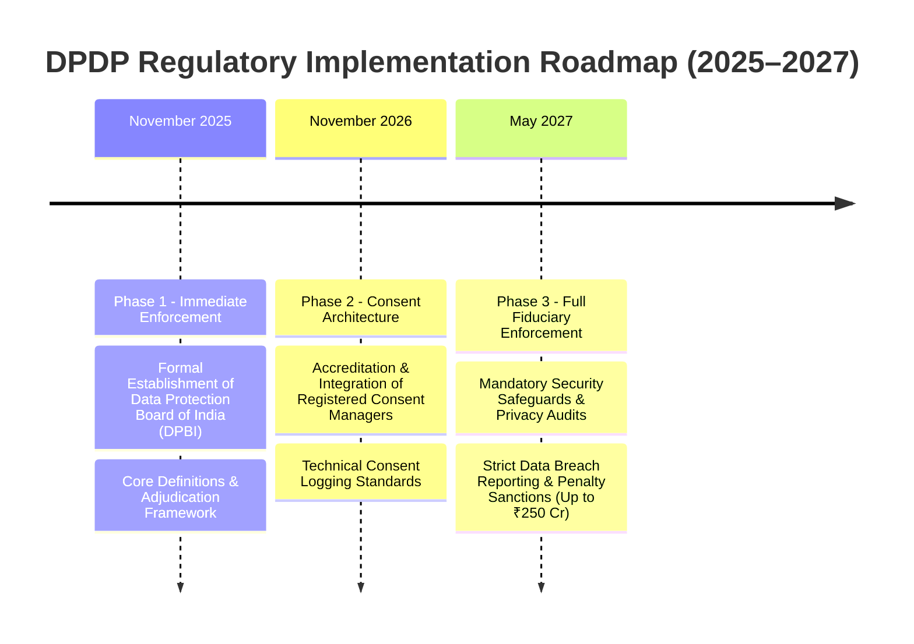

# CRAFTEGON Corporate Services (CCS)
## Digital Personal Data Protection (DPDP) Act, 2023 & DPDP Rules, 2025 Compliance Framework
### Operational Data Fiduciary Guidelines, Consent Architecture & Statutory Retention Protocols

**Document Reference:** `DOC-CCS-DPDP-SOP-2026-V1`  
**Statutory Framework:** Digital Personal Data Protection Act, 2023 (Act No. 22 of 2023); DPDP Rules, 2025 (Notified 13 Nov 2025); Information Technology Act, 2000  
**Operating Entity:** CRAFTEGON LLP (Corporate Services Division)  
**Classification:** Enterprise Data Protection Policy & Internal Operational Standard  

---

## 1. Statutory Context & Phased Enforcement Architecture

The **Digital Personal Data Protection Act, 2023** was enacted by Parliament to regulate the processing of digital personal data while respecting the right to privacy and the necessity of processing for lawful purposes. The **Ministry of Electronics and Information Technology (MeitY)** officially notified the **Digital Personal Data Protection Rules, 2025** on **13 November 2025**, instituting a structured, 3-phase enforcement timeline:



As an institutional corporate services provider managing sensitive corporate KYC, director credentials, financial statements, and digital signatures, **CRAFTEGON LLP** operates proactively under full Phase 3 operational standards from Day 1.

---

## 2. Institutional Role & Data Governance Classification

Under the DPDP Act, CRAFTEGON LLP acts in two distinct statutory capacities:
1. **Data Fiduciary (Primary Role):** When determining the purpose and means of collecting personal data directly from enterprise clients, directors, and subscribers for entity establishment, corporate retainers, and regulatory compliance advisory.
2. **Data Processor (Technical Role):** When transmitting or formatting data strictly on behalf of client enterprises to government regulatory portals (MCA V3, GSTN, ITD, IP India) or empanelled practicing professionals (Chartered Accountants and Company Secretaries).

---

## 3. Seven Core Data Protection Principles Applied to CCS Operations

### 3.1 Principle 1: Lawful, Fair & Transparent Processing (Section 4 & 5)
Personal data is processed strictly based on **Affirmative, Unambiguous Consent** or under lawful statutory obligations imposed by Indian corporate and tax legislation. Pre-ticked consent boxes, deceptive dark patterns, and bundled blanket authorizations are strictly prohibited.

### 3.2 Principle 2: Purpose Limitation (Section 5(1))
Personal data collected for a specific regulatory filing (e.g., DIN allocation or SPICe+ incorporation) must **never be repurposed** for unsolicited marketing, third-party lead generation, or credit profiling.

### 3.3 Principle 3: Data Minimization (Section 6(1))
CCS collects only the minimum personal data strictly necessary to complete the specific corporate mandate:
- For Web KYC: Only DIN, registered mobile number, and email address.
- For Name Reservation (RUN): No director KYC required.
- For SPICe+ Incorporation: PAN, one secondary ID proof, one residential address proof, and passport (for foreign nationals).

### 3.4 Principle 4: Data Accuracy & Quality (Section 8(3))
Because filings before the Ministry of Corporate Affairs and Income Tax Department carry severe criminal penalties under Sections 447 and 448 of the Companies Act, CCS enforces independent algorithmic and manual data validation against government databases before portal submission.

### 3.5 Principle 5: Storage Limitation & Statutory Retention Exceptions (Section 8(7))
Data must not be retained longer than necessary to satisfy the lawful purpose. However, in accordance with Section 8(7) of the DPDP Act, data retention must yield to mandatory Indian statutory record-keeping periods:
- **Books of Account & Financial Records:** Mandatory retention for **eight (8) financial years** under Section 128(5) of the Companies Act, 2013 and Section 44AA of the Income Tax Act, 1961.
- **GST Invoices & Ledgers:** Mandatory retention for **72 months (6 years)** from the due date of furnishing the annual return under Section 36 of the CGST Act, 2017.
- **Corporate Incorporation Dossiers, MOA & AOA:** **Permanent retention** throughout the active corporate existence of the client entity.
- **Unconverted Leads / Abandoned Inquiries:** Securely purged from edge databases after **ninety (90) days**.

### 3.6 Principle 6: Integrity & Confidentiality (Section 8(5))
Personal data is protected by technical and operational safeguards:
- **Data at Rest:** 256-bit Advanced Encryption Standard (AES-256) across all Cloudflare R2 object storage vaults and relational databases.
- **Data in Transit:** Transport Layer Security (TLS 1.3) with strict HTTP Strict Transport Security (HSTS) headers.
- **Role-Based Access Control (RBAC):** Compliance specialists access only the files of assigned client mandates. Administrative credentials enforce Multi-Factor Authentication (MFA).

### 3.7 Principle 7: Accountability & Auditability (Section 8(4))
Every data access event, client consent grant, portal upload, and partner referral is immutably logged with timestamps, IP addresses, and user identifiers for regulatory auditability.

---

## 4. Inbound Lead Intake & Consent Architecture

Every public intake form on `ccs.craftegon.com` and the Cloudflare Pages serverless endpoint (`functions/api/v1/enquiries.js`) enforces explicit DPDP compliance:

```javascript
// Strict DPDP affirmative consent validation invariant
const dpdp_consent = body.dpdp_consent === true || body.dpdp_consent === 'yes' || body.dpdp_consent === 'true';

if (!dpdp_consent) {
  errors.push({ 
    field: 'dpdp_consent', 
    issue: 'Affirmative DPDP Act consent is mandatory before processing enquiry.' 
  });
}
```

### Standard DPDP Notice Presented to Data Principals:
> *"By submitting this form, you explicitly consent to the collection and processing of your personal identifiers by CRAFTEGON LLP strictly for corporate compliance coordination, statutory filings, and professional service communication in compliance with the Digital Personal Data Protection Act, 2023. We do not sell or share personal data with third-party advertisers."*

---

## 5. Security Incident Management & Breach Notification Protocol

In the event of an unauthorized access, breach, or compromise of personal data:
1. **Immediate Triage (0–2 Hours):** The Corporate Compliance & Security Desk isolates the affected system, revokes compromised credentials, and determines the scope of the incident.
2. **CERT-In Statutory Reporting (Within 6 Hours):** In compliance with Section 70B of the Information Technology Act, 2000 and the CERT-In Directions 2022, cybersecurity incidents of specified severity must be formally reported to CERT-In (`incident@cert-in.org.in`) within six (6) hours of noticing.
3. **Data Protection Board of India (DPBI) & Data Principal Notice:** In compliance with Section 8(6) of the DPDP Act and the DPDP Rules, 2025, formal notification detailing the nature of the breach, affected data categories, potential consequences, and remedial measures taken must be submitted to the DPBI and communicated directly to affected Data Principals without undue delay.

---

## 6. Data Principal Rights & Grievance Redressal Architecture

In compliance with Chapter III of the DPDP Act, 2023, clients and individuals whose personal data is held by CCS possess the following statutory rights:
1. **Right to Access Information (Section 11):** Summary of personal data being processed and identities of all Data Fiduciaries/Processors with whom data has been shared.
2. **Right to Correction & Erasure (Section 12):** Correction of inaccurate or misleading data, updating of incomplete records, and erasure of personal data that is no longer required for the purpose for which it was collected (subject to statutory tax and corporate retention mandates).
3. **Right of Grievance Redressal (Section 13):** Access to an expedited grievance redressal mechanism responding to data privacy complaints within thirty (30) calendar days.
4. **Right to Nominate (Section 14):** Ability to designate an individual who, in the event of death or incapacity, shall exercise Data Principal rights.

### Official Grievance Redressal Contact:
- **Designated Data Protection Grievance Officer:** Grievance Desk, CRAFTEGON LLP  
- **Official Privacy Email:** `privacy@craftegon.com` / `admin@craftegon.com`  
- **Corporate Desk:** Mavoor Road, Kozhikode, Kerala 673004, India  
- **Statutory Turnaround:** Written acknowledgment within 48 hours; definitive resolution within 30 days.
