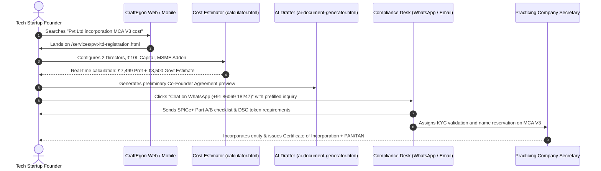
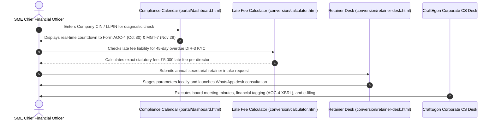
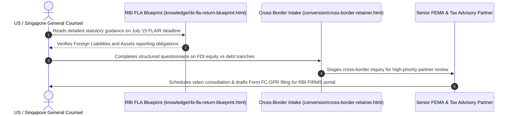

# CraftEgon CCS — Audience Personas & End-to-End User Journeys

**Document ID**: `CRAFTEGON-PROD-002`  
**Classification**: Audience & User Experience Architecture  
**Version**: 1.0  
**Operating Entity**: CraftEgon Corporate Compliance Services, under **CraftEgon LLP**  

---

## 1. Primary Audience Personas

```
┌────────────────────────────────────────────────────────────────────────┐
│ 1. EARLY-STAGE STARTUP FOUNDER (Tech, D2C, AI Ventures)                │
├────────────────────────────────────────────────────────────────────────┤
│ • Focus: SPICe+ Incorporation, Co-Founder Agreements, DPIIT, IP TM-A   │
│ • Key Trigger: Raising Angel / Pre-Seed capital; issuing shares        │
│ • Anxiety: Overpaying traditional firms; getting stuck in MCA V3 re-sub│
└────────────────────────────────────────────────────────────────────────┘

┌────────────────────────────────────────────────────────────────────────┐
│ 2. GROWING SME PROMOTER / CFO (Mid-Market ₹5 Cr - ₹50 Cr Turnover)     │
├────────────────────────────────────────────────────────────────────────┤
│ • Focus: Annual RoC Retainer, AOC-4, MGT-7, GSTR-9/9C, Labour (PF/ESIC)│
│ • Key Trigger: Avoiding Section 403 ₹100/day fines and RoC notices     │
│ • Anxiety: Unpredictable annual compliance fees; lack of dedicated CS │
└────────────────────────────────────────────────────────────────────────┘

┌────────────────────────────────────────────────────────────────────────┐
│ 3. CROSS-BORDER EXECUTIVE / FDI INVESTOR (Overseas MNC / NRI)          │
├────────────────────────────────────────────────────────────────────────┤
│ • Focus: FEMA 1999, RBI FLA Return, FC-GPR / FC-TRS, Transfer Pricing   │
│ • Key Trigger: Incoming foreign direct investment or overseas subsidiary│
│ • Anxiety: Severe RBI compounding penalties; complex FIRMS portal rules│
└────────────────────────────────────────────────────────────────────────┘

┌────────────────────────────────────────────────────────────────────────┐
│ 4. ENTERPRISE BOARD & INDEPENDENT DIRECTOR (Large / Public Unlisted)   │
├────────────────────────────────────────────────────────────────────────┤
│ • Focus: Secretarial Audit (MR-3), CSR Section 135, ESG, Board Minutes │
│ • Key Trigger: Mandatory statutory thresholds under Section 204        │
│ • Anxiety: Personal director disqualification under Section 164(2)     │
└────────────────────────────────────────────────────────────────────────┘

┌────────────────────────────────────────────────────────────────────────┐
│ 5. DISTRESSED PROMOTER / EXITING FOUNDER (Defunct / Inactive Entities) │
├────────────────────────────────────────────────────────────────────────┤
│ • Focus: Fast-Track Strike-Off (STK-2), Dormant Status (MSC-1), NCLT   │
│ • Key Trigger: Shutting down failed venture to free DINs and avoid fines│
│ • Anxiety: Frozen personal bank accounts, active director liabilities  │
└────────────────────────────────────────────────────────────────────────┘
```

---

## 2. End-to-End User Journeys

### Journey A: Early-Stage Startup Founder (Incorporation to Cap Table)


---

### Journey B: Mid-Market CFO (Annual RoC Compliance & Retainer)


---

### Journey C: Overseas MNC General Counsel (Cross-Border FDI & FEMA)


---

### Journey D: Enterprise Board Secretary (Mandatory Secretarial Audit MR-3)
1. **Discovery**: Director lands on [`verticals/11-governance-audit.html`](file:///c:/Users/shibi/OneDrive/Desktop/craftegon-ccs/verticals/11-governance-audit.html).
2. **Eligibility Verification**: Reads statutory thresholds under Section 204 of Companies Act 2013 (Paid-up capital $\ge$ ₹50 Cr or Turnover $\ge$ ₹250 Cr).
3. **Scope Intake**: Submits audit checklist via [`conversion/secretarial-audit-scope.html`](file:///c:/Users/shibi/OneDrive/Desktop/craftegon-ccs/conversion/secretarial-audit-scope.html).
4. **Execution**: Practicing CS conducts physical/digital inspection of statutory registers (MGT-1, MBP-1, MBP-4) and issues certified Form MR-3.

---

### Journey E: Distressed Founder (Fast-Track Corporate Exit STK-2)
1. **Problem**: Founder has an inactive company incurring annual penalties; needs fast-track dissolution under Section 248.
2. **Diagnostic Assessment**: Uses [`conversion/strike-off-checker.html`](file:///c:/Users/shibi/OneDrive/Desktop/craftegon-ccs/conversion/strike-off-checker.html) to evaluate 3 conditions: zero assets/liabilities, zero business operations for 2+ years, closed bank accounts.
3. **Escalation**: System routes to Strike-Off Desk with prefilled indemnity bond and statement of accounts requirements.
