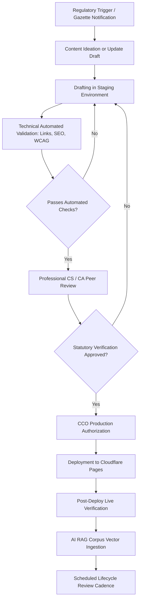

# CraftEgon CCS — Content Maintenance & Regulatory Governance Workflow

## 1. Executive Summary & Purpose

CraftEgon Corporate Compliance Services (CraftEgon CCS / `ccs.craftegon.com`, under CraftEgon LLP) operates in a hyper-dynamic Indian statutory and regulatory environment spanning corporate affairs (MCA), taxation (CBDT/CBIC), securities and financial regulations (SEBI/RBI), intellectual property (CGPDTM), labor welfare (EPFO/ESIC), and data privacy (DPDP Act 2023).

Because corporate compliance decisions involve financial penalties, director disqualifications, prosecution risks, and legal standing, **content published on CraftEgon CCS must maintain 100% regulatory fidelity, traceability, and temporal validity**. This document establishes the strict lifecycle, verification protocols, gazette tracking systems, superseded content handling, and emergency errata workflows governing all 113 public routes, calculators, blueprints, and AI retrieval corpora.

---

## 2. Core Governance Principles

1. **Traceable Statutory Lineage**: No regulatory statement, due date, filing threshold, or penalty slab may exist on any public page or AI corpus without an explicit statutory citation (Act, Section, Rule, Regulation, Circular, Notification, or Master Direction).
2. **Temporal Integrity**: Regulatory obligations are time-bound. Content must distinguish historical rules, current statutory regimes, and prospective amendments with `effective_from` and `effective_to` dates.
3. **Dual-Signoff Firewall**: Before any statutory guidance, calculator formula, or compliance calendar rule is promoted to production, it requires dual approval:
   - **Primary Drafter**: Legal Researcher / Content Associate.
   - **Regulatory Reviewer**: Practicing Company Secretary (ACS/FCS) or Chartered Accountant (ACA/FCA) affiliated with CraftEgon LLP.
4. **Litigation Firewall & Advocates Act 1961**: All dispute-related content, NCLT guidance, and appellate procedures must explicitly state that advisory, briefing, and drafting support are provided by CraftEgon CCS, while courtroom representation is handled exclusively by independent empanelled advocates under the Advocates Act 1961 and Bar Council of India guidelines.
5. **Zero Speculation / Quarantined AI Knowledge**: Unverified draft notifications, media speculation, or unapproved gazette bills must never be ingested into the production RAG index for customer-facing AI agents.

---

## 3. Roles and Governance Hierarchy

| Role | Responsibility | Designation / Qualification | Artifact Authority |
| :--- | :--- | :--- | :--- |
| **Content Author** | Drafts service pages, knowledge guides, FAQs, and metadata. | Compliance Analyst / Legal Associate | Working draft branches (`docs/drafts/*`) |
| **Technical Auditor** | Validates HTML validity, link meshes, JSON-LD schemas, and WCAG accessibility. | Senior Frontend / Full-Stack Engineer | CI/CD test runners, script validations |
| **Domain Reviewer (CS/CA)** | Verifies statutory accuracy, fee slabs, penalty equations, and circular validity. | Practicing CS / CA / LLB (CraftEgon LLP) | Staging sign-off, regulatory metadata approval |
| **Chief Compliance Officer (CCO)** | Final publication authorization for high-risk domains (FEMA, NCLT, DPDP, Corporate Restructuring). | Partner / Designated Partner (CraftEgon LLP) | Production merge & release sign-off |
| **AI Knowledge Custodian** | Curates vector chunks, inspects hallucination metrics, validates grounding citations. | AI Solutions Architect / Knowledge Engineer | RAG embedding registry & prompt configurations |

---

## 4. Standard Content Lifecycle Workflow



### Step-by-Step Execution:
1. **Trigger Phase**: Updates are triggered by either:
   - Scheduled periodic review cadence (see Section 5).
   - Real-time regulatory events (e.g., MCA General Circulars, CBDT Notifications, Central Gazette publications).
2. **Drafting Phase**: All changes occur on an isolated feature branch (`content/v{vertical}-{service}-update`). Authors apply standard 10-section page architecture per [`content-requirements.md`](file:///c:/Users/shibi/OneDrive/Desktop/craftegon-ccs/docs/product-blueprint/content-requirements.md).
3. **Automated Technical CI Verification**: The branch must execute the repository QA test suite without warnings:
   - `node scripts/verify-links.js` (0 broken links).
   - `node scripts/check-orphans.js` (0 orphan pages).
   - `node scripts/audit-seo.js` (111/111 pages validated with compliant title, meta description, H1, and JSON-LD schema).
   - `node scripts/test-chat-engine.js` (Chat intent and phone/email anchor integrity).
4. **Professional Regulatory Audit**: Practicing professionals verify:
   - Exact Act, Section, and Rule numbers.
   - Government fee brackets (MCA Form AOC-4/MGT-7 slabs, IP India trademark filing fees).
   - Section 403 penalty escalation formulas (₹100/day continuous compounding).
   - Timelines and statutory forms.
5. **Production Release**: Pull request merged to `main`, auto-building via GitHub Actions to Cloudflare Pages.
6. **Vector Re-Indexing**: New content chunks are normalized, hash-stamped, and deployed to the Gemini/Vector DB grounding index with updated revision metadata.

---

## 5. Review Cadence Matrix by Domain

| Category | Typical Regulatory Domains | Maximum Review Cadence | Trigger Events Requiring Out-of-Cycle Review |
| :--- | :--- | :--- | :--- |
| **Tier 1: High Volatility (Tax & Statutory Deadlines)** | GST (V04), Income Tax (V05), RoC Annual Compliance (V02) | **Monthly** (1st week of calendar month) | Union Budget (Finance Act), GST Council Meetings, MCA late-fee waivers / extension circulars |
| **Tier 2: Medium Volatility (Regulatory & Capital)** | RBI & FEMA (V07), SEBI Compliance (V08), Labour Welfare (V06) | **Quarterly** (15 days post quarter-end) | RBI Monetary Policy / Master Direction updates, Labour Code transition notifications, SEBI LODR amendments |
| **Tier 3: Standard Commercial Compliance** | Entity Formation (V01), Trademark & IPR (V03), Licenses (V11) | **Bi-Annually** (April & October) | SPICe+ form modifications, Trademark Rules amendments, BIS/CDSCO portal re-architectures |
| **Tier 4: Structural & Dispute Advisory** | Contracts & Drafting (V09), NCLT Resolution (V10), Real Estate (V12) | **Annual** (May of each year) | Supreme Court & NCLAT landmark precedents, IBC ordinance/amendments, RERA state rule notifications |
| **Tier 5: Emerging & Technology Governance** | DPDP Act (V13), ESG Governance (V14), Virtual CFO (V15) | **Continuous / Monthly** | DPDP Central Rules notifications, Data Protection Board appointments, SEBI BRSR Core mandate rollouts |

---

## 6. Official Gazette & Regulatory Monitoring System

To prevent obsolete data from remaining active on the website or within the AI compliance engine, CraftEgon CCS maintains an active source monitoring tracker:

### 6.1 Daily Automated & Manual Ingestion Channels
1. **The Gazette of India (`egazette.gov.in`)**:
   - Monitored daily by the compliance team for Extraordinary Gazettes (Part II, Section 3, Sub-section (i) and (ii)) issued by MCA, Ministry of Finance, and Ministry of Labour.
2. **Ministry of Corporate Affairs Portal (`mca.gov.in`)**:
   - Daily scraping/inspection of the "Notifications", "General Circulars", and "Companies Act Amendments" RSS and listing pages.
3. **Goods & Services Tax Network (`gst.gov.in` & `cbic.gov.in`)**:
   - Weekly monitoring of CBIC Central Tax notifications, circulars, and GST Council press releases.
4. **Reserve Bank of India (`rbi.org.in`)**:
   - Bi-weekly check of RBI Notifications, Master Directions, and A.P. (DIR Series) circulars.
5. **Controller General of Patents, Designs and Trade Marks (`ipindia.gov.in`)**:
   - Monthly check for Public Notices, fee updates, and IPAB/High Court IP Division transition rules.

### 6.2 Monitoring Log Schema
Every detected change is recorded in `docs/compliance-records/regulatory-change-log.csv`:
```csv
change_id,source_agency,official_doc_reference,date_of_notification,summary_of_amendment,affected_verticals,affected_routes,impact_severity,status,assigned_reviewer,action_deadline
MCA-2026-042,MCA,Gen Circular 04/2026,2026-10-12,"Extension of AGM timeline for FY 2025-26 in specific states",V02,"/services/roc-annual-filing.html,/conversion/roc-due-date.html",High,In-Review,CS_Poompatta,2026-10-16
```

---

## 7. Handling Superseded & Deprecated Regulatory Information

When a statutory provision, circular, or government rule is amended or repealed, CraftEgon CCS adheres to a strict "Never Silently Overwrite" policy:

### 7.1 Historical Audit Integrity
1. **Effective Dates Maintained**: Every regulatory knowledge item in [`data-model-and-api-architecture.md`](file:///c:/Users/shibi/OneDrive/Desktop/craftegon-ccs/docs/product-blueprint/data-model-and-api-architecture.md) retains its `effective_from` date. When repealed, the `effective_to` timestamp is set to the gazette date.
2. **Superseded Notices**: Public pages that document multi-year compliance histories (such as RoC annual filing timelines or tax slabs) retain prior-year tables clearly designated as `[ARCHIVED — APPLICABLE TO FY 2024-25 AND PRIOR]`.
3. **AI Index Purging**: 
   - Historical rules are tagged in vector metadata with `{ "validity_status": "SUPERSEDED", "effective_to": "YYYY-MM-DD" }`.
   - The primary RAG retriever filters by default to `{ "validity_status": "CURRENT" }` unless the user explicitly asks an audit question about a past financial year (e.g., *"What was the late fee for MCA filing in FY 2022-23?"*).

---

## 8. Urgent Correction & Errata Procedure (P0 Hotfix Protocol)

If a factual error, obsolete due date, or incorrect statutory penalty is discovered on a live public page or calculator, the team follows the P0 Errata Protocol:

```
[Defect Detected] (Customer ticket / Internal audit / Gazette update)
       │
       ▼
[Triage < 30 Minutes] (Domain Reviewer confirms factual discrepancy)
       │
       ▼
[Quarantine / Live Banner] (If severe, enable warning banner on route)
       │
       ▼
[Hotfix Execution < 2 Hours] (Edit HTML, meta-tags, schema, and formulas)
       │
       ▼
[Automated Test Suite Pass] (node scripts/verify-links.js && audit-seo.js)
       │
       ▼
[CCO Sign-off & Production Push] (Git commit: "fix(errata): correct [Form Name] late fee")
       │
       ▼
[Publish Errata Note] (Logged on docs/compliance-records/errata-log.md)
       │
       ▼
[Purge CDN & AI Embeddings] (Clear Cloudflare cache + rebuild vector chunk)
```

### SLA Targets:
- **P0 Regulatory Blocker** (Incorrect due date, invalid statutory penalty, inaccurate government account info): **< 2 hours to production**.
- **P1 High Priority** (Typographical error in Act section, broken reference link, out-of-date form number): **< 12 hours**.
- **P2 Minor Improvement** (Styling enhancement, clarity improvement, supplementary FAQ): **Next weekly release**.

---

## 9. Content Audit Trails and Version Control

- **Git-Based Single Source of Truth**: All website files, partials, documentation, and data configurations reside in GitHub (`shibilipoompatta/craftegon-ccs`).
- **Semantic Commit Conventions**: Every content change must follow explicit commit messaging:
  - `docs(vertical)`: Regulatory narrative updates.
  - `fix(statutory)`: Penalty or due date corrections.
  - `feat(tool)`: Calculator rule additions.
  - `chore(seo)`: Metadata, OpenGraph, or schema adjustments.
- **On-Page Audit Badges**: High-compliance service pages and calculation tools must render the metadata block:
  ```html
  <div class="compliance-audit-badge">
    <span>Statutory Authority: <strong>Companies Act, 2013</strong></span>
    <span>Last Verified: <strong>October 2026</strong></span>
    <span>Review Owner: <strong>CraftEgon Regulatory Advisory Panel</strong></span>
  </div>
  ```

---

## 10. Publication & Rollback Process

### 10.1 Safe Deployment
Deployments are continuously deployed via GitHub Actions to Cloudflare Pages. Cloudflare Pages preserves immutable deployment IDs for every single commit.

### 10.2 Instant Rollback
In the event of an undetected regression or flawed statutory update:
1. Navigate to the Cloudflare Pages deployment dashboard for `craftegon-ccs`.
2. Locate the previous verified green deployment ID.
3. Click **"Rollback to this deployment"** (Effective propagation time: `< 30 seconds` worldwide).
4. Simultaneously issue `git revert <commit-hash>` on the `main` branch to reconcile the repository state.
5. Notify the Chief Compliance Officer and file a post-mortem incident report.

---

## 11. Authoritative Sign-Off Matrix

| Document Category | Lead Drafter | Mandatory Reviewer | Approving Authority | Review Frequency |
| :--- | :--- | :--- | :--- | :--- |
| **Master Blueprint Docs** | Full-Stack Architect | Legal Lead | Designated Partner | Bi-Annual |
| **Service Pages (57)** | Content Specialist | Practicing CS / CA | Regulatory Lead | Quarterly |
| **Conversion Tools (19)** | Frontend Engineer | Financial / Tax Analyst | Head of Engineering | Bi-Annual |
| **AI Prompt & RAG Base** | AI Knowledge Engineer | Domain Specialist | CCO | Monthly |
| **Legal & Privacy Policies**| Legal Counsel | Data Protection Officer | Managing Partner | Annual |
