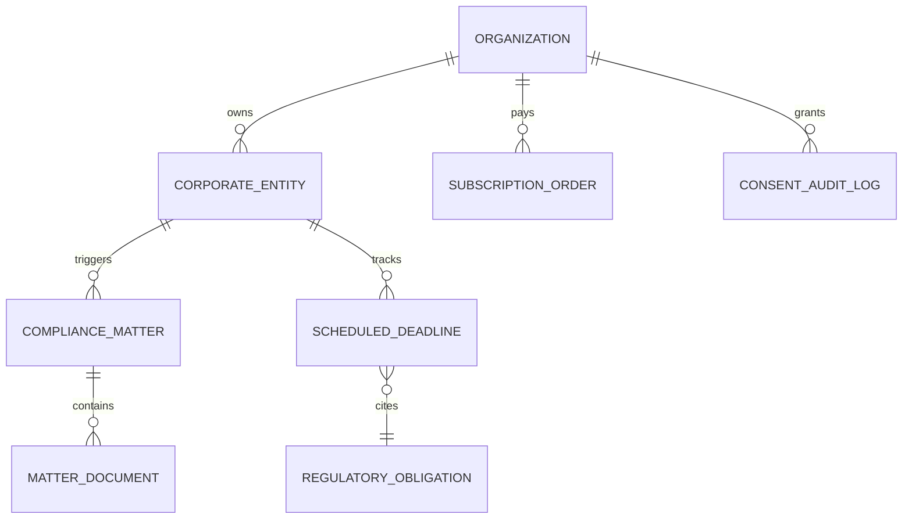

# CraftEgon CCS — Data Model & Backend API Architecture

**Document ID**: `CRAFTEGON-ARCH-001`  
**Classification**: Technical Architecture & Schema Specification  
**Version**: 1.0  
**Operating Entity**: CraftEgon Corporate Compliance Services, under **CraftEgon LLP**  

---

## 1. System Architecture Tiering

CraftEgon CCS follows a **Decoupled Edge-First Architecture**:

```
┌────────────────────────────────────────────────────────────────────────┐
│ TIER 1: STATIC EDGE PRESENTATION (Cloudflare Pages CDN)                │
├────────────────────────────────────────────────────────────────────────┤
│ • 113 Static HTML5 pages, Vanilla CSS3 tokens, ES6+ JS modules        │
│ • Sub-second TTFB, 100% edge caching, zero cold starts                 │
│ • Client-side fee calculator, intake forms, and chat widget            │
└──────────────────────────────────┬─────────────────────────────────────┘
                                   │
                                   ▼ [HTTPS / JSON REST API]
┌────────────────────────────────────────────────────────────────────────┐
│ TIER 2: SERVERLESS API ORCHESTRATION (Cloudflare Workers / Node.js)    │
├────────────────────────────────────────────────────────────────────────┤
│ • Edge API Gateway with JWT / OTP authentication                       │
│ • Statutory deadline calculation microservices                         │
│ • Razorpay subscription mandate & GST invoicing webhooks               │
│ • RAG semantic search & LLM inference proxy with PII masking           │
└──────────────────────────────────┬─────────────────────────────────────┘
                                   │
                                   ▼ [Encrypted Connection / TLS 1.3]
┌────────────────────────────────────────────────────────────────────────┐
│ TIER 3: PERSISTENT COMPLIANCE DATA LAYER (PostgreSQL + RLS)            │
├────────────────────────────────────────────────────────────────────────┤
│ • Normalized Regulatory Obligation Database (Versioned)                │
│ • Client Entity, Matter Tracking & Document Metadata Tables            │
│ • Immutable DPDP Act 2023 Consent & Audit Log Vault                    │
└────────────────────────────────────────────────────────────────────────┘
```

---

## 2. Normalized Regulatory Obligation Data Model (Rule 4)

Every compliance duty is modeled as an immutable, versioned record:

```sql
CREATE TABLE regulatory_obligations (
    obligation_id           VARCHAR(64) PRIMARY KEY,     -- e.g. "MCA-AOC4-ANNUAL"
    version                 INTEGER NOT NULL DEFAULT 1,  -- Incremented on statutory revision
    name                    VARCHAR(255) NOT NULL,       -- "Form AOC-4 Financial Statements Filing"
    description             TEXT NOT NULL,
    jurisdiction            VARCHAR(32) NOT NULL,        -- "IN-CENTRAL", "IN-MH", "IN-KA", etc.
    governing_act           VARCHAR(255) NOT NULL,       -- "Companies Act, 2013"
    governing_section       VARCHAR(128) NOT NULL,       -- "Section 137(1)"
    governing_rule          VARCHAR(255) NOT NULL,       -- "Rule 12, Companies (Accounts) Rules, 2014"
    official_source_url     TEXT NOT NULL,               -- "https://www.mca.gov.in/..."
    
    -- Applicability Conditions (JSON Schema)
    applicable_entity_types TEXT[] NOT NULL,             -- ARRAY['PVT_LTD', 'PUBLIC_UNLISTED', 'OPC']
    applicability_criteria  JSONB NOT NULL,              -- e.g. {"requires_audit": true, "has_share_capital": true}
    
    -- Calculation Logic
    trigger_event           VARCHAR(64) NOT NULL,        -- "AGM_DATE", "FINANCIAL_YEAR_END", "INCORPORATION_DATE"
    offset_days             INTEGER NOT NULL,            -- e.g. 30
    calculation_rule        VARCHAR(64) NOT NULL,        -- "EVENT_DATE_PLUS_OFFSET"
    
    -- Penalty Formulas
    statutory_fee_base      NUMERIC(10, 2) NOT NULL,     -- Normal filing fee based on capital
    daily_late_penalty      NUMERIC(10, 2) NOT NULL,     -- 100.00 (Sec 403)
    max_late_penalty        NUMERIC(10, 2),              -- NULL = Uncapped
    
    -- Validity & Governance
    effective_from          DATE NOT NULL,               -- "2014-04-01"
    effective_to            DATE,                        -- NULL if currently active
    verification_status     VARCHAR(32) NOT NULL,        -- "VERIFIED_ACTIVE", "SUPERSEDED", "UNDER_REVIEW"
    last_verified_at        TIMESTAMP WITH TIME ZONE NOT NULL,
    review_owner            VARCHAR(128) NOT NULL,       -- "Practicing CS Lead"
    
    -- Platform Interconnections
    service_route           VARCHAR(255) NOT NULL,       -- "/services/aoc4-xbrl.html"
    calculator_route        VARCHAR(255),                -- "/conversion/calculator.html"
    knowledge_route         VARCHAR(255)                 -- "/knowledge/mca-v3-filing-guide.html"
);
```

---

## 3. Core Database Entities & Relationships



### Table Definitions
1. `ORGANIZATION`: Client enterprise account, primary billing contact, WhatsApp/Email preferences.
2. `CORPORATE_ENTITY`: Tracked legal entities (CIN, LLPIN, Name, Incorporation Date, RoC State, Capital Slabs).
3. `REGULATORY_OBLIGATION`: Normalized statutory rules (schema above).
4. `SCHEDULED_DEADLINE`: Instantiated due dates for a specific entity & financial year with countdown status (`PENDING`, `COMPLETED`, `OVERDUE`).
5. `COMPLIANCE_MATTER`: Professional service workflow stage (e.g. `Intake`, `Drafting`, `DSC_Signing`, `RoC_Filed`, `Challan_Approved`).
6. `CONSENT_AUDIT_LOG`: Immutable DPDP Act consent timestamps, channel selections, and IP records.

---

## 4. REST & Serverless API Endpoints

| Method | Endpoint Route | Request Payload | Response Schema | Purpose |
| :--- | :--- | :--- | :--- | :--- |
| `GET` | `/api/v1/obligations/lookup` | `?cin=...&fy=2025-26` | List of applicable deadlines with statutory citations | Powers live countdown calendar |
| `POST` | `/api/v1/calculator/estimate` | `{"service_id": "...", "capital": 1000000}` | `{"prof_fee": 7499, "govt_fee": 3500, "breakdown": [...]}` | Verified fee computation |
| `POST` | `/api/v1/intake/submit` | Form fields, entity name, phone, email | `{"status": "staged", "intake_id": "...", "wa_url": "..."}` | Secure lead intake |
| `POST` | `/api/v1/drafter/synthesize` | `{"doc_type": "board_resolution", "parties": [...]}` | `{"status": "generated", "html_preview": "..."}` | Document synthesis |
| `POST` | `/api/v1/chat/message` | `{"query": "...", "session_id": "..."}` | `{"reply": "...", "sources": [...], "action_links": [...]}` | Grounded RAG Co-Pilot |
| `POST` | `/api/v1/billing/create-subscription` | `{"tier": "GROWTH", "billing_cycle": "ANNUAL"}` | `{"order_id": "...", "razorpay_key": "..."}` | Retainer checkout |
