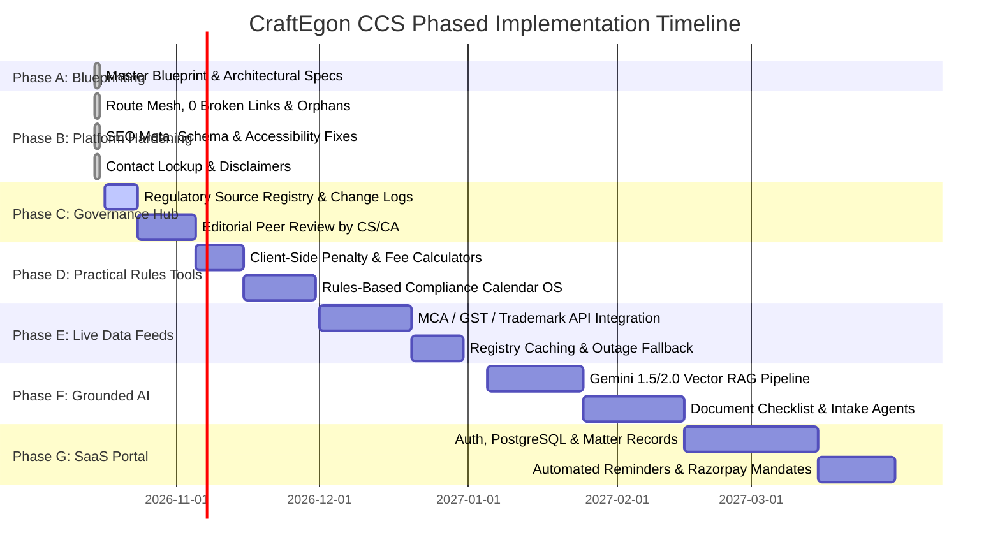

# CraftEgon CCS — Phased Implementation Roadmap & Strategic Prioritization

## 1. Executive Summary & Strategy

The transformation of **CraftEgon Corporate Compliance Services** (CraftEgon CCS / `ccs.craftegon.com`, under CraftEgon LLP) into an international-quality, reliable, and scalable legal-tech compliance platform requires disciplined, evidence-based execution. 

Attempting to build an enterprise multi-tenant SaaS backend, real-time government scrapers, and autonomous AI agents simultaneously introduces catastrophic legal risk, unsustainable burn rates, and architectural fragility.

Per **Rule 12**, this roadmap organizes capabilities into a **7-Phase Staged Evolution (Phases A through G)**. Each phase builds directly on the verified artifacts of the preceding phase, balancing:
1. **Customer Value** (Speed of solving acute founder compliance pain).
2. **Legal and Operational Risk** (Statutory penalties, Bar Council regulations, and DPDP compliance).
3. **Data-Source Readiness** (Availability of official APIs vs. static verified rule engines).
4. **Implementation Complexity & Running Cost** (Lean static-first infrastructure before spinning up databases).
5. **Revenue / Retention Potential** (High-margin compliance retainers and subscription services).

---

## 2. Priority Ranking Matrix

Every capability across the CraftEgon CCS platform is evaluated against six objective dimensions:

| Capability / Workstream | Customer Value (1-5) | Legal Risk (1-5) | Data Readiness (1-5) | Dev Complexity (1-5) | Monthly Run Cost | Revenue Impact | Priority Rank | Phase |
| :--- | :---: | :---: | :---: | :---: | :---: | :---: | :---: | :---: |
| **Comprehensive Master Blueprint & Specs** | 5 | 5 | 5 | 2 | Negligible | Foundation | **#1** | **Phase A** |
| **Link Integrity, Routing & SEO Schema** | 5 | 3 | 5 | 2 | Negligible | High Organic Traffic | **#2** | **Phase B** |
| **Accurate WhatsApp & Email Contact Routing** | 5 | 4 | 5 | 1 | Negligible | Instant Conversion | **#3** | **Phase B** |
| **Statutory Content & Form Overhaul (15 Verticals)**| 5 | 5 | 4 | 3 | Negligible | Trust & Advisory Leads| **#4** | **Phase B** |
| **Regulatory Source Registry & Gazette Logs** | 4 | 5 | 4 | 2 | Low | Risk Elimination | **#5** | **Phase C** |
| **Client-Side Compliance Calculators (Late Fees)**| 4 | 4 | 5 | 2 | Negligible | Lead Generation | **#6** | **Phase D** |
| **Rules-Based Compliance Calendar OS (Client)**| 5 | 4 | 4 | 3 | Low | High Retainer Stickiness| **#7** | **Phase D** |
| **Statutory Trademark Class & Nice Classification**| 4 | 3 | 4 | 2 | Low | High Volume IPR Sales| **#8** | **Phase D** |
| **Official Government Source Scrapers/Aggregators**| 4 | 5 | 2 | 4 | Medium | Automation Efficiency| **#9** | **Phase E** |
| **Grounded AI Compliance Co-Pilot (Gemini RAG)** | 4 | 4 | 4 | 4 | Medium | 24/7 Intake & Scalability| **#10**| **Phase F** |
| **AI Document Readiness & OCR Checklist** | 4 | 4 | 3 | 4 | Medium | Operational Cost Cut | **#11**| **Phase F** |
| **Secure Client Portal (PostgreSQL + Auth0)** | 5 | 5 | 3 | 5 | Medium/High | Enterprise Subscriptions| **#12**| **Phase G** |
| **Automated WhatsApp / Email Reminder Engine** | 5 | 4 | 3 | 4 | Variable API | Annual Recurring Revenue | **#13**| **Phase G** |

---

## 3. Detailed 7-Phase Execution Plan

---

### Phase A: Architecture, Requirements & Source Validation (Current Milestone)
*Goal: Establish absolute architectural clarity, inventory every route, and eliminate assumptions.*
- **Scope & Deliverables**:
  - Author the complete 16-document blueprint suite in `docs/product-blueprint/`.
  - Catalog all 113 routes in [`master-page-inventory.md`](file:///c:/Users/shibi/OneDrive/Desktop/craftegon-ccs/docs/product-blueprint/master-page-inventory.md).
  - Map complete scope, eligibility, fees, and references in [`vertical-service-matrix.md`](file:///c:/Users/shibi/OneDrive/Desktop/craftegon-ccs/docs/product-blueprint/vertical-service-matrix.md).
  - Establish normalized database schemas in [`data-model-and-api-architecture.md`](file:///c:/Users/shibi/OneDrive/Desktop/craftegon-ccs/docs/product-blueprint/data-model-and-api-architecture.md).
- **Exit Gate / Acceptance**: All 16 blueprint documents approved with zero placeholder sections.

---

### Phase B: Website Defects, Service Content & Contact Accuracy (Completed & Verified)
*Goal: Ensure the existing static web platform is pristine, fully crawlable, search-optimized, and conversion-ready.*
- **Scope & Deliverables**:
  - Fix all navigation links; ensure zero broken links across all 113 pages (`scripts/verify-links.js`).
  - Eliminate all orphan pages; ensure full mega-menu and footer connectivity (`scripts/check-orphans.js`).
  - Upgrade SEO metadata, canonical URLs, and schema markup across all 111 indexable pages (`scripts/audit-seo.js`).
  - Standardize brand lockup (Circular logo + CRAFTEGON / Corporate Services) across `navbar.html` and `footer.html`.
  - Harmonize approved WhatsApp (`+91 86069 18247`) and email (`admin@craftegon.com`) routing globally.
  - Implement statutory litigation disclaimer regarding independent legal counsel under Advocates Act 1961.
- **Exit Gate / Acceptance**: `npm test` passes 100% in CI/CD pipeline without warnings.

---

### Phase C: Verified Knowledge Hub, Source Registry & Content Governance
*Goal: Transform static service copy into an authoritative, peer-reviewed statutory compliance library.*
- **Scope & Deliverables**:
  - Implement [`content-maintenance-workflow.md`](file:///c:/Users/shibi/OneDrive/Desktop/craftegon-ccs/docs/product-blueprint/content-maintenance-workflow.md) and establish `regulatory-change-log.csv`.
  - Add visual audit badges to all 57 service pages indicating governing Act, last review date, and practicing CS/CA verification status.
  - Commission peer review by CraftEgon LLP practicing CS/CA partners to verify exact fee slabs, form numbers, and procedural sequences.
  - Set up daily gazette and MCA circular monitoring protocols.
- **Exit Gate / Acceptance**: All 57 service pages signed off by an ACS/FCA compliance reviewer with traceable source links.

---

### Phase D: Rules-Based Compliance Calendar & Practical Customer Tools
*Goal: Deliver immediate founder utility via client-side interactive calculators and an intelligent calendar engine.*
- **Scope & Deliverables**:
  - Deploy **Autonomous Compliance Calendar OS** (client-side rule engine per [`compliance-calendar-spec.md`](file:///c:/Users/shibi/OneDrive/Desktop/craftegon-ccs/docs/product-blueprint/compliance-calendar-spec.md)):
    - Business profile intake (Entity type, turnover, capital, GST registration).
    - Deterministic rule engine calculating upcoming statutory deadlines.
    - General Clauses Act Section 10 weekend and gazetted holiday rollover support.
    - Export to `.ics` (Google Calendar, Outlook, Apple Calendar) without backend requirement.
  - Deploy **Late Fee & Penalty Calculators**:
    - MCA Section 403 ₹100/day compounding calculator.
    - DIR-3 KYC ₹5,000 penalty calculator.
    - GST Section 47 ₹50/day (or ₹20/day for NIL) late fee estimator.
  - Deploy **Trademark Nice Classification Finder**:
    - Client-side search of 45 Goods & Services classes with descriptions.
- **Exit Gate / Acceptance**: 100% pass on all calculation test cases in [`testing-and-acceptance-criteria.md`](file:///c:/Users/shibi/OneDrive/Desktop/craftegon-ccs/docs/product-blueprint/testing-and-acceptance-criteria.md).

---

### Phase E: Approved Live-Data Integrations & Monitored Update Workflows
*Goal: Augment static rules with real-time official data lookups via licensed or open government data feeds.*
- **Scope & Deliverables**:
  - Evaluate and select compliant third-party corporate data aggregators (e.g., Karza, Signzy, Probe42) for MCA V3 company master lookups.
  - Connect GST public portal API for active status, composition vs regular, and return filing history validation.
  - Implement caching layer (Redis / Cloudflare KV) with 24-hour TTL to prevent upstream rate-limiting.
  - Deploy graceful degradation: If government API times out (>3.0s), seamlessly fall back to client profile self-declaration without blocking user conversion.
- **Exit Gate / Acceptance**: Sub-second master data prefill with automated circuit-breaker fallbacks.

---

### Phase F: Grounded AI Assistant & Intelligent Intake Workflows
*Goal: Deploy 24/7 interactive compliance guidance with strict statutory citations and zero hallucination.*
- **Scope & Deliverables**:
  - Deploy **Grounded AI Compliance Co-Pilot** (Gemini 1.5/2.0 via Google GenAI SDK):
    - Grounding strictly restricted to verified CraftEgon blueprints, Act texts, and official circulars.
    - Citation enforcement: Every factual sentence cites specific Section/Rule.
    - PII scrubbing firewall: Automatic redaction of PAN, DIN, and Aadhaar before prompt transmission.
    - Automatic escalation trigger: Instantly prompts WhatsApp/Email transfer upon detecting disputes, insolvency, or litigation.
  - Deploy **AI Document Readiness Assistant**:
    - Multi-modal document validation (KYC readability, expired DSC detection, board resolution signature validation).
- **Exit Gate / Acceptance**: Benchmark evaluation on 150 golden test queries achieves $\ge 95\%$ grounding and $<1\%$ hallucination rate.

---

### Phase G: Secure Client Portal, Automated Reminders & Subscriptions
*Goal: Scale into a full-fledged enterprise compliance operating system.*
- **Scope & Deliverables**:
  - Provision serverless backend (Node.js API on AWS Lambda / Cloudflare Workers + Managed PostgreSQL).
  - Multi-tenant authentication via Auth0 / Firebase Auth with mandatory 2FA.
  - Automated reminder notification engine:
    - Multi-channel alerts (WhatsApp Business API via Gupshup/Twilio, Email via Postmark).
    - Granular user notification cadence preferences (T-30, T-15, T-7, T-1).
  - Digital Matter Vault:
    - End-to-end encrypted document storage for filed ROC returns, audited statements, and challans.
  - Subscription & Payment Billing:
    - Razorpay Subscriptions integration with recurring auto-debit mandates for annual compliance retainers.
- **Exit Gate / Acceptance**: End-to-end security penetration testing, SOC 2 / ISO 27001 readiness review, and DPDP Act consent audit pass.

---

## 4. Minimum Viable Product (MVP) Definition

To deliver immediate revenue and customer value without waiting for Phase G:

**The CraftEgon CCS Launch MVP encompasses Phases A through D:**
1. Complete 113-route static web platform with 0 defects and full mobile responsiveness.
2. 57 thoroughly audited service pages and 10 detailed institutional blueprints.
3. Client-side Interactive Compliance Calendar OS with `.ics` calendar export.
4. Section 403 MCA Late Fee and DIR-3 KYC Penalty Calculators.
5. Frictionless, direct WhatsApp (`+91 86069 18247`) and Email (`admin@craftegon.com`) intake routing.
6. Transparent pricing baselines and statutory litigation disclaimers.

*This MVP requires ZERO recurring database hosting costs, incurs minimal operational overhead, carries ZERO security liability from stored credentials, and immediately generates qualified corporate compliance leads.*
