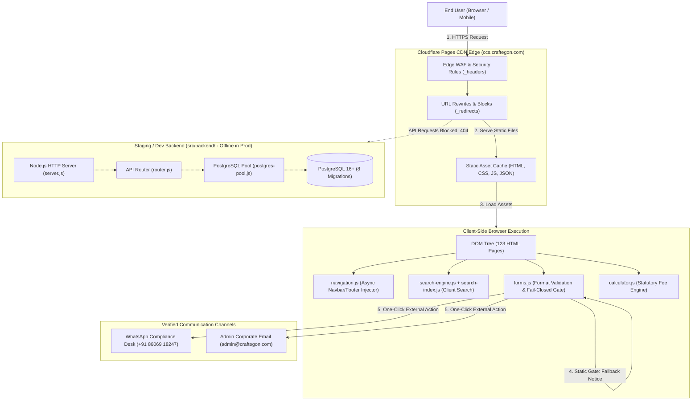
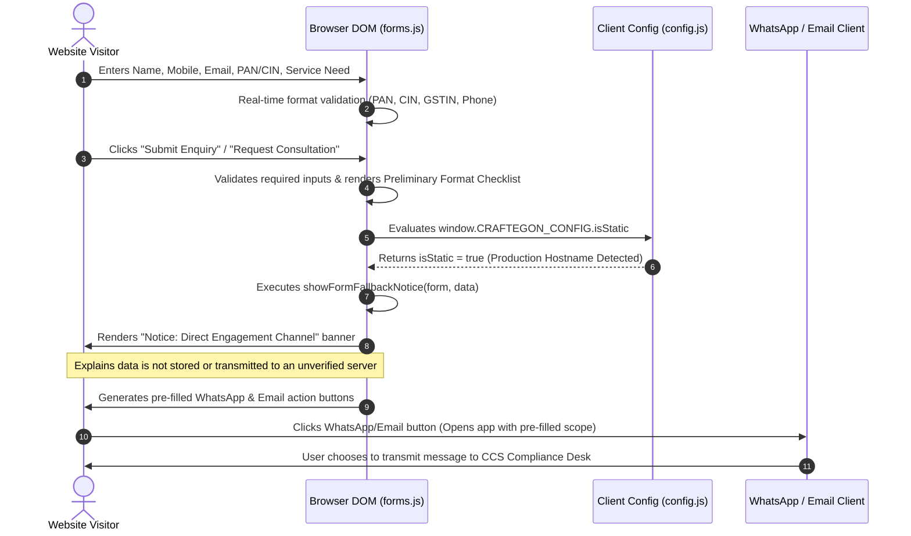
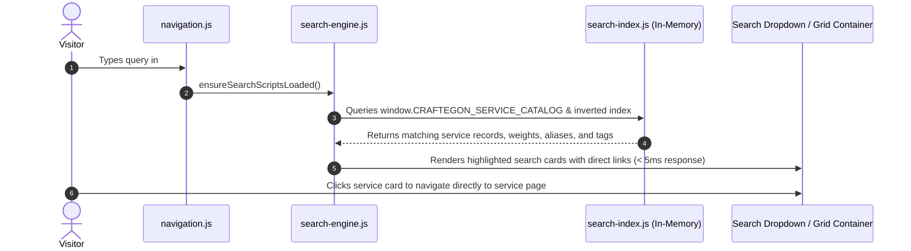

# CraftEgon Corporate Services (CCS)
# Architecture and Data Flow Description

**Document Reference:** `docs/technical-audit/03_ARCHITECTURE_AND_DATA_FLOW.md`  
**Audit Date:** November 2026  
**Auditor:** Senior Software Architect & Technical Auditor  
**Status:** Complete Architectural Description  

---

## 1. System Context & Deployment Architecture

CraftEgon Corporate Services operates under a bifurcated architecture:
1. **Production Deployment (Live):** A high-performance, globally distributed static web deployment hosted on **Cloudflare Pages** serving 123 static HTML5 assets, custom CSS tokens, and modular ES6 client-side JavaScript.
2. **Internal Backend Baseline (Local/Staging):** A complete, unhosted Node.js server application in `src/backend/` supporting PostgreSQL data storage, multi-tenant Row-Level Security, and automated test runners.

---

## 2. Production Lead & Enquiry Data Flow

Because Cloudflare Pages serves purely static files and `_redirects` blocks `/api/*`, all form submissions on the live production website follow this fail-closed lifecycle:

### Key Safety Invariant
At no point in the production form submission flow is sensitive corporate or personal data transmitted over unverified HTTP endpoints. The user retains complete agency: data only leaves their machine if they explicitly choose to send the pre-filled message via WhatsApp or their email client.

---

## 3. Client-Side Search Data Flow

The search bar in the global navbar and on `services.html` operates entirely inside the browser:

---

## 4. Statutory Calculator & Diagnostic Flow

Calculators (`conversion/calculator.html`, `conversion/strike-off-checker.html`, `conversion/ai-document-generator.html`) execute deterministic statutory rules locally:

1. **Input Collection:** User selects legal entity type, authorized capital tier, delay days beyond statutory filing due dates, and applicable amnesty flags (e.g. CCFS-2026).
2. **Formula Execution (`calculator.js`):**
   - Applies Companies Act, 2013 Section 403 standard late fee rules: ₹100/day per overdue form (AOC-4, MGT-7).
   - Applies Rule 12A flat ₹5,000 late fee for overdue DIR-3 KYC.
   - Calculates statutory MCA fee tiers and professional service retainers.
3. **DOM Update:** Real-time fee itemization rendered instantly without network latency.
4. **Export / Action:** Generates structured text checklists or pre-fills conversion intake desks.

---

## 5. Development / Staging Dynamic Data Flow (Internal Prototype)

When running in an internal staging or test harness environment with `CRAFTEGON_DYNAMIC_API=true`:

1. **Client Submission:** Browser sends `POST /api/v1/enquiries` with JSON payload.
2. **Security Headers & Middleware (`server.js`):** Enforces CSP, CORS origin validation, and body size limits (max 32KB).
3. **Input Sanitization & Bot Filter (`router.js`):** Validates honeypot field (`_hp_website`) and minimum render timing threshold (rejects submissions under 2,000ms).
4. **Repository Layer (`enquiry-repository.js`):**
   - In PostgreSQL mode: Executes parameterized SQL insert into `lead_enquiries` with tenant isolation and generated reference `LEAD-YYYY-XXXXXX`.
   - In In-Memory mode: Stores record in `memory-store.js` Map for headless test suites.
5. **Response:** Returns HTTP 201 with `success: true` and `lead_reference`.
6. **Notification:** Triggers `emailService.sendEnquiryNotification` to compliance team inbox.
