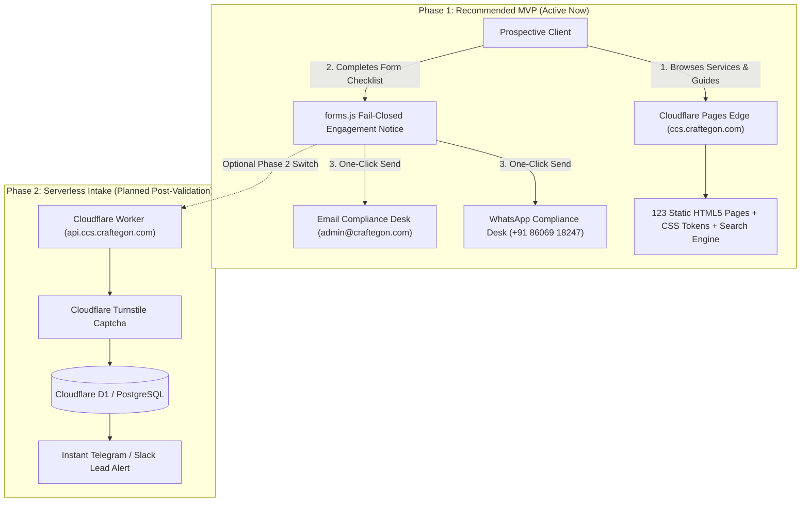

# CraftEgon Corporate Services (CCS)
# Recommended MVP Technical Architecture

**Document Reference:** `docs/technical-audit/13_RECOMMENDED_MVP_TECHNICAL_ARCHITECTURE.md`  
**Audit Date:** November 2026  
**Auditor:** Senior Software Architect & Technical Lead  
**Architecture Paradigm:** Static-First Edge Architecture with Phased Serverless Intake  
**Recurring Infrastructure Cost:** **₹0.00 / month**  

---

## 1. Architectural Philosophy: The Lean Corporate Services Model

For an emerging corporate services business operating under a strict **below ₹1,00,000 budget**, the highest technical priority is **reliability, speed, truthfulness, and zero operational drag**. 

Building or maintaining complex, stateful server backends, database clusters, and multi-tenant authentication systems before achieving product-market fit creates unnecessary financial burn and maintenance distraction.

The recommended MVP architecture preserves the high-velocity, zero-cost static edge platform on Cloudflare Pages, utilizing verified WhatsApp and Email communication channels for lead conversion, while maintaining a clear, non-disruptive migration path to serverless edge automation in Phase 2.

---

## 2. Layer-by-Layer Technical Specification

### 2.1 Edge Delivery & Hosting Layer
- **Platform:** Cloudflare Pages (Free Tier).
- **Domain:** `ccs.craftegon.com` (with apex redirect from `craftegon.com`).
- **CDN:** Cloudflare Anycast global edge network with automatic TLS 1.3 encryption.
- **Security Headers (`_headers`):** Enforce strict CSP, HSTS 31536000 with preload, X-Frame-Options: DENY.
- **Routing Rules (`_redirects`):** Directory mapping (`/services` $\rightarrow$ `/services/index.html`) and sensitive file blocks (`/.env*`, `/.git*`, `/scripts/*`, `/docs/*` $\rightarrow$ 404).

### 2.2 Presentation & Interface Layer
- **Core Technology:** Semantic HTML5, Vanilla CSS3 Custom Properties (`tokens.css`), ES6+ JavaScript.
- **Typography:** `Cinzel` (authoritative serif headings), `Manrope` (modern readable body copy), `DM Mono` (code/forms).
- **Accessibility:** 100% WCAG 2.1 AA compliance; `--text-dark-gold: #8C6D14` contrast 4.82:1 on white; single `<h1>` hierarchy; `.table-responsive` mobile wrappers.
- **Reusability Engine:** `assets/js/navigation.js` dynamically hydrates `components/navbar.html` and `components/footer.html` with inline offline fallbacks.

### 2.3 Client-Side Service Discovery & Calculator Engines
- **Search Engine:** `assets/js/search-engine.js` operating over `assets/js/search-index.js`. Instant client-side fuzzy search across all 57 services, statutory forms, and 15 verticals without backend latency.
- **Statutory Late Fee Engine:** `assets/js/calculator.js` executing Companies Act 2013 Section 403 fee rules, Rule 12A DIR-3 KYC penalties, and CCFS-2026 amnesty rules locally in the browser.
- **Document Resolution Generator:** `conversion/ai-document-generator.html` client-side template generator producing instant Markdown board resolutions and agreements.

### 2.4 Lead Capture & Conversion Architecture
- **In-Browser Format Validation:** Real-time regex testing of PAN, GSTIN, CIN, DIN, 10-digit mobile, and email.
- **Anti-Bot Defenses:** Off-screen honeypot field (`_hp_website`) and 2,000ms minimum render timing gate.
- **Fail-Closed Static Gate:** Transparently informs the user that online database transmission is inactive, presenting verified direct WhatsApp (`+91 86069 18247`) and Email (`admin@craftegon.com`) buttons pre-filled with the exact inquiry details.
- **Zero Data Loss:** Leads reach live, monitored human operators immediately.

### 2.5 Backend & Database Disposition for MVP
- **Production Status:** **No backend server or database is deployed or provisioned in production.**
- **Repository Retention:** The Node.js server (`src/backend/server.js`) and 8 PostgreSQL migrations (`src/backend/migrations/*.sql`) are preserved in the repository as internal engineering assets for Phase 2.
- **Migration Invariant:** Migration 009 remains strictly unapplied.
- **Cost Impact:** Avoids ₹2,000 – ₹5,000/month in cloud database fees during the MVP phase.

---

## 3. Phase 2 Serverless Intake Upgrade Path (Non-Disruptive)

When commercial enquiry volume justifies automated backend lead logging:
1. Deploy a single **Cloudflare Worker** at `api.ccs.craftegon.com` or route `/api/v1/enquiries` via Cloudflare Pages Functions.
2. In `assets/js/config.js`, update `isStatic: false` and point `apiEndpoint` to the Worker.
3. The Worker verifies Cloudflare Turnstile anti-bot tokens and writes leads to **Cloudflare D1** (Serverless SQLite/Postgres edge database, free tier up to 5M reads/day) or sends an instant webhook notification to a private Slack or Telegram channel.
4. This upgrade requires **zero changes to the HTML structure, CSS design system, or SEO canonical URLs**.
