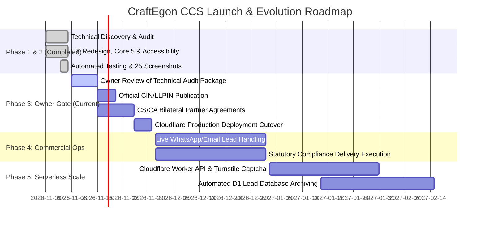

# CraftEgon Corporate Services (CCS)
# Implementation Roadmap

**Document Reference:** `docs/technical-audit/15_IMPLEMENTATION_ROADMAP.md`  
**Audit Date:** November 2026  
**Auditor:** Senior Software Architect & Technical Lead  
**Planning Horizon:** 90-Day MVP Launch & Phased Serverless Evolution  
**Status:** Audit Complete; Awaiting Owner Review Gate  

---

## 1. Multi-Phase Roadmap Overview

---

## 2. Phase Breakdown & Exit Criteria

### Phase 1 & 2: Technical Discovery, Remediation & Verification (COMPLETED)
- **Achievements:**
  - Audited full repository, configuration files, and 123 HTML files.
  - Refactored design tokens in `tokens.css` to WCAG 2.1 AA (`#8C6D14` dark gold).
  - Redesigned Homepage (`index.html`) with Problem-Solution Matrix and Core 5 Launch Shelf.
  - Restructured Universal Service Directory (`services.html`) with dynamic filtering.
  - Expanded 5 Core Launch Services to complete 13-section standardized templates.
  - Created institutional `about.html` disclosing Kozhikode physical desk and Advocates Act 1961 boundary.
  - Executed 75/75 automated test suites with 100% pass rate.
  - Captured 25 multi-viewport headless Chrome screenshots.
- **Exit Condition:** All technical audit deliverables submitted for owner review.

---

### Phase 3: Owner Review & Production Cutover Gate (CURRENT WINDOW: Days 1–15)
- **Action Items:**
  1. Business owner reviews and signs off on the technical audit and redesign packages.
  2. Populate official Corporate Identification Number (CIN / LLPIN) in `about.html` and `components/footer.html` upon receipt from RoC.
  3. Finalize bilateral engagement letters with practicing CS and CA partner firms in Kozhikode / Kochi for Tier-2 statutory attestations.
  4. Perform git commit on `main` and trigger Cloudflare Pages production deployment.
- **Exit Condition:** Public website live and accessible at `https://ccs.craftegon.com`.

---

### Phase 4: Commercial Lead Operations & Validation (Days 16–60)
- **Action Items:**
  1. Monitor incoming enquiries routed via WhatsApp (`+91 86069 18247`) and Email (`admin@craftegon.com`).
  2. Track response turnaround times (Mon–Sat 9AM–7PM IST).
  3. Validate founder conversion rates on the 5 Core Flagship Services (Pvt Ltd, LLP, MSME, DIR-3 KYC, Trademark).
  4. Collect client feedback on statutory late fee calculators and checklists.
- **Exit Condition:** First 20 paying corporate clients onboarded; commercial demand proven.

---

### Phase 5: Serverless Edge Intake & Automation (Days 61–90+)
- **Action Items (Funded from Early Cash Flow):**
  1. Implement a single Cloudflare Worker handling `POST /api/v1/enquiries`.
  2. Protect endpoints using Cloudflare Turnstile anti-bot verification (free tier).
  3. Persist leads into Cloudflare D1 edge database (zero server maintenance).
  4. Dispatch instant automated alerts to an internal Slack or Telegram compliance channel.
- **Exit Condition:** Seamless background form intake operational without ongoing server costs.
