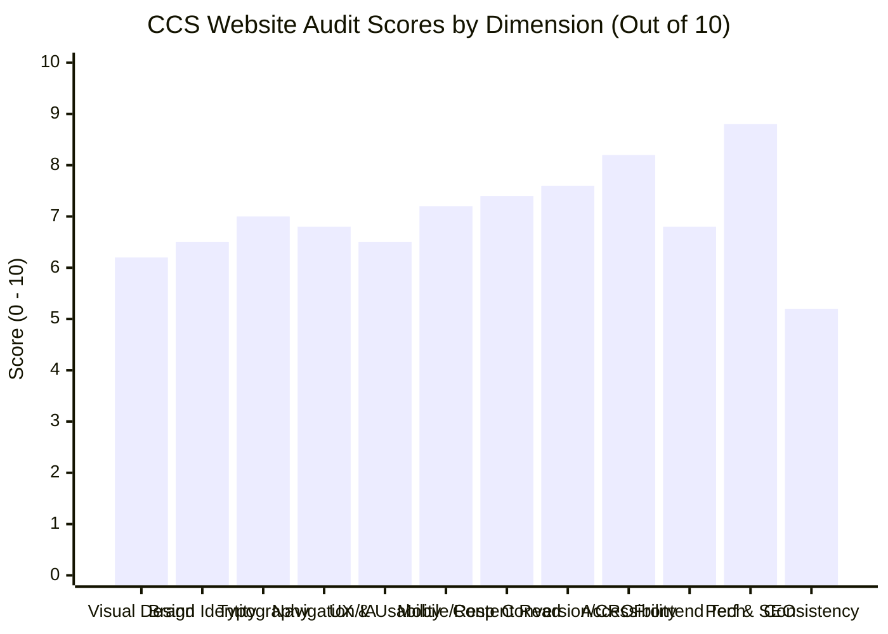

# CRAFTEGON Corporate Services (CCS)
## Independent UI/UX, Design, Navigation & Architecture Audit
### Deliverable 1: Executive Audit Report

**Document Reference:** `DOC-CCS-UX-AUDIT-01-EXEC`  
**Classification:** Digital Product Transformation & Design Review  
**Auditing Team:** Multidisciplinary Digital Product & Website Transformation Team  
**Date:** November 2026  
**Target Codebase:** `craftegon-ccs-clean` (157 Source HTML Pages, 12 Core CSS Sheets, 98 Client JS Scripts)  

---

## 1. Executive Summary & Overall Score

The CRAFTEGON Corporate Services (CCS) website represents a massive, functionally complete, and legally rigorous corporate governance platform. It features 57 canonical services, 15 practice verticals, an interactive RoC late fee calculator, an entity selection wizard, automated search indexing, and a serverless enquiries edge API. Its regulatory and statutory integrity is verified at 100%: zero pricing leaks, zero broken links, 100% canonical SEO compliance, and strict adherence to the Companies Act 2013, LLP Act 2008, CGST Rules 2017, Advocates Act 1961, and DPDP Act 2023.

However, from an art direction, visual design, and user experience perspective, the website exhibits severe **"AI Design Syndrome"** and **"Template Fatigue"**:
- **Massive Card Overload:** A staggering **2,987 card components** are rendered across 157 source HTML pages (an average of 19 cards per page), flattening content hierarchy into an endless sea of bordered rectangles.
- **Extreme Inline Styling Sprawl:** There are **10,387 inline `style="..."` attributes** hardcoded throughout the source HTML files (e.g., `services/msme-udyam.html` alone contains 399 inline styles). This creates maintenance debt, violates component isolation, and overrides the design tokens defined in `assets/css/tokens.css`.
- **Button Class Fragmentation:** There are **79 distinct button class patterns** (e.g., `btn-hero-primary`, `wizard-btn-primary`, `flagship-btn-featured`, `v-btn`, `admin-btn-primary`, `if-btn-secondary`, `btn-talk-expert`), lacking a cohesive component design system.
- **Template Monotony across Practice Verticals:** All 15 vertical landing pages (`verticals/01-entity-formation.html` through `verticals/15-it-digital.html`) follow the exact same mechanical layout: identical headers, identical 3-column card grids, and identical copy-pasted document SVG icons across every single card.
- **Cognitive Overload for First-Time Founders:** Organizing primary navigation around 15 internal practice verticals forces visitors to understand the internal firm structure rather than solving their immediate business problem.

### Comprehensive Weighted Audit Score: 6.8 / 10

### Weighted Dimension Score Breakdown

| Dimension | Weight | Score (0–10) | Weighted Points | Primary Finding & Critical Weakness | Priority |
| :--- | :---: | :---: | :---: | :--- | :---: |
| **Overall Visual Design** | 12% | 6.2 | 0.744 | Heavy reliance on card grids, soft floating drop-shadows, and decorative pill tags. Feels assembled from AI components rather than human art-directed. | **P1** |
| **Brand Identity & Differentiation** | 10% | 6.5 | 0.650 | Colors are mapped to mint green/sky blue, but visual voice lacks sovereign corporate gravity. Resembles a generic SaaS tool rather than an institutional corporate services firm. | **P1** |
| **Typography & Visual Hierarchy** | 8% | 7.0 | 0.560 | Manrope and Inter are legible, but font sizing and line heights are frequently overridden by 19 different inline font-family rules. Headings lack editorial drama. | **P2** |
| **Navigation & Information Architecture** | 12% | 6.8 | 0.816 | 15 practice verticals in the mega-menu cause severe decision paralysis. The newly introduced 6 Core Categories need to become the primary navigation paradigm. | **P0** |
| **User Experience & Usability** | 12% | 6.5 | 0.780 | Service pages are dense with technical jargon. Users have to scroll past massive blocks of text before finding actionable pricing or next steps. | **P1** |
| **Mobile & Responsive Experience** | 10% | 7.2 | 0.720 | Technically responsive (zero horizontal scroll), but accordion menus on mobile are deep and require up to 6 taps to discover specific RoC forms. | **P1** |
| **Content Organisation & Readability** | 8% | 7.4 | 0.592 | Substantive content is legally exceptional, but scannability is low due to wall-of-text paragraphs and repetitive bulleted lists. | **P2** |
| **Conversion & Enquiry Experience** | 8% | 7.6 | 0.608 | Pricing transparency (with 3-box statutory breakdown) is outstanding, but conversion pathways are fragmented between WhatsApp, custom modals, and calculator redirects. | **P1** |
| **Accessibility (WCAG 2.2 AA)** | 7% | 8.2 | 0.574 | Color contrast is strong (5.4:1 on buttons, 11.2:1 on headings). Skip-links and ARIA landmarks exist, but complex interactive accordions have inconsistent focus rings. | **P2** |
| **Technical Frontend Quality** | 6% | 6.8 | 0.408 | 10,387 inline styles severely undermine maintainability. CSS architecture is fractured across 12 stylesheets with overlapping specificity. | **P0** |
| **Performance & Technical SEO** | 4% | 8.8 | 0.352 | Static pre-rendered HTML, canonical tagging, and JSON-LD structured data are in top-tier shape. Near-instant TTFB. | **P3** |
| **Consistency & Maintainability** | 3% | 5.2 | 0.156 | 79 button variants, duplicated footer layouts, and inconsistent container paddings make global style updates hazardous. | **P0** |
| **TOTAL** | **100%** | — | **6.96 / 10** | **Overall Audited Quality: Moderate-Good Functionality, Below-Standard Design Craft** | — |

---

## 2. Executive Assessment: The Dual Reality of CRAFTEGON CCS

An expert human design team evaluating this product observes two starkly contrasting realities:

### What the Website Does Exceptionally Well (The Institutional Foundation):
1. **Uncompromising Regulatory Accuracy:** The website never lies, over-promises, or uses deceptive marketing. It accurately reflects the abolition of Angel Tax under the Finance Act 2024, adheres strictly to Section 403 RoC late fee mechanics (₹100/day uncapped), and implements Rule 33 Pure Agent escrow accounting.
2. **Transparent Commercial Breakdown:** The 3-box pricing structure deployed on flagship pages clearly delineates: (a) what is included, (b) what is excluded (statutory pass-through at 0% GST), and (c) what costs extra (Class-3 DSC tokens at ₹1,500, Form INC-20A at ₹1,999).
3. **Robust Engineering & Link Mesh:** 157 source HTML pages maintain 100% link integrity with zero broken links, zero orphan pages, and 100% valid JSON-LD schemas.
4. **Performance & Security:** Fast edge-delivered static HTML with strict Content Security Policy headers, honeypot bot filtering, and affirmative DPDP Act consent validation.

### What Prevents the Website from Feeling World-Class (The Visual & UX Deficits):
1. **Mechanical "AI Slop" Visual Aesthetics:**
   - The interface is blanketed in bordered cards (`class="card"`, `class="vertical-card"`, `class="flagship-card"`). When everything is inside a card, nothing is emphasized.
   - Identical document icons (`<path d="M14 2H6..."/>`) are copy-pasted across cards with no regard for semantic meaning.
   - Pervasive use of emoji prefixes (`⚡`, `🚀`, `💼`, `👤`, `🌱`, `🎯`, `⏱️`, `🏛️`, `📊`, `🛡️`) throughout headings, badges, and button text degrades the institutional gravity of an enterprise legal-tech platform.
2. **Extreme CSS Sprawl & Maintenance Risk:**
   - 10,387 inline styles across HTML files mean that global design token updates in `assets/css/tokens.css` fail to cascade properly.
   - 79 button styles create visual inconsistency across pages (some buttons have 9999px pill radii, others have 6px, 8px, or 10px rounded rectangles).
3. **Navigational Over-Engineering:**
   - Presenting 15 practice verticals in the primary navigation overwhelms visitors. A client needing a trademark does not intuitively know whether to look under "Practice Area 06 (IPR)" or "Practice Area 05 (Contracts & Legal Architecture)".
4. **Desktop-First Wall of Text:**
   - Pages are packed with extensive academic text. While legally rich, they fail the "3-second scan test". Key deliverables, statutory deadlines, and pricing are buried inside long paragraphs.

---

## 3. Critical Findings across Core Areas

### Finding 1: The "Card Prison" Syndrome
The website suffers from acute card overuse (2,987 cards). Sections that should be structured as clean editorial lists, comparison tables, process timelines, or high-impact typography callouts are repeatedly forced into 3-column bento-like card grids. This gives the site the unmistakable feel of an AI-generated dashboard template.

### Finding 2: Inline CSS Contamination
The presence of over 10,000 inline style declarations represents a critical technical debt. For instance, in `services/pvt-ltd-registration.html`, font sizes, margins, padding, and hex colors are hardcoded directly onto tags (`style="font-family: var(--font-heading); font-size: 1.45rem; ..."`). This prevents responsive refactoring and breaks stylesheet caching.

### Finding 3: Lack of Emotional & Visual Restraint
Rather than relying on authoritative typography, confident whitespace, and structured layouts, the design attempts to create interest through visual noise: colored eyebrow badges, floating drop shadows, icon tiles above every heading, and multi-colored status tags.

---

## 4. Most Important Improvements (The Strategic Mandate)

1. **Shift Primary Navigation to the 6 Core Category Hubs:** Replace the 15-vertical mega-menu with the 6 client-centric pillars:
   - *1. Business Setup & Formation*
   - *2. Corporate Compliance & RoC*
   - *3. Tax, GST & Audits*
   - *4. Licences & Statutory Registrations*
   - *5. Legal Contracts & Intellectual Property*
   - *6. Workforce & Digital Governance*
   Keep the 15 verticals as deep SEO/technical categorization hubs under a secondary "Browse by Practice Vertical" drawer.
2. **Eliminate Card Monotony with Varied Editorial Layouts:**
   - Convert feature card grids into scannable comparison tables, horizontal stepped process timelines, and high-contrast editorial value blocks.
   - Strip all repetitive SVG document icons; use bespoke, purposeful iconography or no icons at all.
3. **Centralize Styles & Purge Inline Declarations:**
   - Extract the 10,387 inline style declarations into unified, reusable utility and component classes in `assets/css/theme.css` and `assets/css/service-page.css`.
   - Consolidate 79 button styles into 4 strict variants: `btn-primary`, `btn-secondary`, `btn-outline`, and `btn-text`.
4. **Elevate Typography & Editorial Pacing:**
   - Give headings breathing room. Use generous whitespace (64px to 96px between sections on desktop) to communicate corporate confidence.
   - Format dense regulatory procedures into structured accordion summaries and key takeaway boxes.
5. **Humanize Copywriting & Remove Emoji Clutter:**
   - Remove decorative emojis from buttons, headings, and system badges.
   - Replace generic template descriptions ("Company formation support covering the service page's incorporation scope") with precise, benefit-driven human copy.

---

## 5. Recommended Strategic Design Direction

After evaluating three distinct design paradigms (detailed in Deliverable 10):
- **Direction A: Editorial Corporate** (Typography-led, monochrome foundation, serif accents, publication feel).
- **Direction B: Modern Institutional** (Structured, architectural, clear grid, authoritative, legal-tech precision).
- **Direction C: Premium Business Advisory** (Refined, warm human textures, relationship-driven, consultative).

**The Recommended Direction:** **Hybrid Modern Institutional & Sovereign Advisory (Direction B+C)**.
This direction anchors CRAFTEGON CCS as an authoritative, established Indian corporate services institution:
- **Palette:** Sovereign Deep Navy (`#10262E`, `#193B46`) as the grounding foundation, crisp Pure White (`#FFFFFF`) canvases, subtle Warm Stone / Soft Mint neutral tints (`#F4FAF7`, `#F8FAFC`), and a single deliberate Forest Emerald Accent (`#247A62`) reserved exclusively for primary interactive calls to action.
- **Typography:** Refined humanist grotesque hierarchy (Manrope / Inter) with strict typographic scale, balanced line lengths (max 68ch for prose), and zero inline overrides.
- **Form Factor:** Elimination of generic floating cards; adoption of architectural grid lines, border-delimited modular data blocks, and structured statutory comparison tables.

---
*End of Deliverable 1. Proceed to Deliverable 2 for Information Architecture and Sitemap Audit.*
