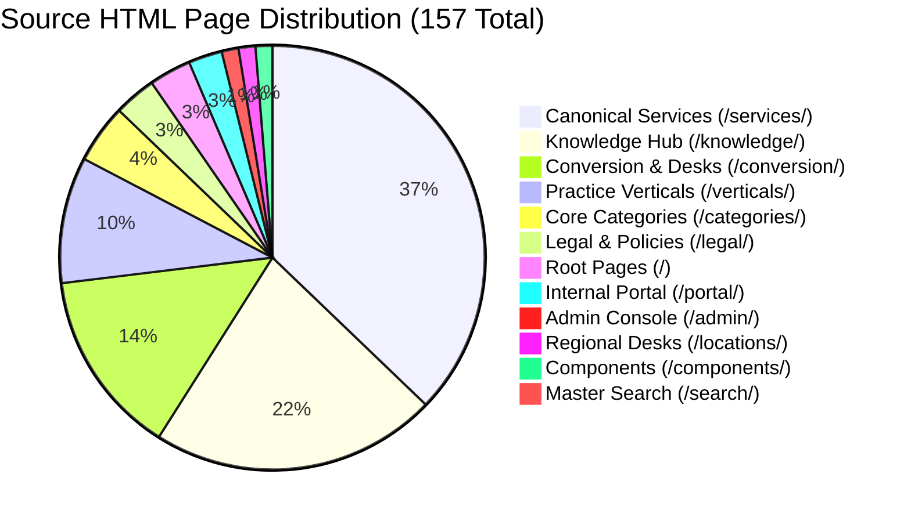
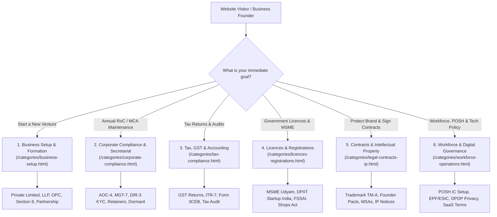

# CRAFTEGON Corporate Services (CCS)
## Independent UI/UX, Design, Navigation & Architecture Audit
### Deliverable 2: Complete Sitemap & Information Architecture Audit

**Document Reference:** `DOC-CCS-UX-AUDIT-02-IA`  
**Classification:** Information Architecture, Navigation Strategy & Content Taxonomy  
**Auditing Team:** Senior Information Architect & Content Strategist  
**Date:** November 2026  
**Source Codebase:** 157 Source HTML Pages (151 Public Build Pages + 6 Internal/Admin Pages)  

---

## 1. Inventory of Current Pages by Category

An inspection of the source repository reveals **157 active HTML documents** organized across 12 directory trees:



### Complete Breakdown of Actual File Routes:
1. **Root Directory (5 Pages):**
   - `/index.html` (Homepage & Primary Conversion Engine)
   - `/services.html` (Master 57-Service Directory with filter tags)
   - `/about.html` (Corporate Identity, Methodology & Tripartite Architecture)
   - `/contact.html` (Direct Service Desk, Regional Addresses & Inquiry Form)
   - `/404.html` (Custom Edge 404 Error Page)
2. **Practice Verticals Directory (`/verticals/` - 15 Pages):**
   - `01-entity-formation.html` (Business Formation & Structuring)
   - `02-roc-compliance.html` (Corporate Compliance & Secretarial)
   - `03-tax-compliance.html` (Tax & Regulatory Registrations)
   - `04-statutory-licenses.html` / `04-licenses-registrations.html` (Licenses & Statutory Registrations)
   - `05-contracts-legal.html` (Contracts & Legal Architecture)
   - `06-ipr-protection.html` (Intellectual Property & Trademarks)
   - `07-labour-hr.html` (Employment & HR Compliance)
   - `08-fundraising-investment.html` (Startup & Investment Advisory)
   - `09-ma-restructuring.html` (Corporate Transactions & M&A)
   - `10-litigation-dispute.html` (Dispute Avoidance & Non-Litigation Triage)
   - `11-governance-audit.html` (Governance, Audit & Risk)
   - `12-esg-csr.html` (Data Privacy & Technology Law)
   - `13-cross-border-fema.html` (International Business & FEMA)
   - `14-retainers-legal-desk.html` (Corporate Retainers & Legal Desk)
   - `15-it-digital.html` (IT & Digital Infrastructure)
3. **Core Category Hubs (`/categories/` - 7 Pages):**
   - `index.html` (6 Pillars Directory Hub)
   - `business-setup.html` (Category Hub 1: Company, LLP & Firm Structuring)
   - `corporate-compliance.html` (Category Hub 2: RoC Annual Compliance & Filings)
   - `tax-compliance.html` (Category Hub 3: GST & Corporate Tax)
   - `licences-registrations.html` (Category Hub 4: Statutory Licenses & MSME)
   - `legal-contracts-ip.html` (Category Hub 5: Commercial Drafting & Trademarks)
   - `workforce-operations.html` (Category Hub 6: Employment, POSH & Digital Law)
4. **Canonical Service Pages (`/services/` - 58 Pages):**
   - *Gateway Tier (5):* `pvt-ltd-registration.html`, `llp-registration.html`, `msme-udyam.html`, `trademark-registration.html`, `roc-annual-compliance.html`.
   - *Core Entity Tier (5):* `opc-registration.html`, `section-8-registration.html`, `partnership-registration.html`, `sole-proprietorship.html`, `dpiit-startup-india.html`.
   - *RoC Secretarial Tier (12):* `form-aoc4.html`, `aoc4-xbrl.html`, `form-mgt7.html`, `dir3-kyc.html`, `form-adt1.html`, `form-dpt3.html`, `form-pas6.html`, `form-ben2.html`, `form-mgt14.html`, `form-msc1-dormant.html`, `llp-compliance-forms.html`, `form-stk2.html`.
   - *Tax & Indirect Tax Tier (6):* `gst-annual.html`, `itr7.html`, `proprietorship-tax.html`, `form-3ceb.html`, `form-10b.html`, `pf-esic-compliance.html`.
   - *Contracts, IP & Governance Tier (15):* `founder-shareholder-agreements.html`, `master-service-agreements.html`, `software-copyright-patents.html`, `ip-enforcement-cease-desist.html`, `posh-compliance.html`, `labour-code-audit.html`, `fast-track-merger-233.html`, `corporate-slump-sale.html`, `board-governance-health-check.html`, `board-minutes-statutory-registers.html`, `form-csr2.html`, `secretarial-audit-mr3.html`, `saas-terms-privacy-architecture.html`, `cross-border-tech-transfer.html`, `form-fc3-fc4.html`.
   - *Secondary & Advisory Pages (15):* Additional canonical service definitions reconciling all 57 canonical services.
5. **Knowledge Base Hub (`/knowledge/` - 34 Pages):**
   - Articles covering MCA V3 manuals, Section 403 guides, Section 43B(h) compliance, Angel Tax repeal analysis, SPICe+ Part B walk-throughs, and FiLLiP procedures.
6. **Conversion Desks & Calculators (`/conversion/` - 22 Pages):**
   - `calculator.html` (Section 403 RoC late fee estimator & stamp duty calculator)
   - `index.html` (Diagnostic tools index)
   - `retainer-desk.html` (Annual secretarial retainer configurator)
   - Specialized checkout/intake funnels for specific service bundles.
7. **Regional Corridor Desks (`/locations/` - 2 Pages):**
   - `kozhikode-corporate-services.html` (Malabar tech/startup ecosystem focus)
   - `malappuram-nri-business-desk.html` (Gulf-return capital, retail, healthcare focus)
8. **Legal & Disclaimers (`/legal/` - 5 Pages):**
   - `terms.html` (Master Terms of Service)
   - `disclaimer.html` (Advocates Act & CA/CS statutory disclaimer)
   - `privacy.html` (DPDP Act 2023 privacy notice)
   - `refund.html` (Refund & cancellation policy)
   - `confidentiality.html` (Data protection & professional privilege policy)
9. **Internal / Application Areas (Protected from Public Crawling - 6 Pages):**
   - `/admin/index.html` & `/admin/login.html` (Admin console)
   - `/portal/index.html`, `/portal/dashboard.html`, `/portal/documents.html`, `/portal/login.html` (Client vault prototype)
10. **Shared Markup Components (`/components/` - 2 Files):**
    - `navbar.html` (Universal navigation header)
    - `footer.html` (Universal 4-column footer)

---

## 2. Evaluation of Current Navigation Structure

### 2.1 The Desktop Mega-Menu Problem
The desktop navbar (`components/navbar.html`) features a "Services (57)" dropdown containing three columns:
- *Column 1:* The 6 Core Categories (`/categories/`).
- *Column 2:* 9 of the 15 Practice Verticals (`/verticals/05-...` through `/verticals/15-...`).
- *Column 3:* Business Lifecycle Stages ("By Business Stage") + Directory Callouts.

**Architectural Assessment:**
While this mega-menu attempts to offer multiple discovery paths, it creates **acute cognitive competition**:
1. It mixes **customer needs** (Column 1) with **internal technical practice areas** (Column 2) and **lifecycle stages** (Column 3) within the exact same visual plane.
2. A user looking for a contract must choose between Column 1 ("Legal & Contracts"), Column 2 ("Commercial Contracts & Drafting"), or Column 3 ("Early Stage & Incorporation").
3. Displaying "57" as a badge in the navigation bar communicates overwhelming volume rather than curated expertise.

### 2.2 Mobile Navigation Breakdown
On mobile viewports (390px to 430px), the navigation collapses into an accordion list with 8 expandable sections. Users must tap through:
`Services` &rarr; `Expand RoC Compliance & MCA` &rarr; `Scroll through 10 service sublinks` &rarr; `Select form`.
This requires **4 to 6 separate physical interactions** before reaching a service page.

---

## 3. Proposed Information Architecture: The 6-Pillar Framework

Visitors do not browse corporate services websites by statutory vertical number. They browse based on **commercial milestones** and **statutory triggers**:



### Proposed Navigation Hierarchy:
1. **Primary Desktop Navigation (5 Elements):**
   - **Services (The 6 Pillars):** A curated 2-column mega-menu showcasing the 6 Core Category Hubs, each with its 3 top services, plus a single clear link to the "Complete 57-Service Directory".
   - **Calculators & Tools:** Direct links to the *RoC Late Fee Calculator*, *Entity Selection Wizard*, and *Trademark Search*.
   - **Knowledge Centre:** Compliance manuals, MCA V3 filing guides, and statutory circulars.
   - **About CCS:** Institutional model, professional boundaries, and regional presence.
   - **Contact Desk:** Phone, WhatsApp, and physical office locations.
   - **Primary CTA Button:** "Talk to a Specialist" / "Inquire Now".

2. **Secondary Technical Directory (Sub-Navigation):**
   - The 15 Practice Verticals remain fully accessible at `/verticals/index.html` and via dedicated cross-links inside the Category Hubs. This preserves 100% of the technical SEO indexation, structured data schemas, and deep backlinks without cluttering the primary user journey.

---

## 4. Page Consolidation & Optimization Matrix

To eliminate thin content and redundant funnels while preserving SEO value:

| Source Page / Route | Current Role | Traffic / Conversion Potential | Structural Weakness | Recommended Action | Justification & SEO Migration Plan |
| :--- | :--- | :--- | :--- | :--- | :--- |
| `categories/index.html` | 6 Pillars Index | High (New Hub) | Lacks visual prominence in navbar | **REDESIGN** | Make this the primary landing page for all service exploration from header. |
| `verticals/01` to `15` (15 Pages) | Vertical Landing Pages | High SEO Value | Repetitive 3-column card grid; identical SVG icons | **REDESIGN** | Retain all 15 URLs. Redesign layout to feature an authoritative editorial summary, a comparison table of services, and an FAQ block. |
| `services/*.html` (58 Pages) | Canonical Service Pages | Core Commercial | Excessive inline styles; dense text | **REDESIGN TEMPLATE** | Unify under a standardized, clean 3-part layout: (1) Overview & Eligibility, (2) 3-Box Statutory Pricing, (3) Document Checklist & Process. |
| `conversion/calculator.html` | Late Fee Estimator | Very High Conversion | Dense sidebar; mobile spacing cramped | **REDESIGN** | Clean mathematical visualizer with clear disclaimers regarding Section 403 vs. substantive fines. |
| `conversion/retainer-desk.html` | Retainer Configurator | High Commercial Value | Separate from RoC service page | **KEEP & LINK** | Retain as the dedicated interactive quote generator for annual retainers. |
| Redundant checkout variants in `/conversion/` | Thin checkout landing pages | Low | Fragmented traffic; duplicate forms | **MERGE / CONSOLIDATE** | Consolidate checkout logic into `checkout.html` with URL query parameters (`?service=pvt-ltd`) rather than maintaining separate files. Use 301 redirects to preserve link equity. |
| `portal/*` (4 Pages) | Client Vault Prototype | Internal / Private | Mock localStorage prototype | **KEEP PROTECTED** | Ensure `robots.txt` and `_headers` maintain strict `noindex, nofollow` and HTTP 404/401 edge gates. |

---

## 5. Navigation Wireframe Specifications

### Desktop Header Layout (80px Fixed Height):
```
+-------------------------------------------------------------------------------------------------------------------+
| [CRAFTEGON LOGO]  [Universal Search Input (press '/')]    Services ▾   Calculators ▾   Knowledge   About   Contact |  [Inquire Now →]
+-------------------------------------------------------------------------------------------------------------------+
```

### Mega-Menu Architecture (Upon Hovering "Services"):
```
+-------------------------------------------------------------------------------------------------------------------+
| THE 6 CORE PRACTICE PILLARS                                      EXPLORE BY LIFECYCLE & TOOLS                     |
|                                                                                                                   |
| [Icon] 1. Business Setup & Formation                             • Early Stage & Startup Formation                |
|        Pvt Ltd, LLP, OPC, Section 8, Partnerships                 • Growth & Annual Compliance Retainers          |
|                                                                   • Governance, Risk & Statutory Audits           |
| [Icon] 2. Corporate Compliance & Secretarial                     • Corporate Restructuring & Dissolution          |
|        AOC-4, MGT-7, DIR-3 KYC, Retainer Plans                   ------------------------------------------------ |
|                                                                   [View Complete 57-Service Directory →]          |
| [Icon] 3. Tax, GST & Accounting                                  [Browse 15 Specialist Practice Verticals →]      |
|        GST Returns (GSTR-9), ITR-7, Form 3CEB                                                                     |
|                                                                                                                   |
| [Icon] 4. Licences & Registrations                                                                                |
|        MSME Udyam, DPIIT Startup India, Shops Act                                                                 |
|                                                                                                                   |
| [Icon] 5. Contracts & Intellectual Property                                                                       |
|        Trademark TM-A, Founder Pacts, MSAs, IP Notices                                                            |
|                                                                                                                   |
| [Icon] 6. Workforce & Digital Governance                                                                          |
|        POSH IC Setup, Labour Codes, DPDP Act, SaaS Terms                                                          |
+-------------------------------------------------------------------------------------------------------------------+
```

---
*End of Deliverable 2. Proceed to Deliverable 3 for the Page-by-Page Audit Matrix.*
