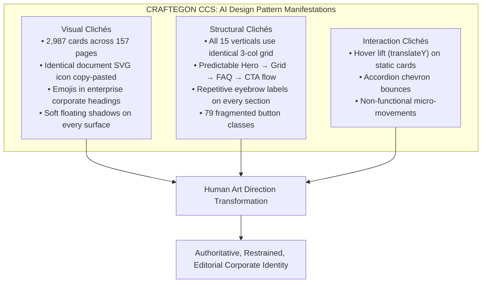

# CRAFTEGON Corporate Services (CCS)
## Independent UI/UX, Design, Navigation & Architecture Audit
### Deliverable 4: AI Design Pattern & "AI Slop" Audit

**Document Reference:** `DOC-CCS-UX-AUDIT-04-AI-SLOP`  
**Classification:** Art Direction Review, Anti-Slop Filter & Component Deconstruction  
**Auditing Team:** Expert Website Design Reviewer & Senior Art Director  
**Date:** November 2026  
**Methodology:** Antislop Core Filter (`antislop.md`, `antislop-ui.md`, `antislop-copywriting.md`)  

---

## 1. Executive Art Direction Finding: The "AI Slop" Dilemma

Modern AI coding agents generate functional code rapidly, but left unconstrained, they default to a predictable, recognizable set of aesthetic clichés. These patterns—known in contemporary digital design as **"AI Slop"**—signal to sophisticated enterprise visitors that a website was assembled mechanically by an automated generator rather than crafted by an experienced corporate design agency.

CRAFTEGON CCS suffers from **three distinct categories of AI design patterns**:
1. **Visual Clichés:** Repetitive bordered cards, soft floating drop-shadows, emoji-prefixed pills, and copy-pasted SVG icons.
2. **Structural Clichés:** Formulaic section sequencing, identical 3-column feature grids, and copy-pasted layouts across all 15 verticals.
3. **Interaction Clichés:** Unnecessary hover elevation on non-clickable surfaces and motion without functional purpose.



---

## 2. Granular Deconstruction of Identified AI Patterns

### Pattern 1: The "Copy-Paste Document Icon" across Practice Verticals
- **Screenshot / Page Reference:** `verticals/01-entity-formation.html` (Lines 842, 861, 880, 899, 918, 937), `verticals/02-roc-compliance.html`, `verticals/03-tax-compliance.html`.
- **Relevant Component / CSS:** `<div class="vertical-card-icon"><svg...><path d="M14 2H6a2 2 0 0 0-2 2v16a2 2 0 0 0 2 2h12a2 2 0 0 0 2-2V8z"/><polyline points="14 2 14 8 20 8"/><line x1="16" y1="13" x2="8" y2="13"/><line x1="16" y1="17" x2="8" y2="17"/></svg></div>`
- **Why it Reads as AI Slop:** In training data, LLMs associate "corporate service" with a generic text document icon. As a result, the agent generated the exact same SVG document icon **6 times on Vertical 01, 8 times on Vertical 02, and 6 times on Vertical 03**. A Private Limited company, an LLP, an OPC, a Section 8 non-profit, and a partnership all display the identical document graphic!
- **Why it Harms the Experience:** It provides zero visual differentiation. Visitors scanning the page cannot distinguish entity formation from trademark protection at a glance.
- **Human Art Direction Fix:** **REMOVE ALL REPETITIVE GENERIC ICONS.** Corporate advisory services do not require an icon above every heading. Replace the icon grid with an authoritative, typographically disciplined comparison table or numbered operational stages.
- **Action:** `REMOVE`.

### Pattern 2: Emoji-Prefixed System Badges & Headings
- **Screenshot / Page Reference:** Homepage (`index.html` Lines 1490, 1511, 1518, 1525, 1532, 1593), `conversion/calculator.html`.
- **Relevant Code:**
  - `<span class="section-eyebrow">⚡ 60-Second Diagnostic Tool</span>`
  - `<span id="rec-badge">🎯 100% STATUTORY FIT • EQUITY FINANCING READY</span>`
  - `<span class="chip-title">🚀 Venture Capital / Angels</span>`
  - `<span class="chip-title">💼 Bootstrapped / Services</span>`
  - `<span class="channel-icon">🏢</span>`, `<span class="channel-icon">🏛️</span>`, `<span class="channel-icon">📊</span>`, `<span class="channel-icon">🛡️</span>`
- **Why it Reads as AI Slop:** Prompts asking for "modern, friendly, engaging UI" cause LLMs to insert consumer emoji characters into enterprise B2B corporate interfaces.
- **Why it Harms the Experience:** CRAFTEGON deals with statutory company incorporation, NCLT insolvency boundaries, Section 43B(h) tax disallowances, and criminal fraud warranties under Sections 447/448 of the Companies Act. Sprinkling rocket ships (`🚀`), lightning bolts (`⚡`), and target bullseyes (`🎯`) across statutory disclosures undermines the credibility of the firm when dealing with serious corporate promoters, CAs, and international investors.
- **Human Art Direction Fix:** **PURGE ALL EMOJIS FROM SYSTEM MARKUP.** Replace with restrained, mono-spaced technical metadata labels (e.g., `DIAGNOSTIC TOOL // 60s`, `STATUTORY CATEGORY: EQUITY FINANCING READY`) styled in crisp uppercase typography.
- **Action:** `REMOVE & REPLACE WITH TYPOGRAPHIC LABELS`.

### Pattern 3: The "Card Prison" (2,987 Cards across 157 Pages)
- **Screenshot / Page Reference:** Throughout `index.html`, `services.html`, all `verticals/*.html`, all `categories/*.html`.
- **Relevant Code:** `assets/css/theme.css`, `assets/css/vertical-hub.css`, `assets/css/service-page.css`.
- **Why it Reads as AI Slop:** A card is a default UI container for unknown content in AI models. When an AI doesn't know how to structure complex editorial relationships, it puts every sentence inside a card with a border, border-radius, and box-shadow.
- **Why it Harms the Experience:** When an entire webpage consists of 20 bordered white boxes floating on a pale gray/mint canvas, visual hierarchy is destroyed. The visitor's eye wanders aimlessly because every box has the same visual weight.
- **Human Art Direction Fix:** **DECONSTRUCT THE CARDS.** 
  - Transform service listings into structured, borderless **editorial data tables** with clean horizontal dividers.
  - Convert process steps into a single continuous horizontal stepped timeline.
  - Reserve bordered containers strictly for interactive conversion elements (e.g., the final pricing quote box or form intake module).
- **Action:** `REDESIGN & REDUCE CARD COUNT BY 70%`.

### Pattern 4: The Monotonous 15-Vertical Layout Clone
- **Screenshot / Page Reference:** Comparing `verticals/01-entity-formation.html` with `verticals/06-ipr-protection.html` and `verticals/11-governance-audit.html`.
- **Relevant Code:** `vertical-card-grid`, `vertical-card`, `v01-grid`, `v06-grid`.
- **Why it Reads as AI Slop:** The developer prompt created Vertical 01 and then instructed the model to "generate Verticals 02 through 15 using the same template". The AI complied literally: every vertical landing page has:
  1. Identical breadcrumb line.
  2. Identical H1 and 2-line intro paragraph.
  3. Identical 3-column card grid containing 4 to 8 cards.
  4. Identical bottom note box with a 4px left border.
- **Why it Harms the Experience:** Corporate transactions and M&A (Vertical 09) require a fundamentally different information structure than Trademark filing (Vertical 06) or Director KYC (Vertical 02). Forcing complex restructurings into the same card grid as basic registrations feels mechanical and unconvincing.
- **Human Art Direction Fix:** **CREATE THREE SPECIALIZED VERTICAL ARCHETYPES:**
  - *Archetype A (Transactional / Formation):* Stepped sequence showing prerequisites, entity comparison, and timeline.
  - *Archetype B (Compliance & Audits):* Calendar-led layout showing statutory deadlines, penalty schedules, and filing frequencies.
  - *Archetype C (Governance, Contracts & M&A):* Editorial layout with sample clauses, risk checklists, and expert advisory dossiers.
- **Action:** `REDESIGN INTO 3 PURPOSEFUL TEMPLATES`.

### Pattern 5: Button Class Proliferation (79 Distinct Button Classes)
- **Screenshot / Page Reference:** Across all CSS sheets (`tokens.css`, `theme.css`, `navbar.css`, `service-page.css`, `checkout.css`, `admin.css`).
- **Relevant Classes:** `btn-hero-primary`, `btn-hero-secondary`, `wizard-btn-primary`, `wizard-btn-secondary`, `flagship-btn-featured`, `flagship-btn`, `if-btn-primary`, `if-btn-secondary`, `btn-talk-expert`, `admin-btn-primary`, `dock-btn-whatsapp`, `dock-btn-calc`, etc.
- **Why it Reads as AI Slop:** Every time the AI created a new section, it invented a new button class (`wizard-btn-primary`, `flagship-btn-featured`) with its own padding, border-radius, background gradient, and hover animation instead of reusing an established component.
- **Why it Harms the Experience:** Some buttons have `border-radius: 9999px` (pill), others have `6px`, `8px`, or `10px`. Some have gradient backgrounds, others solid. This creates subtle visual discordance that subconscious human perception flags as "messy" and "unprofessional".
- **Human Art Direction Fix:** **CONSOLIDATE INTO 4 CANONICAL BUTTON VARIANTS:**
  - `.btn-primary`: Solid Sovereign Emerald (`#247A62`), white text, 6px radius, hover state `#1B5E4B`.
  - `.btn-secondary`: Sovereign Deep Navy (`#193B46`), white text, 6px radius.
  - `.btn-outline`: 1.5px border (`#DCE8E5`), dark text (`#193B46`), hover background `#F4FAF7`.
  - `.btn-text`: Pure typography link with an arrow (`→`), no background, no border.
- **Action:** `CONSOLIDATE & REFACTOR`.

### Pattern 6: Unnecessary Hover Lift (`translateY(-2px)` / `translateY(-4px)`) on Static Cards
- **Screenshot / Page Reference:** `assets/css/theme.css`, `assets/css/vertical-hub.css` (Hover states on `.card`, `.vertical-card`).
- **Relevant Code:**
  ```css
  .vertical-card:hover {
    transform: translateY(-3px);
    box-shadow: 0 10px 25px -5px rgba(0, 0, 0, 0.08);
  }
  ```
- **Why it Reads as AI Slop:** In modern web standards, an element should elevate on hover **only if the entire card is an actionable click target**. In many CCS cards, the card itself is an `<article>` with an internal `<a>` tag at the bottom. Floating the entire card causes visual disorientation and misleads users into clicking blank white space.
- **Human Art Direction Fix:** Restrict interactive states to the actual clickable elements (links and buttons). Maintain cards flat against the canvas to project architectural stability and grounded authority.
- **Action:** `REMOVE HOVER FLOAT FROM NON-CLICKABLE CONTAINERS`.

---

## 3. Summary of Anti-Slop Architectural Rules for Redesign

To ensure CRAFTEGON CCS achieves genuine human-art-directed quality, the redesign must enforce the following **Hard Invariants**:

| Invariant Code | Slop Technique Banned | Human-Art-Directed Standard Imposed |
| :---: | :--- | :--- |
| **SLOP-INV-01** | Emojis in headings, badges, and CTAs | Typographic micro-labels (`font-mono`, uppercase, 0.75rem, letter-spacing +0.08em). |
| **SLOP-INV-02** | Copy-pasted SVG document icons | No decorative icons. Use functional iconography only when representing distinct file formats or actions. |
| **SLOP-INV-03** | Repetitive 3-column card grids | Varied editorial pacing: structured comparison tables, horizontal stepped flows, and split-screen layouts. |
| **SLOP-INV-04** | 79 fragmented button classes | 4 canonical button classes defined in `theme.css`: `btn-primary`, `btn-secondary`, `btn-outline`, `btn-text`. |
| **SLOP-INV-05** | Inline `style="..."` attribute sprawl | Zero inline CSS on content tags; 100% styles managed via semantic classes and tokens. |
| **SLOP-INV-06** | Soft floating drop shadows on all surfaces | Flat, architectural planes separated by subtle hairline borders (`#DCE8E5`) and soft background value alternation. |

---
*End of Deliverable 4. Proceed to Deliverable 5 for Design System Recommendations.*
