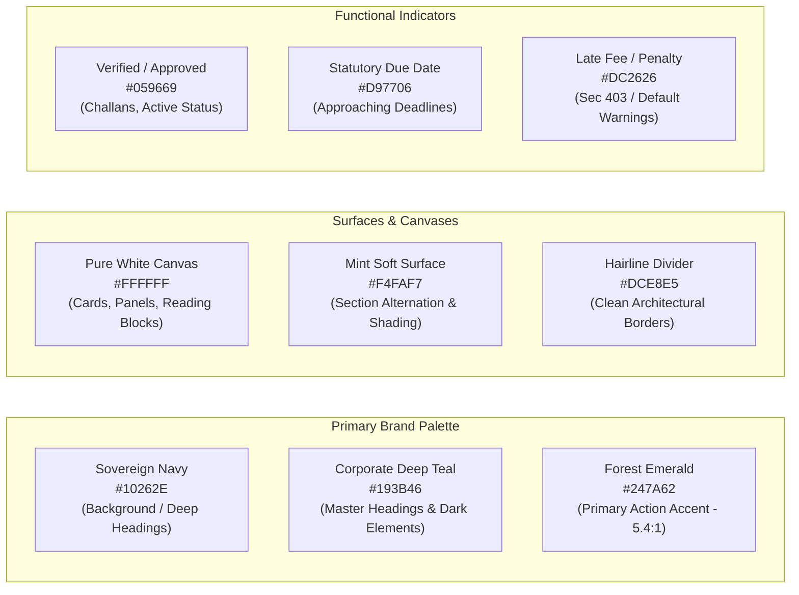

# CRAFTEGON Corporate Services (CCS)
## Independent UI/UX, Design, Navigation & Architecture Audit
### Deliverable 5: Design System Recommendations

**Document Reference:** `DOC-CCS-UX-AUDIT-05-DESIGN-SYS`  
**Classification:** Enterprise Design System Specification & Component Standards  
**Auditing Team:** Senior Web Design Art Director & Senior Frontend Architect  
**Date:** November 2026  
**Implementation Target:** `assets/css/tokens.css`, `assets/css/theme.css`, `assets/css/service-page.css`  

---

## 1. Brand Direction & Visual Philosophy

To transcend the generic "AI SaaS" look, CRAFTEGON Corporate Services must establish a **Modern Institutional & Sovereign Advisory** visual identity. 

This identity communicates:
- **Architectural Stability:** Grounded surfaces, hairline borders, and disciplined grid alignment rather than floating cards.
- **Statutory Authority:** Deep sovereign navy and emerald tones that convey legal gravitas and compliance precision.
- **Editorial Clarity:** High-contrast, beautifully set typography with generous whitespace and scannable data hierarchy.
- **Human Craft:** Absence of cheap visual shortcuts (no emojis in headings, no gratuitous gradients, no generic stock photos).

---

## 2. Refined Color System & Accessibility Ratios

The color system builds upon the established mint green / sky blue foundation while shifting the dominant visual weight to **Sovereign Deep Navy** and **Forest Emerald**:



### Contrast & Token Mapping (WCAG 2.2 AA Compliant)

| Token Name | Hex Value | Role / Application | Background Evaluated | Contrast Ratio | WCAG Compliance |
| :--- | :---: | :--- | :--- | :---: | :---: |
| `--navy-900` | `#10262E` | Deepest Hero Headings, Footer Canvas | On `#FFFFFF` Canvas | **14.2 : 1** | Triple-A (Pass) |
| `--navy-800` | `#193B46` | Master Headings, Navigation Links | On `#FFFFFF` Canvas | **11.2 : 1** | Triple-A (Pass) |
| `--text-main` | `#243746` | High-Legibility Body Text | On `#FFFFFF` Canvas | **10.1 : 1** | Triple-A (Pass) |
| `--text-secondary` | `#52717A` | Metadata, Sub-labels, Captions | On `#FFFFFF` Canvas | **5.1 : 1** | Double-A (Pass) |
| `--accent-emerald` | `#247A62` | Primary Action Buttons, Active States | White Text on Button | **5.4 : 1** | Double-A (Pass) |
| `--accent-ocean` | `#287DA8` | Secondary Accents, External Links | On `#FFFFFF` Canvas | **4.8 : 1** | Double-A (Pass) |
| `--surface-canvas` | `#F4FAF7` | Alternating Section Background | Under `#243746` Text | **9.6 : 1** | Triple-A (Pass) |
| `--border-subtle` | `#DCE8E5` | Hairline Architectural Borders | Separator against White | **1.2 : 1** | Non-text UI Component |
| `--danger` | `#DC2626` | Penalty & Late Fee Warnings | On `#FEF2F2` Light Red | **5.8 : 1** | Double-A (Pass) |

---

## 3. Typography System & Reading Hierarchy

The typography pairs **Manrope** (for geometric, authoritative corporate headings), **Inter** (for neutral, highly legible body copy), and **DM Mono** (for statutory sections, e-form codes, and monetary figures):

### Typographic Scale (Fluid CSS Clamp)
```css
:root {
  /* Font Families */
  --font-heading: 'Manrope', -apple-system, BlinkMacSystemFont, "Segoe UI", sans-serif;
  --font-body: 'Inter', -apple-system, BlinkMacSystemFont, "Segoe UI", sans-serif;
  --font-mono: 'DM Mono', SFMono-Regular, Menlo, Monaco, Consolas, monospace;

  /* Fluid Type Scale (Desktop to Mobile) */
  --text-display: clamp(2.5rem, 5vw, 3.75rem);   /* Hero Display Titles */
  --text-h1:      clamp(2.0rem, 3.8vw, 2.75rem);  /* Page Main Headings */
  --text-h2:      clamp(1.5rem, 2.6vw, 2.0rem);   /* Major Section Titles */
  --text-h3:      clamp(1.2rem, 1.8vw, 1.5rem);   /* Subsection & Feature Titles */
  --text-h4:      clamp(1.05rem, 1.4vw, 1.25rem); /* Card Titles & Modal Headers */
  --text-body:    clamp(0.95rem, 1.1vw, 1.05rem); /* Prose Paragraphs */
  --text-small:   0.875rem;                       /* Metadata, Captions, Labels */
  --text-micro:   0.75rem;                        /* Uppercase Tags & Eyebrows */

  /* Line Heights */
  --lh-tight:   1.2;
  --lh-snug:    1.35;
  --lh-normal:  1.5;
  --lh-relaxed: 1.68;

  /* Line Measure (Optimal Readability) */
  --measure-prose: 68ch;
}
```

### Typographic Execution Rules:
1. **Line Length Discipline:** Paragraphs must never stretch across 1200px screens. All prose must be constrained to `max-width: var(--measure-prose)` (approx. 680px) to prevent eye fatigue.
2. **Elimination of Inline Font Overrides:** Eradicate all 19 occurrences of inline `style="font-family:..."`.
3. **No Decorative All-Caps for Paragraphs:** Uppercase styling is restricted strictly to micro-labels (`--text-micro`) with tracking `letter-spacing: 0.08em`.

---

## 4. Spacing System & Layout Grid

CCS enforces an **8-Point Modular Grid** to maintain mathematical rhythm:

```css
:root {
  /* 8-Point Spacing Scale */
  --space-1:  0.25rem;  /* 4px  - Hairline gap */
  --space-2:  0.5rem;   /* 8px  - Tight padding */
  --space-3:  0.75rem;  /* 12px - Input padding / Chip spacing */
  --space-4:  1.0rem;   /* 16px - Standard component padding */
  --space-6:  1.5rem;   /* 24px - Card internal padding */
  --space-8:  2.0rem;   /* 32px - Module spacing */
  --space-12: 3.0rem;   /* 48px - Section padding on mobile */
  --space-16: 4.0rem;   /* 64px - Section padding on tablet */
  --space-24: 6.0rem;   /* 96px - Major section padding on desktop */

  /* Maximum Layout Containers */
  --container-max: 1200px;
  --container-narrow: 840px;
}
```

---

## 5. Standardized Component Specifications

### 5.1 Button Component Consolidation (4 Strict Variants)

The 79 fragmented button classes are replaced with **4 canonical variants**:

```css
/* Base Button Properties */
.btn {
  display: inline-flex;
  align-items: center;
  justify-content: center;
  gap: var(--space-2);
  font-family: var(--font-body);
  font-size: 0.95rem;
  font-weight: 600;
  line-height: 1;
  padding: 0.75rem 1.5rem;
  border-radius: 6px;
  text-decoration: none;
  cursor: pointer;
  transition: background-color 0.15s ease, border-color 0.15s ease, color 0.15s ease;
  white-space: nowrap;
}

/* 1. Primary Action Button */
.btn-primary {
  background-color: var(--accent-emerald, #247A62);
  color: #FFFFFF;
  border: 1px solid transparent;
}
.btn-primary:hover {
  background-color: #1B5E4B;
}

/* 2. Secondary Corporate Button */
.btn-secondary {
  background-color: var(--navy-800, #193B46);
  color: #FFFFFF;
  border: 1px solid transparent;
}
.btn-secondary:hover {
  background-color: var(--navy-900, #10262E);
}

/* 3. Subtle Outline Button */
.btn-outline {
  background-color: transparent;
  color: var(--navy-800, #193B46);
  border: 1.5px solid var(--border-subtle, #DCE8E5);
}
.btn-outline:hover {
  background-color: var(--surface-canvas, #F4FAF7);
  border-color: var(--navy-800, #193B46);
}

/* 4. Text / Arrow Link */
.btn-text {
  background: transparent;
  color: var(--accent-emerald, #247A62);
  padding: 0;
  border: none;
}
.btn-text:hover {
  color: #1B5E4B;
  text-decoration: underline;
}
```

### 5.2 Structured Data & Comparison Table Component
Instead of forcing features into cards, services utilize clean tabular data:

```html
<div class="table-responsive">
  <table class="data-table">
    <thead>
      <tr>
        <th scope="col">Entity Structure</th>
        <th scope="col">Statutory Governing Law</th>
        <th scope="col">Statutory Audit Requirement</th>
        <th scope="col">Turnaround SLA</th>
        <th scope="col">Action</th>
      </tr>
    </thead>
    <tbody>
      <tr>
        <td><strong>Private Limited Company</strong></td>
        <td>Companies Act, 2013</td>
        <td>Mandatory from Year 1</td>
        <td>3–5 Working Days</td>
        <td><a href="/services/pvt-ltd-registration.html" class="btn-text">View Scope &rarr;</a></td>
      </tr>
      <tr>
        <td><strong>Limited Liability Partnership</strong></td>
        <td>LLP Act, 2008</td>
        <td>Exempt up to ₹40L Turnover</td>
        <td>5–7 Working Days</td>
        <td><a href="/services/llp-registration.html" class="btn-text">View Scope &rarr;</a></td>
      </tr>
    </tbody>
  </table>
</div>
```

### 5.3 Form & Input Field Standards
- **Labels:** Always placed above the input field; never rely on disappearing placeholders.
- **Accessible Focus Ring:** `outline: 2px solid var(--accent-emerald); outline-offset: 2px;`
- **Error States:** Visible red border (`#DC2626`) with an immediate, plain-text error message below the field explaining the fix.

---

## 6. Motion & Micro-Interaction Principles

1. **Functional Purpose Test:** An animation must serve an orientation or state transition purpose (e.g., expanding an accordion or opening a mobile menu). Purely decorative floating, drifting, or pulsating animations are **prohibited**.
2. **Speed & Easing:** Micro-interactions must complete within **150ms to 200ms** using standard `ease-out`.
3. **Respect for Reduced Motion:** Every animation must respect user operating system preferences:
   ```css
   @media (prefers-reduced-motion: reduce) {
     *, *::before, *::after {
       animation-duration: 0.01ms !important;
       animation-iteration-count: 1 !important;
       transition-duration: 0.01ms !important;
       scroll-behavior: auto !important;
     }
   }
   ```

---
*End of Deliverable 5. Proceed to Deliverable 6 for Customer Journey Audits.*
