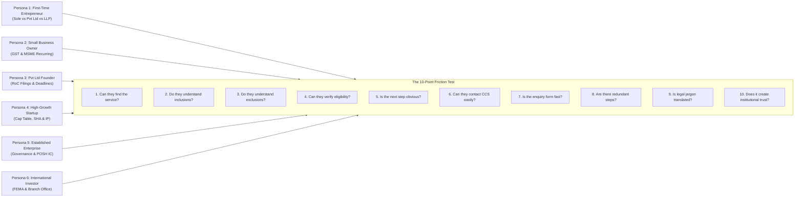

# CRAFTEGON Corporate Services (CCS)
## Independent UI/UX, Design, Navigation & Architecture Audit
### Deliverable 6: Customer Journey & Persona Audit

**Document Reference:** `DOC-CCS-UX-AUDIT-06-JOURNEYS`  
**Classification:** Customer Journey Mapping, Friction Diagnostics & Conversion Analysis  
**Auditing Team:** Senior Conversion Rate Optimisation (CRO) Specialist & UX Researcher  
**Date:** November 2026  
**Evaluation Scope:** 6 Distinct Enterprise Personas Simulating Real-World Intent  

---

## 1. Persona Journey Testing Framework

To evaluate whether the CRAFTEGON CCS website successfully serves real commercial clients rather than hypothetical abstractions, 6 distinct customer personas were tested against 10 critical operational questions:

---

## 2. In-Depth Persona Walk-Throughs & Friction Analysis

### Persona 1: The First-Time Entrepreneur (Kerala / Pan-India)
- **Profile:** An individual launching a commercial tech or retail venture with savings. Unfamiliar with corporate law, MCA forms, or statutory terminology. Confused between Sole Proprietorship, LLP, and Private Limited.
- **Entry Point:** Homepage (`/index.html`) or Entity Selector Wizard.
- **The Experience:**
  - *Positive:* The 60-Second Entity Selector Wizard (`#entity-selector`) effectively asks about capital funding goals and team size, providing an instant recommendation (Private Limited vs. LLP).
  - *Friction Points:* The homepage hero text uses complex jargon: "From SPICe+ Private Limited company incorporation and statutory MCA compliance to corporate tax architecture...". A first-time founder doesn't know what "SPICe+" or "MCA" stands for.
  - *Confusion on Inclusions:* When viewing `/services/pvt-ltd-registration.html`, the user reads that "DSC is not included". A first-time founder has no idea what a Digital Signature Certificate is or why they need to pay ₹1,500 extra for a cryptographic USB token.
- **10-Point Score:** **7 / 10**. Good wizard routing, but heavy jargon barrier.
- **Remediation:** Add a plain-language tooltip explaining DSC: *"A Digital Signature Certificate (DSC) is a government-issued secure digital key required to sign official electronic incorporation documents."*

---

### Persona 2: Existing Small Business Owner (MSME / Trader)
- **Profile:** An established manufacturer or merchant needing MSME Udyam registration, GST annual filing, and assistance recovering delayed payments under Section 15 of the MSMED Act.
- **Entry Point:** Search query landing on `/services/msme-udyam.html` or `/verticals/04-statutory-licenses.html`.
- **The Experience:**
  - *Positive:* Transparent pricing: ₹1,399 professional fee with explicit confirmation that the official government portal fee is ₹0.
  - *Friction Points:* The page contains 399 inline styles, resulting in visual clutter. Information on how MSME registration connects to Section 43B(h) buyer tax disallowances is buried in the 4th section of text.
  - *Confusion on Eligibility:* The page does not immediately clarify that wholesale and retail traders are excluded from Section 43B(h) tax protection based on CBDT Circular 1/2024.
- **10-Point Score:** **6.5 / 10**. High content accuracy, but poor scan-ability.
- **Remediation:** Introduce an interactive **"MSME Benefit Eligibility Checker"** at the top of the page allowing users to check whether their specific NIC code qualifies for 43B(h) protection.

---

### Persona 3: Private Limited Company Founder Facing RoC Deadlines
- **Profile:** Director of an incorporated startup needing to file Form AOC-4 and Form MGT-7, having missed the initial due date and terrified of Section 403 penalties.
- **Entry Point:** Direct search landing on `/conversion/calculator.html` or `/services/roc-annual-compliance.html`.
- **The Experience:**
  - *Positive:* The Section 403 calculator provides immediate mathematical clarity, showing the ₹100/day late fee accrual and distinguishing it from substantive officer fines.
  - *Friction Points:* The retainer booking desk (`/conversion/retainer-desk.html`) is separated from the main RoC service page (`/services/roc-annual-compliance.html`). The founder has to switch between multiple tabs to compare retainer tiers.
  - *Next Step Ambiguity:* The founder sees the calculated fee (e.g., ₹4,500), but the button labeled "Engage Compliance Desk" takes them to a generic consultation form rather than an itemized checkout schedule.
- **10-Point Score:** **7.5 / 10**. High utility, minor checkout fragmentation.
- **Remediation:** Embed the calculator directly into `/services/roc-annual-compliance.html` so users can compute their fee and generate a formal retainer quote in one seamless flow.

---

### Persona 4: High-Growth Startup Founder (Pre-Seed / Seed Stage)
- **Profile:** Tech co-founders negotiating their first angel/institutional investment. Need a Shareholder Agreement (SHA), founder reverse vesting schedule, DPIIT recognition, and Trademark filing.
- **Entry Point:** `/services/dpiit-startup-india.html` and `/services/founder-shareholder-agreements.html`.
- **The Experience:**
  - *Positive:* The DPIIT page is accurate, explaining that Section 56(2)(viib) "Angel Tax" was abolished under the Finance Act 2024 and focusing instead on Section 80-IAC (3-year tax holiday) and IP fee rebates.
  - *Friction Points:* To get all 4 required services (DPIIT, SHA, Trademark, and Incorporation), the founder must visit 4 distinct vertical pages. There is no unified "Seed Stage Startup Legal Bundle" package.
- **10-Point Score:** **7.2 / 10**. High legal sophistication, but lacks bundled transactional packaging.
- **Remediation:** Deploy a prominent **"Startup Launch Bundle"** on the Business Setup category page, packaging Incorporation + DPIIT + Trademark + Founder SHA under an itemized, transparent quote.

---

### Persona 5: Established Enterprise Executive (Head of Legal / HR)
- **Profile:** General Counsel or HR Director of a company with 50+ employees needing to audit their POSH Act Internal Committee compliance and prepare for mandatory Section 204 Secretarial Audit (Form MR-3).
- **Entry Point:** `/verticals/07-labour-hr.html` or `/services/posh-compliance.html`.
- **The Experience:**
  - *Positive:* The POSH page provides exact statutory details: Internal Committee constitution order, external NGO member requirements, and the mandatory Section 134(3)(q) disclosure in the Board's Report.
  - *Friction Points:* The visual design looks too "startup-like". An enterprise General Counsel expects an authoritative, institutional aesthetic. The presence of floating cards and casual button styles reduces the perception of corporate scale.
- **10-Point Score:** **6.8 / 10**. Substantively strong, visually under-powered.
- **Remediation:** Adopt the Modern Institutional design system (sovereign navy, architectural hairline borders, formal document previews).

---

### Persona 6: International Investor / NRI Business Founder
- **Profile:** Non-Resident Indian (NRI) in the UAE/GCC or foreign enterprise wanting to establish a wholly-owned subsidiary or branch office in India under FEMA regulations.
- **Entry Point:** `/verticals/13-cross-border-fema.html` or `/locations/malappuram-nri-business-desk.html`.
- **The Experience:**
  - *Positive:* The dedicated Malappuram NRI corridor page specifically addresses Gulf-return capital, tax residency, and repatriation of profits.
  - *Friction Points:* Pricing is quoted solely in Indian Rupees (INR) with no currency conversion or indication of foreign inward remittance procedures (FC-GPR filing on the RBI FIRMS portal).
- **10-Point Score:** **7.0 / 10**. Strong regional context, needs cross-border currency and regulatory clarity.
- **Remediation:** Add an international client callout detailing RBI FIRMS portal registration, Form FC-GPR filing timelines (within 30 days of share allotment), and a direct overseas WhatsApp routing trigger.

---

## 3. Consolidated Friction & Conversion Matrix

| Journey Step | Friction Identified | Psychological Impact on Client | Recommended CRO Fix |
| :--- | :--- | :--- | :--- |
| **Discovery** | 15 practice verticals in the navbar create decision fatigue. | "I don't know where my requirement lives; this site is too complicated." | Unify navbar around the **6 Core Pillars** (`/categories/`). |
| **Service Evaluation** | Dense wall-of-text paragraphs on service pages. | "I don't have time to read this legal essay; I just need to know what they do." | Re-architect pages with a 3-part scannable layout: (1) Key Scope, (2) 3-Box Pricing, (3) Process. |
| **Fee Transparency** | DSC and INC-20A statutory exclusions require extra cost. | "Is this a hidden fee? Why wasn't this included in the base headline price?" | Keep the 3-box statutory breakdown prominently visible above the fold on all service pages. |
| **Inquiry Submission** | Contact forms ask for open-ended messages without guidance. | "Will someone actually call me back or did this vanish into a black hole?" | Provide instant confirmation with the unique `CCS-ENQ-YYYYMMDD-XXXXX` reference code and a direct WhatsApp fallback. |

---
*End of Deliverable 6. Proceed to Deliverable 7 for Competitor and Design Reference Research.*
