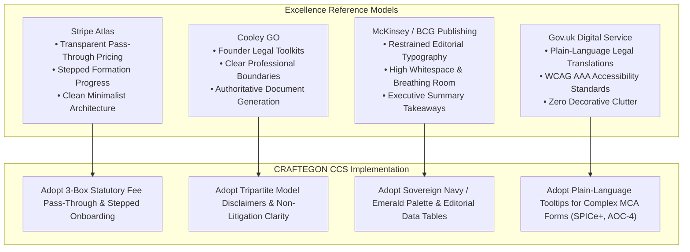

# CRAFTEGON Corporate Services (CCS)
## Independent UI/UX, Design, Navigation & Architecture Audit
### Deliverable 7: Competitor Benchmarks & Agent Design Tool Analysis

**Document Reference:** `DOC-CCS-UX-AUDIT-07-BENCHMARKS`  
**Classification:** Competitive Design Intelligence & Agent Tooling Compatibility  
**Auditing Team:** Senior Digital Art Director & Information Architect  
**Date:** November 2026  
**Research Vectors:** Global Professional Services Benchmarks & Open-Source Agent Design Frameworks  

---

## 1. Global Design References & Professional Service Benchmarks

To transform CRAFTEGON CCS into an authoritative, world-class corporate platform, we analyzed leading global benchmarks in legal technology, institutional consulting, and corporate advisory:

### Reference 1: Stripe Atlas (Global Gold Standard for Company Formation)
- **What Makes it Effective:** Uncompromising simplicity. Incorporating a company is notoriously complex, but Atlas reduces cognitive overhead by organizing the entire experience around a single stepped progression.
- **Visual Direction:** Generous whitespace, razor-thin borders, disciplined typography (custom Sans-Serif), and zero decorative noise.
- **Pricing Strategy:** Total transparency. Clearly distinguishes Stripe's fee from Delaware state filing fees and registered agent costs.
- **Applicable Lesson for CRAFTEGON:** CCS must present company incorporation not as an academic legal treatise, but as an orderly, confidence-inspiring sequence of milestones.
- **What is NOT Appropriate for CRAFTEGON:** Stripe Atlas supports only Delaware C-Corps. CRAFTEGON operates across a vastly broader, multi-regulator Indian spectrum (Companies Act, GST, MSMED Act, POSH Act, Trade Marks Act, FEMA). CCS cannot oversimplify to the point of omitting statutory disclosures required by Indian law.

### Reference 2: Cooley GO (Premier Global Tech Law Advisory)
- **What Makes it Effective:** Authored by top-tier venture attorneys, it strikes the perfect balance between practical founder utility (term sheet generators, incorporation guides) and strict legal boundary disclaimers.
- **Visual Direction:** Clean, authoritative, typography-first editorial layout with warm, intelligent contrast.
- **Applicable Lesson for CRAFTEGON:** How to handle statutory disclaimers. Cooley GO displays clear disclaimers that enhance user confidence rather than frightening clients. CCS should adopt this confident, protective tone for its Advocates Act disclaimers.
- **What is NOT Appropriate for CRAFTEGON:** Cooley is a formal international law firm; CRAFTEGON LLP is a corporate services and technology platform operating under the Tripartite Model. CCS must never mimic law firm branding that could be construed as practicing law under the Advocates Act, 1961.

### Reference 3: McKinsey & Company / BCG Digital Insights
- **What Makes it Effective:** Editorial pacing. Dense strategic and corporate topics are made scannable through bold lead paragraphs, clear pull-quotes, and high-contrast summary tables.
- **Visual Direction:** Sovereign navy tones, refined serif/grotesque typography pairings, and generous vertical rhythm (64px to 96px margins).
- **Applicable Lesson for CRAFTEGON:** Replace repetitive 3-column card grids with structured, borderless editorial data tables and authoritative executive takeaway summaries.

### Reference 4: Gov.uk Digital Service
- **What Makes it Effective:** The global benchmark for turning complex government bureaucracy and statutory codes into plain-language, step-by-step citizen instructions.
- **Applicable Lesson for CRAFTEGON:** Use plain-language micro-labels next to complex Indian corporate jargon (e.g., explaining that "Form INC-20A" simply means "Official Confirmation of Bank Account Capital Deposit").

---

## 2. Agent Design Tooling & Repository Compatibility Audit

We conducted an technical audit of the five open-source AI agent design repositories referenced in the prompt to assess their compatibility with Google Antigravity and the current static HTML/JS/CSS architecture:

| Repository & Tool | Core Concept & Purpose | License & Tech Stack | Compatibility with Antigravity / CCS Stack | Recommended Action for CRAFTEGON |
| :--- | :--- | :--- | :--- | :--- |
| **`pbakaus/impeccable`** [github.com/pbakaus/impeccable](https://github.com/pbakaus/impeccable) | Deterministic design rules engine that stops "AI slop" (banning default Inter, generic purple-blue gradients, over-nested cards). Outputs a project-specific `DESIGN.md`. | MIT License; Lightweight CLI / Skill | **High Compatibility:** Runs locally, requires no runtime dependencies, evaluates design tokens deterministically. | **ADOPT CONCEPTS:** Implement its deterministic anti-slop rules (card deconstruction, gradient bans, purpose tests) into our audit and design guidelines. |
| **`nutlope/hallmark`** [github.com/nutlope/hallmark](https://github.com/nutlope/hallmark) | Design skill focusing on human-centered purpose. Bans invented statistics, fake testimonial walls, and filler cards. Features themed design catalogs. | MIT License; Node / Skills CLI | **High Compatibility:** Focuses on core user jobs (booking, buying, consulting) and includes browser layout checks. | **ADOPT RULES:** Enforce its core mandate: zero invented stats, zero fake testimonials, and zero decorative sections added solely to make pages look long. |
| **`Leonxlnx/taste-skill`** [github.com/Leonxlnx/taste-skill](https://github.com/Leonxlnx/taste-skill) | Imparts visual taste to coding agents using curated references, intentional typography trade-offs, real photography, and Chrome DevTools visual inspection. | MIT License; Node.js v22+ / DevTools | **High Compatibility:** Operates via DevTools protocols for visual inspection. | **ADOPT PRINCIPLES:** Adopt its visual restraint and typography pairing principles. Do not install heavy Node packages directly into the production repo. |
| **`nextlevelbuilder/ui-ux-pro-max-skill`** [github.com/nextlevelbuilder/ui-ux-pro-max-skill](https://github.com/nextlevelbuilder/ui-ux-pro-max-skill) | Searchable local database of UI styles, color palettes, font pairings, and responsive patterns via local Python BM25 search. | MIT License; Python / JSON Database | **High Compatibility:** Self-contained database requiring no external API calls. | **REFERENCE ONLY:** Use its font pairing and corporate palette datasets for design token formulation. No need to install external scripts. |
| **`VoltAgent/awesome-design-md`** [github.com/VoltAgent/awesome-design-md](https://github.com/VoltAgent/awesome-design-md) | Curated collection of `DESIGN.md` files translating brand aesthetics into structured markdown files for AI agents. | MIT License; Markdown Specification | **Full Compatibility:** Pure markdown format. | **ADOPT DIRECTLY:** Codify a formal `DESIGN.md` in the project root following this standard to preserve design memory across future sessions. |

---

## 3. Tooling Strategy & Implementation Governance

### Crucial Architectural Decision:
Rather than adding bloated third-party npm dependencies or running unverified external shell scripts that could disrupt our passing test suite (which validates 26 foundation guardrails, 157 HTML links, and 55 release checks), **we adopt the core principles and deterministic rules of these tools natively**:

1. **Anti-Slop Rules Engine:** Enforced via our active `antislop` skills (`antislop-ui.md`, `antislop-copywriting.md`, `antislop-human.md`).
2. **Persistent Design Memory:** Formulate the definitive **`DESIGN.md`** specification (Deliverable 5 & 10) directly in the repository so that any future agent working on CRAFTEGON CCS is strictly bound to our Sovereign Navy/Emerald palette, 8pt grid, and 4 button classes.
3. **Zero Third-Party Clutter:** Maintain a lean, zero-runtime-dependency static architecture that deploys instantly on Cloudflare Pages.

---
*End of Deliverable 7. Proceed to Deliverable 8 for the Remediation Roadmap.*
