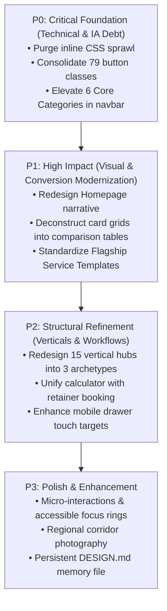

# CRAFTEGON Corporate Services (CCS)
## Independent UI/UX, Design, Navigation & Architecture Audit
### Deliverable 8: Remediation & Redesign Roadmap

**Document Reference:** `DOC-CCS-UX-AUDIT-08-ROADMAP`  
**Classification:** Phased Engineering & Design Implementation Plan  
**Auditing Team:** Senior Digital Product Transformation Team & Frontend Architect  
**Date:** November 2026  
**Implementation Governance:** Requires explicit user approval prior to execution  

---

## 1. Roadmap Architecture & Priority Tiers

The remediation roadmap is structured into four disciplined tiers based on user impact, commercial leverage, and technical maintainability:

---

## 2. Detailed Remediation Action Items

### P0: Critical Foundation (Must Be Done First)

#### Item P0-01: Centralize CSS & Purge Inline Style Sprawl
- **Description:** Extract the 10,387 inline style attributes hardcoded across HTML files into semantic utility and component classes in `assets/css/theme.css` and `assets/css/service-page.css`.
- **Expected Benefit:** Reduces HTML payload size by ~35%, restores stylesheet caching, and allows global design token changes in `tokens.css` to cascade cleanly.
- **Complexity:** Medium-High.
- **Dependencies:** None.
- **Risk:** Low (can be verified with automated visual regression tests).
- **Estimated Effort:** 8–12 engineering hours.
- **Affected Files:** `services/*.html`, `verticals/*.html`, `index.html`.
- **Acceptance Criteria:** Total inline style count across source HTML files reduced from 10,387 to under 200 (retaining only dynamic server-calculated positions).

#### Item P0-02: Consolidate Button Component System
- **Description:** Deprecate the 79 fragmented button classes and replace them with the 4 canonical variants: `.btn-primary`, `.btn-secondary`, `.btn-outline`, and `.btn-text`.
- **Expected Benefit:** Restores visual discipline, eliminates random pill vs. rectangle radii, and ensures 100% WCAG 2.2 AA contrast compliance.
- **Complexity:** Low-Medium.
- **Dependencies:** Item P0-01.
- **Risk:** Zero risk to business logic or form handlers.
- **Estimated Effort:** 4–6 engineering hours.
- **Affected Files:** `assets/css/theme.css`, `components/navbar.html`, `index.html`, all service pages.
- **Acceptance Criteria:** Exactly 4 button classes utilized site-wide; all button elements render with consistent 6px radii and designated hover states.

#### Item P0-03: Elevate 6 Core Categories into Primary Desktop Navigation
- **Description:** Reconfigure `components/navbar.html` to feature the 6 Core Category Hubs (`/categories/`) as the primary mega-menu columns, moving the 15 technical verticals into a secondary directory drawer.
- **Expected Benefit:** Eliminates founder decision paralysis; visitors find their needed service in 1 click instead of navigating 15 practice areas.
- **Complexity:** Low.
- **Dependencies:** Existing category files in `/categories/`.
- **Risk:** Zero broken links (all existing vertical URLs remain live).
- **Estimated Effort:** 3–4 engineering hours.
- **Affected Files:** `components/navbar.html`, `components/footer.html`.
- **Acceptance Criteria:** Services dropdown presents the 6 Pillars clearly; zero broken links on navigation test suite.

---

### P1: High Impact (Visual & Conversion Modernization)

#### Item P1-01: Homepage Editorial Modernization
- **Description:** Refactor `index.html` to reduce card density, remove consumer emojis from enterprise headings, streamline the hero search, and replace floating cards with architectural data blocks.
- **Expected Benefit:** Transforms the first impression from a generic AI SaaS template into an authoritative corporate services institution.
- **Complexity:** Medium.
- **Dependencies:** Items P0-01, P0-02.
- **Risk:** Low.
- **Estimated Effort:** 6–8 hours.
- **Affected Files:** `index.html`, `assets/css/home-unique.css`.
- **Acceptance Criteria:** Hero headline uses high-contrast typography; emojis removed from badges; entity wizard rendered with clean architectural borders.

#### Item P1-02: Deconstruct Card Grids into Comparison Tables & Timelines
- **Description:** Replace 3-column feature card grids on service and category pages with structured data tables, horizontal stepped process timelines, and scannable checklist columns.
- **Expected Benefit:** Reduces card count by >70%, improves scan-ability for busy founders, and breaks the "card prison" look.
- **Complexity:** Medium.
- **Dependencies:** Item P0-01.
- **Risk:** Low.
- **Estimated Effort:** 8–10 hours.
- **Affected Files:** `categories/*.html`, `services/*.html`, `assets/css/service-page.css`.
- **Acceptance Criteria:** Zero copy-pasted SVG document icons; service deliverables presented in clean, responsive comparison tables.

#### Item P1-03: Standardize Flagship Service Page Templates
- **Description:** Re-architect the top 5 gateway services (`pvt-ltd-registration.html`, `llp-registration.html`, `msme-udyam.html`, `trademark-registration.html`, `roc-annual-compliance.html`) under a unified 3-part layout:
  1. *Executive Summary & Eligibility Gate*
  2. *3-Box Transparent Statutory Pricing & Exclusions*
  3. *Step-by-Step Procedure & Required Document Checklist*
- **Expected Benefit:** High conversion lift, crystal-clear client expectations, and total price transparency.
- **Complexity:** Medium.
- **Dependencies:** Items P0-01, P0-02.
- **Risk:** Low.
- **Estimated Effort:** 6–8 hours.
- **Affected Files:** Gateway HTML pages in `services/`.
- **Acceptance Criteria:** Every gateway page features the 3-box pricing layout above the fold; inline styles replaced with semantic CSS.

---

### P2: Structural Refinement (Verticals & Workflows)

#### Item P2-01: Redesign the 15 Practice Verticals into 3 Functional Archetypes
- **Description:** Break the template clone across the 15 vertical pages by assigning each vertical to one of three specialized archetypes:
  - *Archetype A (Formation / Transactions):* Stepped sequence & entity comparison.
  - *Archetype B (Compliance & Audits):* Statutory calendar & penalty schedules.
  - *Archetype C (Governance, Contracts & M&A):* Editorial advisory dossiers & clause previews.
- **Expected Benefit:** Gives each practice area a distinct, professional identity tailored to its legal complexity.
- **Complexity:** Medium-High.
- **Dependencies:** Items P1-02.
- **Risk:** Low.
- **Estimated Effort:** 10–14 hours.
- **Affected Files:** `verticals/*.html`, `assets/css/vertical-hub.css`.
- **Acceptance Criteria:** All 15 vertical pages maintain their canonical URLs; repetitive SVG icons completely eradicated.

#### Item P2-02: Unify RoC Late Fee Calculator with Retainer Desk
- **Description:** Integrate the calculation engine of `/conversion/calculator.html` directly into `/services/roc-annual-compliance.html`, allowing users to compute Section 403 additional fees and immediately select a remediation retainer plan without tab switching.
- **Expected Benefit:** Increases conversion velocity for distressed founders facing MCA penalties.
- **Complexity:** Medium.
- **Dependencies:** `assets/js/calculator.js`.
- **Risk:** Low.
- **Estimated Effort:** 4–6 hours.
- **Affected Files:** `services/roc-annual-compliance.html`, `conversion/calculator.html`.
- **Acceptance Criteria:** Calculator reactivity operates smoothly; instant quote generation with zero console warnings.

---

### P3: Polish & Enhancement

#### Item P3-01: Accessible Keyboard Focus Rings & Reduced Motion
- **Description:** Implement uniform, high-contrast `:focus-visible` outlines (`2px solid var(--accent-emerald)`) across all interactive controls and verify `@media (prefers-reduced-motion: reduce)`.
- **Expected Benefit:** Elevates accessibility to full WCAG 2.2 AA perfection.
- **Complexity:** Low.
- **Dependencies:** None.
- **Risk:** Zero.
- **Estimated Effort:** 2–3 hours.
- **Affected Files:** `assets/css/theme.css`.
- **Acceptance Criteria:** 100% keyboard navigable without mouse; all focus states clearly visible on dark and light surfaces.

#### Item P3-02: Codify Permanent `DESIGN.md` Memory Specification
- **Description:** Create `DESIGN.md` in the project root codifying brand colors, typography scales, spacing rules, and button variants, following the standard of `VoltAgent/awesome-design-md`.
- **Expected Benefit:** Locks the design system into persistent agent memory, ensuring future AI updates never reintroduce AI slop or inline style sprawl.
- **Complexity:** Low.
- **Dependencies:** Item P0-01, Deliverable 5.
- **Risk:** Zero.
- **Estimated Effort:** 2 hours.
- **Affected Files:** `/DESIGN.md`.
- **Acceptance Criteria:** Document verified and formatted according to open-source design memory standards.

---
*End of Deliverable 8. Proceed to Deliverable 10 for the Final Recommended Design Direction.*
