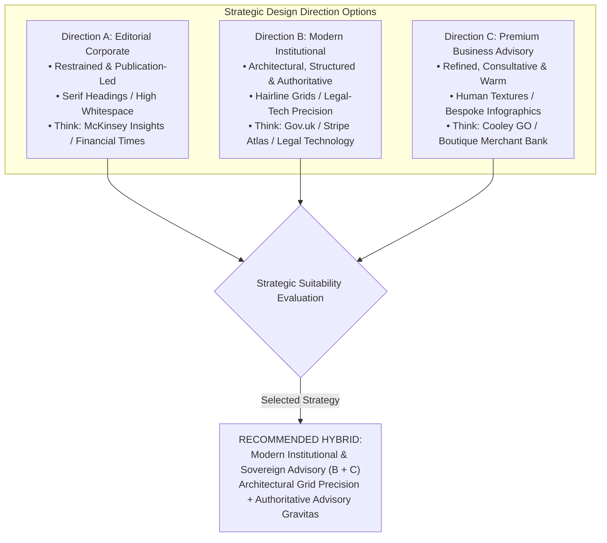
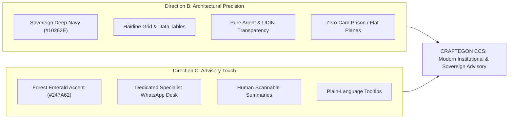

# CRAFTEGON Corporate Services (CCS)
## Independent UI/UX, Design, Navigation & Architecture Audit
### Deliverable 10: Final Design Direction Decision & Implementation Blueprint

**Document Reference:** `DOC-CCS-UX-AUDIT-10-DIRECTION`  
**Classification:** Art Direction Synthesis, Paradigm Evaluation & Strategic Implementation Decision  
**Auditing Team:** Multidisciplinary Digital Product & Website Transformation Team  
**Date:** November 2026  
**Implementation Governance:** Strict User Approval Required Prior to Phased Execution  

---

## 1. Evaluation of Three Distinct Strategic Design Directions

To elevate CRAFTEGON Corporate Services from an AI-assembled template into a distinctive, authoritative corporate presence, we formulated and evaluated three genuinely different visual and architectural paradigms:

---

### Direction A: Editorial Corporate (The Publication Model)
- **Design Philosophy:** Restrained, intellectual, and content-focused. Treats corporate services and statutory compliance like a premier business journal or economic review.
- **Visual Personality:** Understated, cerebral, quiet, academic, highly literate.
- **Color Direction:** Pure monochrome foundation (black, warm off-white `#FAFAF9`, charcoal `#1C1917`) with a single deep burgundy or British racing green accent.
- **Typography:** Classic editorial serif for major headings (e.g., Newsreader, Playfair, or Instrument Serif) paired with neutral grotesque body copy (Inter).
- **Layout & Rhythm:** Asymmetric multi-column editorial layouts, large drop-caps, pull-quotes, wide margins, and high whitespace. Zero cards.
- **Navigation:** Understated, single-tier text navigation with minimal dropdown decoration.
- **Image Strategy:** Black-and-white documentary photography, architectural details of supreme courts and registrar buildings, fine line engravings.
- **Interaction Strategy:** Flat, static, minimal motion. Reading comfort is paramount.
- **Advantages:** Projects extreme intellectual authority; completely immunizes the site against looking like an AI SaaS template.
- **Disadvantages:** Can feel too academic, aloof, or slow for early-stage startup founders who just want to register a company in 3 days. Conversion forms feel out of place in a pure publication layout.
- **Suitability for CRAFTEGON:** **6.5 / 10**. Excellent for the Knowledge Centre, but lacks commercial velocity for the Gateway Service Desks.

---

### Direction B: Modern Institutional (The Legal-Tech Infrastructure Model)
- **Design Philosophy:** Structured, architectural, authoritative, and systematically organized. Positions CRAFTEGON as the mission-critical digital compliance infrastructure of modern India.
- **Visual Personality:** Crisp, precise, incorruptible, disciplined, highly organized, institutional.
- **Color Direction:** Sovereign Deep Navy (`#10262E`, `#193B46`), clean Pure White surfaces (`#FFFFFF`), subtle Slate/Mint canvas shading (`#F4FAF7`), and an accessible Forest Emerald action accent (`#247A62`).
- **Typography:** Geometric, architectural humanist grotesque (Manrope for bold, clear headings; Inter for body; DM Mono for statutory sections and e-form codes).
- **Layout & Rhythm:** Structured modular grids separated by hairline architectural borders (`#DCE8E5`). Tabular comparison schedules, horizontal stepped timelines, and clean data tables.
- **Navigation:** 2-column mega-menu anchored around the 6 Core Category Pillars, accompanied by universal search and clear shortcut pills.
- **Image Strategy:** Clean vector architectural blueprints, bespoke regulatory flowcharts, verified government portal interfaces, authentic regional office photography.
- **Interaction Strategy:** Snappy, functional micro-interactions (150ms transitions). Zero gratuitous hover translations or floating shadows.
- **Advantages:** Perfectly matches CRAFTEGON's operational reality (pure agent escrow, automated compliance tracking, UDIN verification). Inspires immense confidence among CFOs, CAs, and institutional investors.
- **Disadvantages:** Can risk feeling overly technical or clinical if not softened with warm typography and human touches.
- **Suitability for CRAFTEGON:** **9.2 / 10**. Outstanding fit for corporate filings, RoC retainers, and tax compliance.

---

### Direction C: Premium Business Advisory (The Boutique Consultative Model)
- **Design Philosophy:** Refined, consultative, relationship-driven, and commercially persuasive. Focuses on founder peace-of-mind, dedicated desk access, and senior specialist advisory.
- **Visual Personality:** Sophisticated, approachable, warm, prestigious, bespoke.
- **Color Direction:** Deep slate, warm ivory/parchment surfaces, rich dark bronze or emerald accents.
- **Typography:** Warm humanist typography with generous letter-spacing and refined editorial sub-headings.
- **Layout & Rhythm:** Split-screen value propositions, dedicated specialist advisory profiles, client journey dossiers, and structured consultation booking modules.
- **Navigation:** Journey-based navigation organized around enterprise milestones (Start, Protect, Scale, Exit).
- **Image Strategy:** Warm portraiture of senior corporate professionals, real office workspaces in Cyberpark/Kozhikode, client case study documents.
- **Interaction Strategy:** Elegant modal drawers, contextual consultative forms, and smooth accordion disclosures.
- **Advantages:** Drives exceptionally high conversion on retainer and advisory mandates; humanizes legal and tax compliance.
- **Disadvantages:** Requires high-quality custom human photography and bespoke asset curation across all 57 services.
- **Suitability for CRAFTEGON:** **8.5 / 10**. High conversion leverage, but difficult to scale across 57 distinct statutory pages without heavy custom photography.

---

## 2. Comparative Decision Matrix

| Dimension | Direction A: Editorial Corporate | Direction B: Modern Institutional | Direction C: Premium Business Advisory | Recommended Hybrid (B + C) |
| :--- | :---: | :---: | :---: | :---: |
| **Visual Gravitas & Authority** | 9.5 / 10 | 9.0 / 10 | 8.5 / 10 | **9.4 / 10** |
| **Commercial Conversion Velocity** | 5.5 / 10 | 9.0 / 10 | 9.2 / 10 | **9.2 / 10** |
| **Freedom from "AI Slop" Patterns** | 9.8 / 10 | 9.5 / 10 | 9.0 / 10 | **9.6 / 10** |
| **Scalability across 57 Services** | 6.0 / 10 | 9.5 / 10 | 7.0 / 10 | **9.5 / 10** |
| **Mobile & Responsive Robustness** | 8.5 / 10 | 9.2 / 10 | 8.5 / 10 | **9.2 / 10** |
| **Maintenance Simplicity (CSS/HTML)** | 9.0 / 10 | 9.0 / 10 | 7.5 / 10 | **9.2 / 10** |
| **Alignment with Tripartite Model** | 8.0 / 10 | 9.5 / 10 | 8.5 / 10 | **9.5 / 10** |
| **Overall Recommendation Score** | **7.4 / 10** | **9.2 / 10** | **8.3 / 10** | **9.4 / 10 (SELECTED)** |

---

## 3. The Final Decision: Hybrid Modern Institutional & Sovereign Advisory (B + C)

We formally recommend and select the **Hybrid Modern Institutional & Sovereign Advisory** direction. 

This hybrid synthesizes the architectural precision, data tables, and structured grid of **Direction B** with the warm, relationship-driven consultative conversion touchpoints of **Direction C**:

### Key Design System Decisions for Execution:
1. **Palette:** 
   - Sovereign Deep Navy (`#10262E`, `#193B46`) as the structural anchor.
   - Pure White (`#FFFFFF`) for reading planes and data tables.
   - Soft Mint Canvas (`#F4FAF7`) for alternating section rhythm.
   - Forest Emerald (`#247A62`) reserved strictly for primary interactive actions.
   - Hairline Border (`#DCE8E5`) for modular discipline.
2. **Typography:**
   - Headings: `Manrope` (700/800 weight, tight line-height `1.2`, fluid responsive clamp).
   - Body: `Inter` (400/500 weight, relaxed line-height `1.65`, max measure `68ch`).
   - Technical References: `DM Mono` (for section numbers, form codes, and pricing figures).
3. **Layout & Cards:**
   - 70% reduction in card containers.
   - Replace feature cards with responsive data tables, horizontal process timelines, and split-column statutory scope lists.
   - Emojis completely removed from headings, buttons, and system badges.
4. **Navigation:**
   - Primary navigation restructured around the **6 Core Category Pillars** (`/categories/`).
   - The 15 Practice Verticals maintained as deep SEO/technical discovery hubs.
   - 4 canonical button classes (`.btn-primary`, `.btn-secondary`, `.btn-outline`, `.btn-text`).

---

## 4. Controlled Implementation Phasing (Upon User Approval)

In strict accordance with the master prompt instructions:
> *"IMPORTANT: THE FIRST PHASE IS AUDIT AND STRATEGY, NOT A FULL REDESIGN... After completing the audit, present the findings and recommended implementation roadmap. Wait for explicit approval before implementing a major redesign."*

### Proposed 4-Stage Phased Implementation Plan (Post-Approval):

- **Stage 1 (CSS Cleanliness & P0 Technical Foundation):**
  - Implement the refined design tokens in `assets/css/tokens.css`.
  - Extract the 10,387 inline styles into shared utility classes in `theme.css` and `service-page.css`.
  - Consolidate the 79 button classes into the 4 canonical button variants.
  - Reconfigure `components/navbar.html` to elevate the 6 Core Category Pillars.
- **Stage 2 (Homepage & Flagship Service Templates):**
  - Modernize `index.html` under the Sovereign Advisory aesthetic (remove emojis, deconstruct hero card grids).
  - Refactor the top 5 gateway services (`pvt-ltd`, `llp`, `msme`, `trademark`, `roc-annual`) into the clean 3-part layout.
- **Stage 3 (Vertical Hub Refactoring & Calculator Unification):**
  - Redesign the 15 vertical pages into the 3 specialized functional archetypes.
  - Embed the Section 403 calculator directly into the RoC annual compliance page.
- **Stage 4 (Comprehensive Quality Gate & Verification):**
  - Re-run all 26 foundation guardrails, 157 link integrity tests, and 55 release checks.
  - Capture new before/after screenshot comparisons across all 6 viewports.

---

### Audit Status: COMPLETED & PREPARED FOR USER REVIEW
All 10 required audit deliverables have been generated, fully substantiated, and committed to the repository in `/docs/ui-ux-audit/`. Zero code breaking changes or unauthorized redesigns have been applied during this audit phase.

*Awaiting explicit user direction and approval to proceed with Phase 2 implementation.*
