# TASK-CCS-UX-009: Website Information Architecture Proposal

**Project:** CraftEgon Corporate Services (CCS)  
**Website:** `https://ccs.craftegon.com/`  
**Auditor:** Principal Information Architect & UX Director  
**Date:** November 8, 2026

---

## 1. Executive Information Architecture Principles

The future information architecture for CraftEgon Corporate Services must replace navigational clutter and endless homepage scrolling with an intuitive, shallow, and predictable hierarchy. 

### Core Architectural Principles:
1. **Shallow Depth:** Any visitor must be able to reach any of the 57 services in **two clicks or fewer** from any entry point.
2. **Distinct Architectural Destinations:** The homepage is an executive overview; the Explore Services directory (`/services/`) is the comprehensive discovery engine; individual service pages are authoritative conversion destinations; the Knowledge Centre (`/knowledge/`) is an educational resource hub.
3. **Decoupled Private Suites:** The Client Portal and Admin Console are completely excised from the public site tree.
4. **Contextual Reciprocal Mesh:** Every service page cross-links to its parent vertical, adjacent services, relevant diagnostic tools, and statutory guides without circular dead-ends.

---

## 2. Proposed Site Map & Navigation Hierarchy

```mermaid
graph TD
  Root["CCS Public Website (ccs.craftegon.com)"]
  
  Root --> Home["/ (Homepage - Concise Triage & Value Hook)"]
  Root --> Services["/services/ (Explore Services Directory - 57 Services)"]
  Root --> Verticals["/verticals/ (15 Practice Area Pillars)"]
  Root --> Tools["/conversion/ (Diagnostic Tools & Calculators)"]
  Root --> Knowledge["/knowledge/ (Knowledge Centre & Guides)"]
  Root --> About["/about.html (Institutional Profile & Service Desk)"]
  Root --> Contact["/contact.html (Dedicated Contact & Enquiry Desk)"]
  Root --> Legal["/legal/ (Terms, Privacy, Disclaimers)"]

  Services --> SvcCat1["Entity Formation (8 Services)"]
  Services --> SvcCat2["ROC & Secretarial (13 Services)"]
  Services --> SvcCat3["Tax & Regulatory (7 Services)"]
  Services --> SvcCat4["IP & Commercial (9 Services)"]
  Services --> SvcCat5["Governance & FEMA (20 Services)"]

  Verticals --> V01["01 Entity Formation"]
  Verticals --> V02["02 ROC Compliance"]
  Verticals --> V03["03 Tax Compliance"]
  Verticals --> V04_15["04 to 15 Other Verticals"]
```

---

## 3. Primary Header Navigation Architecture

The fixed top navigation (`.if-header`) will feature a clean, minimal layout engineered for rapid scannability across desktop and mobile:

### Desktop Navigation Structure:
1. **Brand Lockup (Left):** Corporate Logo + *"CraftEgon Corporate Services"* (Subtitle: *"Building Business Infrastructure"*).
2. **Explore Services (Mega-Menu Trigger):**
   - Direct link to `/services/`.
   - Hover dropdown organizing the 57 services into 4 logical business columns:
     - *Column 1:* Business Formation & Structuring
     - *Column 2:* Annual ROC & Corporate Secretarial
     - *Column 3:* Tax, GST & Statutory Registrations
     - *Column 4:* IP, Trademarks & Commercial Drafting
3. **Practice Areas (Dropdown):** Clean links to the 15 Practice Verticals grouped by Business Lifecycle (*Establish • Operate • Comply • Protect • Grow*).
4. **Diagnostic Tools:** Quick links to Late Fee Calculator, Stamp Duty Estimator, and Compliance Calendar.
5. **Knowledge:** Direct link to `/knowledge/` (Plain-Language Statutory Guides).
6. **About:** Direct link to `/about.html` (Institutional Standards & Service Desk).
7. **Contact:** Direct link to `/contact.html`.
8. **Header Action (Right):**
   - Universal Search Trigger (icon/input modal)
   - WhatsApp Quick Action button (`+91 86069 18247`)

### Mobile Drawer Navigation Structure:
The mobile drawer collapses into a clean, accordion-based menu with generous tap targets (≥48px):
- Top search input bar
- Direct links: Home, Explore Services (All 57), Practice Areas (15 Verticals), Diagnostic Tools, Knowledge Centre, About CCS, Contact Us
- Direct Call & WhatsApp buttons (`+91 86069 18247`)
- Automatic drawer close on any internal link activation (verified in TASK-007)

---

## 4. Business Lifecycle Taxonomy Mapping

To make the vast 57-service catalogue instantly understandable, all 15 Practice Verticals are mapped into a unified **5-Stage Business Lifecycle**:

| Lifecycle Stage | Stage Objective | Practice Verticals Included | Representative Services |
| :--- | :--- | :--- | :--- |
| **1. Establish** | Entity incorporation, founding structuring, initial clearances. | `01-entity-formation.html` `04-licences-registrations.html` | Pvt Ltd Registration, LLP Formation, MSME Udyam, Shop & Establishment. |
| **2. Operate** | Day-to-day corporate governance, contracts, workforce compliance. | `05-contracts-documentation.html` `07-hr-employment.html` `15-digital-it-infrastructure.html` | Founder Agreements, Employment Contracts, POSH Policies, SaaS Terms. |
| **3. Comply** | Statutory deadlines, annual returns, secretarial records. | `02-roc-compliance.html` `03-tax-compliance.html` `11-governance-audit.html` | Form AOC-4, Form MGT-7, DIR-3 KYC, GST Annual Returns, Form MR-3. |
| **4. Protect** | Asset preservation, brand security, risk avoidance. | `06-intellectual-property.html` `10-dispute-avoidance.html` `12-data-privacy.html` | Trademark Applications, TM Objection Replies, DPDP Audits, Board Mediation. |
| **5. Grow** | Capital expansion, cross-border investment, restructuring. | `08-startup-investment.html` `09-corporate-transactions.html` `13-international-fema.html` `14-corporate-retainers.html` | Due Diligence, Mergers/Demergers, RBI FLA Returns, Dedicated Corporate Retainers. |

---

## 5. URL & Route Continuity Guarantees

To protect existing search engine rankings, domain authority, and client bookmarks:
- **Zero URL Churn on Services:** All 57 individual service URLs (e.g., `/services/pvt-ltd-registration.html`, `/services/roc-annual-compliance.html`) will remain strictly identical.
- **Zero URL Churn on Verticals:** All 15 vertical URLs (`/verticals/01-entity-formation.html` through `15-digital-it-infrastructure.html`) will remain strictly identical.
- **Directory Consolidation:** `/services/` (backed by `/services/index.html`) is designated as the primary canonical directory; `/services.html` will issue a clean 301 redirect.
- **New Dedicated Contact Route:** Introduce `/contact.html` as the official standalone contact and inquiry desk.
- **Excluded Routes:** `/portal/*` and `/admin/*` will return HTTP 404 on the public domain once excluded.
