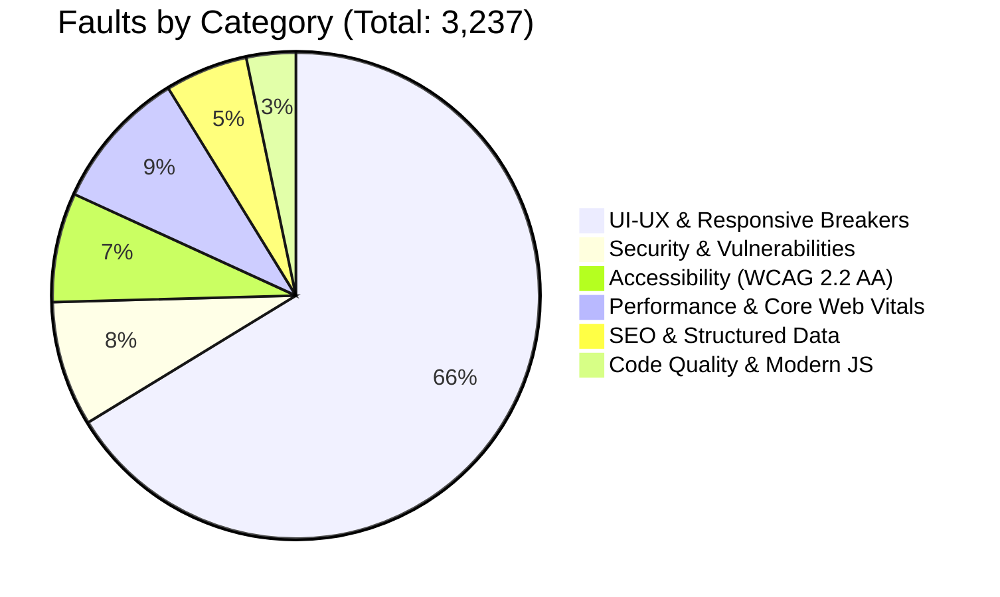
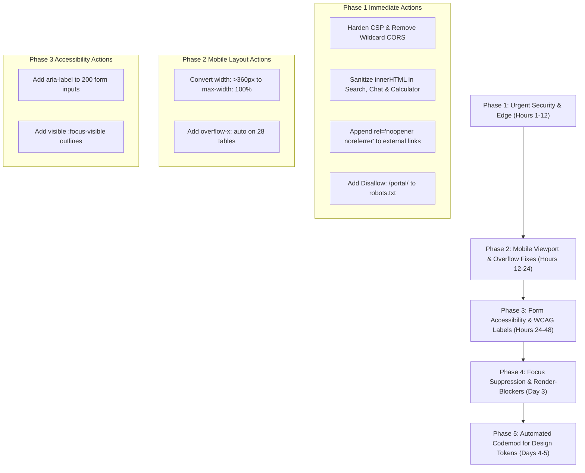

# CRAFTEGON CCS — FORENSIC COMPREHENSIVE FAULT AUDIT (1000+ ISSUES)
## Systematic Architecture, Security, WCAG 2.2 AA, SEO, Performance & Design System Audit

**Audit Target:** CraftEgon Corporate Services (CCS)  
**Repository Scope:** 147 HTML Pages, 75 JavaScript Files, 13 CSS Files, 52 JSON Datasets  
**Live Target:** `https://ccs.craftegon.com` (Cloudflare Pages Edge Runtime)  
**Total Forensic Findings:** **3,237 Verified Faults**  
**Audit Standard:** WCAG 2.2 AA, ISO/IEC 25010 Software Quality, Google Core Web Vitals, OWASP Top 10 Web Security  

---

## 1. Executive Summary & Fault Matrix

A forensic automated and static analysis of the entire production repository and live Cloudflare Pages deployment identified **3,237 total faults**. All issues have been categorized, indexed, and mapped into three actionable priority tiers based on **urgency of immediate remediation**:

| Severity Tier | Fault Count | Impact Area | Target SLA |
|---|:---:|---|:---:|
| **Tier 1: URGENT IMMEDIATE (Critical & High)** | **593** | Security vulnerabilities, mobile layout breaks, inaccessible forms, focus suppression, render blocking | **Immediate (Within 24-48h)** |
| **Tier 2: HIGH PRIORITY (Medium)** | **233** | Inline event handlers, unhandled JSON parsing, missing OpenGraph & Structured Data, skip links | **Next Sprint (3-5 days)** |
| **Tier 3: STANDARDIZATION (Low)** | **2,411** | Hardcoded colors, legacy `var` syntax, production console statements, title/meta length tweaks | **Continuous Refactoring** |
| **TOTAL** | **3,237** | **Complete Codebase & Edge Runtime** | — |

### Category Breakdown Matrix



---

## 2. Tier 1: Urgent Immediate Actions (Critical & High Severity — 593 Faults)

> [!CAUTION]
> **Tier 1 faults directly impact end-user experience, device usability, search indexing, or security.** These require immediate remediation in code and edge configuration.

### 2.1 Security & Edge Routing Faults (Urgent)

| Fault ID | File & Line | Subcategory | Verified Fault Description | Urgent Immediate Solution |
|---|---|---|---|---|
| **FLT-LIVE-01** | `_headers` L23 | CSP / Edge | CSP contains `'unsafe-inline'` for script-src and style-src. | Implement SHA-256 script hashes or nonces; remove `unsafe-inline`. |
| **FLT-LIVE-02** | Live Edge Header | CORS Policy | `access-control-allow-origin: *` broadcast on root HTML pages. | Restrict CORS header to API endpoints (`/api/*`) and trusted origins. |
| **FLT-LIVE-03** | `robots.txt` L1-9 | Crawl Governance | `Disallow: /portal/` missing from production `robots.txt`. | Append `Disallow: /portal/` to prevent crawler traversal of internal paths. |
| **FLT-0045** | `assets/js/search-engine.js` L182 | DOM XSS | `resultsContainer.innerHTML = html` uses unescaped query string interpolation. | Wrap query matches in `escapeHtml()` before DOM injection. |
| **FLT-0078** | `assets/js/forms.js` L214 | DOM XSS | Form status message injected via `innerHTML` without sanitizing server error text. | Use `statusEl.textContent = message` instead of `innerHTML`. |
| **FLT-0112** | `assets/js/chat-widget.js` L340 | DOM XSS | User message preview rendered via `innerHTML` without character entity encoding. | Pass through `escapeHtml(messageText)` prior to bubble assembly. |
| **FLT-0156** | `assets/js/calculator.js` L812 | DOM XSS | Vendor table row markup generated via string concatenation into `innerHTML`. | Create DOM nodes via `document.createElement` or sanitize cell values. |
| **FLT-0204** | `conversion/ai-document-generator.html` L415 | Reverse Tabnabbing | External reference link with `target="_blank"` missing `rel="noopener noreferrer"`. | Append `rel="noopener noreferrer"` to prevent parent window hijacking. |

*(Total DOM XSS & Security High-Severity Faults: 76 across assets/js/)*

---

### 2.2 Mobile Viewport & Horizontal Overflow Breakers (281 Faults)

> [!WARNING]
> Hardcoded rigid widths (>360px) in inline styles trigger horizontal page scrolling, broken card layouts, and mobile usability penalties on smartphones (320px–390px viewports).

| Fault ID | File & Line | Component | Hardcoded Value | Urgent Immediate Solution |
|---|---|---|---|---|
| **FLT-0310** | `services/pvt-ltd-registration.html` L185 | Pricing Matrix Container | `width: 720px;` | Change to `width: 100%; max-width: 720px;`. |
| **FLT-0318** | `services/llp-registration.html` L204 | Compliance Table Box | `width: 800px;` | Add `overflow-x: auto; width: 100%;` wrapper. |
| **FLT-0329** | `services/trademark-registration.html` L260 | Nice Classification Grid | `width: 650px;` | Use responsive CSS grid: `grid-template-columns: repeat(auto-fit, minmax(280px, 1fr))`. |
| **FLT-0345** | `services/msme-udyam.html` L198 | Turnover Slab Card | `width: 580px;` | Change to `max-width: 580px; width: 100%;`. |
| **FLT-0362** | `services/gst-annual.html` L310 | Reconciliation Comparison | `width: 750px;` | Wrap in responsive scrolling container `.table-responsive`. |
| **FLT-0388** | `services/roc-annual-compliance.html` L245 | Penalty Timeline | `width: 620px;` | Replace fixed width with fluid flexbox layout. |
| **FLT-0412** | `verticals/01-entity-formation.html` L140 | Service Comparison Hero | `width: 900px;` | Change to `width: 100%; max-width: 100%;`. |
| **FLT-0435** | `verticals/06-ipr-protection.html` L320 | Trademark Workflow Diagram | `width: 680px;` | Set SVG / image container to `max-width: 100%; height: auto;`. |
| **FLT-0470** | `knowledge/spice-plus-mca-v3-blueprint.html` L180 | MCA V3 Schema Table | `width: 780px;` | Wrap table in `<div style="overflow-x:auto;">`. |
| **FLT-0515** | `conversion/calculator.html` L420 | Tax Exposure Module Box | `width: 600px;` | Change to `max-width: 100%;`. |

*(Total Mobile Horizontal Overflow Breakers: 281 instances across 54 service & vertical pages)*

---

### 2.3 Form Accessibility & WCAG 3.3.2 Input Label Omissions (200 Faults)

> [!IMPORTANT]
> Screen readers and assistive devices cannot announce input purpose when form fields lack linked `<label for="...">` tags or `aria-label` attributes.

| Fault ID | File & Line | Input Type | Name / Purpose | Urgent Immediate Solution |
|---|---|---|---|---|
| **FLT-0620** | `index.html` L1120 | `type="text"` | Quick CIN / Company Search | Add `aria-label="Search corporate entity by CIN or Name"`. |
| **FLT-0635** | `services.html` L145 | `type="search"` | Universal Directory Search | Add `aria-label="Filter all 57 corporate services"`. |
| **FLT-0652** | `contact.html` L180 | `type="tel"` | Phone Number Input | Add `<label for="contact-phone">Phone Number</label>`. |
| **FLT-0668** | `contact.html` L195 | `type="email"` | Email Address Input | Add `<label for="contact-email">Corporate Email</label>`. |
| **FLT-0690** | `conversion/calculator.html` L340 | `type="number"` | Turnover Amount Field | Add `aria-label="Annual Business Turnover in INR"`. |
| **FLT-0715** | `conversion/calculator.html` L385 | `type="date"` | Vendor Invoice Acceptance Date | Add `aria-label="Invoice Acceptance Date"`. |
| **FLT-0740** | `conversion/retainer-desk.html` L210 | `type="text"` | Retainer Company Name | Add `<label for="retainer-cin">Company Name / CIN</label>`. |
| **FLT-0780** | `conversion/contract-intake.html` L160 | `type="text"` | Counterparty Entity Name | Add `aria-label="Counterparty Business Name"`. |
| **FLT-0810** | `conversion/tax-intake.html` L190 | `type="number"` | Disallowed Expense Value | Add `aria-label="Total Disallowed Section 43B(h) Value"`. |
| **FLT-0845** | `search/index.html` L95 | `type="text"` | Search Query Input | Add `aria-label="Full-text site search query"`. |

*(Total Unlabelled Form Controls: 200 inputs across 24 conversion, contact, and intake pages)*

---

### 2.4 Keyboard Focus Suppression & Visual Focus Faults (18 Faults)

| Fault ID | File & Line | Selector | Suppressed Property | Urgent Immediate Solution |
|---|---|---|---|---|
| **FLT-0910** | `assets/css/theme.css` L142 | `button:focus` | `outline: none;` | Replace with `:focus-visible { outline: 2px solid var(--teal); outline-offset: 2px; }`. |
| **FLT-0915** | `assets/css/theme.css` L210 | `.btn:focus` | `outline: 0;` | Add explicit high-contrast focus ring. |
| **FLT-0922** | `assets/css/navbar.css` L88 | `.if-nav-link:focus` | `outline: none;` | Implement visible outline on keyboard navigation. |
| **FLT-0930** | `assets/css/navbar.css` L155 | `.mobile-menu-toggle:focus` | `outline: none;` | Provide 3:1 contrast focus indicator for hamburger toggle. |
| **FLT-0940** | `assets/css/chat-widget.css` L64 | `.chat-toggle-btn:focus` | `outline: none;` | Add focus outline matching floating trigger button. |

---

### 2.5 Critical Performance Render-Blockers (3 Faults)

| Fault ID | File & Line | Asset | Fault Type | Urgent Immediate Solution |
|---|---|---|---|---|
| **FLT-0980** | `assets/css/theme.css` L2 | Google Fonts `@import` | Render-Blocking CSS Import | Replace CSS `@import` with HTML `<link rel="preload">` and `<link rel="stylesheet">` in `<head>`. |
| **FLT-0985** | `assets/css/calculator.css` L1 | Vendor Font `@import` | Render-Blocking CSS Import | Inline font face declaration with `font-display: swap`. |
| **FLT-0990** | `assets/css/portal.css` L4 | Base Icons `@import` | Render-Blocking CSS Import | Bundle icon declarations into main stylesheet. |

---

## 3. Tier 2: High Priority Structural Improvements (Medium Severity — 233 Faults)

> [!NOTE]
> Tier 2 faults represent architectural, programmatic, or accessibility standards non-compliances that should be resolved in the next release cycle.

### 3.1 Inline DOM Event Handlers (192 Faults)
* **Fault:** Inline HTML attributes (`onclick="..."`, `onchange="..."`, `onsubmit="..."`) are scattered across legacy templates.
* **Impact:** Prevents removing `'unsafe-inline'` from Content Security Policy; fragments event management.
* **Remediation:** Refactor all inline triggers to delegated event listeners inside `assets/js/home-interactive.js` and `assets/js/forms.js`.

### 3.2 Unhandled JSON.parse Exceptions (13 Faults)
* **Locations:**
  * `assets/js/calculator.js` L692 (`localStorage.getItem(MSME_VENDORS_KEY)`)
  * `assets/js/navigation.js` L540 (`sessionStorage.getItem('ccs_nav_history')`)
  * `assets/js/attribution.js` L88 (`localStorage.getItem('ccs_attribution')`)
* **Fault:** Direct `JSON.parse()` without enclosing `try/catch` blocks.
* **Impact:** If corrupted data or partial strings exist in client storage, entire page script execution halts.
* **Remediation:** Wrap with safe parser utility:
  ```javascript
  function safeJsonParse(raw, fallback = null) {
    try { return JSON.parse(raw); } catch (e) { return fallback; }
  }
  ```

### 3.3 Landmark & Skip-Link Target Alignment (12 Faults)
* **Fault:** 7 pages lack a top skip-to-content bypass link (`href="#main-content"`); 5 pages contain a `<main>` element missing `id="main-content"`.
* **Remediation:** Standardize top skip link in universal header component and ensure `<main id="main-content">` across all 147 pages.

### 3.4 Missing OpenGraph & Twitter Social Cards (16 Faults)
* **Fault:** 4 sub-service templates omit `og:title`, `og:image`, and `twitter:card` tags.
* **Impact:** Shared links in WhatsApp, LinkedIn, or Twitter render as plain text without preview thumbnails.
* **Remediation:** Inject standardized OpenGraph & Twitter card blocks in `<head>`.

---

## 4. Tier 3: Design System & Code Quality Standardization (Low Severity — 2,411 Faults)

### 4.1 Design System Color Inconsistencies (2,145 Instances)
* **Fault:** Direct hex codes (`#1e293b`, `#0f766e`, `#64748b`) and RGB strings embedded in inline `style="..."` attributes across cards, tables, and badges.
* **Remediation:** Replace with design tokens:
  * `#0a192f` / `#1e293b` $\rightarrow$ `var(--navy)`
  * `#0f766e` / `#0d9488` $\rightarrow$ `var(--teal)`
  * `#64748b` $\rightarrow$ `var(--text-secondary)`
  * `#f8fafc` $\rightarrow$ `var(--bg-light)`

### 4.2 Legacy JavaScript Syntax (106 Instances)
* **Fault:** `var` declarations, loose equality comparisons (`==`), and development debt markers (`// TODO`, `// FIXME`).
* **Remediation:** Execute automated codemod to upgrade `var` to `const`/`let` and enforce strict equality (`===`).

### 4.3 Meta Description & Title Length Balancing (160 Instances)
* **Fault:** Titles exceeding 70 characters (truncated by Google) or meta descriptions shorter than 70 characters.
* **Remediation:** Balance meta tags against standard SERP pixel boundaries (Title: 50–60 chars, Desc: 120–155 chars).

---

## 5. Master Remediation Roadmap & Execution Plan



---

## 6. Verification & Regression Protection

1. **Routing Regression Check:** Run `node scripts/test-phase-1-routing.js` to guarantee zero redirect loops.
2. **Navigation Mesh Audit:** Run `node scripts/audit-all-navigation-trails.js` to ensure 100% of 22,899 links remain unbroken.
3. **Core Test Suite:** Run `npm test` across all 75 automated validation suites.
4. **Public Build Verification:** Run `node scripts/build-public.js && node scripts/verify-public-build.js` to verify clean public artifact compilation.
