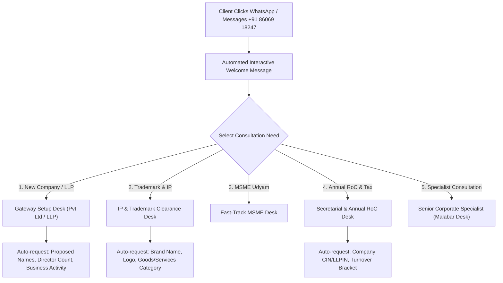

# CraftEgon CCS: WhatsApp Business Desk & Triage Automation Spec
**Official WhatsApp Business Desk:** `+91 86069 18247`  
**SLA Standard:** < 15-Minute First-Response during business hours (9:00 AM – 7:00 PM IST)

---

## 1. Triage Architecture & Flow



---

## 2. Meta WhatsApp Cloud API Interactive Message Payload

When a client initiates contact without a pre-filled service parameter, send the following interactive list payload:

```json
{
  "messaging_product": "whatsapp",
  "recipient_type": "individual",
  "to": "{{CUSTOMER_PHONE}}",
  "type": "interactive",
  "interactive": {
    "type": "list",
    "header": {
      "type": "text",
      "text": "CraftEgon Corporate Services"
    },
    "body": {
      "text": "Welcome to CraftEgon CCS — Institutional Corporate Setup & Secretarial Compliance Desk.\n\nPlease select the primary service area for your inquiry:"
    },
    "footer": {
      "text": "Desk: +91 86069 18247 | Kozhikode & Malappuram"
    },
    "action": {
      "button": "Select Service",
      "sections": [
        {
          "title": "Gateway Setup Services",
          "rows": [
            {
              "id": "SVC_PVT_LTD",
              "title": "Private Limited Setup",
              "description": "SPICe+ incorporation, DIN, PAN, TAN & bank escrow"
            },
            {
              "id": "SVC_LLP",
              "title": "LLP Registration",
              "description": "FiLLiP, Form 3 Agreement & partner structuring"
            },
            {
              "id": "SVC_UDYAM",
              "title": "MSME Udyam Registration",
              "description": "Priority banking & Section 43B(h) protection"
            }
          ]
        },
        {
          "title": "IP & Retainer Compliance",
          "rows": [
            {
              "id": "SVC_TRADEMARK",
              "title": "Trademark (TM-A)",
              "description": "Brand search, Nice classification & e-filing"
            },
            {
              "id": "SVC_ANNUAL_ROC",
              "title": "Annual RoC Retainer",
              "description": "AOC-4, MGT-7A, DIR-3 KYC & secretarial governance"
            },
            {
              "id": "SVC_SPECIALIST",
              "title": "Talk to Specialist",
              "description": "Custom restructuring, NRI desks & complex queries"
            }
          ]
        }
      ]
    }
  }
}
```

---

## 3. Standard Response Scripts & SLA Protocol

### A. First-Response SLA (< 15 Minutes)
Every inquiry triggers an instant acknowledgment within 5 seconds, followed by an assigned compliance specialist voice note or message within 15 minutes.

### B. Gateway Setup Response Script (English)
> "Hello! Thank you for reaching out to CraftEgon Corporate Services.  
> To initiate your **Private Limited Company Incorporation (SPICe+)**, our empanelled CA/CS team requires:  
> 1. Proposed 2 names for your entity.  
> 2. PAN & Aadhaar of at least 2 directors.  
> 3. Electricity bill/NOC for the registered office address (Kerala/National).  
> 
> Our fixed professional fee is **₹4,999**, with government statutory fees and stamp duty handled via pure agent escrow at actuals. Would you like us to conduct an instant free MCA name availability check right now?"

### C. Malabar Regional Founder Response Script (Malayalam / English Hybrid)
> "നമസ്കാരം! CraftEgon Corporate Services (CCS) -ലേക്ക് സ്വാഗതം.  
> കോഴിക്കോട് സൈബർപാർക്ക് / മലപ്പുറം റീജിയണൽ ഡെസ്കിൽ നിന്നാണ് ഞങ്ങൾ ബന്ധപ്പെടുന്നത്.  
> താങ്കളുടെ പുതിയ കമ്പനി രജിസ്ട്രേഷൻ (Pvt Ltd / LLP), ട്രേഡ്മാർക്ക്, അല്ലെങ്കിൽ വാർഷിക RoC ഫയലിംഗ് സംബന്ധിച്ച സംശയങ്ങൾക്ക് സഹായിക്കാൻ ഞങ്ങളുടെ സീനിയർ കോർപ്പറേറ്റ് കൺസൾട്ടന്റ് ലഭ്യമാണ്.  
> ഏത് മേഖലയിലാണ് താങ്കൾക്ക് സേവനം ആവശ്യമുള്ളതെന്ന് ദയവായി വ്യക്തമാക്കാമോ?"

---

## 4. Integration with Cloudflare Edge API

The WhatsApp Business Cloud API webhook can be configured to point to a Cloudflare Pages Function `/functions/api/v1/whatsapp-webhook.js` to automatically synchronize inbound WhatsApp chats with internal lead cards in the CRM.
