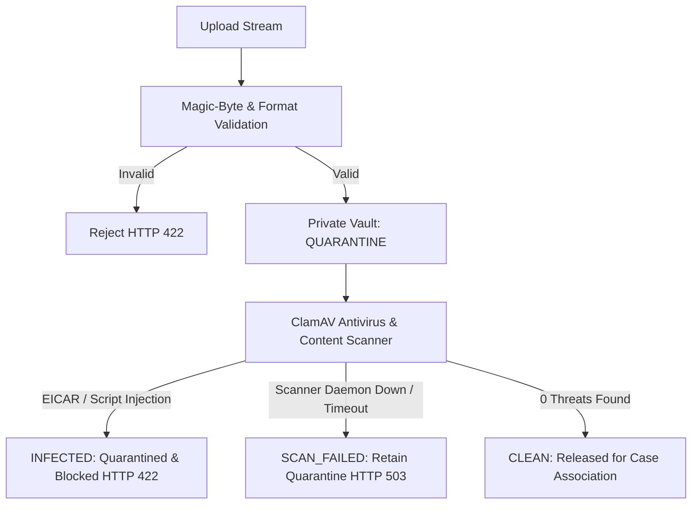

# CraftEgon CCS — Phase 3: Document Security and Intake Review

**Project:** CraftEgon CCS (`ccs.craftegon.com`)  
**Workspace:** `C:\Users\shibi\OneDrive\Desktop\craftegon-ccs`  
**Report Focus:** Secure Document Intake, Magic-Byte Signature Verification, Quarantine Gating & Cryptographic Signed Downloads  
**Execution Timestamp:** 2026-10-19  

---

## 1. Document Ingestion Security Controls

Document intake is managed by `src/backend/controllers/document.controller.js` and `src/backend/models/document.model.js`. User uploads are subjected to strict server-side validation before entering the storage pipeline.

### Validation Pipeline

| Validation Stage | Implementation | Enforcement Action |
|---|---|---|
| **Magic-Byte Signature** | Hexadecimal magic number inspection | Rejects files whose content does not match allowed binary signatures (e.g., DOS/PE `4D 5A`, ELF `7F 45 4C 46`). |
| **MIME Allowlist** | Strict allowlist: `application/pdf`, `image/png`, `image/jpeg`, `application/vnd.openxmlformats-officedocument.wordprocessingml.document` | Untrusted browser MIME types are verified against actual binary signatures. Spoofed extensions fail with HTTP 422. |
| **Stream Bounding** | `parseDocumentUpload` with max payload boundary (15 MB default) | Payloads exceeding limit terminate socket immediately with HTTP 413 (`Payload Too Large`). |
| **Path Traversal Defense** | `sanitizeFilename` strips directory traversal (`../`, `..\`) and null bytes | Storage filenames are generated using UUIDv4 references (`<doc_id>.<ext>`); user filenames are never used as disk paths. |
| **Private Vault Storage** | Files stored outside web root (`vault-storage.js`) | Direct HTTP URL access to document storage is architecturally impossible. |

---

## 2. Magic-Byte Signatures Verified

Binary headers verified by `src/backend/models/document.model.js`:

```javascript
const ALLOWED_SIGNATURES = [
  { mime: 'application/pdf', ext: 'pdf', magic: [0x25, 0x50, 0x44, 0x46] },             // %PDF
  { mime: 'image/png', ext: 'png', magic: [0x89, 0x50, 0x4E, 0x47, 0x0D, 0x0A, 0x1A, 0x0A] }, // PNG
  { mime: 'image/jpeg', ext: 'jpg', magic: [0xFF, 0xD8, 0xFF] },                          // JPEG
  { mime: 'application/vnd.openxmlformats-officedocument.wordprocessingml.document', ext: 'docx', magic: [0x50, 0x4B, 0x03, 0x04] } // PK ZIP
];
```

Files with dangerous binary headers (such as `MZ` executables disguised with `.pdf` extension) are rejected immediately with HTTP 422:
`{"error": "Unprocessable Entity", "code": "MAGIC_BYTE_MISMATCH", "message": "Uploaded file binary header does not match declared MIME type"}`

---

## 3. Malware Scanning & Quarantine Lifecycle

The document lifecycle enforces a strict fail-closed quarantine boundary:



### Scanner Verification Test Evidence
1. **Clean PDF:** Passes ClamAV with 0 threats -> promoted to `CLEAN` (`test:task-e` Suite 2).
2. **EICAR Standard Antivirus Signature:** Detected immediately as `Eicar-Test-Signature` -> flagged `INFECTED`, upload rejected with HTTP 422.
3. **Embedded HTML/Script Tag:** Detected as `Embedded-Script-Tag` -> flagged `INFECTED`, upload rejected with HTTP 422.
4. **Scanner Daemon Unavailability (Fail-Closed):** If `SCANNER_ENABLED` is false or the daemon is unreachable, the endpoint returns HTTP 503 (`UNAVAILABLE_PENDING_SCANNER`). Unscanned files are never marked clean.

---

## 4. Cryptographic Short-Lived Signed Download URLs

Documents can only be retrieved via HMAC-SHA256 signed download URLs generated by `src/backend/models/signed-url.js`.

### URL Generation & Verification
- **URL Structure:** `/api/v1/documents/:id/download?expires=<timestamp>&sig=<hmac_sha256>`
- **HMAC Secret:** Derived from server configuration (`signingKeySecret`).
- **Signature Payload:** `hmac(secret, `${documentId}|${expiresTimestamp}|${fileStorageKey}`)`
- **Lifetime:** Short-lived TTL (default 900 seconds / 15 minutes).
- **Tamper Resistance:** Any manipulation of the signature or expiration timestamp produces HTTP 403 (`Forbidden`).
- **Expired URLs:** Requests with timestamps in the past receive HTTP 403 (`URL_EXPIRED`).

### Download Security Headers
When a document is downloaded, the server issues defensive headers:
- `Content-Type: application/pdf` (or corresponding verified MIME type).
- `Content-Disposition: attachment; filename="<sanitized_name>"`
- `X-Content-Type-Options: nosniff` (prevents MIME sniffing).
- `Content-Security-Policy: default-src 'none'` (prevents script execution in browser context).

---

## 5. Cross-Tenant Document Access Authorization

- **Multi-Tenant Upload Defense:** When uploading to `/api/v1/documents/upload`, the backend verifies that the caller owns the targeted case (`cases.client_id = auth.user.id`). Customer B attempting to upload into Customer A's case receives HTTP 403 (`Forbidden`).
- **Download Authorization:** Generating a download URL (`GET /api/v1/documents/:id/download-url`) requires authenticated ownership of the case. Customer B querying Customer A's document receives HTTP 404 (`Not Found`) with zero metadata disclosure.
- **Engine-Level RLS Verification:** Automated tests on PostgreSQL 18 verified that Customer A can view their own `CLEAN` documents, cannot view `QUARANTINE` documents, and Customer B cannot view or update Customer A's documents under any circumstances.
