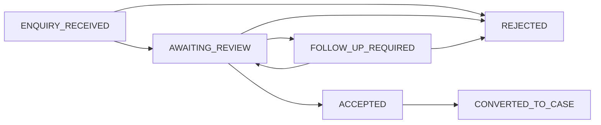
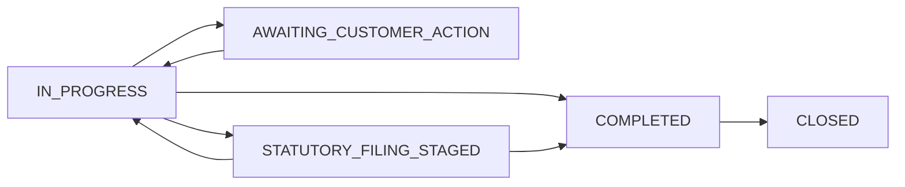

# CraftEgon CCS — Phase 3: Enquiry and Case Workflows Report

**Project:** CraftEgon CCS (`ccs.craftegon.com`)  
**Workspace:** `C:\Users\shibi\OneDrive\Desktop\craftegon-ccs`  
**Report Focus:** Public Lead Intake, Canonical Service Mapping, State Progression & Lifecycle Authorization  
**Execution Timestamp:** 2026-10-19  

---

## 1. Form Inventory & Frontend Connection Architecture

CraftEgon CCS features 17 interactive lead-generation and corporate service enquiry forms distributed across service verticals. Each form is connected via `assets/js/forms.js` to the centralized server-side ingestion endpoint (`/api/v1/enquiries`).

### Form Mapping Matrix

| Form Identifier | Source Route | Canonical Service ID | Primary Vertical | Submission Payload Attributes |
|---|---|---|---|---|
| `form-global-contact` | `/contact.html` | `V01-SVC-001` / General | `V01` | `contact_name`, `email`, `phone`, `company_name`, `message`, `dpdp_consent` |
| `form-dpiit-startup` | `/services/dpiit-startup-india.html` | `V01-SVC-001` | `V01` | `contact_name`, `email`, `phone`, `cin_llpin`, `service_id`, `vertical_id` |
| `form-llp-reg` | `/services/llp-registration.html` | `V01-SVC-002` | `V01` | `contact_name`, `email`, `phone`, `service_id`, `vertical_id`, `dpdp_consent` |
| `form-pvt-ltd-inc` | `/services/private-limited-company-incorporation.html` | `V01-SVC-007` | `V01` | `contact_name`, `email`, `phone`, `service_id`, `vertical_id`, `dpdp_consent` |
| `form-opc-inc` | `/services/one-person-company-opc-incorporation.html` | `V01-SVC-006` | `V01` | `contact_name`, `email`, `phone`, `service_id`, `vertical_id`, `dpdp_consent` |
| `form-section-8` | `/services/section-8-company-ngo.html` | `V01-SVC-009` | `V01` | `contact_name`, `email`, `phone`, `service_id`, `vertical_id`, `dpdp_consent` |
| `form-strike-off` | `/services/company-strike-off-closure.html` | `V02-SVC-013` | `V02` | `contact_name`, `email`, `phone`, `cin_llpin`, `service_id`, `vertical_id` |
| `form-annual-filing` | `/services/annual-compliance-roc-filings.html` | `V02-SVC-001` | `V02` | `contact_name`, `email`, `phone`, `cin_llpin`, `service_id`, `vertical_id` |
| `form-dir3-kyc` | `/services/dir-3-kyc-compliance.html` | `V02-SVC-007` | `V02` | `contact_name`, `email`, `phone`, `din_number`, `service_id`, `vertical_id` |
| `form-trademark` | `/services/trademark-registration.html` | `V03-SVC-001` | `V03` | `contact_name`, `email`, `phone`, `trademark_name`, `class_number` |
| `form-copyright` | `/services/copyright-registration.html` | `V03-SVC-003` | `V03` | `contact_name`, `email`, `phone`, `work_type`, `service_id`, `vertical_id` |
| `form-fdi-reporting` | `/services/fdi-inward-remittance-reporting.html` | `V04-SVC-001` | `V04` | `contact_name`, `email`, `phone`, `fc_gpr_flag`, `service_id`, `vertical_id` |
| `form-fema-flc` | `/services/fema-annual-flc-return.html` | `V04-SVC-003` | `V04` | `contact_name`, `email`, `phone`, `cin_llpin`, `service_id`, `vertical_id` |
| `form-gst-reg` | `/services/gst-registration-online.html` | `V05-SVC-001` | `V05` | `contact_name`, `email`, `phone`, `pan_number`, `service_id`, `vertical_id` |
| `form-payroll-pf` | `/services/payroll-epf-esic-compliance.html` | `V05-SVC-005` | `V05` | `contact_name`, `email`, `phone`, `headcount`, `service_id`, `vertical_id` |
| `form-hr-policy` | `/services/employment-agreements-hr-policies.html` | `V06-SVC-001` | `V06` | `contact_name`, `email`, `phone`, `policy_type`, `service_id`, `vertical_id` |
| `form-posh-ic` | `/services/posh-compliance-internal-committee.html` | `V06-SVC-003` | `V06` | `contact_name`, `email`, `phone`, `workforce_size`, `service_id`, `vertical_id` |

---

## 2. Ingestion Controls & Anti-Abuse Defenses

1. **Server-Side Validation Boundary:**
   - Independent validation in `src/backend/models/enquiry.model.js` checks:
     - Mandatory `contact_name` (2 to 100 characters).
     - Valid RFC 5322 email syntax (max 254 characters).
     - Indian mobile number validation (`/^(?:91)?[6-9]\d{9}$/`).
     - Explicit DPDP (Digital Personal Data Protection Act 2023) consent checkbox boolean requirement.
     - Strict verification that `service_id` exists in the canonical Phase 2 registry and matches its declared `primary_vertical_id`.
2. **Referral-Only Route Protection (Advocates Act 1961 Boundary):**
   - Direct self-serve intake for contentious litigation routes (`/services/nclt-insolvency-defense.html`, `/services/oppression-mismanagement-disputes.html`, `/services/director-removal-board-disputes.html`) is strictly rejected with HTTP 422:
     > *"Direct self-serve intake is not available for contentious tribunal or courtroom litigation matters under Advocates Act 1961 regulations. Please contact our managing partner desk directly for neutral advocate referral coordination."*
3. **Anti-Abuse, Rate-Limiting & Honeypots:**
   - Rate limiting: Max 3 enquiry submissions per 60-second window per client IP hash. Excess requests receive HTTP 429 (`Too Many Requests`) with a standard `Retry-After: 60` header.
   - Honeypot trapping: Submissions populating the invisible `_hp_website` field are silently trapped, returning a synthetic HTTP 201 response (`LEAD-2026-000000`) without creating database records or triggering team notifications.
   - Idempotency hashing: SHA-256 hash of payload contents prevents accidental double-clicking, returning the original lead reference with HTTP 200 (`idempotent_replay: true`).

---

## 3. Server-Side Data Model & Persistence

The schema defines distinct tables for enquiries and operational cases:

```sql
-- Migration 001: lead_enquiries table
CREATE TABLE IF NOT EXISTS lead_enquiries (
    id UUID PRIMARY KEY DEFAULT gen_random_uuid(),
    lead_reference VARCHAR(32) UNIQUE NOT NULL,
    service_id VARCHAR(32) NOT NULL,
    vertical_id VARCHAR(16) NOT NULL,
    contact_name VARCHAR(128) NOT NULL,
    email_hash VARCHAR(64) NOT NULL,
    phone_hash VARCHAR(64) NOT NULL,
    encrypted_contact_payload TEXT,
    scope_description TEXT,
    source_url VARCHAR(255),
    dpdp_consent BOOLEAN NOT NULL DEFAULT FALSE,
    status VARCHAR(32) NOT NULL DEFAULT 'ENQUIRY_RECEIVED',
    created_at TIMESTAMPTZ NOT NULL DEFAULT CURRENT_TIMESTAMP,
    expires_at TIMESTAMPTZ NOT NULL
);

-- Migration 001: cases table
CREATE TABLE IF NOT EXISTS cases (
    id UUID PRIMARY KEY DEFAULT gen_random_uuid(),
    case_reference VARCHAR(32) UNIQUE NOT NULL,
    client_id UUID NOT NULL REFERENCES client_accounts(id),
    lead_id UUID REFERENCES lead_enquiries(id),
    service_id VARCHAR(32) NOT NULL,
    vertical_id VARCHAR(16) NOT NULL,
    title VARCHAR(255) NOT NULL,
    status VARCHAR(32) NOT NULL DEFAULT 'IN_PROGRESS',
    assigned_team VARCHAR(64) DEFAULT 'CORPORATE_SECRETARIAL',
    created_at TIMESTAMPTZ NOT NULL DEFAULT CURRENT_TIMESTAMP,
    updated_at TIMESTAMPTZ NOT NULL DEFAULT CURRENT_TIMESTAMP
);
```

---

## 4. Lifecycle State Progression & Access Control

Authoritative state transitions are validated in `src/backend/models/state-machines.js`:

### Lead Lifecycle


### Case Lifecycle


### Access Authorization & IDOR Defenses
- **Staff-Only Lead Triage:** `GET /api/v1/enquiries/:ref` requires authentication with role `compliance_operator` or `managing_partner`. Anonymous and client users receive HTTP 401 or HTTP 403.
- **Tenant Case Isolation (RLS):** Clients can only view cases where `cases.client_id = auth.user.id`. Cross-tenant queries return HTTP 404 (`Not Found`) with zero leakage of corporate metadata.
- **Privilege Escalation Protection:** Clients cannot update case status (`PATCH /api/v1/portal/cases/:ref`); status mutation is strictly restricted to staff roles, preventing clients from marking their own cases `COMPLETED`.
