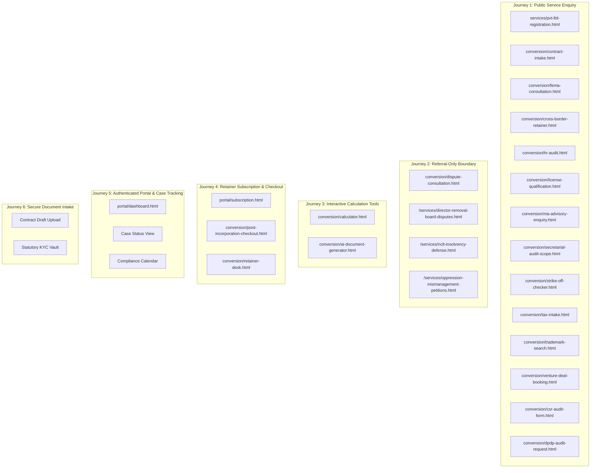
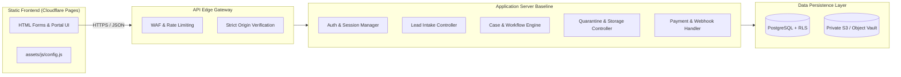
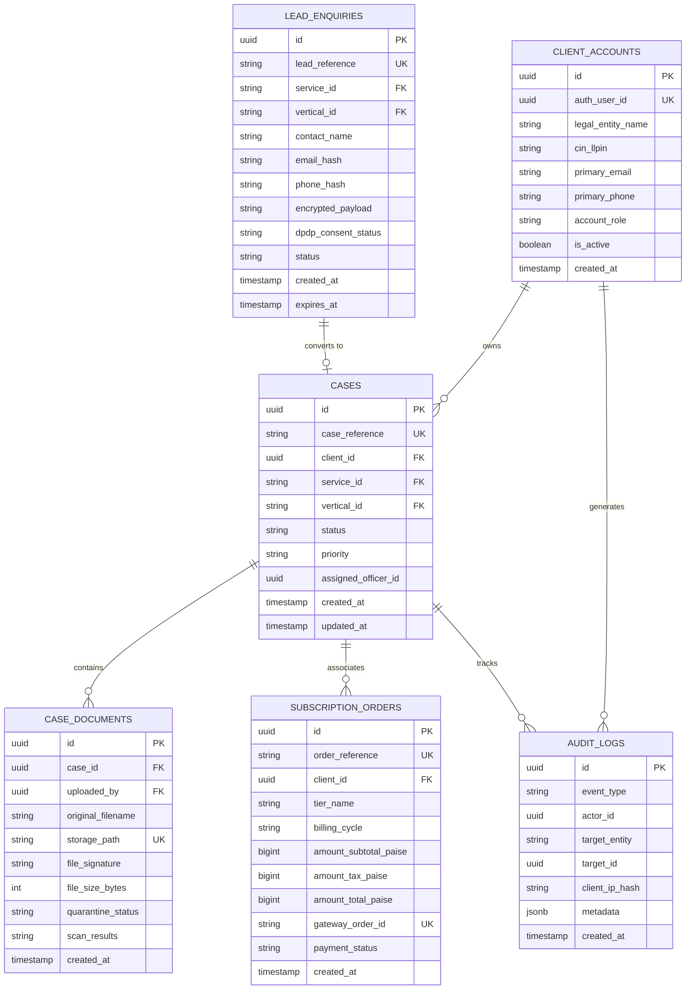
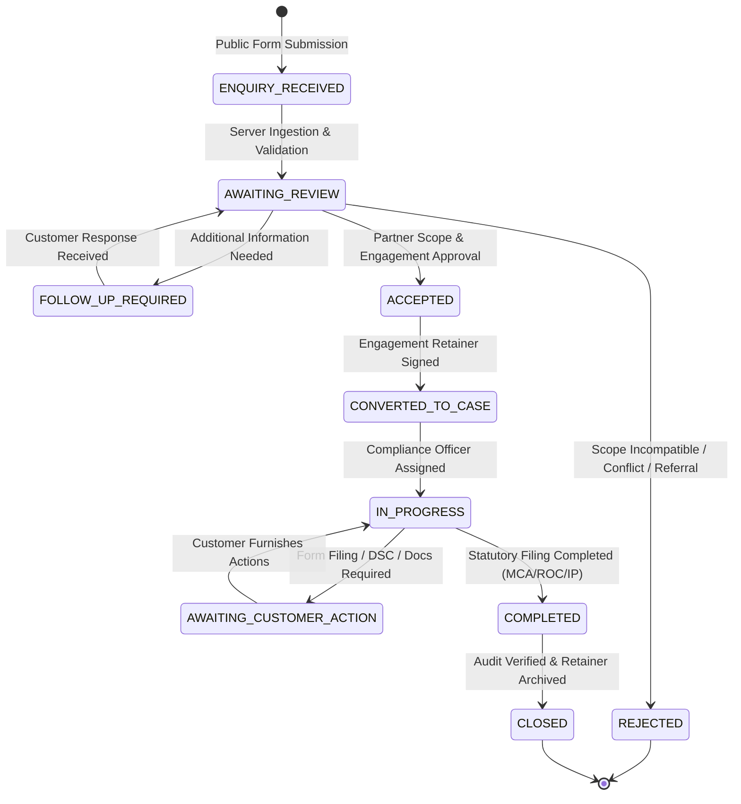
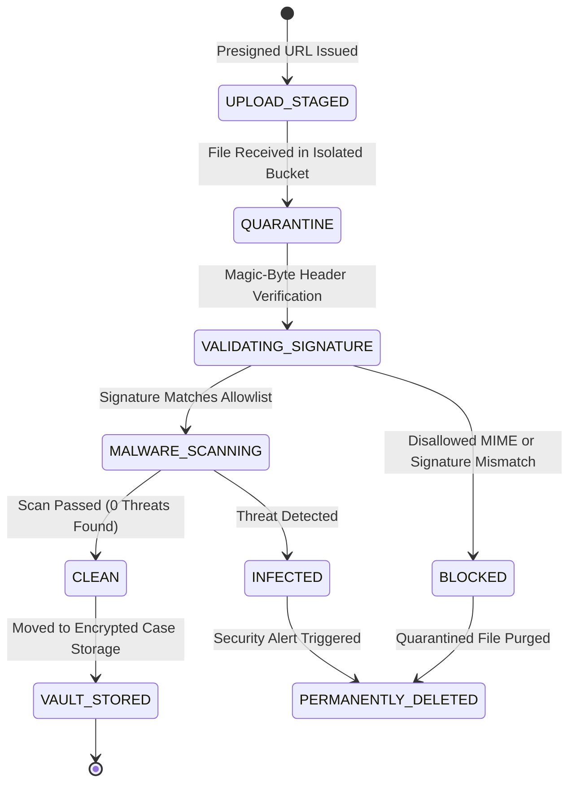
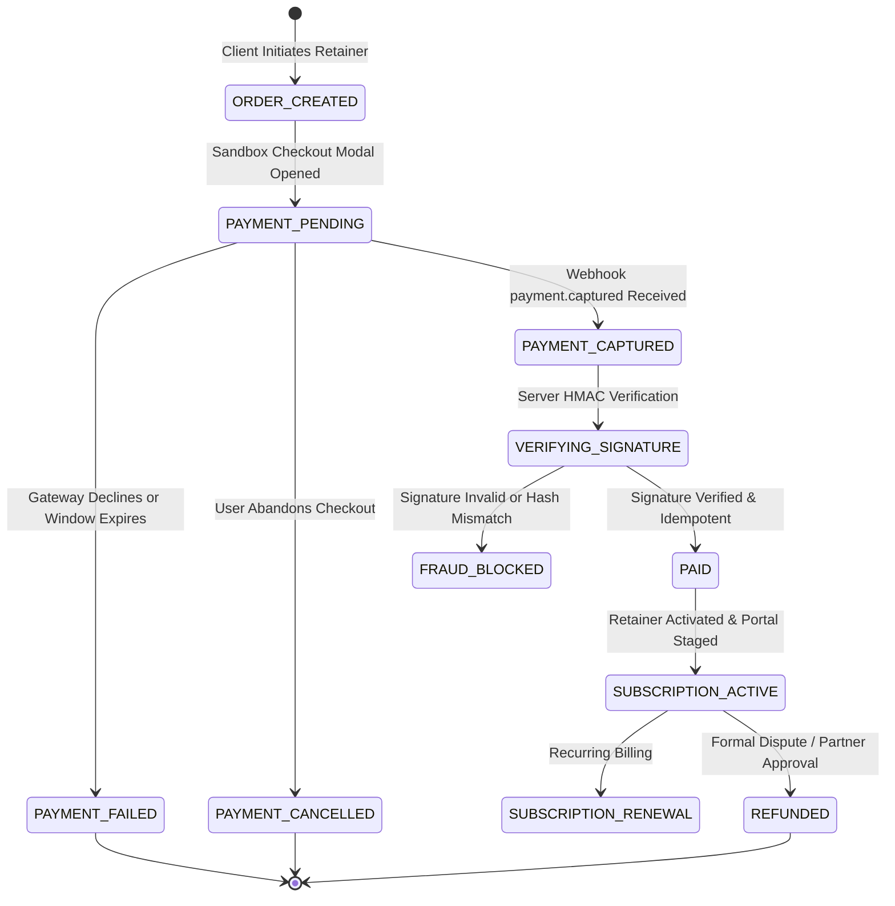

# CraftEgon CCS — Phase 3: Master Implementation Plan

**Project:** CraftEgon Corporate Compliance Services (CCS)  
**Document:** Phase 3 — Core Customer Journeys Master Implementation Plan  
**Repository:** `craftegon-ccs` workspace (`c:\Users\shibi\OneDrive\Desktop\craftegon-ccs`)  
**Execution Environment:** Node.js v20.18.0 / Windows  
**Current Baseline Commit:** `cda19a4 chore(platform): comprehensive update of UI tokens, brand lockup, legal disclaimers, and content architecture`  
**Date of Plan:** October 18, 2026  
**Status:** Task A Architecture & Implementation Plan Completed — Awaiting Explicit Approval  

---

## Executive Summary

Phase 1 established the foundation (57 verified service routes, 15-vertical taxonomy, 54 remediation assertions).  
Phase 2 created the authoritative source-of-truth data layer (7 canonical JSON datasets, 7 JSON schemas, 88 master validation assertions).  
Phase 3 progresses CraftEgon CCS from a static marketing site with an in-memory prototype into an enterprise-grade corporate governance operating system supporting authenticated customer journeys, lead and case tracking, secure document intake, and sandboxed payment processing.

This document establishes the concrete architecture, database schema, security boundaries, and phased execution roadmap for **Phase 3 Tasks B through G**.

> [!IMPORTANT]
> **Strict Operational Governance Enforced:**
> - Zero external cloud resources, databases, buckets, or vendor accounts are provisioned during this planning phase.
> - All tests utilize 100% synthetic fixtures; zero real customer data, real documents, or live payment credentials exist in the repository.
> - Unapproved Phase 2 pricing estimates remain strictly gated from customer-facing checkout.

---

## 1. Baseline Repository Inspection

Prior to drafting this implementation plan, the local working tree, file system, and test suites were audited:

### 1.1 Git Status & Commit History
* **Active Branch:** `main` (synchronized with `origin/main`).
* **Working Tree:** Clean (commit `cda19a4`).
* **Production Integrity:** 113 production HTML files, CSS stylesheets (`assets/css/`), and client JavaScript (`assets/js/*.js`) remain completely untouched.

### 1.2 Baseline Test Execution Results
1. **Master Regression Suite (`npm test`):**
   * **142 total assertions passed, 0 failed** across Phase 1 remediation (54 tests) and Phase 2 data layer master validation (88 tests).
   * 113 HTML files audited with 0 broken links and 0 orphan pages.
   * 111 files verified with 100% technical SEO metadata compliance.
   * Chat engine (40 checks) and trademark search XSS security suite (40 checks) fully passing.
2. **Lead Intake Prototype Suite (`node scripts/test-lead-intake-prototype.js`):**
   * **31 assertions passed, 0 failed** (Exit Code 0).
   * Verified relational integrity (`service_id` $\leftrightarrow$ `vertical_id`), referral route boundaries, active strike-off / merger acceptance, anti-spoofing direct connection IP resolution, rate limiting, bot traps, and PII-masked audit logging.

### 1.3 Audit of Existing Forms, Portals & Checkouts
* **Total `<form>` elements on disk:** Exactly 21 forms across the site.
  * **15 Conversion Lead Forms (`conversion/*.html`):** Use `.if-lead-form` class; currently present safe client-side fallback notices because `data-endpoint` is unpopulated.
  * **1 Direct Service Lead Form (`services/pvt-ltd-registration.html`):** Uses `.if-lead-form`.
  * **2 Client-Side Interactive Tools:** `conversion/calculator.html` (`#estimator-form`) and `conversion/ai-document-generator.html` (`#ai-drafter-form`).
  * **1 CIN Calendar Calibration Form:** `portal/dashboard.html` (`#cin-lookup-form`).
  * **1 Checkout Simulation Form:** `portal/subscription.html` (`#checkout-form`) — currently persists to browser `localStorage` and simulates activation.
* **Document Upload Audit:** Exactly **zero `<input type="file">` elements exist** on disk. Forms such as `conversion/contract-intake.html` describe document uploads but provide only text inputs. Secure file intake must be built from the ground up.

---

## 2. Customer Journey Inventory & Form Mapping

The 21 forms across the platform map into six discrete customer journeys:



### Table 2.1: Comprehensive Form Inventory & Server Contracts

| Form File Path | DOM Identifier | Primary Vertical | Canonical Service / Scope | Current Frontend Behavior | Required Server Contract |
| :--- | :--- | :--- | :--- | :--- | :--- |
| `services/pvt-ltd-registration.html` | `.if-lead-form` | V01 (Incorporation) | `V01-SVC-007` (Pvt Ltd) | Fallback notice | Public Lead Intake API (`POST /api/v1/enquiries`) |
| `conversion/contract-intake.html` | `.if-lead-form` | V05 (Contracts) | `V05-SVC-001` to `007` | Fallback notice | Public Lead Intake API + Case Document Upload |
| `conversion/cross-border-retainer.html`| `.if-lead-form` | V07 (FEMA & FDI) | `V07-SVC-001` to `007` | Fallback notice | Public Lead Intake API |
| `conversion/csr-audit-form.html` | `.if-lead-form` | V13 (CSR) | `V13-SVC-001` to `002` | Fallback notice | Public Lead Intake API |
| `conversion/dispute-consultation.html` | `.if-lead-form` | Referral-Only | Contentious / NCLT | Fallback notice | **Referral Boundary:** Rejects commercial intake; directs to legal referral notice |
| `conversion/dpdp-audit-request.html` | `.if-lead-form` | V06 (IP & Privacy) | `V06-SVC-004` (DPDP) | Fallback notice | Public Lead Intake API |
| `conversion/fema-consultation.html` | `.if-lead-form` | V07 (FEMA & FDI) | `V07-SVC-001` to `007` | Fallback notice | Public Lead Intake API |
| `conversion/hr-audit.html` | `.if-lead-form` | V10 (Labour & HR) | `V10-SVC-001` to `005` | Fallback notice | Public Lead Intake API |
| `conversion/license-qualification.html`| `.if-lead-form` | V04 (Licensing) | `V04-SVC-001` to `008` | Fallback notice | Public Lead Intake API |
| `conversion/ma-advisory-enquiry.html` | `.if-lead-form` | V09 (M&A) | `V09-SVC-001` to `003` | Fallback notice | Public Lead Intake API (Transactional only) |
| `conversion/post-incorporation-checkout.html` | `.if-lead-form` | V01 (Incorporation) | Post-Inc Package | Fallback notice | Retainer Checkout Session API |
| `conversion/retainer-desk.html` | `.if-lead-form` | V02 (Secretarial) | Retainer Packages | Fallback notice | Public Lead Intake API |
| `conversion/secretarial-audit-scope.html` | `.if-lead-form` | V11 (Governance) | `V11-SVC-001` to `003` | Fallback notice | Public Lead Intake API |
| `conversion/strike-off-checker.html` | `.if-lead-form` | V02 (Secretarial) | `V02-SVC-013` / `015` | Fallback notice | Public Lead Intake API (Active strike-off) |
| `conversion/tax-intake.html` | `.if-lead-form` | V03 (Taxation) | `V03-SVC-001` to `007` | Fallback notice | Public Lead Intake API |
| `conversion/trademark-search.html` | `.if-lead-form` | V06 (IP & Privacy) | `V06-SVC-001` to `003` | Fallback notice | Public Lead Intake API |
| `conversion/venture-deal-booking.html` | `.if-lead-form` | V12 (Venture Capital)| `V12-SVC-001` to `004` | Fallback notice | Public Lead Intake API |
| `portal/subscription.html` | `#checkout-form` | Institutional SaaS | Starter/Growth/Ent. | `localStorage` simulation | Sandbox Payment Session API (`POST /api/v1/payments/create-order`) |
| `portal/dashboard.html` | `#cin-lookup-form` | Compliance Calendar | CIN Deadline engine | Static demo math | Authenticated Portal API (`GET /api/v1/portal/cases`) |

---

## 3. Concrete Architecture & Deployment Specification

### 3.1 Component Architecture Overview



### 3.2 Evaluation of Candidate Backend & Database Providers

| Evaluation Dimension | Candidate 1 (Preferred): Supabase Pro | Candidate 2 (Secondary): Cloudflare Workers + D1 + R2 | Candidate 3: AWS Dedicated (RDS + ECS + S3) |
| :--- | :--- | :--- | :--- |
| **Backend & API Hosting** | Supabase Edge Functions (Deno) / Node.js API server | Cloudflare Workers (V8 isolates at edge) | Node.js Express/Fastify on AWS ECS Fargate |
| **Database & Migrations** | Managed PostgreSQL 15+ in AWS Mumbai (`ap-south-1`). Standard SQL migrations. | Cloudflare D1 (SQLite at edge). Migrations via Wrangler D1. | AWS RDS PostgreSQL 15+ in AWS Mumbai (`ap-south-1`). Standard SQL migrations. |
| **Row-Level Security (RLS)** | **Native PostgreSQL RLS** directly tied to `auth.uid()`. Database-enforced tenant isolation. | **None (SQLite).** Tenant isolation must be written manually in every SQL query (`WHERE tenant_id = ?`). | **Native PostgreSQL RLS** directly tied to connection session variables. |
| **Authentication** | Built-in GoTrue (MFA, TOTP, Magic Links, Secure Cookies, JWT session tokens). | Custom Worker implementation required for hashing, session rotation, and recovery. | AWS Cognito or custom auth microservice with Argon2id. |
| **Private Document Storage** | Supabase Storage (S3-compatible) with RLS on `storage.objects`. | Cloudflare R2 (S3-compatible) with $0 egress bandwidth. | AWS S3 in AWS Mumbai (`ap-south-1`) with bucket policies and KMS encryption. |
| **Malware Scanning** | Asynchronous webhook trigger to ClamAV microservice. | Worker streaming to external virus scanning API. | Native AWS GuardDuty for S3 or ECS ClamAV task. |
| **Payment Webhooks** | Edge Function verifying Razorpay HMAC-SHA256 signature with idempotent DB lock. | Worker verifying Razorpay HMAC-SHA256 signature with D1 lock. | Express handler verifying Razorpay HMAC-SHA256 with transactional lock. |
| **Secret Management** | Supabase Secrets Vault / Doppler / AWS Secrets Manager. | Cloudflare Worker Secrets (`wrangler secret`). | AWS Secrets Manager / Parameter Store. |
| **Estimated Monthly Cost** | **$26.50 – $32.50 / month (~₹2,225 – ₹2,730)** | **$5.00 – $10.00 / month (~₹420 – ₹840)** | **$25.00 – $45.00 / month (~₹2,100 – ₹3,780)** |

### 3.3 Target Environment Separation

```
┌────────────────────────────────────────────────────────────────────────┐
│                        CRAFTEGON CCS ENVIRONMENTS                      │
├───────────────────┬────────────────────────────┬───────────────────────┤
│ Environment       │ Characteristics & Purpose  │ Security Boundaries   │
├───────────────────┼────────────────────────────┼───────────────────────┤
│ 1. Local Dev      │ - Node.js local runtime    │ - Mock/Stub APIs      │
│    (Current)      │ - In-memory / Local SQLite │ - Zero real secrets   │
│                   │ - Synthetic test fixtures  │ - Port 3001 only      │
├───────────────────┼────────────────────────────┼───────────────────────┤
│ 2. Staging        │ - Staging Supabase / DB    │ - Razorpay Test Mode  │
│    (Pre-Prod)     │ - AWS Mumbai (ap-south-1)  │ - Synthetic accounts  │
│                   │ - Preview branch builds    │ - Quarantine enabled  │
├───────────────────┼────────────────────────────┼───────────────────────┤
│ 3. Production     │ - Isolated Prod Database   │ - Strict IP filtering │
│    (Authorized)   │ - Live domain endpoints    │ - Live HSM keys       │
│                   │ - Partner-only admin access│ - Hardware MFA        │
└───────────────────┴────────────────────────────┴───────────────────────┘
```

---

## 4. Server-Side Data Schema & Security Model

### 4.1 Database Entity Relationship Diagram



### 4.2 Row-Level Security (RLS) Policy Specifications

All PostgreSQL tables must enforce Row-Level Security:

1. **`lead_enquiries` Table:**
   * `SELECT / UPDATE`: Accessible **only** by authenticated staff with `compliance_operator` or `managing_partner` roles.
   * `INSERT`: Allowed by public `anon` role subject to server-side rate limits and validation constraints.
2. **`cases` Table:**
   * `SELECT`: `USING (client_id = auth.uid() OR auth.jwt() ->> 'role' IN ('compliance_operator', 'managing_partner'))`.
   * `UPDATE`: Restricted to authorized staff for status progression; customers may only update fields in `AWAITING_CUSTOMER_ACTION` state.
3. **`case_documents` Table:**
   * `SELECT`: Granted only if user owns the parent case (`case.client_id = auth.uid()`) and document `quarantine_status = 'CLEAN'`.
   * Staff roles can view both quarantined and clean documents for inspection.
4. **`subscription_orders` Table:**
   * `SELECT`: `USING (client_id = auth.uid() OR auth.jwt() ->> 'role' IN ('compliance_operator', 'managing_partner'))`.
   * `UPDATE`: Only server webhook service role can mutate payment status to `PAID`.

---

## 5. Customer Journey State Machines

### 5.1 Lead & Case Tracking Lifecycle State Machine



### 5.2 Document Intake Quarantine State Machine



### 5.3 Payment & Subscription State Machine



---

## 6. Security, Anti-Abuse & Privacy Controls

### 6.1 Direct Connection IP Resolution (Anti-Spoofing)
* **Default Policy:** The backend **completely ignores** `X-Forwarded-For` and `X-Real-IP` headers on direct connections to prevent spoofing.
* **Trusted Reverse Proxy Gating:** Headers such as `CF-Connecting-IP` or `X-Forwarded-For` are inspected **if and only if** the immediate upstream socket address matches an explicitly configured IP in the `TRUSTED_PROXIES` environment variable (e.g. Cloudflare IP ranges).

### 6.2 Rate Limiting & Concurrency
* **Sliding Window:** 5 submissions per 10-minute window per client IP hash.
* **Salted Hashing:** Client IPs are hashed using HMAC-SHA256 with an ephemeral, server-side secret (`IP_HASH_SALT`). Raw IP addresses are **never stored** in log files or database rows.
* **Idempotency Protection:** Enquiries and payment orders require a deterministic content hash (`SHA-256(contact + service + timestamp_bucket)`). Duplicate requests within 15 minutes return cached responses without duplicate database insertions.

### 6.3 Bot Mitigation & Payload Protection
* **Honeypot Trap:** Forms include hidden, off-screen fields (`_hp_website`, `_hp_time`). If populated, the request is silently blackholed.
* **Submission Speed Threshold:** Submissions occurring faster than 2,000 milliseconds from form rendering are flagged as automated bots and rejected.
* **Stream Limits:** Maximum HTTP request body size is capped strictly at 32 KB. Payloads exceeding this limit result in immediate socket termination (`Connection: close`) and HTTP 413, preventing resource exhaustion.

### 6.4 Privacy by Design (DPDP Act 2023 Compliance)
* **Explicit Consent:** Every lead form mandates unambiguous consent acknowledging CraftEgon's role as a Data Fiduciary.
* **Data Minimization & Audit Masking:**
  * Emails in audit logs are masked: `sh***@gmail.com`.
  * Phone numbers in audit logs are masked: `+91 ******8247`.
  * No passwords, auth tokens, session secrets, or raw file contents are ever written to stdout or application logs.
* **Statutory Retention:** Unconverted prospective enquiries are marked for automatic deletion after 180 days. Converted case files retain statutory accounting records for 8 years under Section 128 of the Companies Act 2013.

---

## 7. Phased Implementation Roadmap (Tasks B through G)

Following Task A baseline sign-off, execution proceeds sequentially across six distinct tasks:

```
┌────────────────────────────────────────────────────────────────────────┐
│                        PHASE 3 EXECUTION ROADMAP                       │
├─────────┬──────────────────────────────────┬───────────────────────────┤
│ Task    │ Objective & Deliverables         │ Exit Verification Gate    │
├─────────┼──────────────────────────────────┼───────────────────────────┤
│ Task B  │ Server API & Database Foundation │ Local server baseline     │
│         │ - Server-side API structure      │ passing SQL migrations    │
│         │ - PostgreSQL schema migrations   │ and config validation     │
│         │ - Automated test harnesses       │                           │
├─────────┼──────────────────────────────────┼───────────────────────────┤
│ Task C  │ Enquiry Forms & Lead Tracking    │ Form submissions persist; │
│         │ - Connect 15 conversion forms    │ opaque references created;│
│         │ - Server validation & state flow │ referral boundary verified│
├─────────┼──────────────────────────────────┼───────────────────────────┤
│ Task D  │ Authentication & Client Portal   │ Cross-customer isolation  │
│         │ - Real server session management │ proven; RLS blocks data   │
│         │ - Replace localStorage mocks     │ leakage; dashboard live   │
├─────────┼──────────────────────────────────┼───────────────────────────┤
│ Task E  │ Secure Document Intake           │ Magic-byte validation;    │
│         │ - Private presigned uploads      │ quarantine state machine; │
│         │ - ClamAV / scanner integration   │ short-lived download URLs │
├─────────┼──────────────────────────────────┼───────────────────────────┤
│ Task F  │ Payment Sandbox Integration      │ Razorpay test orders;     │
│         │ - Server-side order creation     │ HMAC webhook verified;    │
│         │ - Webhook signature verification │ idempotency demonstrated  │
├─────────┼──────────────────────────────────┼───────────────────────────┤
│ Task G  │ End-to-End Acceptance Testing    │ Complete synthetic journey│
│         │ - Synthetic customer flow        │ executed; 100% tests pass;│
│         │ - Full regression & audit report │ acceptance report issued  │
└─────────┴──────────────────────────────────┴───────────────────────────┘
```

---

## 8. Unresolved Decisions & Risk Matrix

The following operational and legal decisions require formal sign-off before cloud provisioning or production cutover:

| # | Unresolved Decision / Risk | Impact if Unresolved | Recommended Resolution |
| :- | :--- | :--- | :--- |
| **1** | **Backend Cloud Provider Selection** | Blocks cloud provisioning (Task B). | Approve **Supabase Pro in AWS Mumbai (`ap-south-1`)** for native RLS and sovereign compliance; keep Cloudflare as edge CDN. |
| **2** | **Document Quarantine / Malware Scanner** | Inability to safely accept sensitive client PDF/DOCX uploads in Task E. | Deploy containerized ClamAV on non-production runner or AWS Lambda triggered by upload webhooks. |
| **3** | **Commercial Pricing Sign-off** | Phase 2 pricing is 100% UNVERIFIED; cannot charge live customers. | Maintain sandbox test amounts in Task F; mandate formal executive pricing review before Phase 4 live activation. |
| **4** | **Payment Gateway Merchant Onboarding** | Cannot generate live Razorpay API credentials. | Authorize **Razorpay Sandbox (`rzp_test_*`)** for all Phase 3 tasks. Zero live payments permitted. |
| **5** | **Contentious Dispute Intake Handling** | Potential Advocates Act 1961 regulatory infraction if NCLT litigation is offered directly. | Ensure `conversion/dispute-consultation.html` explicitly directs users to independent advocate referral notices. |

---

## 9. Conclusion & Stop Point for Approval

Task A has successfully established the complete technical baseline, form inventory, architecture design, database schema, and test requirements.

> [!CAUTION]
> **HARD STOP:** In strict adherence to project governance, no external cloud resources have been provisioned, no accounts have been registered, and no production code has been modified.
> **Managing Partner / User Approval is required** to accept this implementation plan and authorize the commencement of **Task B (Backend and Database Foundation)**.
