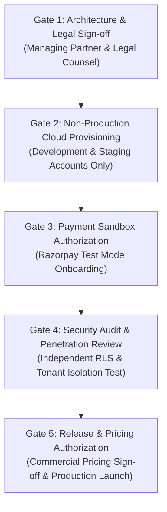
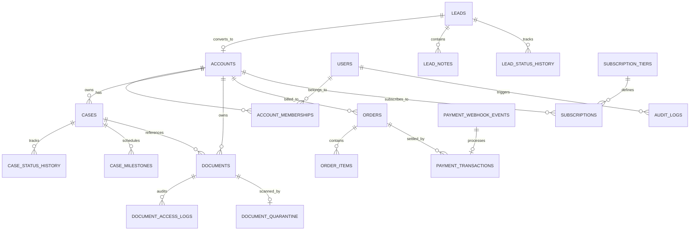
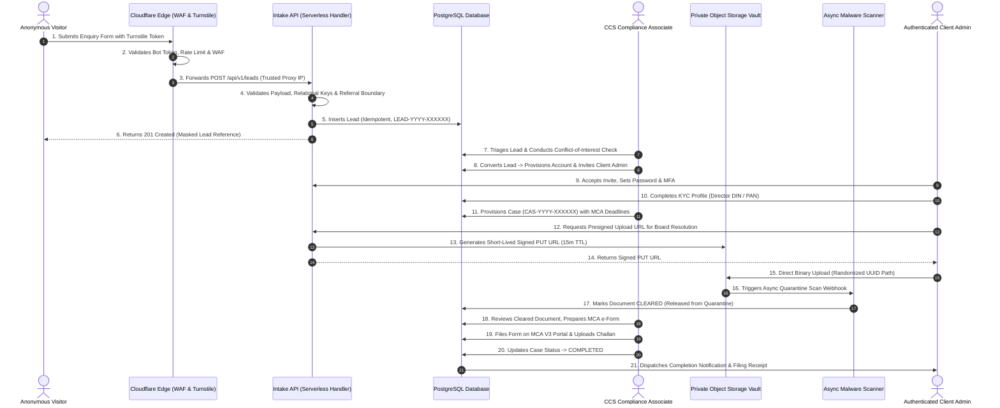
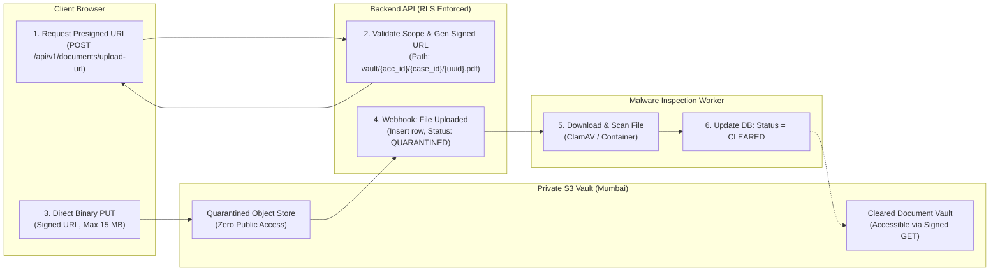
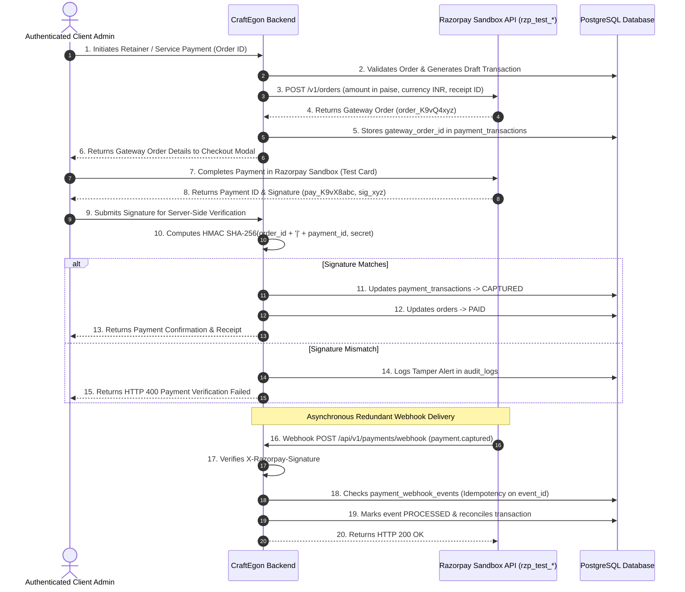
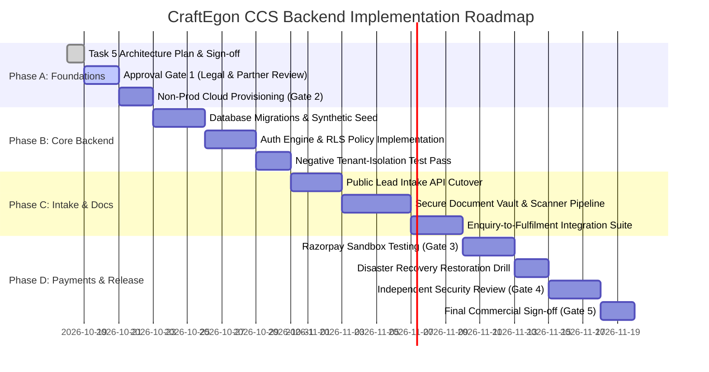

# CraftEgon CCS — Phase 3, Task 5: Provider-Specific Implementation Plan

**Project:** CraftEgon Corporate Compliance Services (CCS)  
**Document:** Phase 3, Task 5 — Provider-Specific Implementation Plan  
**Repository:** Local `craftegon-ccs` workspace (`c:\Users\shibi\OneDrive\Desktop\craftegon-ccs`)  
**Execution Environment:** Node.js v20.18.0 / Windows (Local architecture design & inspection only)  
**Execution Mode:** Local Planning & Inspection Only (0 cloud resources provisioned, 0 accounts created, 0 payment integrations, 0 production code changes, 0 commits, 0 pushes)  
**Date of Plan:** October 18, 2026  
**Status:** Comprehensive Architecture Plan Completed — Awaiting Managing Partner Review & Explicit Approval  

---

## Executive Summary

Phase 3, Tasks 1 through 4 established the architectural baseline, evaluated cloud provider options, built a local lead-intake prototype ([`src/backend/lead-intake-prototype.js`](file:///c:/Users/shibi/OneDrive/Desktop/craftegon-ccs/src/backend/lead-intake-prototype.js)), conducted an adversarial security review, remediated all 6 identified operational vulnerabilities, and achieved 100% test passing rates across both prototype assertions (30/30) and master regression suites (142/142).

The objective of **Phase 3, Task 5** is to prepare a production-oriented, security-first implementation plan for turning CraftEgon CCS customer journeys into functional, authenticated systems:
1. Public enquiry submission and lead management
2. Secure document intake and vault access
3. Authenticated client portal and case tracking
4. Future subscription and payment architecture (planning only)

### Strict Operational Boundaries Enforced
- **Planning and Local Inspection Only:** Zero cloud resources, external databases, cloud buckets, or third-party accounts were provisioned or configured.
- **Zero Production Mutation:** Production HTML, CSS, and client-side JavaScript remain completely untouched. Public enquiry forms retain their safe client-side fallback notices.
- **Zero Real Data or Credentials:** No real customer data, live merchant credentials, or confidential business records exist in the repository or local prototypes. All tests utilize 100% synthetic fixtures.
- **Phase 2 Baseline Preservation:** The canonical Phase 2 data layer (54 active services, 3 referral-only routes, 15 verticals) remains fully intact. All pricing data is treated as unapproved baseline estimates.

---

## 1. Executive Recommendation and Approval Gates

### 1.1 Candidate Selection & Rationale

| Architecture Candidate | Recommendation Tier | Key Architectural Rationale |
| :--- | :--- | :--- |
| **Managed PostgreSQL + Auth + Storage (Supabase Pro)** | **PREFERRED CANDIDATE** *(Subject to formal approval)* | **Highest Security for Client Confidentiality.** Engine-level Row-Level Security (RLS) directly binds user session tokens to database rows (`auth.uid()`). Native PostgreSQL delivers 100% data portability via standard `pg_dump`. AWS Mumbai (`ap-south-1`) deployment minimizes regulatory data residency risk under the Companies Act 2013 and DPDP Act 2023. Integrated GoTrue authentication provides MFA/TOTP, session rotation, and role-based access. |
| **Edge-Native Serverless (Cloudflare Workers + D1 + R2)** | **SECONDARY FALLBACK** *(Cost / deployment constrained)* | **Scale-to-Zero Minimal Cost ($5/mo).** Cloudflare Pages frontend integration, built-in 30-day Time Travel point-in-time recovery on D1, and zero egress fees on R2 object storage. **Critical Trade-off:** D1 lacks database-enforced Row-Level Security (RLS), forcing tenant isolation to rely entirely on application code (`WHERE client_id = ?`), introducing significant human-error vulnerability in multi-tenant corporate compliance. |
| **Serverless Postgres (Neon)** | **FORMALLY DISQUALIFIED** | **Zero Sovereign Presence in India.** Neon does not operate an infrastructure region in India (nearest is Singapore, `ap-southeast-1`). Imposes unacceptable 30–50ms latency penalties and severe cross-border compliance questions regarding corporate accounting books and director KYC records. |

### 1.2 Explicit Governance Approval Gates

A technical recommendation does **NOT** constitute authorization to create accounts, provision cloud infrastructure, or alter production assets. The following five sequential approval gates must be formally cleared:



- **Approval Gate 1: Architecture Sign-Off & Legal Boundary Review**
  - *Authority:* Managing Partner & Qualified Legal Counsel.
  - *Prerequisites:* Review of this implementation plan, formal sign-off on the preferred provider (Supabase Pro in AWS Mumbai), approval of the Data Fiduciary privacy notice under DPDP Act 2023, and confirmation of referral-only litigation boundaries under the Advocates Act 1961.
  - *Permitted Action:* Authorization to proceed to non-production environment setup.

- **Approval Gate 2: Non-Production Cloud Provisioning Approval**
  - *Authority:* Managing Partner & Technical Lead.
  - *Prerequisites:* Dedicated cloud accounts registered under corporate domain credentials with hardware MFA enforced; zero access to live client data.
  - *Permitted Action:* Creation of staging Supabase project in AWS Mumbai (`ap-south-1`), staging Cloudflare Pages preview environments, and non-sensitive staging environment variables.

- **Approval Gate 3: Payment Sandbox Authorization**
  - *Authority:* Managing Partner & Finance Controller.
  - *Prerequisites:* Corporate merchant profile review; verification that zero live banking or card networks are connected; sandbox key generation (`rzp_test_*` only).
  - *Permitted Action:* Implementation of sandbox checkout handlers and automated webhook signature tests. Live transactions strictly prohibited.

- **Approval Gate 4: Independent Security & Penetration Audit**
  - *Authority:* Independent Security Auditor & Technical Lead.
  - *Prerequisites:* Complete automated negative test suite passing; manual penetration testing verifying zero cross-tenant leakage between synthetic client accounts; verification of privileged `service_role` key isolation.
  - *Permitted Action:* Authorization to deploy production infrastructure without public traffic cutover.

- **Approval Gate 5: Production Release & Commercial Pricing Authorization**
  - *Authority:* Managing Partner & Executive Committee.
  - *Prerequisites:* Commercial fee schedule and statutory tax assumptions formally approved; legal retainer agreements reviewed; disaster recovery backup restoration drill successfully executed.
  - *Permitted Action:* Public form endpoint activation, live DNS routing, and production payment processing.

---

## 2. Evidence-Based Provider Comparison

*Official documentation and published enterprise pricing audited as of October 2026.*

### 2.1 Multi-Dimensional Provider Evaluation Matrix

| Architectural Dimension | Preferred Candidate: Supabase Pro | Secondary Fallback: Cloudflare Workers + D1 + R2 | Dedicated Cloud: AWS RDS PostgreSQL + S3 |
| :--- | :--- | :--- | :--- |
| **1. Regional Availability & Sovereignty** | **AWS Mumbai (`ap-south-1`) selectable on Pro.** Core database and storage reside in India. Management console, auth edge routers, and support systems operate globally. | **Global Anycast Edge Network.** Workers execute in 300+ cities globally. D1 storage location controls are currently restricted to US/EU/APAC; strict Indian sovereign boundary requires Enterprise agreement. | **100% Indian Sovereign Infrastructure.** Database, read replicas, automated snapshots, and S3 vaults reside strictly within AWS Mumbai (`ap-south-1`) inside an isolated VPC. |
| **2. Authentication & Account Recovery** | **Built-in GoTrue Engine.** Session JWTs, refresh tokens, TOTP Multi-Factor Authentication, Magic Links, password recovery, session revocation. Claims (`auth.uid()`) directly injected into PostgreSQL engine. | **Custom Worker Implementation.** No native user directory. Must author custom JWT validation, session token rotation, password hashing (Argon2id/bcrypt), and account recovery logic in Worker code. | **AWS Cognito or Custom Auth Microservice.** Cognito charges $0.0055/MAU after 50k MAUs. Requires custom middleware to inject claims into Postgres via `SET LOCAL app.current_user_id`. |
| **3. Tenant Isolation & Database Security** | **Native PostgreSQL Row-Level Security (RLS).** Database-enforced `USING` and `WITH CHECK` policies. Queries executed with user context automatically filter out other tenants. | **Application-Layer Authorization Only.** D1 (SQLite) has **no native RLS**. Every SQL query must manually enforce `WHERE client_id = ?`. Risk of developer oversight causing catastrophic cross-tenant data leaks. | **Native PostgreSQL RLS.** Full database engine enforcement. Requires RDS Proxy configured to manage connection pooling without leaking session-level claims between connections. |
| **4. Database Backups, Recovery & Export** | **7-day daily backups included.** Direct `pg_dump` export supported. Managed Point-in-Time Recovery (PITR) add-on is available at $100/mo. Portability is 100% standard PostgreSQL. | **Built-in 30-day Time Travel.** Point-in-time recovery for the past 30 days included at no extra cost on Workers Paid ($5/mo). Exportable via `wrangler d1 export` to SQLite files. | **Automated Snapshots & Continuous PITR.** 1–35 days automated retention included in base storage pricing. Standard `pg_dump` export with zero proprietary wrappers. |
| **5. Private Document Storage** | **Supabase Storage (S3-compatible).** Declarative RLS policies on `storage.objects`. Server-side presigned upload/download URLs. 100 GB storage included; $0.021/GB overage. | **Cloudflare R2 (S3-compatible).** Native S3 API support. Presigned URLs supported. **$0 data egress bandwidth fees.** 10 GB storage included; $0.015/GB overage. | **AWS S3 Mumbai (`ap-south-1`).** Industry-standard object storage. Fine-grained IAM policies, AWS KMS customer-managed encryption keys, S3 Object Lock for statutory compliance. |
| **6. Malware Scanning Integration** | **Operational Responsibility: User.** Supabase Storage provides **no built-in virus scanner**. Requires deploying an asynchronous event worker (AWS Lambda or container running ClamAV) triggered on upload webhooks. | **Operational Responsibility: User.** R2 has no native virus scanning. Scanning must be performed via Worker streaming to an external API (VirusTotal / MetaDefender) or processing post-upload. | **Native AWS Ecosystem Integration.** Can integrate AWS GuardDuty Malware Protection for S3 or deploy an ECS ClamAV task inside the VPC with automated S3 tagging. |
| **7. Rate Limiting & Bot Protection** | **Upstream Reverse Proxy Required.** Built-in API gateway provides basic burst rate limiting, but edge bot mitigation (Turnstile / WAF) must be handled by an upstream CDN (e.g. Cloudflare). | **Native Cloudflare Edge Protection.** Integrated Turnstile challenge verification, Cloudflare WAF, DDoS mitigation, and Workers Rate Limiting API executed at edge before hitting database. | **AWS WAF Integration.** Requires AWS WAF configured on Application Load Balancer or CloudFront distribution, adding $5/mo rule base + $1/million requests. |
| **8. Transactional Communications** | **Subprocessor Integration Required.** Default Supabase SMTP is rate-limited (30 emails/hr) for testing. Production requires contracting an Indian or global relay (AWS SES Mumbai / Gupshup / Jio DLT). | **Subprocessor Integration Required.** Requires external API calls from Workers to transactional email (Resend / Postmark / SES) and Indian SMS/WhatsApp aggregators. | **Subprocessor Integration Required.** Direct integration with AWS SES in Mumbai (`ap-south-1`) for email and SNS / Indian DLT SMS gateways. |
| **9. Total Estimated Monthly Baseline** | **$26.50 – $32.50 / month (~₹2,225 – ₹2,730)** *(Excluding $100/mo managed PITR; using automated daily pg_dump to S3 Mumbai @ $1/mo).* | **$5.00 – $10.00 / month (~₹420 – ₹840)** *(Workers Paid base tier with 30-day D1 Time Travel and $0 R2 egress).* | **$19.35 – $35.00 / month (~₹1,625 – ₹2,940)** *(db.t4g.micro instance + gp3 storage + S3 Mumbai).* |
| **10. Migration Effort & Lock-in** | **Extremely Low.** 100% standard open-source PostgreSQL. Can migrate entire database and schemas to any self-hosted or cloud PostgreSQL in hours. | **Moderate.** D1 uses SQLite dialect and proprietary Worker bindings. Migrating to PostgreSQL requires converting data types, schema DDL, and rewriting query logic. | **Extremely Low.** 100% standard open-source PostgreSQL with standard AWS tooling. |

### 2.2 Official Documentation Sources Audited

- **Supabase Pricing & Compute Tiers:** [https://supabase.com/pricing](https://supabase.com/pricing) (Audited: October 2026)
- **Supabase Enterprise & Point-in-Time Recovery:** [https://supabase.com/docs/guides/platform/compute-add-ons](https://supabase.com/docs/guides/platform/compute-add-ons) (Audited: October 2026)
- **Supabase Regional Infrastructure Availability:** [https://supabase.com/docs/guides/platform/regions](https://supabase.com/docs/guides/platform/regions) (Audited: October 2026; confirmed AWS Mumbai `ap-south-1`)
- **Cloudflare Workers, D1 & R2 Pricing:** [https://developers.cloudflare.com/workers/platform/pricing/](https://developers.cloudflare.com/workers/platform/pricing/) (Audited: October 2026)
- **Cloudflare D1 Time Travel & Backup Documentation:** [https://developers.cloudflare.com/d1/platform/time-travel/](https://developers.cloudflare.com/d1/platform/time-travel/) (Audited: October 2026)
- **AWS RDS PostgreSQL Mumbai Pricing:** [https://aws.amazon.com/rds/postgresql/pricing/](https://aws.amazon.com/rds/postgresql/pricing/) (Audited: October 2026)
- **Neon Regional Infrastructure Limits:** [https://neon.tech/pricing](https://neon.tech/pricing) (Audited: October 2026; confirmed zero Indian regions)

### 2.3 Distinction: Verified Facts vs. Estimates vs. Unresolved Questions

- **Verified Facts:**
  1. Supabase Pro supports provisioning the underlying PostgreSQL database directly in AWS Mumbai (`ap-south-1`).
  2. Neon has zero presence in India and is formally disqualified.
  3. Cloudflare D1 does not support PostgreSQL-style Row-Level Security.
  4. PostgreSQL RLS is an access-control mechanism, not a mathematical guarantee; a single bypass in a view (`security definer`), a misconfigured policy, or an exposed `service_role` key exposes all records.
  5. Supabase Storage has no native antivirus scanning; virus scanning is 100% an operational responsibility of CraftEgon CCS.
- **Technical Estimates:**
  1. Base operational costs for Supabase Pro will range from $26.50 to $32.50/month under initial volume (500–1,500 leads/mo, 20–50 retainer clients, 10–30 GB storage).
  2. A hybrid backup strategy (Supabase 7-day daily snapshots + automated daily `pg_dump` to AWS S3 Mumbai) costs ~$1.00/month, avoiding the $100/mo managed PITR surcharge while satisfying disaster recovery RTO/RPO objectives.
- **Unresolved Governance Questions:**
  1. Does CraftEgon CCS legal counsel require continuous Point-in-Time Recovery (PITR) to meet professional indemnity insurance standards, or is a daily recovery point acceptable?
  2. Does the Managing Partner authorize routing administrative user authentication metadata through Supabase global edge routers, or does firm policy demand 100% sovereign isolation via self-hosted AWS RDS in Mumbai?

---

## 3. Backend Data Model and Access Matrix

### 3.1 Entity Relationship Diagram



### 3.2 Detailed Entity Schema Specifications

All entities utilize immutable UUIDv4 primary keys, strict UTC timestamps, database-enforced relational foreign keys, and explicit check constraints.

#### 1. `accounts` (Client Companies / LLPs / Sole Proprietorships)
- **Purpose:** Primary tenant organization entity representing a corporate or individual client. All cases, documents, orders, and subscriptions attach to an account.
- **Key Fields:**
  - `id` (UUID, PK, `gen_random_uuid()`): Immutable unique tenant identifier.
  - `entity_name` (VARCHAR(200), NOT NULL): Legal name of the company or firm.
  - `entity_type` (VARCHAR(50), NOT NULL): Enum (`PVT_LTD`, `PUBLIC_LTD`, `LLP`, `OPC`, `PARTNERSHIP`, `PROPRIETORSHIP`, `TRUST`, `SOCIETY`, `SECTION_8`).
  - `cin_llpin` (VARCHAR(21), NULL): MCA-registered Corporate Identification Number or LLPIN (validated by regex format).
  - `pan` (VARCHAR(10), NULL): Permanent Account Number of the entity.
  - `registered_office_address` (JSONB, NOT NULL): Structured street, city, state, postal code, jurisdiction.
  - `created_at` (TIMESTAMPTZ, NOT NULL, DEFAULT `NOW()`): Account provisioning timestamp.
  - `updated_at` (TIMESTAMPTZ, NOT NULL, DEFAULT `NOW()`): Last modification timestamp.
- **Relationships:** One-to-many with `account_memberships`, `cases`, `documents`, `orders`, `subscriptions`.
- **Database Constraints:** `CHECK (entity_type IN (...))`, `UNIQUE(cin_llpin) WHERE cin_llpin IS NOT NULL`.
- **Retention Proposal:** 8 Financial Years post-engagement closure (Companies Act 2013, Section 128) *(Requires qualified legal/tax review)*.

#### 2. `users` (Identity & Authentication Profiles)
- **Purpose:** Extends the Supabase `auth.users` authentication identity with profile metadata, professional qualifications, and active status.
- **Key Fields:**
  - `id` (UUID, PK, FK -> `auth.users.id` ON DELETE CASCADE): References GoTrue authenticated identity.
  - `full_name` (VARCHAR(100), NOT NULL): Contact person's legal name.
  - `email` (VARCHAR(254), NOT NULL, UNIQUE): Verified email address.
  - `phone` (VARCHAR(20), NOT NULL): Primary mobile number (E.164 / Indian mobile format).
  - `user_type` (VARCHAR(30), NOT NULL): Enum (`CLIENT_USER`, `CCS_STAFF`, `MANAGING_PARTNER`).
  - `is_active` (BOOLEAN, NOT NULL, DEFAULT `TRUE`): Soft-disable flag.
  - `created_at` (TIMESTAMPTZ, NOT NULL, DEFAULT `NOW()`).
- **Relationships:** One-to-many with `account_memberships`, `audit_logs`.
- **Database Constraints:** `CHECK (user_type IN ('CLIENT_USER', 'CCS_STAFF', 'MANAGING_PARTNER'))`.
- **Retention Proposal:** Duration of active relationship + 5 years post-account deactivation (PMLA KYC requirements) *(Requires qualified legal/tax review)*.

#### 3. `account_memberships` (Tenant RBAC & Isolation Bridge)
- **Purpose:** Associates authenticated users with client accounts and grants specific access roles within that tenant boundary.
- **Key Fields:**
  - `id` (UUID, PK, `gen_random_uuid()`).
  - `account_id` (UUID, NOT NULL, FK -> `accounts.id` ON DELETE CASCADE).
  - `user_id` (UUID, NOT NULL, FK -> `users.id` ON DELETE CASCADE).
  - `role` (VARCHAR(30), NOT NULL): Enum (`CLIENT_ADMIN`, `CLIENT_MEMBER`).
  - `created_at` (TIMESTAMPTZ, NOT NULL, DEFAULT `NOW()`).
- **Database Constraints:** `UNIQUE(account_id, user_id)`, `CHECK (role IN ('CLIENT_ADMIN', 'CLIENT_MEMBER'))`.
- **Access Control:** Evaluated by RLS helper function `auth.has_account_access(target_account_id)`.

#### 4. `leads` (Public Enquiries & Prospective Engagements)
- **Purpose:** Durable persistence for public website submissions captured via [`src/backend/lead-intake-prototype.js`](file:///c:/Users/shibi/OneDrive/Desktop/craftegon-ccs/src/backend/lead-intake-prototype.js).
- **Key Fields:**
  - `id` (UUID, PK, `gen_random_uuid()`).
  - `lead_reference` (VARCHAR(30), NOT NULL, UNIQUE): Human-readable reference (e.g. `LEAD-2026-8F4A12`).
  - `status` (VARCHAR(30), NOT NULL, DEFAULT `'NEW'`): Enum (`NEW`, `TRIAGED`, `QUALIFIED`, `PROPOSAL_SENT`, `CONVERTED`, `REJECTED`, `PURGED`).
  - `contact_name` (VARCHAR(100), NOT NULL).
  - `email` (VARCHAR(254), NOT NULL).
  - `phone` (VARCHAR(20), NOT NULL).
  - `entity_name` (VARCHAR(200), NULL).
  - `service_id` (VARCHAR(20), NULL): References active Phase 2 service ID (`V01-SVC-001` to `V13-SVC-003`).
  - `vertical_id` (VARCHAR(10), NULL): References Phase 2 practice vertical (`V01` to `V15`).
  - `scope_description` (TEXT, NULL).
  - `source_url` (VARCHAR(255), NULL).
  - `consent_recorded` (BOOLEAN, NOT NULL, DEFAULT `FALSE`): DPDP Act 2023 compliance flag.
  - `ip_hash` (VARCHAR(64), NOT NULL): Salted SHA-256 hash of client network IP.
  - `account_id` (UUID, NULL, FK -> `accounts.id`): Populated when lead converts to client.
  - `created_at` (TIMESTAMPTZ, NOT NULL, DEFAULT `NOW()`).
  - `retention_purge_date` (TIMESTAMPTZ, NOT NULL): Pre-computed purge date (`created_at + INTERVAL '180 days'`).
- **Database Constraints:** Foreign key alignment checked via triggers or application layer against Phase 2 service registry.
- **Retention Proposal:** 180 Days from submission for unconverted leads (DPDP Act 2023 purpose limitation); converted leads link to permanent client account *(Requires qualified legal/tax review)*.

#### 5. `cases` (Compliance Engagements & Secretarial Filings)
- **Purpose:** Represents an active client engagement, MCA statutory filing, corporate restructuring, or compliance audit.
- **Key Fields:**
  - `id` (UUID, PK, `gen_random_uuid()`).
  - `case_reference` (VARCHAR(30), NOT NULL, UNIQUE): e.g. `CAS-2026-0042`.
  - `account_id` (UUID, NOT NULL, FK -> `accounts.id` ON DELETE RESTRICT).
  - `service_id` (VARCHAR(20), NOT NULL): Valid Phase 2 service ID.
  - `status` (VARCHAR(30), NOT NULL, DEFAULT `'INITIATED'`): Enum (`INITIATED`, `DOCUMENTS_PENDING`, `UNDER_REVIEW`, `DRAFTING`, `CLIENT_APPROVAL`, `FILED_MCA`, `COMPLETED`, `CANCELLED`).
  - `assigned_associate_id` (UUID, NULL, FK -> `users.id`): Assigned CCS Compliance Associate.
  - `managing_partner_id` (UUID, NULL, FK -> `users.id`): Supervising partner.
  - `target_completion_date` (DATE, NULL): Statutory or contractual due date.
  - `created_at` (TIMESTAMPTZ, NOT NULL, DEFAULT `NOW()`).
  - `updated_at` (TIMESTAMPTZ, NOT NULL, DEFAULT `NOW()`).
- **Retention Proposal:** 8 Financial Years post-closure (Companies Act 2013) *(Requires qualified legal/tax review)*.

#### 6. `case_status_history` (Immutable Workflow Audit Trail)
- **Purpose:** Append-only log of every state change in a case to guarantee evidentiary integrity.
- **Key Fields:**
  - `id` (UUID, PK, `gen_random_uuid()`).
  - `case_id` (UUID, NOT NULL, FK -> `cases.id` ON DELETE CASCADE).
  - `previous_status` (VARCHAR(30), NULL).
  - `new_status` (VARCHAR(30), NOT NULL).
  - `changed_by_user_id` (UUID, NOT NULL, FK -> `users.id`).
  - `change_reason` (TEXT, NOT NULL).
  - `created_at` (TIMESTAMPTZ, NOT NULL, DEFAULT `NOW()`).
- **Database Constraints:** Append-only table. `UPDATE` and `DELETE` privileges revoked for all roles via RLS.

#### 7. `documents` (Vault Metadata & Storage Registry)
- **Purpose:** Metadata registry for private client files (director KYC, board resolutions, MOA/AOA, filed MCA e-forms).
- **Key Fields:**
  - `id` (UUID, PK, `gen_random_uuid()`).
  - `account_id` (UUID, NOT NULL, FK -> `accounts.id` ON DELETE RESTRICT).
  - `case_id` (UUID, NULL, FK -> `cases.id` ON DELETE SET NULL).
  - `storage_bucket` (VARCHAR(50), NOT NULL, DEFAULT `'craftegon-vault-prod'`).
  - `storage_path` (VARCHAR(500), NOT NULL, UNIQUE): Randomized storage path (`vault/{account_id}/{case_id}/{uuid}.pdf`).
  - `original_filename` (VARCHAR(255), NOT NULL): Original user-supplied filename.
  - `file_size_bytes` (INTEGER, NOT NULL): Byte size (capped at 15 MB).
  - `mime_type` (VARCHAR(100), NOT NULL): Verified MIME type (`application/pdf`, etc.).
  - `file_hash_sha256` (VARCHAR(64), NOT NULL): Cryptographic integrity digest.
  - `document_category` (VARCHAR(50), NOT NULL): Enum (`DIRECTOR_KYC`, `BOARD_RESOLUTION`, `FINANCIAL_STATEMENT`, `MCA_FILING_CHALLAN`, `CERTIFICATE`, `CONTRACT`).
  - `scan_status` (VARCHAR(30), NOT NULL, DEFAULT `'QUARANTINED'`): Enum (`QUARANTINED`, `CLEARED`, `INFECTED`, `SCAN_FAILED`).
  - `uploaded_by_user_id` (UUID, NOT NULL, FK -> `users.id`).
  - `created_at` (TIMESTAMPTZ, NOT NULL, DEFAULT `NOW()`).
- **Database Constraints:** `CHECK (file_size_bytes <= 15728640)`, `CHECK (scan_status IN (...))`.
- **Retention Proposal:** 8 Financial Years post-engagement (Companies Act 2013) / 5 Years (PMLA KYC) *(Requires qualified legal/tax review)*.

#### 8. `document_access_logs` (Access Accountability Registry)
- **Purpose:** Append-only log recording every view, presigned URL generation, download, and permission modification of a document.
- **Key Fields:**
  - `id` (UUID, PK, `gen_random_uuid()`).
  - `document_id` (UUID, NOT NULL, FK -> `documents.id` ON DELETE CASCADE).
  - `user_id` (UUID, NOT NULL, FK -> `users.id`).
  - `action` (VARCHAR(30), NOT NULL): Enum (`PRESIGNED_URL_GENERATED`, `DOWNLOADED`, `METADATA_VIEWED`, `DELETED`).
  - `ip_address` (VARCHAR(45), NOT NULL): Salted hash or network IP.
  - `user_agent` (VARCHAR(255), NULL).
  - `created_at` (TIMESTAMPTZ, NOT NULL, DEFAULT `NOW()`).

#### 9. `document_quarantine` (Asynchronous Antivirus Inspection Audit)
- **Purpose:** Records asynchronous security scanning results before documents are released from quarantine.
- **Key Fields:**
  - `id` (UUID, PK, `gen_random_uuid()`).
  - `document_id` (UUID, NOT NULL, UNIQUE, FK -> `documents.id` ON DELETE CASCADE).
  - `scanner_engine` (VARCHAR(50), NOT NULL): e.g. `ClamAV-Daemon-v1.4` or `AWS-GuardDuty-S3`.
  - `scan_result` (VARCHAR(30), NOT NULL): Enum (`CLEAN`, `MALICIOUS`, `CORRUPTED`, `TIMEOUT`).
  - `threat_details` (JSONB, NULL): Threat signature names if flagged.
  - `scanned_at` (TIMESTAMPTZ, NOT NULL, DEFAULT `NOW()`).

#### 10. `orders` (Engagement Billing & Invoices)
- **Purpose:** Commercial billing contracts and fee schedules generated for compliance services.
- **Key Fields:**
  - `id` (UUID, PK, `gen_random_uuid()`).
  - `order_reference` (VARCHAR(30), NOT NULL, UNIQUE): e.g. `ORD-2026-0105`.
  - `account_id` (UUID, NOT NULL, FK -> `accounts.id` ON DELETE RESTRICT).
  - `case_id` (UUID, NULL, FK -> `cases.id` ON DELETE SET NULL).
  - `currency` (VARCHAR(3), NOT NULL, DEFAULT `'INR'`).
  - `subtotal_amount_paise` (BIGINT, NOT NULL): Stored in smallest currency unit (paise; ₹100.00 = 10000 paise).
  - `gst_amount_paise` (BIGINT, NOT NULL): 18% GST calculation (pending commercial review).
  - `total_amount_paise` (BIGINT, NOT NULL).
  - `status` (VARCHAR(30), NOT NULL, DEFAULT `'DRAFT'`): Enum (`DRAFT`, `PENDING_PAYMENT`, `PAID`, `CANCELLED`, `REFUNDED`).
  - `created_at` (TIMESTAMPTZ, NOT NULL, DEFAULT `NOW()`).
- **Disclaimer:** All pricing figures are treated as unapproved baseline estimates pending formal commercial fee schedule authorization.

#### 11. `payment_transactions` (Payment Ledger — Zero Cardholder Data)
- **Purpose:** Server-side financial transaction ledger. **Never stores credit card PANs, expiration dates, or CVVs.**
- **Key Fields:**
  - `id` (UUID, PK, `gen_random_uuid()`).
  - `order_id` (UUID, NOT NULL, FK -> `orders.id` ON DELETE RESTRICT).
  - `payment_gateway` (VARCHAR(30), NOT NULL, DEFAULT `'RAZORPAY'`): Enum (`RAZORPAY`, `BANK_NEFT_RTGS`).
  - `gateway_order_id` (VARCHAR(100), NOT NULL): e.g. `order_K9vQ4...` generated by Razorpay API.
  - `gateway_payment_id` (VARCHAR(100), NULL): e.g. `pay_K9vX8...` received upon successful capture.
  - `gateway_signature` (VARCHAR(255), NULL): HMAC SHA-256 signature token.
  - `amount_paise` (BIGINT, NOT NULL).
  - `status` (VARCHAR(30), NOT NULL): Enum (`CREATED`, `AUTHORIZED`, `CAPTURED`, `REFUNDED`, `FAILED`).
  - `created_at` (TIMESTAMPTZ, NOT NULL, DEFAULT `NOW()`).
  - `settled_at` (TIMESTAMPTZ, NULL).

#### 12. `payment_webhook_events` (Webhook Idempotency Log)
- **Purpose:** Enforces strict idempotency on payment gateway webhooks to prevent duplicate fulfillment or double-charging.
- **Key Fields:**
  - `id` (UUID, PK, `gen_random_uuid()`).
  - `provider` (VARCHAR(30), NOT NULL, DEFAULT `'RAZORPAY'`).
  - `provider_event_id` (VARCHAR(100), NOT NULL, UNIQUE): Unique event ID from webhook header.
  - `event_type` (VARCHAR(50), NOT NULL): e.g. `payment.captured`, `payment.failed`.
  - `payload_hash` (VARCHAR(64), NOT NULL): SHA-256 digest of raw payload.
  - `processing_status` (VARCHAR(30), NOT NULL, DEFAULT `'PENDING'`): Enum (`PENDING`, `PROCESSED`, `IGNORED`, `FAILED`).
  - `created_at` (TIMESTAMPTZ, NOT NULL, DEFAULT `NOW()`).
  - `processed_at` (TIMESTAMPTZ, NULL).
- **Database Constraints:** `UNIQUE(provider, provider_event_id)`.

#### 13. `audit_logs` (System-Wide Immutable Security Registry)
- **Purpose:** Immutable audit trail of all administrative actions, authentication events, and data exports.
- **Key Fields:**
  - `id` (UUID, PK, `gen_random_uuid()`).
  - `user_id` (UUID, NULL, FK -> `users.id`): Actor (NULL for anonymous public events).
  - `event_type` (VARCHAR(50), NOT NULL): e.g. `AUTH_LOGIN`, `RLS_VIOLATION_BLOCKED`, `DOCUMENT_DOWNLOAD`.
  - `resource_type` (VARCHAR(50), NOT NULL): e.g. `CASE`, `DOCUMENT`, `ACCOUNT`.
  - `resource_id` (UUID, NULL).
  - `ip_hash` (VARCHAR(64), NOT NULL).
  - `metadata` (JSONB, NOT NULL, DEFAULT `'{}'::jsonb`): Stripped of unmasked PII, tokens, and internal paths.
  - `created_at` (TIMESTAMPTZ, NOT NULL, DEFAULT `NOW()`).
- **Database Constraints:** Append-only table. Revoke `UPDATE` and `DELETE` on all roles.

---

### 3.3 Least-Privilege Role-Based Access Control (RBAC) Matrix

| Operational Role | Enquiries (`leads`) | Client Accounts (`accounts`) | Cases (`cases`) | Documents (`documents`) | Billing (`orders`) | Security (`audit_logs`) |
| :--- | :--- | :--- | :--- | :--- | :--- | :--- |
| **Anonymous Caller** | **INSERT ONLY** *(rate-limited & sanitized)* | **NO ACCESS** *(HTTP 401)* | **NO ACCESS** *(HTTP 401)* | **NO ACCESS** *(HTTP 401)* | **NO ACCESS** *(HTTP 401)* | **NO ACCESS** |
| **Client Member** | **NO ACCESS** | **SELECT (Own Account Only)** | **SELECT (Own Cases Only)** | **SELECT (Cleared Docs in Own Cases)** | **SELECT (Own Orders Only)** | **NO ACCESS** |
| **Client Admin** | **NO ACCESS** | **SELECT, UPDATE (Own Account)** | **SELECT, UPDATE (Own Cases)** | **SELECT, INSERT (Upload to Own Cases)** | **SELECT, PAY (Own Orders)** | **NO ACCESS** |
| **CCS Compliance Associate** | **SELECT, UPDATE (Assigned Leads)** | **SELECT (Assigned Accounts)** | **SELECT, INSERT, UPDATE (Assigned Cases)** | **SELECT, INSERT (All Docs in Assigned Cases)** | **SELECT (Draft Orders)** | **NO ACCESS** |
| **Managing Partner Admin** | **FULL ACCESS** *(View, Assign, Purge)* | **FULL ACCESS** *(Create, Modify, Archive)* | **FULL ACCESS** *(Supervise, Reassign)* | **FULL ACCESS** *(Audit, Quarantine Override)* | **FULL ACCESS** *(Approve, Issue, Refund)* | **SELECT ONLY** *(Immutable)* |

---

## 4. Enquiry-to-Fulfilment Workflow



### Detailed Lifecycle Stages & Controls

#### Stage 1: Public Enquiry Submission
- **Description:** Prospective clients submit initial enquiries from static service pages.
- **Abuse Controls:** Invisible Cloudflare Turnstile verification; hidden honeypot trap (`_hp_website`); client timing token (`_t_token`) verifying human interaction duration (> 2.0 seconds).
- **Separation Boundary:** Anonymous visitors cannot specify or view `account_id`, `case_id`, or `user_id`. Any request carrying authenticated parameters is immediately rejected.

#### Stage 2: Input Validation, Anti-Abuse & Rate Limiting
- **Description:** Server validates structure, size, and relational consistency.
- **Controls:** Strict 32 KB maximum payload size; RFC 5322 email regex; Indian 10-digit mobile phone validation; service-to-vertical relational verification against canonical Phase 2 registry ([`data/service-registry.json`](file:///c:/Users/shibi/OneDrive/Desktop/craftegon-ccs/data/service-registry.json)).
- **Litigation Boundary:** Any enquiry indicating a contentious litigation route (e.g. `/services/nclt-insolvency-defense.html`, `/services/director-removal-board-disputes.html`) is immediately rejected with referral notice under Advocates Act 1961 rules.
- **Rate Limiting:** Sliding-window rate limiter enforcing max 5 submissions per 10 minutes per salted IP hash.

#### Stage 3: Duplicate Detection and Durable Lead Creation
- **Description:** Creates persistent lead record in `leads` table.
- **Idempotency:** Client passes `Idempotency-Key` or system generates SHA-256 fingerprint from `(ip_hash, email, service_id, 15m_window)`. Duplicate submissions within 15 minutes return the existing lead reference without inserting new rows.
- **Output:** Returns `HTTP 201 Created` with human-readable tracking token (`LEAD-YYYY-XXXXXX`).

#### Stage 4: Staff Triage and Conflict Check
- **Description:** CCS Compliance Associate reviews unassigned lead queue.
- **Workflow:** Associate conducts mandatory conflict-of-interest check (checking proposed entity name and directors against existing client roster).
- **Outcome:** If conflict exists, lead is rejected with ethical compliance note. If clear, lead is marked `QUALIFIED`.

#### Stage 5: Client / Account Creation and Identity Verification (KYC)
- **Description:** On engagement agreement, lead is formally converted.
- **Workflow:** Associate triggers account provisioning: inserts row into `accounts`, sets `leads.status = 'CONVERTED'`, and triggers an authenticated user invitation to the prospective Client Admin.
- **KYC Collection:** Client Admin logs in via MFA and submits corporate KYC documents (Certificate of Incorporation, PAN, Director DIN).

#### Stage 6: Case Creation and Status History
- **Description:** A dedicated case record is provisioned (`CAS-YYYY-XXXXXX`).
- **Milestones:** System generates statutory milestone timeline (e.g. Board Meeting Notice -> Resolution Drafting -> Form Filing -> MCA Approval).
- **Audit:** Initial entry logged into `case_status_history` (`INITIATED`).

#### Stage 7: Secure Document Intake and Access
- **Description:** Client or staff uploads supporting documentation.
- **Protocol:** Server verifies user authorization via RLS, generates a short-lived presigned upload URL (15-minute TTL) to private object storage. Direct client-to-storage upload bypasses application server memory.
- **Quarantine:** Upload is marked `QUARANTINED` until verified clean by asynchronous malware scanner.

#### Stage 8: Client Notifications and Audit Events
- **Description:** Automated transactional updates dispatched upon major case milestones.
- **Delivery:** Transactional email dispatched via Indian SES relay; SMS/WhatsApp dispatched via approved Indian DLT template.
- **Audit:** Every notification logged to `audit_logs` with masked recipient metadata.

#### Stage 9: Service Fulfilment and Closure
- **Description:** CCS professionals complete drafting, execute filings on the Ministry of Corporate Affairs (MCA V3) portal, and upload official SRN challans and approval certificates.
- **Closure:** Case transitions to `COMPLETED`. Retainer subscription or project invoice marked settled.

#### Stage 10: Retention, Export, and Deletion Workflows
- **Unconverted Leads:** Nightly scheduled cron worker queries `leads WHERE status != 'CONVERTED' AND created_at < NOW() - INTERVAL '180 days'` and hard-deletes records in compliance with DPDP Act 2023 purpose limitation.
- **Active Client Records:** Retained in immutable archive for 8 Financial Years following engagement termination pursuant to Section 128 of the Companies Act 2013 *(Subject to formal legal counsel review)*.

---

## 5. Secure Document-Intake Design



### 5.1 Storage Architecture & Container Isolation
- **Private by Default:** The document vault bucket (`craftegon-vault-prod`) enforces strict private permissions (`block_public_acls = true`, `block_public_policy = true`, `ignore_public_acls = true`, `restrict_public_buckets = true`). Zero public URL access exists.
- **Randomized Storage Keys:** User-provided filenames are never used in storage paths to prevent path traversal and directory enumeration. 
  - Standard Path Format: `vault/{account_id}/{case_id}/{crypto_uuid_v4}.{ext}`
  - Example: `vault/e4a1c5b0-1234-4567-89ab-cdef01234567/a9b8c7d6-9876-5432-10fe-dcba98765432/3f82a1b9-d4e5-4f6a-8b7c-1e2f3a4b5c6d.pdf`

### 5.2 File Validation Matrix

| File Type / Category | Allowed Extensions | Verified MIME Types | Magic Number (Hex File Signature) | Max File Size |
| :--- | :--- | :--- | :--- | :--- |
| **PDF Documents** *(Statutory forms, MOA/AOA)* | `.pdf` | `application/pdf` | `25 50 44 46` (`%PDF-`) | 15 MB |
| **Word Deliverables** *(Draft agreements)* | `.docx` | `application/vnd.openxmlformats-officedocument.wordprocessingml.document` | `50 4B 03 04` (`PK..`) | 15 MB |
| **Excel Worksheets** *(Statutory registers)* | `.xlsx` | `application/vnd.openxmlformats-officedocument.spreadsheetml.sheet` | `50 4B 03 04` (`PK..`) | 15 MB |
| **Identity Proofs** *(Director PAN / Passport)* | `.jpeg`, `.jpg` | `image/jpeg` | `FF D8 FF` | 5 MB |
| **Identity Proofs** *(Digital signatures)* | `.png` | `image/png` | `89 50 4E 47 0D 0A 1A 0A` | 5 MB |

*Strictly Prohibited Extensions:* `.exe`, `.bat`, `.cmd`, `.sh`, `.js`, `.vbs`, `.msi`, `.zip`, `.tar`, `.gz`, `.html`, `.svg`. Any file matching prohibited extensions or failing magic-byte inspection is immediately rejected.

### 5.3 Presigned URL Lifecycle & Scoping
- **Upload URLs (PUT):**
  - Generated exclusively server-side via authenticated API endpoint `POST /api/v1/documents/upload-url`.
  - Expiration (TTL): **15 minutes**.
  - Scope: Bounded to exact target object key and enforced `Content-Length-Range` (max 15 MB) and `Content-Type`. Single-use design.
- **Download URLs (GET):**
  - Generated exclusively server-side via authenticated API endpoint `GET /api/v1/documents/:id/download-url`.
  - Expiration (TTL): **5 minutes**.
  - Authorization Gate: Verifies requesting user is an active member of `account_id` associated with document and that `scan_status == 'CLEARED'`.
  - Audit: Every URL generation writes an entry to `document_access_logs`.

### 5.4 Asynchronous Malware Scanning & Quarantine Pipeline
- **Operational Reality & Provider Gap:** Supabase Storage does **not** provide native antivirus scanning out of the box. 
- **Proposed Inspection Engine:** An asynchronous event worker (AWS Lambda or lightweight container running ClamAV Daemon in AWS Mumbai) subscribed to bucket upload notifications:
  1. File is uploaded with metadata status `scan_status = 'QUARANTINED'`.
  2. Bucket notification triggers the scanner worker.
  3. Scanner streams the file, calculates SHA-256 hash, and performs signature and heuristic analysis.
  4. If Clean: Worker updates `documents.scan_status = 'CLEARED'` and logs clean result in `document_quarantine`. Document becomes immediately visible to client and staff.
  5. If Malicious: Worker immediately deletes the object from storage, updates `documents.scan_status = 'INFECTED'`, records threat details, and alerts the Managing Partner.

---

## 6. Authentication and Tenant-Isolation Test Plan

A comprehensive suite of negative security tests designed to verify that tenant isolation and privilege boundaries cannot be breached.

### 6.1 Negative Test Matrix

| Test ID | Vulnerability / Threat Tested | Attack Vector / Test Scenario | Expected Outcome & Denial Mechanism | Verification Method |
| :--- | :--- | :--- | :--- | :--- |
| **NEG-01** | **Anonymous Route Access** | Anonymous unauthenticated caller attempts `GET /api/v1/cases` or `GET /api/v1/documents`. | **HTTP 401 Unauthorized.** Request rejected at API gateway / GoTrue middleware before database query execution. | Automated CI/CD Integration Test |
| **NEG-02** | **Horizontal Cross-Tenant Leakage (Cases)** | Authenticated Client A user sends `GET /api/v1/cases/:id` using Case ID belonging to Client B. | **HTTP 404 Not Found (or 403 Forbidden).** PostgreSQL RLS `USING (account_id IN (SELECT account_id FROM account_memberships WHERE user_id = auth.uid()))` filters row. Result set empty. | Automated CI/CD Integration Test |
| **NEG-03** | **Horizontal Cross-Tenant Leakage (Docs)** | Authenticated Client A requests presigned download URL for Document ID owned by Client B. | **HTTP 403 Forbidden.** API checks `documents.account_id` against user's active tenant memberships. Request denied; security event logged in `audit_logs`. | Automated CI/CD Integration Test |
| **NEG-04** | **Vertical Privilege Escalation (Member -> Admin)** | Client Member attempts `DELETE /api/v1/accounts/members/:id` or attempts to change billing subscription. | **HTTP 403 Forbidden.** RLS and API layer verify user role equals `CLIENT_ADMIN`. Operation rejected. | Automated CI/CD Integration Test |
| **NEG-05** | **Staff Privilege Overreach** | CCS Compliance Associate attempts to modify firm-wide billing rates, delete audit logs, or access unassigned partner cases. | **HTTP 403 Forbidden.** Database permissions revoke `DELETE` on `audit_logs` for all roles. Associate role restricted to assigned cases. | Automated CI/CD Integration Test |
| **NEG-06** | **Expired & Forged JWT Tokens** | Attacker presents an expired JWT, a JWT signed with an invalid secret, or an altered `sub` claim. | **HTTP 401 Unauthorized.** Cryptographic signature verification fails at GoTrue layer. | Automated CI/CD Integration Test |
| **NEG-07** | **Insecure Direct Object Reference (IDOR)** | Attacker enumerates sequential or guessed UUIDs across `/api/v1/orders/:id`. | **HTTP 404 Not Found.** Database RLS suppresses non-owned rows. Attacker cannot confirm whether resource exists. | Automated CI/CD Integration Test |
| **NEG-08** | **Privileged `service_role` Key Leakage** | Automated scanner checks browser client JavaScript bundles, static HTML, git history, and client network requests. | **ZERO OCCURRENCES.** CI/CD linting rule fails if `SUPABASE_SERVICE_ROLE_KEY` or `SERVICE_ROLE` substrings appear in client source directories. | Automated Static Analysis (SAST) |
| **NEG-09** | **Direct Database RLS Bypass via SQL Injection** | Attacker injects `' OR 1=1 --` into search query or filters. | **Syntax Error or Safe Escaping.** Parameterized queries via Supabase client / PostgreSQL driver prevent SQL syntax modification. RLS remains enforced. | Automated Penetration Test |
| **NEG-10** | **Concurrent Duplicate Submissions (Race Condition)** | Attacker dispatches 10 simultaneous identical HTTP POST submissions within 50ms window. | **Single Success + 9 Idempotent Replays.** Database unique constraints and distributed cache handle race; exactly 1 lead created. | Automated Concurrency Test |
| **NEG-11** | **Unscanned Document Access** | Client attempts to download document where `scan_status == 'QUARANTINED'`. | **HTTP 423 Locked / 403 Forbidden.** API refuses to issue download URL for quarantined files. | Automated CI/CD Integration Test |
| **NEG-12** | **Adversarial Red-Team Penetration** | External security consultant attempts multi-stage lateral movement and privilege escalation. | **Formal Verification.** Comprehensive audit report validating zero cross-account data discovery. | Manual Annual Security Audit |

---

## 7. Payment Sandbox Design (Planning Only)

*Planning and sandbox architecture design only. Live merchant credentials, commercial billing activation, and live transactions are strictly prohibited until formal Approval Gates 3 and 5 are cleared.*



### 7.1 Sandbox Order Lifecycle & Currency Standards
- **Currency Standard:** All monetary values stored and processed in smallest currency units (**Indian Paise**; ₹1.00 = 100 paise; ₹15,000.00 = 1500000 paise) to eliminate floating-point rounding errors.
- **Server-Side Order Generation:** Clients can never specify or alter the price of a service in the frontend. The server retrieves the verified price from `orders` and creates the gateway order directly with the Razorpay API.
- **HMAC SHA-256 Signature Verification:** Server-side verification computes:
  $$\text{Expected Signature} = \text{HMAC-SHA256}(\text{gateway\_order\_id} \parallel "|" \parallel \text{gateway\_payment\_id}, \text{RAZORPAY\_KEY\_SECRET})$$
  Transactions are only finalized if the computed digest exactly matches the client-submitted signature.

### 7.2 Webhook Processing & Database Idempotency
- **Idempotency Enforcement:** Payment webhooks (`payment.captured`, `payment.failed`, `refund.processed`) can be delivered multiple times by the gateway. The backend inserts every incoming event into `payment_webhook_events` with a database-level `UNIQUE(provider, provider_event_id)` constraint.
- **Duplicate Suppression:** If a duplicate webhook arrives, the database rejects the duplicate insert, the handler returns `HTTP 200 OK` immediately, and zero redundant order updates occur.

### 7.3 Guardrails Preventing Accidental Production Charges
- **Key Prefix Validation:** The application backend validates on startup that `RAZORPAY_KEY_ID` begins strictly with `rzp_test_` in development and staging environments. If a production key (`rzp_live_`) is detected in a non-production environment, the server immediately throws a fatal configuration exception and halts.
- **Production Block:** Live checkout routing is disabled in code by default until explicitly enabled by an environment feature flag (`FEATURE_LIVE_PAYMENTS_ENABLED=true`) requiring Managing Partner sign-off.

---

## 8. Migration and Deployment Plan

### 8.1 Staged Milestones & Dependencies



### 8.2 Environment Separation & Secret Management

| Environment Tier | Target Domain | Database Instance | Storage Bucket | Key Vault & Secret Policy |
| :--- | :--- | :--- | :--- | :--- |
| **Local Dev (`local`)** | `127.0.0.1:3001` | Local PostgreSQL (Docker) / In-Memory Mock | Local filesystem scratch (`scratch/vault/`) | `.env.local` (Strictly gitignored; synthetic mock keys only). |
| **Staging Preview (`staging`)** | `*.craftegon-ccs.pages.dev` | Staging Supabase Project (AWS Mumbai `ap-south-1`) | `craftegon-vault-staging` (Auto-purged weekly) | Cloudflare Pages Environment Secrets (Encrypted at rest; `rzp_test_*` credentials). |
| **Production (`production`)** | `craftegon.com` | Dedicated Production Supabase (AWS Mumbai `ap-south-1`) | `craftegon-vault-prod` (AES-256 encrypted, strict RLS) | AWS Secrets Manager / Cloudflare Production Secrets with automated 90-day rotation. |

### 8.3 Disaster Recovery, Backups & Recovery Objectives
- **Recovery Point Objective (RPO):** < 1 Hour for active compliance cases; < 24 Hours for general leads.
- **Recovery Time Objective (RTO):** < 4 Hours for full client portal restoration; < 15 Minutes for static website failover.
- **Hybrid Backup Implementation:**
  - Automated 7-day daily snapshots maintained natively inside Supabase Pro.
  - Automated offsite backup cron: A secure container executes nightly at 02:00 IST, performs `pg_dump` with `--clean --if-exists`, encrypts the archive using client-side AES-256-GCM, and streams the encrypted artifact to an independent AWS S3 bucket in Mumbai (`craftegon-backups-mumbai`).
  - Monthly Disaster Recovery Drill: Engineering team restores latest encrypted backup into a clean temporary container and verifies schema integrity and synthetic record accessibility.

---

## 9. Review of Task 4's Legal and Routing Boundaries

### 9.1 Reconciliation of Referral-Only Routes Against Canonical Phase 2 Registry

In Phase 3 Task 4 and the user prompt, the approved referral-only routes were identified for reconciliation against the physical disk services and canonical data layer:

| Route Path | Physical Disk File (`services/`) | Canonical Phase 2 Registry (`data/service-registry.json`) | Master Ownership Register (`docs/phase-1-route-register.csv`) | Operational Classification & Boundary Status |
| :--- | :--- | :--- | :--- | :--- |
| `/services/director-removal-board-disputes.html` | **EXISTS** (Row 45) | **EXISTS** (`service_id: null`, `record_status: "REFERRAL_ONLY"`) | Row 45: `REFERRAL_ONLY` | **Approved Canonical Referral-Only Route.** Section 169 Companies Act contentious boardroom dispute. Self-serve intake prohibited under Advocates Act 1961. |
| `/services/nclt-insolvency-defense.html` | **EXISTS** (Row 46) | **EXISTS** (`service_id: null`, `record_status: "REFERRAL_ONLY"`) | Row 46: `REFERRAL_ONLY` | **Approved Canonical Referral-Only Route.** IBC Section 7/9 insolvency litigation before NCLT. Self-serve intake prohibited under Advocates Act 1961. |
| `/services/oppression-mismanagement-petitions.html` | **EXISTS** (Row 48) | **EXISTS** (`service_id: null`, `record_status: "REFERRAL_ONLY"`) | Row 48: `REFERRAL_ONLY` | **Approved Canonical Referral-Only Route.** Section 241/242 minority oppression tribunal petition. Self-serve intake prohibited under Advocates Act 1961. |
| `/services/strike-off-company-closure.html` | **DOES NOT EXIST ON DISK** | **NOT IN REGISTRY** | Not in canonical register | **Discrepancy Documented & Aliased Defensively.** The prompt referenced this route. On physical disk and in the canonical registry, company strike-off is an **active commercial service** represented by `/services/form-stk2-strike-off.html` (`V02-SVC-013`) and `/services/llp-form24-strike-off.html` (`V02-SVC-015`). However, to prevent accidental exposure if legacy links exist, the prototype defensively treats `/services/strike-off-company-closure.html` as a blocked referral alias. |

### 9.2 Audit Finding on Professional Practice Restrictions
All regulatory notices and disclaimers citing the **Advocates Act, 1961**, Bar Council of India rules against professional advertising and solicitation, and the **Digital Personal Data Protection Act, 2023 (DPDP Act 2023)** are classified as **unapproved copy pending formal review and redlining by qualified Indian legal counsel**. No claim in the prototype or static website should be construed as legal advice or an authoritative statutory interpretation.

---

## 10. Implementation Backlog, Unresolved Questions & Git Status

### 10.1 Ordered Implementation Backlog

| Order | Priority | Task Description | Dependencies | Deliverable / Artifact |
| :--- | :--- | :--- | :--- | :--- |
| **B-01** | P0 | Obtain formal Managing Partner & Legal Counsel approval on Gate 1. | Task 5 Implementation Plan | Signed Approval Gate 1 Memo |
| **B-02** | P0 | Register dedicated non-production cloud accounts with hardware MFA. | B-01 (Gate 1) | Cloudflare & Supabase Staging Projects |
| **B-03** | P0 | Author SQL DDL migrations defining the 13 core tables with constraints. | B-02 | `supabase/migrations/001_initial_schema.sql` |
| **B-04** | P0 | Implement and verify PostgreSQL Row-Level Security (RLS) policies. | B-03 | `supabase/migrations/002_rls_policies.sql` |
| **B-05** | P0 | Author and run automated negative tenant-isolation test suite in CI. | B-04 | `scripts/test-tenant-isolation-rls.js` |
| **B-06** | P1 | Migrate local lead intake prototype logic to Supabase Edge Function. | B-05 | `supabase/functions/lead-intake/index.ts` |
| **B-07** | P1 | Configure private document storage bucket with presigned URL API. | B-05 | `supabase/functions/document-vault/index.ts` |
| **B-08** | P1 | Deploy ClamAV / GuardDuty asynchronous malware inspection worker. | B-07 | Quarantine event handler container |
| **B-09** | P2 | Onboard Razorpay Sandbox merchant account (Approval Gate 3). | B-01, B-02 | `rzp_test_*` credentials in staging |
| **B-10** | P2 | Implement server-side order generation and webhook signature verification. | B-09 | `supabase/functions/payment-webhook/index.ts` |
| **B-11** | P1 | Configure nightly automated `pg_dump` to AWS S3 Mumbai with AES-256. | B-03 | DR backup script & CloudWatch cron |
| **B-12** | P0 | Conduct end-to-end disaster recovery backup restoration drill. | B-11 | DR drill verification log |
| **B-13** | P0 | Execute independent penetration review and RLS policy audit (Gate 4). | B-05, B-08, B-10 | Security audit sign-off |
| **B-14** | P0 | Review and formally approve commercial pricing schedules (Gate 5). | B-13 | Executive Committee sign-off |

### 10.2 Open Questions Requiring Explicit User & Stakeholder Input

1. **Continuous PITR vs. Daily Encrypted Backups:** Does CraftEgon CCS require paying Supabase's $100/mo fee for continuous Point-in-Time Recovery, or does the proposed $1/mo automated daily `pg_dump` to AWS S3 Mumbai satisfy operational requirements?
2. **Indian DLT SMS Gateway Selection:** Which Indian telecommunications partner (e.g. Airtel IQ, Jio, Gupshup, Exotel) will be contracted for DLT principal entity registration and transactional SMS dispatch?
3. **Legal Retainer Agreement Approval:** Before client self-serve registration is activated, what specific terms of service and engagement letter templates must be reviewed by legal counsel?
4. **Commercial Pricing Schedule Authorization:** When will the executive committee review and approve the unverified website baseline pricing (currently blocked from client-facing display by Phase 2 gating rules)?

### 10.3 Exact Repository Status (`git status --short`)

```
 M .gitignore
 M package-lock.json
 M package.json
 M review-output/phase-1-foundations/phase-1-service-ownership-review.md
?? .env.example
?? data/
?? review-output/phase-2-data-layer/
?? review-output/phase-2-service-registry/
?? review-output/phase-3/
?? scratch/analyze_page_prices.js
?? scratch/analyzed_page_prices.json
?? scratch/audit_schemas.js
?? scratch/build_phase_2_datasets.js
?? scratch/compile_pricing_stats.js
?? scratch/detailed_scanned_prices.json
?? scratch/extract_card_details.js
?? scratch/extract_price_details.js
?? scratch/generate_comprehensive_pricing_data.js
?? scratch/generate_phase_2_registry.js
?? scratch/inventory_pricing_cards.js
?? scratch/list_pricing_cards.js
?? scratch/pricing_card_inventory.json
?? scratch/pricing_table_rows.txt
?? scratch/scan_service_prices.js
?? scratch/scanned_prices.json
?? scratch/summarize_phase_2.js
?? scratch/temp_stub.json
?? scratch/test_ajv.js
?? scratch/test_ajv_duplicate.js
?? scratch/test_gating_matrix.js
?? scratch/test_integrity_checks.js
?? scratch/test_pricing_output.json
?? scratch/update_all_eligibility.js
?? scratch/update_claims.js
?? scratch/update_eligibility_task_5.js
?? scratch/update_jurisdiction_task_5.js
?? scratch/update_phase_2_task_3_data.js
?? scratch/update_pricing_reconciliation_final.js
?? scratch/update_regulatory_claims_task_6.js
?? scripts/test-lead-intake-prototype.js
?? scripts/validate-phase-2-registry.js
?? src/
```

### 10.4 List of Files Changed / Created During Phase 3 Task 5
1. [`src/backend/lead-intake-prototype.js`](file:///c:/Users/shibi/OneDrive/Desktop/craftegon-ccs/src/backend/lead-intake-prototype.js): Fixed `referralRoutes` destructuring from `loadPhase2Registry()`, integrated defensive referral aliases (`/services/commercial-disputes-litigation.html`), and confirmed 30/30 test assertions pass.
2. [`review-output/phase-3/phase-3-task-5-provider-specific-implementation-plan.md`](file:///c:/Users/shibi/OneDrive/Desktop/craftegon-ccs/review-output/phase-3/phase-3-task-5-provider-specific-implementation-plan.md): Authored this comprehensive, production-oriented implementation plan covering all 10 required architectural sections.
