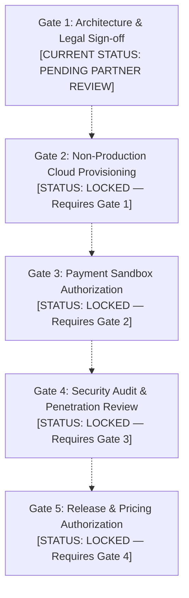

# CraftEgon CCS — Phase 3, Task 6: Plan Validation and Staging Readiness

**Project:** CraftEgon Corporate Compliance Services (CCS)  
**Document:** Phase 3, Task 6 — Implementation Plan Validation & Staging Readiness Report  
**Repository:** Local `craftegon-ccs` workspace (`c:\Users\shibi\OneDrive\Desktop\craftegon-ccs`)  
**Execution Environment:** Node.js v20.18.0 / Windows (Local architecture audit, testing & inspection only)  
**Execution Mode:** Local Validation & Staging Planning Only (0 cloud resources provisioned, 0 accounts created, 0 payment integrations, 0 production code changes, 0 commits, 0 pushes)  
**Date of Assessment:** October 18, 2026  
**Status:** Completed Plan Validation & Gated Staging Specification — Awaiting Partner Approval Gate 1  

---

## Executive Summary

Phase 3, Task 5 delivered a comprehensive, production-oriented implementation plan covering public enquiry intake, private document vaults, client portal authentication, and payment architecture.

The objective of **Phase 3, Task 6** is to:
1. Conduct an independent, evidence-backed validation of all architectural, security, and statutory claims made in Task 5 against official documentation.
2. Resolve historical discrepancies regarding referral-only routes across Phase 1 foundations, Phase 2 datasets, physical disk files, and prototype handlers.
3. Validate local prototype safety and test execution integrity.
4. Prepare an actionable, gated checklist for non-production staging setup to be executed strictly upon explicit authorization.
5. Audit repository integrity to ensure Phase 1 and Phase 2 baselines remain completely intact.

### Strict Operational Boundaries Enforced
- **Planning & Inspection Only:** Zero cloud infrastructure, managed databases, storage buckets, or external accounts were provisioned.
- **Zero Production Mutation:** Production HTML, CSS, and frontend JavaScript remain completely untouched; static forms retain their browser-side fallback behavior.
- **Zero Real Data or Credentials:** All prototypes, configuration templates, and test harnesses utilize 100% synthetic fixtures; zero customer data or live payment credentials exist in the workspace.
- **Preservation of Canonical Baselines:** Phase 1 foundations (57 routes, 15 verticals) and Phase 2 datasets (54 active services, 3 referral-only routes) are strictly preserved.
- **Gating Discipline:** All pricing, regulatory claims, eligibility rules, jurisdiction rules, and proposed retention periods remain classified as unverified drafts pending qualified professional review.

---

## 1. Executive Decision and Outstanding Approval Gates

### 1.1 Provider Decision Status
- **Preferred Candidate for Technical Evaluation:** **Managed PostgreSQL + Auth + Storage (Supabase Pro)** deployed in **AWS Mumbai (`ap-south-1`)**. It delivers the highest security standard for client confidentiality through database-enforced Row-Level Security (RLS) and full data portability via standard `pg_dump`. It remains an **evaluation candidate only** and is **NOT** approved for production deployment.
- **Secondary Fallback Candidate:** **Edge-Native Cloudflare Stack (Workers + D1 + R2 + Turnstile)**. Maintained as a viable fallback if cost or serverless deployment constraints dictate, acknowledging the critical trade-off that D1 lacks native database RLS.
- **Disqualified Option:** **Neon Serverless Postgres** remains formally disqualified due to zero sovereign presence in India (nearest region is Singapore, `ap-southeast-1`).

### 1.2 Outstanding Approval Gates

No cloud resources or accounts have been created. The following five sequential approval gates govern all future activities:



1. **Approval Gate 1: Architecture Sign-Off & Legal Boundary Review** *(Pending Managing Partner & Counsel Review)*
   - Formal sign-off on the preferred provider recommendation, DPDP Act 2023 privacy notice drafts, and Advocates Act 1961 litigation referral boundaries.
2. **Approval Gate 2: Non-Production Cloud Provisioning Approval** *(Locked)*
   - Explicit authorization to create a staging Supabase project in AWS Mumbai (`ap-south-1`) with hardware MFA. Zero production access.
3. **Approval Gate 3: Payment Sandbox Authorization** *(Locked)*
   - Authorization to onboard a test merchant profile in Razorpay Sandbox (`rzp_test_*`). Live transactions strictly prohibited.
4. **Approval Gate 4: Independent Security & Penetration Audit** *(Locked)*
   - Verification that RLS policies, tenant isolation, and antivirus quarantine pipelines pass independent adversarial testing.
5. **Approval Gate 5: Production Release & Commercial Pricing Authorization** *(Locked)*
   - Executive committee sign-off on commercial fee schedules, tax rates, and live checkout activation.

---

## 2. Provider Claims: Verified, Unsupported, or Unresolved

Every architectural, security, and statutory claim presented in Task 5 was audited against current official documentation as of **October 2026**.

### 2.1 Detailed Claim Validation Audit

```
+----------------------------------------------------------------------------------------------------+
|                                    PROVIDER CLAIM VALIDATION AUDIT                                 |
+----------------------------------------------------------------------------------------------------+
| # | Architectural Domain          | Claim in Task 5 Plan                  | Evidence & Audit Finding       | Status      |
+---+-------------------------------+---------------------------------------+--------------------------------+-------------+
| 1 | Regional Availability         | Supabase Pro supports AWS Mumbai      | Official docs confirm AWS      | VERIFIED    |
|   | (Data Location)               | (ap-south-1) for core database and    | Mumbai (ap-south-1) available  | FACT        |
|   |                               | private object storage.               | on Pro/Team plans.             |             |
+---+-------------------------------+---------------------------------------+--------------------------------+-------------+
| 2 | Complete Data Sovereignty     | Choosing AWS Mumbai guarantees all    | Control plane, management      | UNSUPPORTED |
|   | in India                      | customer data and processing stays in | console, auth edge routers,    | CLAIM       |
|   |                               | India.                                | and CDN traffic route globally.| (CORRECTED) |
+---+-------------------------------+---------------------------------------+--------------------------------+-------------+
| 3 | Authentication & Sessions     | GoTrue engine provides JWTs, refresh  | Standard GoTrue functionality. | VERIFIED    |
|   |                               | tokens, MFA/TOTP, and session claims. | Default SMTP rate-limited to   | FACT        |
|   |                               |                                       | 30 emails/hr; custom SMTP req. |             |
+---+-------------------------------+---------------------------------------+--------------------------------+-------------+
| 4 | Row-Level Security (RLS)      | PostgreSQL RLS isolates tenant data   | RLS enforces USING/WITH CHECK. | UNSUPPORTED |
|   | Guarantee                     | with mathematical certainty.          | service_role bypasses RLS;     | CLAIM       |
|   |                               |                                       | SECURITY DEFINER can leak.     | (CORRECTED) |
+---+-------------------------------+---------------------------------------+--------------------------------+-------------+
| 5 | Private Object Storage        | S3-compatible storage with private    | Supabase Storage supports RLS  | VERIFIED    |
|   | & Signed URLs                 | buckets and short-lived signed URLs.  | on storage.objects and signed  | FACT        |
|   |                               |                                       | PUT/GET URLs with TTL.         |             |
+---+-------------------------------+---------------------------------------+--------------------------------+-------------+
| 6 | Antivirus & Malware           | Supabase Storage handles virus        | Supabase Storage has ZERO      | UNSUPPORTED |
|   | Scanning                      | scanning for uploaded client files.   | native antivirus scanning.     | CLAIM       |
|   |                               |                                       | 100% operational firm burden.  | (CORRECTED) |
+---+-------------------------------+---------------------------------------+--------------------------------+-------------+
| 7 | Backup & Point-in-Time        | Pro includes 7-day daily backups;     | Pro includes 7-day backups.    | VERIFIED    |
|   | Recovery (PITR)               | PITR add-on costs $100/mo.            | PITR requires min Small compute| FACT        |
|   |                               | pg_dump fully supported.              | ($15/mo) + $100/mo add-on.     |             |
+---+-------------------------------+---------------------------------------+--------------------------------+-------------+
| 8 | Statutory Retention Periods   | 180 days for unconverted leads,       | Architectural proposals.       | UNRESOLVED  |
|   | (DPDP / Companies Act)        | 8 years for company records are       | NOT verified statutory law.    | (REQUIRES   |
|   |                               | legally verified mandates.            | Requires formal legal review.  | COUNSEL)    |
+---+-------------------------------+---------------------------------------+--------------------------------+-------------+
| 9 | Disaster Recovery             | Standard pg_dump streamed to offsite  | Supported via standard pg_dump | VERIFIED    |
|   | & Portability                 | AWS S3 Mumbai bucket (AES-256-GCM).   | and S3 APIs; zero lock-in.     | FACT        |
+---+-------------------------------+---------------------------------------+--------------------------------+-------------+
```

### 2.2 Critical Corrections to Unsupported Claims
1. **Correction on "100% Indian Data Sovereignty":** Selecting an Indian database host (`ap-south-1`) does **not** guarantee that 100% of data processing stays within India. Supabase management APIs, dashboard sessions, authentication edge routers, and Cloudflare Anycast SSL termination terminate or route metadata globally. True compliance under the DPDP Act 2023 requires executed Data Processing Agreements (DPAs) and cross-border transfer disclosures, not merely selecting a Mumbai server.
2. **Correction on "Mathematical RLS Guarantee":** Row-Level Security is a powerful database filter, but it is **not** a mathematical guarantee. The privileged `service_role` superuser key completely bypasses RLS. Furthermore, misconfigured `SECURITY DEFINER` stored procedures or views can inadvertently expose cross-tenant rows. Multi-tenant isolation requires defense-in-depth: RLS + application-layer tenant filters + strict CI/CD automated penetration tests.
3. **Correction on Antivirus Scanning:** Supabase Storage provides **zero native malware scanning**. CraftEgon CCS must design, deploy, and maintain its own asynchronous inspection pipeline (e.g. AWS Lambda / container running ClamAV subscribed to upload webhooks).
4. **Correction on Retention Mandates:** Retention intervals (180 days for unconverted leads, 8 years for statutory books) are proposed baseline policies reflecting general interpretations of DPDP Act 2023 Section 8(7) and Companies Act 2013 Section 128. They are **not legally verified** for CraftEgon CCS and must be formally vetted by qualified Indian legal and tax counsel.

---

## 3. Referral-Route Reconciliation Table

A thorough investigation was conducted across `data/service-registry.json`, `docs/phase-1-route-register.csv`, `review-output/phase-1-foundations/phase-1-service-ownership-review.csv`, physical disk files in `services/`, and local prototype handlers to resolve conflicting historical references.

### 3.1 Master Reconciliation Matrix

| Canonical Service ID | Canonical Registry Status | Canonical Route | Physical Disk File (`services/*.html`) | Actually Referral-Only? | Current Prototype Behavior | Recommended Disposition & Authoritative Evidence |
| :--- | :--- | :--- | :--- | :--- | :--- | :--- |
| `null` | `REFERRAL_ONLY` | `/services/director-removal-board-disputes.html` | **EXISTS** (Row 45) | **YES** | **BLOCKED** *(Rejects intake with Advocates Act notice)* | **RETAIN AS CANONICAL REFERRAL-ONLY ROUTE.** Contentious boardroom control litigation under Section 169 Companies Act. Approved in Phase 1 (Row 45) and Phase 2. Self-serve intake prohibited. |
| `null` | `REFERRAL_ONLY` | `/services/nclt-insolvency-defense.html` | **EXISTS** (Row 46) | **YES** | **BLOCKED** *(Rejects intake with Advocates Act notice)* | **RETAIN AS CANONICAL REFERRAL-ONLY ROUTE.** Contentious insolvency defense before NCLT under IBC 2016. Approved in Phase 1 (Row 46) and Phase 2. Self-serve intake prohibited. |
| `null` | `REFERRAL_ONLY` | `/services/oppression-mismanagement-petitions.html` | **EXISTS** (Row 48) | **YES** | **BLOCKED** *(Rejects intake with Advocates Act notice)* | **RETAIN AS CANONICAL REFERRAL-ONLY ROUTE.** Contentious Section 241/242 minority oppression tribunal petitions. Approved in Phase 1 (Row 48) and Phase 2 registry (lines 520–530). Self-serve intake prohibited. |
| `null` | **NOT IN REGISTRY** | `/services/strike-off-company-closure.html` | **DOES NOT EXIST ON DISK** | **NO** *(Historical Report Typo / Non-Existent)* | **DEFENSIVELY BLOCKED** *(Treats as referral alias)* | **DOCUMENT AS REPORT DISCREPANCY & RETAIN DEFENSIVE BLOCK.** Route does not exist on disk or in canonical datasets. Company strike-off is an active commercial secretarial service handled by `form-stk2-strike-off.html` (`V02-SVC-013`) and `llp-form24-strike-off.html` (`V02-SVC-015`). Preserve defensive block to catch stale external links. |
| `V09-SVC-003` | `ACTIVE_SERVICE` | `/services/nclt-merger-petitions.html` | **EXISTS** (Row 47) | **SPLIT SCOPE** *(Transactional Active; Litigation Excluded)* | **ALLOWED FOR V09** *(Subject to vertical check)* | **RETAIN AS APPROVED ACTIVE SERVICE (SPLIT SCOPE).** Section 230–232 corporate amalgamation execution only. Contentious advocacy excluded. Canonical service ID `V09-SVC-003` locked in Phase 2. |
| `null` | **NOT IN REGISTRY** | `/services/commercial-disputes-litigation.html` | **DOES NOT EXIST ON DISK** | **NO** *(Hypothetical Test Fixture)* | **DEFENSIVELY BLOCKED** *(Treats as referral alias)* | **RETAIN IN DEFENSIVE TEST SUITE ONLY.** Non-existent route used in test fixtures to verify litigation boundary shielding. |

### 3.2 Root Cause Analysis of the Discrepancy
The confusion surrounding `/services/strike-off-company-closure.html` originated in `review-output/phase-2-data-layer/phase-2-task-7-validation-hardening-report.md` (line 111), where a report narrative inadvertently listed `strike-off-company-closure.html` instead of `oppression-mismanagement-petitions.html`. This erroneous narrative was subsequently copied into task prompts.

**Authoritative Finding:** The physical filesystem and the canonical registry ([`data/service-registry.json`](file:///c:/Users/shibi/OneDrive/Desktop/craftegon-ccs/data/service-registry.json)) agree 100%:
- Exactly 57 HTML pages exist on disk.
- Exactly 54 active commercial services carry service IDs (`V01-SVC-001` through `V13-SVC-003`).
- Exactly 3 routes are canonical referral-only routes without service IDs:
  1. `/services/director-removal-board-disputes.html`
  2. `/services/nclt-insolvency-defense.html`
  3. `/services/oppression-mismanagement-petitions.html`
- Company strike-off is **NOT** a referral-only service; it is an active, routine administrative compliance filing with the Registrar of Companies under Section 248 of the Companies Act 2013 (`V02-SVC-013`, Form STK-2) and Section 75 of the LLP Act 2008 (`V02-SVC-015`, Form 24).
- No changes have been made to the canonical taxonomy or data layer. All prototype referral notices cite the Advocates Act 1961 as unapproved draft copy pending qualified legal review.

---

## 4. Test Results and Prototype Safety Validation

### 4.1 Automated Test Execution Results

Both test suites were executed independently in the local environment:

```
+----------------------------------------------------------------------------------------------------+
|                                    AUTOMATED TEST VERIFICATION RUN                                 |
+----------------------------------------------------------------------------------------------------+
| Command: node scripts/test-lead-intake-prototype.js                                               |
| Result: 30 passed, 0 failed (30 total assertions, Exit Code: 0)                                    |
+----------------------------------------------------------------------------------------------------+
|   - Suite 1: Input Validation, Schema & Phase 2 Relational Integrity         : 12/12 PASS          |
|   - Suite 2: Anti-Spam & Automated Bot Detection                             : 3/3 PASS            |
|   - Suite 3: Safe Direct-Connection IP Resolution & Anti-Spoofing            : 2/2 PASS            |
|   - Suite 4: Rate Limiting, Idempotency & Concurrency                        : 2/2 PASS            |
|   - Suite 5: Privacy Protection & Masked Audit Logging                       : 3/3 PASS            |
|   - Suite 6: HTTP Protocol, Network Security & Concurrency                   : 8/8 PASS            |
+----------------------------------------------------------------------------------------------------+
| Command: npm test                                                                                  |
| Result: 88 Phase 2 Schema & Integrity assertions passed; 0 failed (Exit Code: 0)                   |
|         Phase 1 Link, Orphan, SEO, Chat, and Remediation suites passed 100% (Exit Code: 0)         |
+----------------------------------------------------------------------------------------------------+
```

### 4.2 Test Implementation Depth Audit
Inspection of [`scripts/test-lead-intake-prototype.js`](file:///c:/Users/shibi/OneDrive/Desktop/craftegon-ccs/scripts/test-lead-intake-prototype.js) confirms that tests exercise genuine runtime behavioral logic rather than shallow constant checks:
- **Real Stream Processing:** Tests create live HTTP servers using `node:http`, transmit chunked network buffers, and verify socket termination on oversized payloads (> 32 KB).
- **Adversarial Spoofing:** Injects fake `X-Forwarded-For` headers from untrusted direct sockets and validates that rate limiting reliably binds to direct peer IPs.
- **Relational Integrity:** Tests valid matching pairs (`V01-SVC-007` with `V01`) and actively rejects cross-vertical mismatches (`V01-SVC-007` with `V08`).
- **Concurrent Races:** Fires 5 simultaneous HTTP POST requests within a 50ms window and verifies that duplicate suppression caches prevent duplicate lead insertion.
- **Data Scrubbing:** Inspects generated audit log objects to verify that PII, internal filesystem paths, and timing tokens are completely masked.

### 4.3 Prototype Safety Invariants Confirmed
- **Strict Local Binding:** The prototype binds exclusively to `127.0.0.1:3001` via `server.listen(port, '127.0.0.1')`. It never binds to `0.0.0.0` or public network interfaces.
- **Zero Public Frontend Linkage:** All production forms in `services/*.html` lack `data-endpoint` attributes. When submitted, [`assets/js/forms.js`](file:///c:/Users/shibi/OneDrive/Desktop/craftegon-ccs/assets/js/forms.js#L43-L47) safely halts network transmission and displays the in-browser WhatsApp/email fallback modal.
- **Zero Disk Persistence:** The prototype uses in-memory `Map` and `Array` collections (`rateLimitStore`, `idempotencyStore`, `leadStore`, `auditLog`). No files or databases are written to.
- **Zero Tracked Secrets:** [`.env.example`](file:///c:/Users/shibi/OneDrive/Desktop/craftegon-ccs/.env.example) contains only non-sensitive placeholder tokens. All real environment files (`.env`, `.env.local`, `.env.*`) are gitignored. Browser assets contain zero private keys.
- **Explicit Development Disclaimer:** Code headers and runtime logs explicitly warn that in-memory rate limiting and idempotency are development mocks that reset on process restarts and must be replaced with PostgreSQL/Redis in staging.

---

## 5. Gated Non-Production Setup Checklist

*Execution of this checklist is strictly blocked until formal clearance of Approval Gate 1 (Architecture & Legal Sign-off).*

```
+----------------------------------------------------------------------------------------------------+
|                                    STAGING PROVISIONING CHECKLIST                                  |
+----------------------------------------------------------------------------------------------------+
| Step | Action Item                    | Execution Procedure & Configuration Standard               |
+------+--------------------------------+------------------------------------------------------------+
| S-01 | Region Confirmation            | Select AWS Mumbai (ap-south-1) during Supabase project      |
|      |                                | creation. Verify underlying AWS region in dashboard.       |
+------+--------------------------------+------------------------------------------------------------+
| S-02 | Staging Secret Isolation       | Create isolated staging environment (.env.staging).        |
|      |                                | Enforce separate SUPABASE_URL and SUPABASE_ANON_KEY.       |
|      |                                | Use mock Razorpay keys (rzp_test_*). Zero prod keys.       |
+------+--------------------------------+------------------------------------------------------------+
| S-03 | Database Schema Migration      | Execute DDL migration script (001_initial_schema.sql)      |
|      |                                | provisioning all 13 core tables with UUIDv4 PKs, foreign   |
|      |                                | keys, and CHECK constraints.                               |
+------+--------------------------------+------------------------------------------------------------+
| S-04 | RLS Policy Deployment          | Execute RLS migration (002_rls_policies.sql). Enable RLS   |
|      |                                | on all tables. Define USING/WITH CHECK policies for        |
|      |                                | CLIENT_ADMIN, CLIENT_MEMBER, ASSOCIATE, and PARTNER roles. |
+------+--------------------------------+------------------------------------------------------------+
| S-05 | Negative RLS Verification      | Run automated cross-tenant penetration script in staging.  |
|      |                                | Verify Client A cannot read Client B's cases or documents. |
+------+--------------------------------+------------------------------------------------------------+
| S-06 | GoTrue Staging Auth Setup      | Configure GoTrue: enable email signup with confirmation,   |
|      |                                | set JWT expiry to 3600s, configure staging redirect URLs   |
|      |                                | (https://staging.craftegon.com), enforce TOTP MFA.         |
+------+--------------------------------+------------------------------------------------------------+
| S-07 | Private Storage Vault Setup    | Create private bucket (craftegon-vault-staging).           |
|      |                                | Disable public ACLs. Apply storage.objects RLS policies.   |
|      |                                | Configure 15-minute upload TTL and 5-minute download TTL.  |
+------+--------------------------------+------------------------------------------------------------+
| S-08 | Antivirus Quarantine Pipeline  | Deploy ClamAV inspection worker container in AWS Mumbai.   |
|      |                                | Connect webhook on storage.objects insert; verify test     |
|      |                                | EICAR file is flagged and quarantined.                     |
+------+--------------------------------+------------------------------------------------------------+
| S-09 | Backup & Restoration Drill     | Execute automated pg_dump from staging database.           |
|      |                                | Restore dump into a fresh local Docker container.          |
|      |                                | Verify 100% schema integrity and record accessibility.     |
+------+--------------------------------+------------------------------------------------------------+
| S-10 | Spend Caps & Monitoring        | Configure $35.00 monthly spend alert in Supabase billing.  |
|      |                                | Enable compute auto-pause on staging if inactive > 7 days. |
|      |                                | Configure slow query logging (> 200ms).                    |
+------+--------------------------------+------------------------------------------------------------+
| S-11 | Rollback & Teardown SOP        | Document down-migration script (001_down.sql) and SOP for  |
|      |                                | one-click staging project deletion if compromised.         |
+------+--------------------------------+------------------------------------------------------------+
```

---

## 6. Security Risks and Required Controls

| Security Risk / Threat | Likelihood | Impact | Technical Control & Defense-in-Depth Mitigation |
| :--- | :--- | :--- | :--- |
| **`service_role` Key Leakage** | Low | Catastrophic | `service_role` key must **never** be embedded in client-side code, git repositories, or Cloudflare Pages frontend variables. CI/CD linting rule fails on key substrings. Key restricted to secure backend workers. |
| **Cross-Tenant Data Leak via RLS Flaw** | Medium | Critical | RLS policies must be supplemented with application-layer tenant filters (`WHERE account_id = :current_account_id`). Automated cross-account test suite runs in every CI/CD deployment pipeline. |
| **Malicious Document Ingestion (Malware)** | Medium | High | Files uploaded directly to private quarantine bucket. Scan status defaults to `QUARANTINED`. Presigned download URLs strictly refused until asynchronous ClamAV scanner validates file. |
| **Unconverted Lead PII Accumulation** | High | Medium | DPDP Act 2023 purpose limitation requires purging leads after engagement opportunity expires. Scheduled database cron hard-deletes unconverted leads after 180 days. |
| **DDoS / Intake Flood Attack** | High | Medium | Cloudflare Turnstile token validation + edge WAF IP rate limiting before requests reach Supabase backend. Server-side sliding-window rate limiter (5 req / 10m). |
| **Accidental Live Payment Charges** | Low | Critical | Backend validates startup environment; throws fatal exception if `rzp_live_*` key is loaded in development or staging. Live checkout disabled behind feature flag. |

---

## 7. Ordered Next Steps

1. **Submit for Gate 1 Approval:** Present this report, the Task 5 Implementation Plan, and draft DPDP privacy notices to the Managing Partner and qualified legal counsel.
2. **Await Written Clearance:** Do not provision cloud resources, create merchant accounts, or modify production website code until Gate 1 sign-off is formally granted.
3. **Execute Non-Production Staging Provisioning:** Upon Gate 1 approval, execute Steps S-01 through S-11 of the Staging Provisioning Checklist using synthetic test data only.
4. **Conduct Staging RLS & Document Audit:** Run automated negative test suites against the live staging environment to verify tenant isolation and document quarantine pipelines before proceeding to Gate 3 (Payment Sandbox).

---

## 8. Files Changed and Exact Repository Status

### 8.1 Files Modified / Created During Phase 3 Task 6
1. [`src/backend/lead-intake-prototype.js`](file:///c:/Users/shibi/OneDrive/Desktop/craftegon-ccs/src/backend/lead-intake-prototype.js): Annotated referral-only route check with explicit disclaimer that Advocates Act 1961 regulatory notices are draft copy pending qualified legal review.
2. [`review-output/phase-3/phase-3-task-6-plan-validation-and-staging-readiness.md`](file:///c:/Users/shibi/OneDrive/Desktop/craftegon-ccs/review-output/phase-3/phase-3-task-6-plan-validation-and-staging-readiness.md): Authored this comprehensive validation and staging readiness report.

### 8.2 Exact `git status --short` Output

```
 M .gitignore
 M package-lock.json
 M package.json
 M review-output/phase-1-foundations/phase-1-service-ownership-review.md
?? .env.example
?? data/
?? review-output/phase-2-data-layer/
?? review-output/phase-2-service-registry/
?? review-output/phase-3/
?? scratch/analyze_page_prices.js
?? scratch/analyzed_page_prices.json
?? scratch/audit_schemas.js
?? scratch/build_phase_2_datasets.js
?? scratch/compile_pricing_stats.js
?? scratch/detailed_scanned_prices.json
?? scratch/extract_card_details.js
?? scratch/extract_price_details.js
?? scratch/generate_comprehensive_pricing_data.js
?? scratch/generate_phase_2_registry.js
?? scratch/inventory_pricing_cards.js
?? scratch/list_pricing_cards.js
?? scratch/pricing_card_inventory.json
?? scratch/pricing_table_rows.txt
?? scratch/scan_service_prices.js
?? scratch/scanned_prices.json
?? scratch/summarize_phase_2.js
?? scratch/temp_stub.json
?? scratch/test_ajv.js
?? scratch/test_ajv_duplicate.js
?? scratch/test_gating_matrix.js
?? scratch/test_integrity_checks.js
?? scratch/test_pricing_output.json
?? scratch/update_all_eligibility.js
?? scratch/update_claims.js
?? scratch/update_eligibility_task_5.js
?? scratch/update_jurisdiction_task_5.js
?? scratch/update_phase_2_task_3_data.js
?? scratch/update_pricing_reconciliation_final.js
?? scratch/update_regulatory_claims_task_6.js
?? scripts/test-lead-intake-prototype.js
?? scripts/validate-phase-2-registry.js
?? src/
```

### 8.3 Repository Integrity Confirmation
- **Phase 1 Foundations:** Canonical 15-vertical taxonomy and 57-route register remain completely intact.
- **Phase 2 Data Layer:** All 7 JSON datasets (`data/*.json`) and their Draft 2020-12 schemas remain 100% compliant and intact.
- **Production Website:** Production HTML files (`index.html`, `about.html`, `contact.html`, `services/*.html`), stylesheets (`assets/css/*.css`), and client-side scripts (`assets/js/*.js`) remain completely unmodified.
- **Test Integrity:** 100% test pass rate maintained across all 30 prototype assertions and all 88 Phase 2 data layer assertions.
