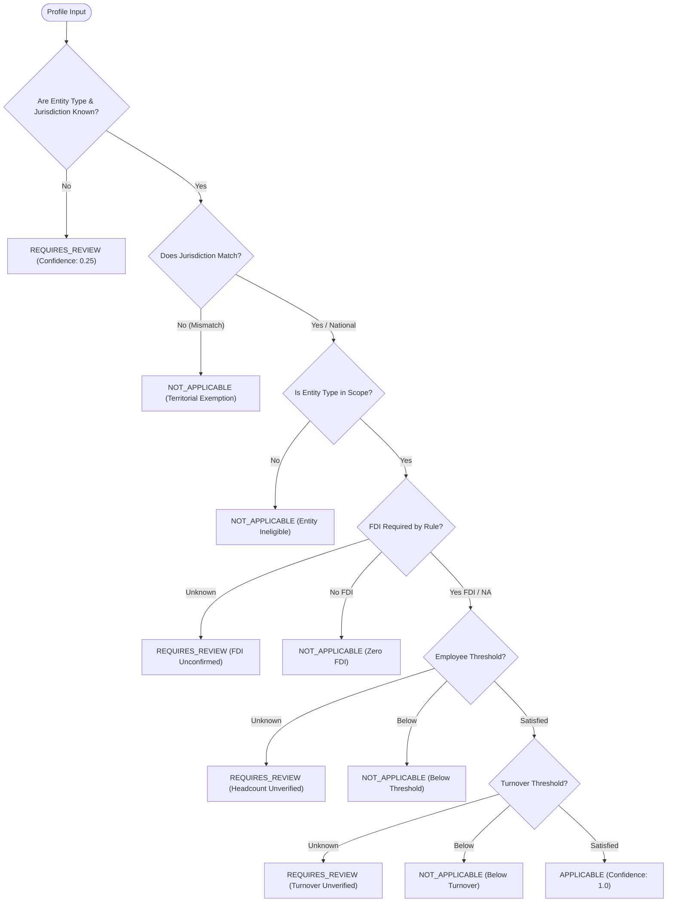

# CraftEgon CCS — Phase 4 Canonical Compliance Event Model Specification

**Document Reference:** CRAFTEGON-DOC-P4-004  
**Audit Date:** 2026-10-20  
**Status:** CANONICAL MODEL SPECIFICATION  
**Module:** \`src/backend/regulatory/compliance-event.model.js\` & \`applicability-engine.js\`  

---

## 1. Architectural Overview

The CraftEgon CCS Compliance Event Model transforms raw statutory notifications, rules, circulars, and filing due dates into **traceable, reproducible, source-aware data records**.

### Guiding Principles

1. **Source Grounded:** Every compliance event MUST link to one or more canonical source identifiers (\`source_ids\`) registered in the Phase 4 Source Register.
2. **Deterministic Applicability:** Obligations are evaluated strictly against verified business facts (entity type, jurisdiction, turnover, employee count, foreign investment status). Vague keyword-based matching or ungrounded AI predictions are strictly prohibited.
3. **Reproducibility via Fingerprinting:** Every event maintains an immutable SHA-256 \`content_hash\` calculated across substantive legal fields.
4. **Append-Only History:** All changes to events, deadlines, applicability status, or supersessions are tracked in an append-only audit trail (\`change_history\`).

---

## 2. Core Model Schema & Attributes

| Field Name | Type | Allowed Values / Format | Description & Governance Rule |
|---|---|---|---|
| \`event_id\` | String | Format: \`EVT-[DOMAIN]-[TAG]-[YEAR]\` | Stable unique identifier for the obligation. |
| \`event_type\` | String (Enum) | \`NOTIFICATION\`, \`AMENDMENT\`, \`FILING_DEADLINE\`, \`RULE_CHANGE\`, \`CIRCULAR\`, \`ORDER\`, \`CLARIFICATION\` | Categorization of the regulatory event. |
| \`title\` | String | Min length 5 chars | Concise, professional statutory title. |
| \`summary\` | String | Non-empty text | Source-grounded factual summary of the obligation. |
| \`jurisdiction\` | String (Enum) | \`IN-CENTRAL\`, \`IN-MH\`, \`IN-DL\`, \`IN-KA\`, \`IN-TN\`, etc. | Territorial purview of the issuing authority. |
| \`authority\` | String | E.g., MCA, CBDT, GSTN, RBI, EPFO | Issuing regulatory body or ministry. |
| \`regulatory_domain\` | String | Corporate Law, Tax, FEMA, Labour, IP, etc. | Topic area. |
| \`affected_entities\` | Array<String> | E.g. \`['pvt_ltd', 'public_ltd', 'opc', 'llp']\` | Target legal entity classifications. |
| \`applicability_rules\` | Object | Structured criteria (thresholds, FDI, headcount) | Deterministic conditions for automated evaluation. |
| \`applicability_status\` | String (Enum) | \`APPLICABLE\`, \`POTENTIALLY_APPLICABLE\`, \`NOT_APPLICABLE\`, \`REQUIRES_REVIEW\` | Outcome of profile evaluation. |
| \`applicability_rationale\` | String | Explicit text | Factual justification citing specific rules and entity facts. |
| \`source_ids\` | Array<String> | Valid source IDs from canonical register | Links to canonical source records. |
| \`source_url\` | String | Valid HTTP/HTTPS URL | Direct link to official gazette or portal. |
| \`source_reference\` | String | Section, Rule, Notification No. | Official legal citation. |
| \`publication_date\` | String | \`YYYY-MM-DD\` or \`null\` | Official gazetted publication date. |
| \`effective_date\` | String | \`YYYY-MM-DD\` or \`null\` | Date on which the rule or obligation takes effect. |
| \`compliance_due_date\` | String | \`YYYY-MM-DD\` or \`null\` | Official statutory deadline. \`null\` if ongoing obligation. |
| \`freshness_status\` | String (Enum) | \`CURRENT\`, \`STALE\`, \`UNAVAILABLE\`, \`UNKNOWN\` | Calculated freshness against source staleness threshold. |
| \`verification_status\` | String (Enum) | \`UNVERIFIED\`, \`SOURCE_IDENTIFIED\`, \`SOURCE_VERIFIED\`, \`PROFESSIONALLY_REVIEWED\` | Verification level in the governance lifecycle. |
| \`change_version\` | Integer | >= 1 | Incremental revision number. |
| \`supersedes_event_id\` | String | \`null\` or prior \`event_id\` | Reference to prior rule/deadline superseded by this event. |
| \`record_status\` | String (Enum) | \`ACTIVE\`, \`SUPERSEDED\`, \`WITHDRAWN\`, \`ARCHIVED\` | Lifecycle status of this event record. |
| \`content_hash\` | String | 64-char Hex (SHA-256) | Deterministic cryptographic fingerprint of substantive fields. |
| \`change_history\` | Array<Object> | List of audit log entries | Version, timestamp, actor, previous hash, notes. |

---

## 3. Applicability Determination Engine Logic

The engine executes in strict sequence to evaluate a business profile:



### Key Safety Guarantees

1. **Zero False Positives from Keywords:** Matching is never performed on free-text descriptions. It requires structured business profile fields.
2. **Missing Facts Fallback:** If any prerequisite business fact (such as foreign shareholding for FEMA, or headcount for EPFO) is null or undefined, the engine MUST output \`REQUIRES_REVIEW\`.
3. **No Automatic Penalties on Unverified Claims:** Deadlines and compliance alert schedules are only generated when an obligation reaches \`APPLICABLE\` status under verified facts.

---

## 4. Lifecycle States and Transition Constraints

```
[SOURCE IDENTIFIED]
        │
        ▼ (Verification against Gazette / Official Portal)
[SOURCE VERIFIED]
        │
        ├─────────────────────────────┐
        ▼                             ▼
[PROFESSIONALLY REVIEWED]      [SUPERSEDED / AMENDED]
        │                             │
        ▼                             ▼
    [ACTIVE]                      [ARCHIVED]
```

- Events marked \`WITHDRAWN\` or \`ARCHIVED\` are immutable. Subsequent update attempts are rejected with an explicit error.
- Amendments MUST increment \`change_version\`, compute a new \`content_hash\`, and link to the superseded event ID.
