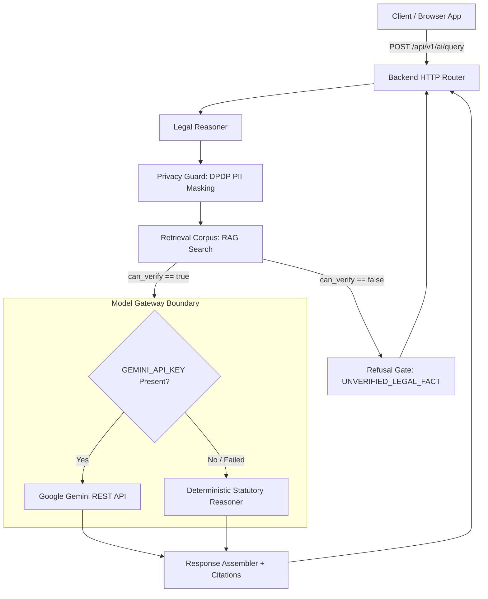

# Phase 5 Server-Side Model Gateway Specification

**Project:** CraftEgon CCS  
**Component:** `src/backend/ai/model-gateway.js`  
**Supported Models:** Google Gemini (`gemini-1.5-flash`, `gemini-2.5-flash`), `craftegon-deterministic-statutory-v1`  
**Execution Modes:** `ONLINE_GEMINI` | `DETERMINISTIC_OFFLINE` | `DETERMINISTIC_OFFLINE_FALLBACK`  

---

## 1. Security Architecture & Threat Model

### 1.1 API Key Isolation
- **Server-Side Confinement:** The `GEMINI_API_KEY` is loaded strictly in the backend Node.js environment (`process.env.GEMINI_API_KEY`).
- **Zero Client Leakage:** The API key is never serialized, never sent across HTTP responses, never included in client-side bundles, and never logged in access logs.
- **Fail-Safe Offline Mode:** If `GEMINI_API_KEY` is null, empty, or inaccessible, the gateway automatically falls back to `DETERMINISTIC_OFFLINE` mode without throwing unhandled exceptions or disrupting user experience.

### 1.2 Data Flow Diagram



---

## 2. Gateway Implementation Details

### 2.1 Native Node.js HTTP Fetch
To avoid unnecessary third-party package dependencies, the gateway utilizes Node.js 18+ native `fetch` with standard `AbortController` timeouts:
- **Default Timeout:** 10,000 ms.
- **Max Retries:** 2 retries with exponential backoff (`500ms * attempt`).
- **Endpoint:** `https://generativelanguage.googleapis.com/v1beta/models/{model}:generateContent?key={apiKey}`

### 2.2 System Prompt & Safety Directives
The gateway injects strict legal grounding constraints into every online generation:
```
You are CraftEgon CCS Legal & Regulatory AI, a specialized corporate compliance assistant for Indian statutory law.
CORE MANDATES:
1. Ground every answer strictly in the provided statutory context chunks and official citations.
2. If the user asks about a statute, section, rule, or tax exemption not grounded in the verified context, or if the premises are fictional or cannot be verified, you MUST refuse to answer and state: "[UNVERIFIED_LEGAL_FACT]: The statutory authorities do not verify this provision."
3. NEVER hallucinate statutory sections, penalties, limitation periods, or tax relief schemes.
4. Separate pure informational analysis from formal legal counsel. Always include the statutory citation.
```

### 2.3 Deterministic Offline Reasoner
When offline or running in automated CI/CD test runners:
- Evaluates the verified context chunks directly.
- Formulates a structured statutory brief containing the subject, statutory requirements, filing deadlines, penalty provisions, and citations.
- Enforces disclaimers mandated by the Advocates Act, 1961.

---

## 3. Response Schema & Telemetry

```json
{
  "success": true,
  "mode": "ONLINE_GEMINI",
  "model": "gemini-1.5-flash",
  "content": "Based on Section 137 of the Companies Act, 2013...",
  "citations": [
    {
      "source_id": "SRC-MCA-001",
      "chunk_id": "CORP-CA2013-S137",
      "authority": "Ministry of Corporate Affairs (MCA)",
      "statute": "Companies Act, 2013",
      "section_or_rule": "Section 137 & Companies (Accounts) Rules, 2014"
    }
  ],
  "latency_ms": 412,
  "usage": {
    "prompt_tokens": 340,
    "completion_tokens": 120
  },
  "disclaimer": "CraftEgon CCS regulatory intelligence is an informational synthesis grounded in cited Indian statutory authorities..."
}
```
