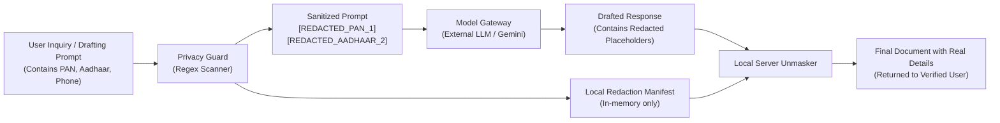

# Phase 5 Privacy Safeguards & DPDP Act 2023 Guardrails Report

**Project:** CraftEgon CCS  
**Component:** `src/backend/ai/privacy-guard.js`  
**Statutory Authority:** Digital Personal Data Protection Act, 2023 (DPDP Act, Section 8 & Section 6)  

---

## 1. Compliance Obligation under the DPDP Act, 2023

Under Section 8 of the DPDP Act 2023, a Data Fiduciary is statutorily obligated to:
1. Implement appropriate technical and organizational measures to ensure compliance.
2. Protect personal data in its possession or under its control by taking reasonable security safeguards to prevent personal data breach.
3. Prevent unauthorized transmission or processing of personal data to third parties without specific, lawful purpose.

Sending customer Permanent Account Numbers (PAN), Aadhaar numbers, or bank details directly to third-party commercial LLM API endpoints constitutes an unacceptable privacy violation and regulatory risk.

---

## 2. PrivacyGuard Implementation & Regex Redaction Architecture

CraftEgon CCS implements pre-flight regex sanitization before any prompt leaves the backend runtime:



---

## 3. Supported Redaction Token Catalog

| Identifier Category | Statutory / Technical Pattern | Example Input | Masked Replacement Token |
| :--- | :--- | :--- | :--- |
| **Aadhaar Number** | 12 digits (`\b[2-9]{1}[0-9]{3}[\s-]?[0-9]{4}[\s-]?[0-9]{4}\b`) | `9876 5432 1098` | `[REDACTED_AADHAAR_1]` |
| **PAN Card** | 5 letters, 4 digits, 1 letter (`\b[A-Z]{5}[0-9]{4}[A-Z]{1}\b`) | `ABCDE1234F` | `[REDACTED_PAN_1]` |
| **Indian Mobile Phone** | +91 / 0 followed by 10 digits (`(?:\+91[\s-]?\|0)?[6-9]\d{4}[\s-]?\d{5}\b`) | `+91 9876543210` | `[REDACTED_PHONE_1]` |
| **Email Address** | Standard RFC 5322 regex | `director@craftegon.com` | `[REDACTED_EMAIL_1]` |
| **Passport Number** | 1 letter followed by 7 digits | `Z1234567` | `[REDACTED_PASSPORT_1]` |
| **Bank Account** | 9 to 18 digits in financial context | `Account: 123456789012` | `[REDACTED_BANK_ACC_1]` |
| **DIN (Director ID)** | 8 digits in Director context | `DIN: 01234567` | `[REDACTED_DIN_1]` |

---

## 4. Redaction Manifest & Local Unmasking

When PII is sanitized, `PrivacyGuard.sanitize()` returns a structured manifest:
```json
{
  "sanitized_text": "Director Ramesh ([REDACTED_PAN_1], [REDACTED_PHONE_2]) wants to file returns.",
  "pii_detected": true,
  "redaction_count": 2,
  "categories_detected": ["PAN", "PHONE_NUMBER"],
  "redaction_manifest": [
    {
      "token": "[REDACTED_PAN_1]",
      "category": "PAN",
      "original_masked_preview": "AB•••••F",
      "original_value": "ABCDE1234F"
    },
    {
      "token": "[REDACTED_PHONE_2]",
      "category": "PHONE_NUMBER",
      "original_masked_preview": "+91•••••10",
      "original_value": "+91 9876543210"
    }
  ],
  "dpdp_compliance": {
    "is_compliant": true,
    "statutory_authority": "Digital Personal Data Protection Act, 2023 (Section 8)",
    "action_taken": "PII_REDACTED_BEFORE_MODEL_DISPATCH"
  }
}
```

The `unmask()` method allows client documents to be reconstituted strictly in the local server runtime before rendering, guaranteeing that external AI providers never receive unredacted Indian PII.
